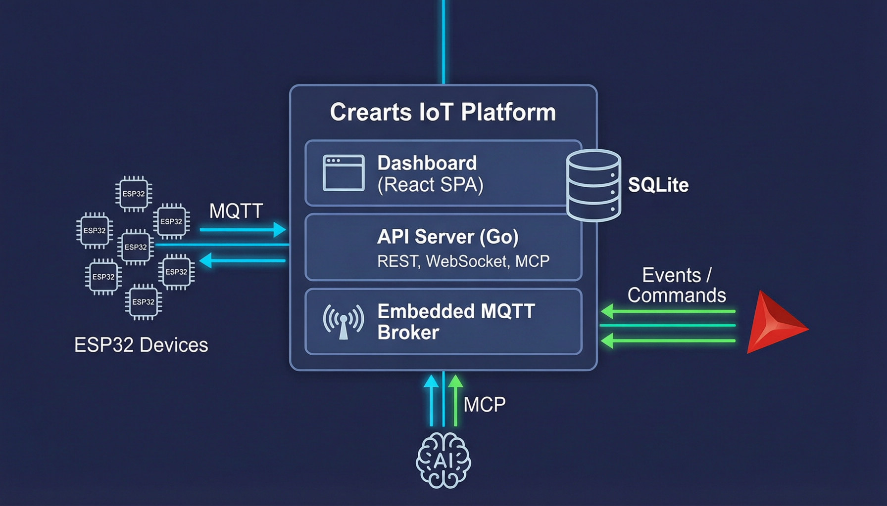

# Cogitor IoT Platform

**Self-hosted IoT backend and operations dashboard for ESP32-class devices.**

[Русская версия](README.ru.md)

One Go binary. Embedded MQTT broker. SQLite database. React dashboard. Zero cloud dependencies.



---

## Table of Contents

- [What Is This?](#what-is-this)
- [Features](#features)
- [Quick Start](#quick-start)
- [Dashboard Overview](#dashboard-overview)
- [Device Onboarding](#device-onboarding)
- [Telemetry & Attributes](#telemetry--attributes)
- [Remote Procedure Calls (RPC)](#remote-procedure-calls-rpc)
- [OTA Firmware Updates](#ota-firmware-updates)
- [Automation & Plugins](#automation--plugins)
- [MCP — AI / LLM Integration](#mcp--ai--llm-integration)
- [Authentication & Users](#authentication--users)
- [Configuration Reference](#configuration-reference)
- [Deployment](#deployment)
- [MQTT Protocol](#mqtt-protocol)
- [Documentation](#documentation)
- [License](#license)

---

## What Is This?

Cogitor IoT Platform is a **single-process IoT backend** that runs on your NAS, Raspberry Pi, or any Linux/Windows machine. It replaces the typical multi-component stack (MQTT broker + backend + database + dashboard) with one binary you can build and run in minutes.

| Layer | Stack |
|-------|--------|
| API / ingest | Go 1.25+, chi router, SQLite |
| Broker | Embedded MQTT ([mochi-mqtt](https://github.com/mochi-mqtt/server)) inside the platform process |
| Automation | Node-RED (optional, rules bus on `platform/v1/...`) |
| UI | React + Bootstrap 5 (Vite), embedded in Go binary |
| MCP | Embedded at `/mcp` (JWT) — LLM device tools |

**No cloud. No SaaS. No per-device fees.** Your data stays on your hardware.

---

## Features

- **Device lifecycle** — create products, register devices, one-time access tokens, token rotation
- **Telemetry ingestion** — store and query device metrics with automatic retention cleanup
- **Desired attributes** — push configuration to devices via MQTT downlink
- **RPC console** — call device methods (reboot, custom) with auto-populated forms from live device catalog
- **OTA updates** — upload `.bin` firmware, host download URLs, auto-push on reconnect (Auto-OTA)
- **Embedded MQTT broker** — no external broker needed; device ACL scoped per identity
- **Real-time dashboard** — WebSocket-powered live updates for device status, telemetry, MQTT sessions
- **Automation** — Node-RED rules bus for cross-device logic; in-process plugins for per-device behavior (LED garland, schedule)
- **MCP endpoint** — AI clients (Cursor, Claude, etc.) can list devices, read telemetry, invoke RPC
- **Auth & roles** — JWT login, Google OAuth, self-registration, admin / operator / viewer roles
- **API tokens** — long-lived tokens for scripts and MCP integration

---

## Quick Start

### Prerequisites

- Go 1.25+ (for bare-metal) or Docker (for containerized deploy)
- Node.js 22+ (only needed to build the frontend; pre-built in Docker)

### 1. Build & Run (bare metal)

```bash
# Clone the repository
git clone git@gitea.darvik.synology.me:darvik/iot-platform-go.git
cd iot-platform-go

# Build dashboard + API in one step
make build

# Run
./bin/platform.exe
```

Or step by step:

```bash
# Build frontend only
make web

# Build Go binary
go build -o bin/platform.exe ./cmd/platform

# Run
./bin/platform.exe
```

### 2. Run with Docker

```bash
cd deploy
cp .env.example .env
# Edit .env — set PUBLIC_BASE_URL, JWT_SECRET, ADMIN_PASSWORD
docker compose up -d --build
```

### 3. Open the Dashboard

| Service | URL |
|---------|-----|
| Dashboard / API | http://localhost:8080 |
| MQTT broker | `mqtt://localhost:1883` |
| MQTT WebSocket | `ws://localhost:8083/` (subprotocol `mqtt`) |
| Node-RED (optional) | http://localhost:1880 |

**Default login**: `admin@cogitor.local` / `admin`

> **Tip**: For development with hot-reload UI, run `cd web && npm run dev` in a separate terminal (API must be running on `:8080`).

---

## Dashboard Overview


The dashboard is a React SPA embedded into the Go binary. It provides a dark-themed, responsive interface for managing your entire IoT deployment.

### Navigation

| Page | What it shows |
|------|---------------|
| **Overview** | Online/offline/total device counts, MQTT status, recent events, active sessions |
| **MQTT** | Live broker sessions, connected clients (device / Node-RED / service), real-time broker event trail |
| **Products** | Device archetypes — create products, define RPC methods, telemetry metrics, attributes |
| **Devices** | All registered devices with status, firmware version, last seen. Search and filter. |
| **Device Detail** | Connection info, telemetry metrics, desired attributes, OTA panel, plugins, RPC console, events |
| **Events** | Device events filtered by severity, device, time range |
| **Logs** | Device log messages from MQTT `v1/l` uplink |
| **OTA** | Firmware management — upload `.bin`, register URLs, notify devices, Auto-OTA toggles, job tracking |
| **Automation** | Embedded Node-RED editor (iframe) for cross-device rules |
| **Settings** | Platform info, API token management, system configuration |
| **Users** | (Admin only) User list, role management, disable/delete accounts |

### Real-Time Updates

The dashboard uses WebSocket (`GET /api/v1/ws?token=<jwt>`) for live updates. When a device connects, sends telemetry, or changes status, the dashboard refreshes automatically — no manual reload needed.

---

## Device Onboarding


### Step 1 — Create a Product

A **product** defines the device archetype: what RPC methods it supports, what telemetry metrics it sends, and what attributes it has.

1. Go to **Products** → enter a `product_id` (e.g. `esp32-cam`) and display name
2. Click **Create**
3. Open the product to define:
   - **RPC methods** — `reboot`, custom methods with typed parameters
   - **Metrics** — telemetry keys with labels, units, format (bytes, percent, rssi, etc.)
   - **Attributes** — reported / desired / both, with type and writability

New products get **ESP defaults** automatically (system metrics, `reboot`, `rpc-list`). Use **Reset to ESP presets** to restore them.

### Step 2 — Register a Device

1. Go to **Devices** → click **Add device**
2. Select the product, enter a `device_id` (e.g. `cam-001`) and optional display name
3. Click **Create**
4. **Copy the access token** from the credentials modal — it is shown **only once**

The credentials modal shows:
- `product_id`, `device_id`, `access_token`
- `username` / `client_id` (format: `{product_id}.{device_id}`)
- `broker_host` / `broker_port`
- Arduino snippet: `CogitorCredentials::createAccessToken(...)`
- **Copy JSON** / download `{product}-{device}.json` for firmware provisioning

### Step 3 — Flash Firmware

Embed the credentials in your ESP32 firmware:

```cpp
CogitorCredentials::createAccessToken("esp32-cam", "cam-001", "192.168.1.22", "<token>");
```

MQTT CONNECT parameters:

```
client_id = {product_id}.{device_id}
username  = {product_id}.{device_id}
password  = <access_token>
```

### Step 4 — Device Online

Once the device connects:
- It appears as **online** in the dashboard (green badge)
- Telemetry starts flowing to the device detail page
- Auto-OTA pushes the latest firmware if versions differ (when enabled)
- The platform auto-detects the topic style (full `iot/v1/...` vs short `v1/me/...`)

### Token Rotation

If a token is compromised:
1. Open the device detail page
2. Click **Rotate token**
3. The old MQTT session is disconnected immediately
4. A new token is shown once — update the device firmware

---

## Telemetry & Attributes

### Telemetry

Devices publish telemetry on `v1/t` (short) or `iot/v1/.../up/telemetry/data` (full). The platform:
- Parses the JSON payload
- Stores it in SQLite with timestamps
- Broadcasts it via WebSocket to the dashboard
- Publishes it to the rules bus for Node-RED

**Query telemetry** via REST:

```
GET /api/v1/devices/{id}/telemetry?keys=temperature,humidity&from=...&to=...&limit=100
GET /api/v1/devices/{id}/telemetry/latest
```

**Retention**: telemetry older than `TELEMETRY_RETENTION_DAYS` (default 30) is auto-cleaned hourly.

### Attributes

Attributes represent device configuration state:

- **Reported** — device tells the platform its current state (e.g. `brightness: 80`)
- **Desired** — platform tells the device what state it should be in (e.g. `targetTemperature: 22`)

Set desired attributes via the device detail page form or REST:

```bash
PATCH /api/v1/devices/{id}/attributes/desired
{ "targetTemperature": 22, "mode": "auto" }
```

The platform persists the desired state and publishes it to the device via MQTT `v1/a/upd`.

---

## Remote Procedure Calls (RPC)

The RPC console on the device detail page lets you call any method the device supports.

### How It Works

1. Dashboard sends `POST /api/v1/devices/{id}/rpc` with method and params
2. Platform publishes MQTT downlink on `v1/r/req` (short) or `…/down/rpc/request` (full)
3. Device processes the request and responds on `v1/r/res`
4. Platform matches the response by correlation `id` and returns the result

### Built-in Methods

- **`rpc-list`** — returns the device's full method catalog with parameter types. The dashboard calls this automatically when the device is online to build dynamic forms.
- **`reboot`** — restart the device (configurable `delayMs`)

### Example

```json
POST /api/v1/devices/5/rpc
{
  "method": "reboot",
  "params": { "delayMs": 1000 },
  "timeout_ms": 30000
}
```

The RPC console auto-populates parameter forms from the product schema and live `rpc-list` response.

---

## OTA Firmware Updates

The OTA page manages firmware images and deployment.

### Upload Firmware

1. Go to **OTA** page
2. Select the product, enter version (e.g. `1.2.0`), optionally a module name (default: `main`)
3. Select a `.bin` file (max 32 MB)
4. Click **Upload**

The platform stores the image and generates a public download URL:

```
{PUBLIC_BASE_URL}/ota/fw/{token}.bin
```

> **Important**: `PUBLIC_BASE_URL` must be reachable from the device (use LAN IP, not `localhost`).

### Notify Devices

- **Notify product** — sends OTA update to all devices of that product
- **Notify single device** — select a device from the dropdown and click **Notify**

The device receives the download URL via MQTT `v1/o/upd` and begins downloading.

### Auto-OTA

Enable **Auto-OTA** per product (toggle on the OTA page). When enabled:
- Device comes online → platform checks firmware version → pushes update if outdated
- Device reports `ota/version` → same check
- Device was offline during notification → pending job is delivered on reconnect

Individual devices can opt out of Auto-OTA via the device detail page toggle.

### OTA Jobs

Track update progress on the OTA page:

| Status | Meaning |
|--------|---------|
| `pending` | Notification sent, device hasn't started yet |
| `running` | Device is downloading / flashing |
| `success` | Update completed |
| `failed` | Update failed (check device logs) |
| `cancelled` | Operator cancelled |

---

## Automation & Plugins

### Rules Bus (Node-RED)

The platform publishes normalized JSON events to the MQTT rules bus:

```
platform/v1/events/{product_id}/{device_id}/telemetry
platform/v1/events/{product_id}/{device_id}/status
platform/v1/events/{product_id}/{device_id}/event
platform/v1/events/{product_id}/{device_id}/attributes/reported
platform/v1/events/{product_id}/{device_id}/rpc/result
platform/v1/events/{product_id}/{device_id}/ota
```

Node-RED subscribes to these topics and can publish commands back:

```
platform/v1/commands/{product_id}/{device_id}/rpc
platform/v1/commands/{product_id}/{device_id}/attributes/desired
platform/v1/commands/{product_id}/{device_id}/ota
```

The **Automation** page embeds the Node-RED editor in an iframe. Set `NODERED_URL` to your Node-RED instance.

### Device Plugins

Plugins are **in-process** per-device automations (not Node-RED). They live in the platform process and use RPC to control devices.

#### LED Garland

Control WS2812 LED strips connected to ESP32:
- Effects: `off`, `white`, `warm`, `red`, `green`, `blue`, `blink`, `strobe`, `breathe`, `chase`, `comet`, `scanner`, `fill`, `theater`, `sparkle`, `fire`, `rainbow`, `police`, `christmas`
- **Quiet hours** — force `off` or dim effect during night (e.g. 23:00–07:00)
- **Active window** — strip is off outside the configured time range
- Multiple strips per device (GPIO + LED count)

#### Schedule

Fire device RPC at configurable local times:
- Set time and weekdays (e.g. reboot at 04:00 on weekdays)
- Timezone-aware (uses platform `TIMEZONE` or per-binding override)

#### Adding Plugins

Plugins appear on the device detail page under **Plugins**. Click **Add plugin**, select a catalog type, configure, and save.

### External Plugins

External plugins run as **separate processes** (any language) and communicate with the platform via four transport modes:

| Mode | Direction | When to use |
|------|-----------|-------------|
| **Webhook** (HTTP push) | Platform → Plugin | Low latency, plugin has a public IP |
| **Polling** (HTTP pull) | Plugin → Platform | Plugin behind NAT/firewall |
| **MQTT** (rules bus) | Plugin subscribes to broker | Cross-device events, Node-RED style |
| **gRPC** | Platform → Plugin | High throughput, strict typing |

Create an external plugin in **Settings → External Plugins**. The platform generates an API token + MQTT credentials (`extplg_…`). Write your plugin in Python, Go, Java, C++ — anything that speaks HTTP, MQTT, or gRPC. See [examples/plugins/](examples/plugins/) for working examples.

---

## MCP — AI / LLM Integration

The platform exposes an **MCP (Model Context Protocol)** endpoint at `/mcp`. Any MCP-compatible AI client (Cursor, Claude, etc.) can interact with your devices.

### Setup

1. Go to **Settings** → create an API token (e.g. name: `mcp`)
2. Copy the `cip_…` token (shown once)
3. Configure your AI client:

```json
{
  "mcpServers": {
    "cogitor-iot": {
      "url": "http://192.168.1.22:8080/mcp",
      "headers": {
        "Authorization": "Bearer cip_…"
      }
    }
  }
}
```

### Available Tools

| Tool | Purpose |
|------|---------|
| `overview` | Online/offline counts, MQTT status |
| `list_devices` | Filter by product / status / query |
| `get_device` | Full detail (telemetry, attributes, schema) |
| `list_products` / `get_product` | Product schemas |
| `list_device_methods` | RPC method catalog |
| `invoke_rpc` | Call any device method |
| `reboot_device` | Shortcut for reboot RPC |
| `get_telemetry` | Latest telemetry samples |
| `get_attributes` | Reported + desired attributes |
| `set_desired_attributes` | Push desired attributes |

Write operations (`invoke_rpc`, `reboot_device`, `set_desired_attributes`) require **operator** or **admin** role.

---

## Authentication & Users

### Login Methods

- **Password** — login by username or email + password
- **Google OAuth** — sign in / sign up with Google (if configured)
- **Self-registration** — create an account with email verification (if enabled)

### Roles

| Role | Read | Write (devices, RPC, OTA) | Admin (users, settings) |
|------|------|---------------------------|------------------------|
| `admin` | yes | yes | yes |
| `operator` | yes | yes | no |
| `viewer` | yes | no | no |

### API Tokens

Long-lived tokens for scripts and MCP:
- Create in **Settings** → name the token → copy `cip_…` (shown once)
- Use as `Authorization: Bearer cip_…`
- Revoke anytime from the same page

### Google OAuth Setup

1. Create OAuth client in Google Cloud Console (Web application)
2. Authorized redirect URI: `{PUBLIC_BASE_URL}/api/v1/auth/google/callback`
3. Set in `.env`:

```env
GOOGLE_CLIENT_ID=...
GOOGLE_CLIENT_SECRET=...
PUBLIC_BASE_URL=http://192.168.1.22:8080
```

---

## Configuration Reference

Configuration priority (first non-empty wins): **OS env → `.env` → `./config.yml` → `/etc/iot-platform-go/config.yml`**.

### Key Variables

| Env | Default | Description |
|-----|---------|-------------|
| `HTTP_ADDR` | `:8080` | HTTP listen address |
| `MQTT_ADDR` | `:1883` | Embedded MQTT TCP listen |
| `MQTT_WS_ADDR` | `:8083` | MQTT over WebSocket (`ws://host:port/`, subprotocol `mqtt`). `off` to disable |
| `SQLITE_PATH` | `./data/platform.db` | SQLite database file |
| `PUBLIC_BASE_URL` | `http://localhost:8080` | Public URL for OTA downloads, email links, OAuth. **Must be device-reachable** |
| `TIMEZONE` | `UTC` | IANA timezone for schedules and quiet hours |
| `LOG_LEVEL` | `info` | `debug` / `info` / `warn` / `error` |
| `JWT_SECRET` | (dev default) | JWT signing key — **change in production** |
| `ADMIN_EMAIL` | `admin@cogitor.local` | Bootstrap admin email |
| `ADMIN_PASSWORD` | `admin` | Bootstrap admin password |
| `TELEMETRY_RETENTION_DAYS` | `30` | Telemetry cleanup period |
| `RPC_DEFAULT_TIMEOUT_MS` | `30000` | RPC response wait timeout |
| `BROKER_HOST_PUBLIC` | `localhost` | MQTT host shown in device credentials |
| `REGISTER_ENABLED` | `true` | Allow self-registration |
| `REGISTER_DEFAULT_ROLE` | `viewer` | Role for new registrations |
| `REQUIRE_EMAIL_VERIFY` | `true` | Require email verification before login |
| `RULES_BUS_ENABLED` | `true` | Enable Node-RED event/command bus |
| `NODERED_URL` | `http://localhost:1880` | Node-RED URL for Automation page iframe |
| `LAB_ALLOW_UNKNOWN_DEVICES` | `false` | Reject devices not registered in the platform |

### Email Configuration

| Env | Default | Description |
|-----|---------|-------------|
| `EMAIL_MODE` | `log` | `log` prints verification links to stdout; `smtp` sends real email |
| `SMTP_HOST` | | SMTP server hostname |
| `SMTP_PORT` | `587` | SMTP port |
| `SMTP_USER` | | SMTP authentication user |
| `SMTP_PASS` | | SMTP authentication password |
| `SMTP_FROM` | `noreply@cogitor.local` | Sender address |

### Example `.env`

```env
HTTP_ADDR=:8080
PUBLIC_BASE_URL=http://192.168.1.22:8080
MQTT_ADDR=:1883
MQTT_WS_ADDR=:8083
BROKER_HOST_PUBLIC=192.168.1.22
TIMEZONE=Asia/Bangkok
JWT_SECRET=change-me-in-production
ADMIN_LOGIN=admin
ADMIN_EMAIL=admin@cogitor.local
ADMIN_PASSWORD=strong-password-here
```

---

## Deployment

### Docker Compose (recommended for production)

```bash
cd deploy
cp .env.example .env
# Edit .env
docker compose up -d --build
```

This starts:
- **platform** — HTTP on `:8080`, MQTT on `:1883`
- **nodered** — Node-RED on `:1880` (optional)

Volumes:
- `platform_data` — SQLite database + firmware images
- `nodered_data` — Node-RED flows and credentials

### Bare Metal (development)

```bash
make build          # builds web UI + Go binary
./bin/platform.exe  # run
```

### Cogitor VPS (`iot.cogitor.dev`)

Production target is a **systemd** service (no Docker on the VPS). Infra: ansible in `devops/cogitor` (`iot.yml`). CI: [docs/12-deploy-vds.md](docs/12-deploy-vds.md) / `.gitea/workflows/deploy-vds.yml`.

```bash
# on VPS (once)
ansible-playbook -i inventory/hosts.yml iot.yml

# from this repo (or Gitea on push)
make build-linux
# scp + systemctl restart iot-platform
```

Dashboard: `https://iot.cogitor.dev` · MQTT: `iot.cogitor.dev:1883` · MQTT WS: `wss://iot.cogitor.dev/mqtt`

### Docker (Synology / compose)

See [docs/13-deploy-docker.md](docs/13-deploy-docker.md) / `.gitea/workflows/deploy-docker.yml`.

### Health Checks

| Endpoint | Purpose |
|----------|---------|
| `GET /healthz` | Liveness probe (no auth) |
| `GET /readyz` | DB + MQTT ready (no auth); includes `mqtt_clients` count |

---

## MQTT Protocol

The platform process **is** the MQTT broker. Devices and Node-RED connect to `MQTT_ADDR` (default `:1883`) or MQTT-over-WebSocket on `MQTT_WS_ADDR` (default `:8083`).

### Topic Styles

Style is **auto-detected** from the first device packet:

| Prefix | Style |
|--------|-------|
| `iot/v1/{product}/{device}/…` | Full |
| `v1/me/…` or `v1/t`, `v1/r/req`, … | Short |

### Key Topics (Short Style)

| Topic | Direction | Purpose |
|-------|-----------|---------|
| `v1/s` | up | Status (LWT — online/offline) |
| `v1/t` | up | Telemetry data |
| `v1/e` | up | Device events |
| `v1/a` | up | Attributes report |
| `v1/a/req` | up | Request desired attributes |
| `v1/a/upd` | down | Desired attributes update |
| `v1/r/req` | down | RPC request |
| `v1/r/res` | up | RPC response |
| `v1/n/req` | up | NTP time request |
| `v1/n/res` | down | NTP time response |
| `v1/o/ver` | up | OTA version report |
| `v1/o/q` | up | OTA query (pull) |
| `v1/o/upd` | down | OTA update notification (URL) |
| `v1/o/p` | up | OTA progress |
| `v1/l` | up | Device log messages |

### Device Authentication

1. Dashboard creates device → generates access token → SHA-256 stored in SQLite
2. MQTT CONNECT: `username={product}.{device}`, `password=token`
3. ACL is scoped to that device's up/down topics only
4. Token rotation drops the live session; device must reconnect with new token

### Monitoring

The **MQTT** page shows:
- Broker status (listening / down)
- Connected clients (kind, username, remote IP, subscriptions)
- Real-time broker event trail (auth, connect/disconnect, ACL deny, ingest, publish)

---

## Documentation

See [docs/README_en.md](docs/README_en.md) for the full index.

| Document | EN | RU |
|----------|----|----|
| Product Requirements (PRD) | [01-prd.md](docs/en/01-prd.md) | [01-prd.md](docs/ru/01-prd.md) |
| REST API | [02-api.md](docs/en/02-api.md) | [02-api.md](docs/ru/02-api.md) |
| Auth & Users | [03-auth.md](docs/en/03-auth.md) | [03-auth.md](docs/ru/03-auth.md) |
| MQTT Protocol | [04-mqtt.md](docs/en/04-mqtt.md) | [04-mqtt.md](docs/ru/04-mqtt.md) |
| MQTT over TLS | [05-mqtt-tls.md](docs/en/05-mqtt-tls.md) | [05-mqtt-tls.md](docs/ru/05-mqtt-tls.md) |
| Automation / Node-RED | [06-automation.md](docs/en/06-automation.md) | [06-automation.md](docs/ru/06-automation.md) |
| Internal Plugins | [07-internal-plugins.md](docs/en/07-internal-plugins.md) | [07-internal-plugins.md](docs/ru/07-internal-plugins.md) |
| External Plugins | [08-external-plugins.md](docs/en/08-external-plugins.md) | [08-external-plugins.md](docs/ru/08-external-plugins.md) |
| Product Schema | [09-product-schema.md](docs/en/09-product-schema.md) | [09-product-schema.md](docs/ru/09-product-schema.md) |
| MCP (LLM Tools) | [10-mcp.md](docs/en/10-mcp.md) | [10-mcp.md](docs/ru/10-mcp.md) |
| Operations | [11-operations.md](docs/en/11-operations.md) | [11-operations.md](docs/ru/11-operations.md) |
| Deploy VDS | [12-deploy-vds.md](docs/en/12-deploy-vds.md) | [12-deploy-vds.md](docs/ru/12-deploy-vds.md) |
| Deploy Docker | [13-deploy-docker.md](docs/en/13-deploy-docker.md) | [13-deploy-docker.md](docs/ru/13-deploy-docker.md) |
| Diagrams | [14-diagrams.md](docs/en/14-diagrams.md) | [14-diagrams.md](docs/ru/14-diagrams.md) |
| Multi-Account & Monitoring (single v1.x) | [16-multi-account.md](docs/en/16-multi-account.md) | [16-multi-account.md](docs/ru/16-multi-account.md) |
| HA / Clustering (v2.x) | [17-ha-architecture.md](docs/en/17-ha-architecture.md) | [17-ha-architecture.md](docs/ru/17-ha-architecture.md) |

---

## Acceptance Checklist

Verify your deployment is working:

- [ ] Device connects with token and appears **online** in dashboard
- [ ] Telemetry shows in device detail and updates via WebSocket
- [ ] Desired attribute patch reaches device (`v1/a/upd`)
- [ ] RPC round-trip with matching `id` and `code: 0`
- [ ] NTP request gets `serverRecvTime` / `serverSendTime`
- [ ] Token rotation drops old session; new token works
- [ ] Node-RED receives `platform/v1/events/.../telemetry`
- [ ] Auto-OTA pushes firmware when enabled and device reconnects

---

## License

Proprietary — Cogitor.
