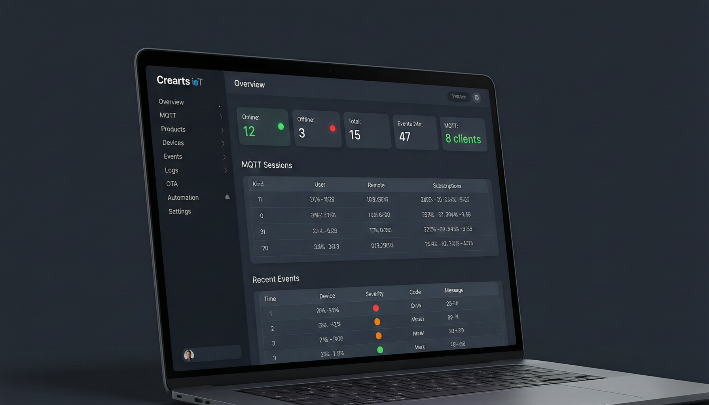
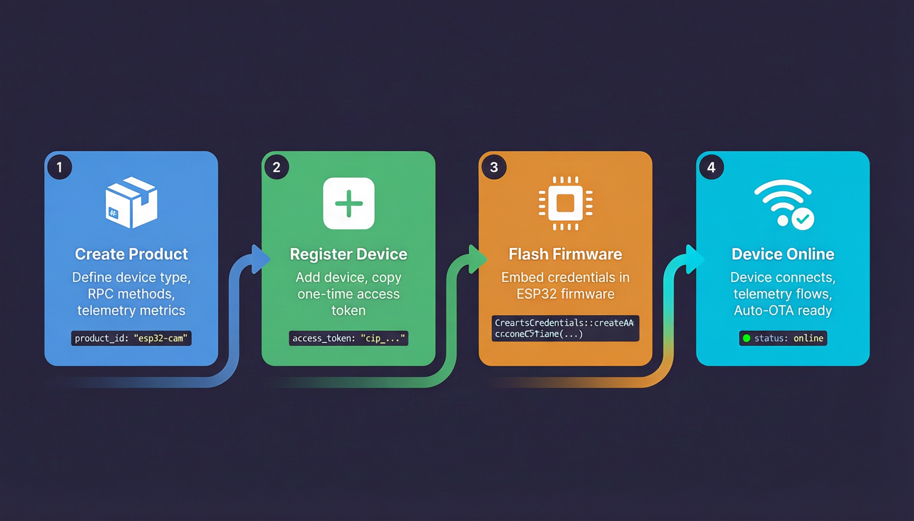

# Cogitor IoT Platform

**Self-hosted IoT-бэкенд и дашборд для управления ESP32-устройствами.**

[English version](README.md)

Один Go-бинарник. Встроенный MQTT-брокер. SQLite. React-дашборд. Без облачных зависимостей.


---

## Содержание

- [Что это?](#что-это)
- [Возможности](#возможности)
- [Быстрый старт](#быстрый-старт)
- [Дашборд](#дашборд)
- [Подключение устройств](#подключение-устройств)
- [Телеметрия и атрибуты](#телеметрия-и-атрибуты)
- [RPC (удалённые вызовы)](#rpc-удалённые-вызовы)
- [OTA-обновления](#ota-обновления)
- [Автоматизация и плагины](#автоматизация-и-плагины)
- [MCP — интеграция с LLM / AI](#mcp--интеграция-с-llm--ai)
- [Аутентификация и пользователи](#аутентификация-и-пользователи)
- [Конфигурация](#конфигурация)
- [Развёртывание](#развёртывание)
- [MQTT-протокол](#mqtt-протокол)
- [Документация](#документация)
- [Лицензия](#лицензия)

---

## Что это?

Cogitor IoT Platform — **однопросцессный IoT-бэкенд**, работающий на NAS, Raspberry Pi или любом Linux/Windows-сервере. Заменяет типичный стек (MQTT-брокер + бэкенд + БД + дашборд) одним бинарником, который можно собрать и запустить за минуты.

| Слой | Стек |
|------|------|
| API / ingest | Go 1.25+, chi router, SQLite |
| Брокер | Встроенный MQTT ([mochi-mqtt](https://github.com/mochi-mqtt/server)) в процессе платформы |
| Автоматизация | Node-RED (опционально, шина правил на `platform/v1/...`) |
| UI | React + Bootstrap 5 (Vite), встроен в Go-бинарник |
| MCP | Встроенный `/mcp` (JWT) — LLM-инструменты для устройств |

**Без облака. Без SaaS. Без платы за устройство.** Данные остаются на вашем оборудовании.

---

## Возможности

- **Жизненный цикл устройств** — создание продуктов, регистрация устройств, одноразовые токены, ротация токенов
- **Приём телеметрии** — хранение и запросы метрик устройств с автоматической очисткой
- **Желаемые атрибуты** — отправка конфигурации на устройства через MQTT downlink
- **RPC-консоль** — вызов методов устройства (перезагрузка, пользовательские) с автозаполнением форм
- **OTA-обновления** — загрузка `.bin` прошивок, хостинг URL, авто-отправка при переподключении (Auto-OTA)
- **Встроенный MQTT-брокер** — внешний брокер не нужен; ACL устройств по идентификатору
- **Дашборд реального времени** — SSE-обновления статуса, телеметрии, MQTT-сессий (HTTP-based, не WebSocket)
- **Автоматизация** — шина правил Node-RED для меж-устройственной логики; встроенные плагины для поведения каждого устройства (LED-гирлянда, расписание)
- **Внешние плагины** — отдельные процессы на любом языке (HTTP / MQTT / gRPC)
- **MCP-эндпоинт** — AI-клиенты (Cursor, Claude и др.) могут просматривать устройства, читать телеметрию, вызывать RPC
- **Аутентификация и роли** — JWT-логин, Google OAuth, саморегистрация, роли admin / operator / viewer
- **API-токены** — долгоживущие токены для скриптов и MCP-интеграции

---

## Быстрый старт

### Требования

- Go 1.25+ (для bare-metal) или Docker (для контейнерного развёртывания)
- Node.js 22+ (только для сборки фронтенда; в Docker уже собран)

### 1. Сборка и запуск (bare metal)

```bash
git clone git@gitea.darvik.synology.me:darvik/iot-platform-go.git
cd iot-platform-go

# Собрать дашборд + API за один шаг
make build

# Запустить
./bin/platform.exe
```

Или пошагово:

```bash
make web                                          # собрать фронтенд
go build -o bin/platform.exe ./cmd/platform       # собрать Go-бинарник
./bin/platform.exe
```

### 2. Запуск через Docker

```bash
cd deploy
cp .env.example .env
# Отредактировать .env — указать PUBLIC_BASE_URL, JWT_SECRET, ADMIN_PASSWORD
docker compose up -d --build
```

### 3. Открыть дашборд

| Сервис | URL |
|--------|-----|
| Дашборд / API | http://localhost:8080 |
| MQTT-брокер | `mqtt://localhost:1883` |
| MQTT WebSocket | `ws://localhost:8083/` (подпротокол `mqtt`) |
| Node-RED (опционально) | http://localhost:1880 |

**Логин по умолчанию**: `admin@cogitor.local` / `admin`

> **Совет**: Для разработки с hot-reload UI выполните `cd web && npm run dev` в отдельном терминале (API должен работать на `:8080`).

---

## Дашборд



React SPA, встроенный в Go-бинарник. Тёмная тема, адаптивный интерфейс для управления всем IoT-развёртыванием.

### Навигация

| Страница | Описание |
|----------|----------|
| **Overview** | Счётчики онлайн/офлайн/всего, статус MQTT, последние события, активные сессии |
| **MQTT** | Живые сессии брокера, подключённые клиенты, события брокера в реальном времени |
| **Products** | Архетипы устройств — создание продуктов, определение RPC-методов, метрик, атрибутов |
| **Devices** | Все зарегистрированные устройства со статусом, версией прошивки, последним появлением |
| **Device Detail** | Информация о подключении, телеметрия, желаемые атрибуты, OTA-панель, плагины, RPC-консоль, события |
| **Events** | События устройств с фильтрацией по серьёзности, устройству, времени |
| **Logs** | Лог-сообщения устройств из MQTT `v1/l` |
| **OTA** | Управление прошивками — загрузка `.bin`, регистрация URL, уведомление устройств, Auto-OTA, отслеживание задач |
| **Automation** | Встроенный редактор Node-RED (iframe) для меж-устройственной логики |
| **Settings** | Информация о платформе, управление API-токенами, конфигурация |
| **Users** | (Только admin) Список пользователей, управление ролями, отключение/удаление |

### Обновления в реальном времени

Дашборд использует SSE (`GET /api/v1/events/stream?token=<jwt>`) для живых обновлений. При подключении устройства, отправке телеметрии или изменении статуса — дашборд обновляется автоматически. SSE — HTTP-based (не WebSocket), работает через любой reverse proxy без sticky sessions, браузер сам переподключается при обрыве через `Last-Event-ID`.

---

## Подключение устройств



### Шаг 1 — Создать продукт

**Продукт** определяет архетип устройства: RPC-методы, метрики телеметрии, атрибуты.

1. **Products** → ввести `product_id` (напр. `esp32-cam`) и имя
2. Нажать **Create**
3. Открыть продукт для определения:
   - **RPC-методы** — `reboot`, пользовательские методы с типизированными параметрами
   - **Метрики** — ключи телеметрии с метками, единицами, форматом
   - **Атрибуты** — reported / desired / both, с типом и доступностью записи

Новые продукты получают **ESP-значения по умолчанию** автоматически.

### Шаг 2 — Зарегистрировать устройство

1. **Devices** → **Add device**
2. Выбрать продукт, ввести `device_id` (напр. `cam-001`)
3. Нажать **Create**
4. **Скопировать токен доступа** из модального окна — показывается **только один раз**

### Шаг 3 — Прошить устройство

```cpp
CogitorCredentials::createAccessToken("esp32-cam", "cam-001", "192.168.1.22", "<token>");
```

Параметры MQTT CONNECT:

```
client_id = {product_id}.{device_id}
username  = {product_id}.{device_id}
password  = <access_token>
```

### Шаг 4 — Устройство онлайн

После подключения:
- Статус **online** в дашборде (зелёный бейдж)
- Телеметрия начинает поступать на страницу устройства
- Auto-OTA отправляет последнюю прошивку при различии версий
- Платформа автоопределяет стиль топиков (полный `iot/v1/...` или короткий `v1/me/...`)

### Ротация токена

1. Открыть страницу устройства
2. Нажать **Rotate token**
3. Старая MQTT-сессия немедленно отключена
4. Новый токен показан один раз — обновить прошивку устройства

---

## Телеметрия и атрибуты

### Телеметрия

Устройства публикуют телеметрию на `v1/t` (короткий) или `iot/v1/.../up/telemetry/data` (полный). Платформа:
- Парсит JSON-пейлоад
- Сохраняет в SQLite с временными метками
- Транслирует через SSE на дашборд
- Публикует в шину правил для Node-RED

**Запрос телеметрии** через REST:

```
GET /api/v1/devices/{id}/telemetry?keys=temperature,humidity&from=...&to=...&limit=100
GET /api/v1/devices/{id}/telemetry/latest
```

**Хранение**: телеметрия старше `TELEMETRY_RETENTION_DAYS` (по умолчанию 30) автоматически очищается каждый час.

### Атрибуты

- **Reported** — устройство сообщает платформе текущее состояние
- **Desired** — платформа указывает устройству желаемое состояние

Установить desired-атрибуты через страницу устройства или REST:

```bash
PATCH /api/v1/devices/{id}/attributes/desired
{ "targetTemperature": 22, "mode": "auto" }
```

Платформа сохраняет и публикует через MQTT `v1/a/upd`.

---

## RPC (удалённые вызовы)

RPC-консоль на странице устройства позволяет вызывать любой метод, поддерживаемый устройством.

1. Дашборд отправляет `POST /api/v1/devices/{id}/rpc` с методом и параметрами
2. Платформа публикует MQTT downlink на `v1/r/req`
3. Устройство обрабатывает и отвечает на `v1/r/res`
4. Платформа сопоставляет ответ по корреляционному `id`

### Встроенные методы

- **`rpc-list`** — возвращает полный каталог методов устройства
- **`reboot`** — перезагрузка устройства

---

## OTA-обновления

### Загрузка прошивки

1. Страница **OTA**
2. Выбрать продукт, ввести версию (напр. `1.2.0`), опционально имя модуля
3. Выбрать `.bin` файл (макс. 32 МБ)
4. Нажать **Upload**

Платформа генерирует публичный URL:

```
{PUBLIC_BASE_URL}/ota/fw/{token}.bin
```

### Уведомление устройств

- **Notify product** — отправка OTA всем устройствам продукта
- **Notify single device** — одному устройству

Устройство получает URL через MQTT `v1/o/upd` и начинает загрузку.

### Auto-OTA

Включить **Auto-OTA** для продукта. При включении:
- Устройство подключается → платформа проверяет версию → отправляет обновление
- Устройство сообщает `ota/version` → аналогичная проверка
- Устройство было офлайн при уведомлении → отложенная задача доставляется при переподключении

---

## Автоматизация и плагины

### Шина правил (Node-RED)

Платформа публикует нормализованные JSON-события:

```
platform/v1/events/{product_id}/{device_id}/telemetry
platform/v1/events/{product_id}/{device_id}/status
platform/v1/events/{product_id}/{device_id}/event
platform/v1/events/{product_id}/{device_id}/attributes/reported
platform/v1/events/{product_id}/{device_id}/rpc/result
platform/v1/events/{product_id}/{device_id}/ota
```

Node-RED подписывается и может публиковать команды обратно:

```
platform/v1/commands/{product_id}/{device_id}/rpc
platform/v1/commands/{product_id}/{device_id}/attributes/desired
platform/v1/commands/{product_id}/{device_id}/ota
```

### Встроенные плагины

Плагины — **внутрипроцессные** автоматизации для каждого устройства (не Node-RED).

#### LED-гирлянда

Управление WS2812-лентами:
- Эффекты: `off`, `white`, `warm`, `red`, `green`, `blue`, `blink`, `strobe`, `breathe`, `chase`, `comet`, `scanner`, `fill`, `theater`, `sparkle`, `fire`, `rainbow`, `police`, `christmas`
- **Тихие часы** — принудительное `off` или приглушение ночью
- **Активное окно** — лента выключена вне настроенного диапазона времени

#### Расписание

Вызов RPC устройства в настраиваемое локальное время:
- Установить время и дни недели (напр. перезагрузка в 04:00 по будням)
- С учётом часовой зоны (`TIMEZONE` или переопределение для каждого binding)

### Внешние плагины

Внешние плагины работают как **отдельные процессы** (любой язык) и общаются с платформой через четыре транспорта:

| Режим | Направление | Когда использовать |
|-------|-------------|--------------------|
| **Webhook** (HTTP push) | Платформа → Плагин | Низкая задержка, у плагина есть публичный IP |
| **Polling** (HTTP pull) | Плагин → Платформа | Плагин за NAT/файрволом |
| **MQTT** (шина правил) | Плагин подписывается на брокер | Кросс-устройственные события, стиль Node-RED |
| **gRPC** | Платформа → Плагин | Высокая пропускная способность, строгая типизация |

Создать внешний плагин: **Settings → External Plugins**. Платформа генерирует API-токен + MQTT-креды (`extplg_…`). Пишите на Python, Go, Java, C++ — любом языке, который говорит HTTP, MQTT или gRPC. Примеры: [examples/plugins/](examples/plugins/).

---

## MCP — интеграция с LLM / AI

Платформа предоставляет **MCP (Model Context Protocol)** эндпоинт на `/mcp`. Любой MCP-совместимый AI-клиент (Cursor, Claude и др.) может взаимодействовать с устройствами.

### Настройка

1. **Settings** → создать API-токен (напр. имя: `mcp`)
2. Скопировать `cip_…` токен (показывается один раз)
3. Настроить AI-клиент:

```json
{
  "mcpServers": {
    "cogitor-iot": {
      "url": "http://192.168.1.22:8080/mcp",
      "headers": {
        "Authorization": "Bearer cip_…"
      }
    }
  }
}
```

### Доступные инструменты

| Инструмент | Назначение |
|------------|-----------|
| `overview` | Счётчики онлайн/офлайн, статус MQTT |
| `list_devices` | Фильтрация по продукту / статусу / запросу |
| `get_device` | Полная информация (телеметрия, атрибуты, схема) |
| `list_products` / `get_product` | Схемы продуктов |
| `list_device_methods` | Каталог RPC-методов |
| `invoke_rpc` | Вызов любого метода устройства |
| `reboot_device` | Быстрая перезагрузка |
| `get_telemetry` | Последние сэмплы телеметрии |
| `get_attributes` | Reported + desired атрибуты |
| `set_desired_attributes` | Отправка desired-атрибутов |

---

## Аутентификация и пользователи

### Методы входа

- **Пароль** — логин по username или email + пароль
- **Google OAuth** — вход / регистрация через Google
- **Саморегистрация** — создание аккаунта с подтверждением email (если включено)

### Роли

| Роль | Чтение | Запись (устройства, RPC, OTA) | Админ (пользователи, настройки) |
|------|--------|-------------------------------|-------------------------------|
| `admin` | да | да | да |
| `operator` | да | да | нет |
| `viewer` | да | нет | нет |

### API-токены

Долгоживущие токены для скриптов и MCP:
- Создать в **Settings** → указать имя → скопировать `cip_…` (показывается один раз)
- Использовать как `Authorization: Bearer cip_…`
- Отозвать в любой момент на той же странице

---

## Конфигурация

Приоритет конфигурации (первый непустой выигрывает): **OS env → `./config.yml` → `/etc/iot-platform/config.yml`**.

### Основные переменные

| Переменная | По умолчанию | Описание |
|------------|-------------|----------|
| `HTTP_ADDR` | `:8080` | Адрес HTTP |
| `MQTT_ADDR` | `:1883` | MQTT TCP |
| `MQTT_WS_ADDR` | `:8083` | MQTT over WebSocket. `off` для отключения |
| `SQLITE_PATH` | `/var/lib/iot-platform/platform.db` | Файл БД SQLite |
| `PUBLIC_BASE_URL` | `http://localhost:8080` | Публичный URL для OTA, email, OAuth. **Доступен с устройств** |
| `TIMEZONE` | `UTC` | Часовая зона IANA для расписаний и тихих часов |
| `LOG_LEVEL` | `info` | `debug` / `info` / `warn` / `error` |
| `JWT_SECRET` | (dev) | Ключ JWT — **сменить в production** |
| `ADMIN_EMAIL` | `admin@cogitor.local` | Email администратора |
| `ADMIN_PASSWORD` | `admin` | Пароль администратора |
| `TELEMETRY_RETENTION_DAYS` | `30` | Период хранения телеметрии |
| `BROKER_HOST_PUBLIC` | `localhost` | MQTT-хост для credentials устройств |
| `REGISTER_ENABLED` | `true` | Разрешить саморегистрацию |
| `REGISTER_DEFAULT_ROLE` | `viewer` | Роль для новых регистраций |
| `REQUIRE_EMAIL_VERIFY` | `true` | Требовать подтверждение email |
| `RULES_BUS_ENABLED` | `true` | Шина событий Node-RED |
| `NODERED_URL` | `http://localhost:1880` | URL Node-RED для страницы Automation |

---

## Развёртывание

### Docker Compose (рекомендуется для production)

```bash
cd deploy
cp .env.example .env
# Отредактировать .env
docker compose up -d --build
```

Запускает:
- **platform** — HTTP на `:8080`, MQTT на `:1883`
- **nodered** — Node-RED на `:1880` (опционально)

### Bare Metal (разработка)

```bash
make build
./bin/platform.exe
```

### VPS (`iot.cogitor.dev`)

Production — **systemd** сервис (без Docker).

```bash
make build-linux
# scp + systemctl restart iot-platform
```

### Проверки здоровья

| Эндпоинт | Назначение |
|----------|-----------|
| `GET /healthz` | Liveness probe (без авторизации) |
| `GET /readyz` | DB + MQTT ready (без авторизации) |

---

## MQTT-протокол

Платформа **является** MQTT-брокером. Устройства и Node-RED подключаются к `MQTT_ADDR` (по умолчанию `:1883`) или MQTT-over-WebSocket на `MQTT_WS_ADDR` (по умолчанию `:8083`).

### Стили топиков

Стиль **автоопределяется** из первого пакета устройства:

| Префикс | Стиль |
|---------|-------|
| `iot/v1/{product}/{device}/…` | Полный |
| `v1/me/…` или `v1/t`, `v1/r/req`, … | Короткий |

### Основные топики (короткий стиль)

| Топик | Направление | Назначение |
|-------|-------------|-----------|
| `v1/s` | up | Статус (LWT — онлайн/офлайн) |
| `v1/t` | up | Телеметрия |
| `v1/e` | up | События устройства |
| `v1/a` | up | Отчёт об атрибутах |
| `v1/a/upd` | down | Обновление desired-атрибутов |
| `v1/r/req` | down | RPC-запрос |
| `v1/r/res` | up | RPC-ответ |
| `v1/o/upd` | down | Уведомление OTA (URL) |
| `v1/o/p` | up | Прогресс OTA |
| `v1/n/req` | up | Запрос NTP |
| `v1/n/res` | down | Ответ NTP |
| `v1/l` | up | Лог-сообщения устройства |

---

## Документация

Полный указатель — [docs/README_ru.md](docs/README_ru.md).

| Документ | RU | EN |
|----------|----|----|
| Требования к продукту (PRD) | [01-prd.md](docs/ru/01-prd.md) | [01-prd.md](docs/en/01-prd.md) |
| REST API | [02-api.md](docs/ru/02-api.md) | [02-api.md](docs/en/02-api.md) |
| Аутентификация | [03-auth.md](docs/ru/03-auth.md) | [03-auth.md](docs/en/03-auth.md) |
| MQTT-протокол | [04-mqtt.md](docs/ru/04-mqtt.md) | [04-mqtt.md](docs/en/04-mqtt.md) |
| MQTT over TLS | [05-mqtt-tls.md](docs/ru/05-mqtt-tls.md) | [05-mqtt-tls.md](docs/en/05-mqtt-tls.md) |
| Автоматизация / Node-RED | [06-automation.md](docs/ru/06-automation.md) | [06-automation.md](docs/en/06-automation.md) |
| Встроенные плагины | [07-internal-plugins.md](docs/ru/07-internal-plugins.md) | [07-internal-plugins.md](docs/en/07-internal-plugins.md) |
| Внешние плагины | [08-external-plugins.md](docs/ru/08-external-plugins.md) | [08-external-plugins.md](docs/en/08-external-plugins.md) |
| Схема продукта | [09-product-schema.md](docs/ru/09-product-schema.md) | [09-product-schema.md](docs/en/09-product-schema.md) |
| MCP (LLM-инструменты) | [10-mcp.md](docs/ru/10-mcp.md) | [10-mcp.md](docs/en/10-mcp.md) |
| Эксплуатация | [11-operations.md](docs/ru/11-operations.md) | [11-operations.md](docs/en/11-operations.md) |
| Развёртывание VDS | [12-deploy-vds.md](docs/ru/12-deploy-vds.md) | [12-deploy-vds.md](docs/en/12-deploy-vds.md) |
| Развёртывание Docker | [13-deploy-docker.md](docs/ru/13-deploy-docker.md) | [13-deploy-docker.md](docs/en/13-deploy-docker.md) |
| Диаграммы | [14-diagrams.md](docs/ru/14-diagrams.md) | [14-diagrams.md](docs/en/14-diagrams.md) |
| Multi-Account и мониторинг (single v1.x) | [16-multi-account.md](docs/ru/16-multi-account.md) | [16-multi-account.md](docs/en/16-multi-account.md) |
| HA / Clustering (v2.x) | [17-ha-architecture.md](docs/ru/17-ha-architecture.md) | [17-ha-architecture.md](docs/en/17-ha-architecture.md) |

---

## Чек-лист приёмки

- [ ] Устройство подключается с токеном и появляется **online** в дашборде
- [ ] Телеметрия видна на странице устройства и обновляется через SSE
- [ ] Desired-атрибут достигает устройства (`v1/a/upd`)
- [ ] RPC round-trip с совпадающим `id` и `code: 0`
- [ ] NTP-запрос получает `serverRecvTime` / `serverSendTime`
- [ ] Ротация токена отключает старую сессию; новый токен работает
- [ ] Node-RED получает `platform/v1/events/.../telemetry`
- [ ] Auto-OTA отправляет прошивку при включении и переподключении устройства

---

## Лицензия

Проприетарная — Cogitor.
