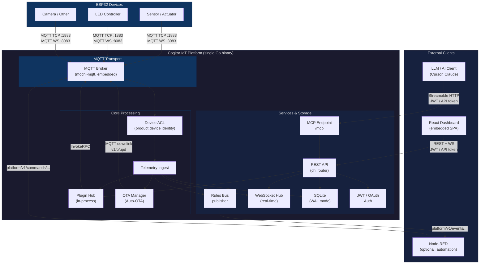
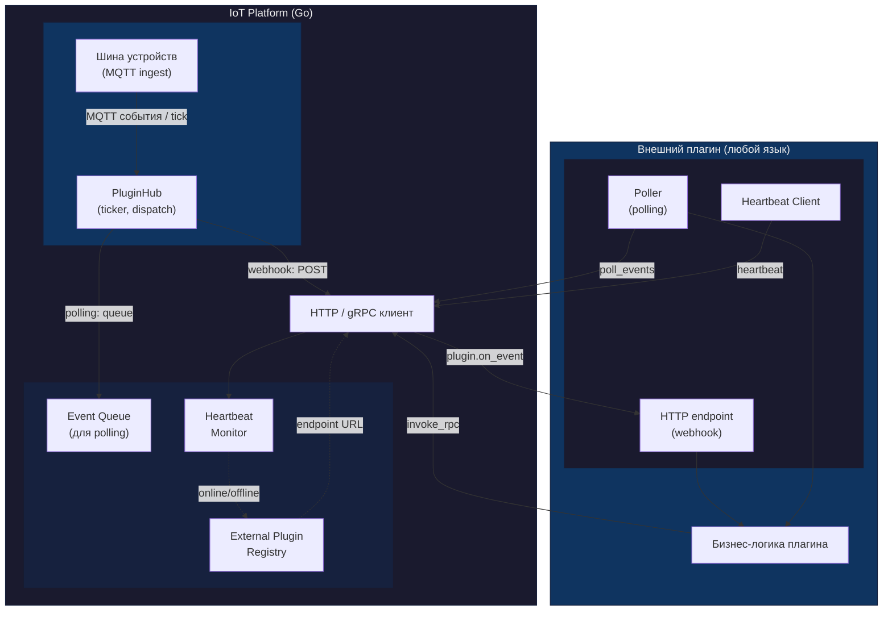
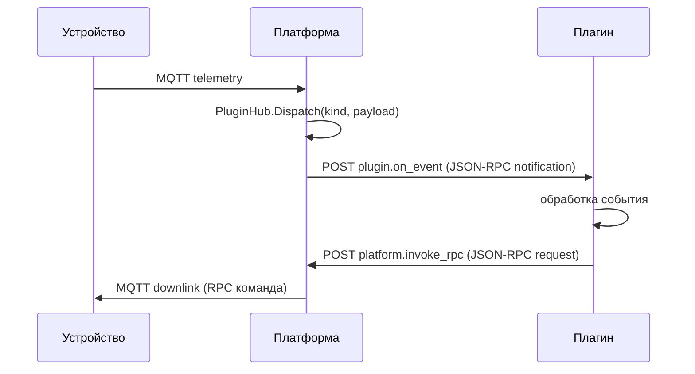
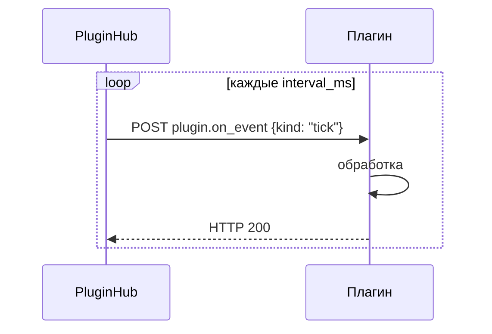
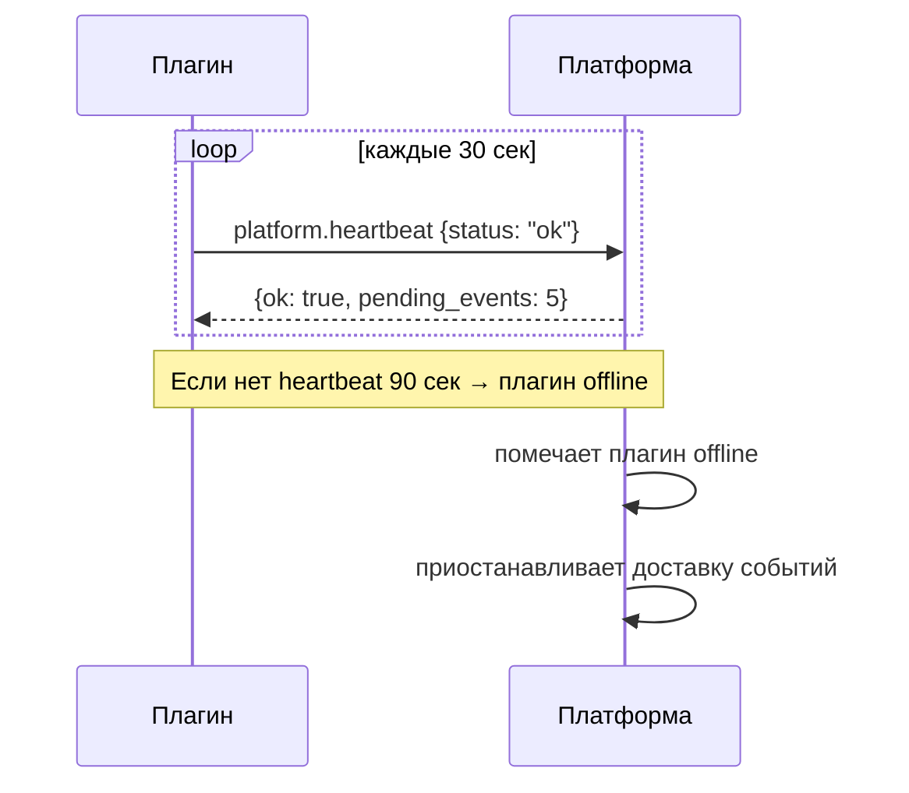
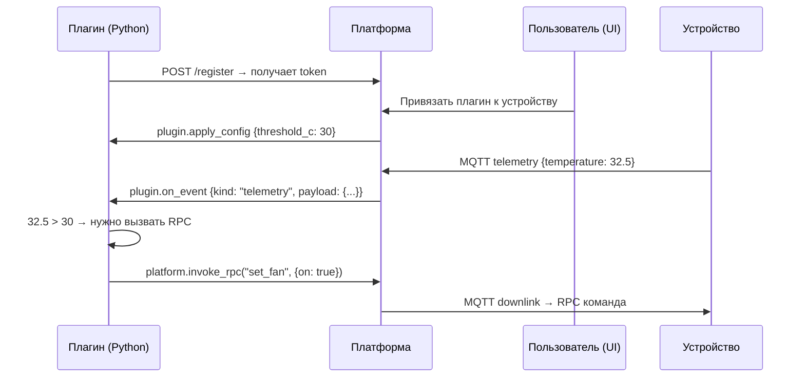
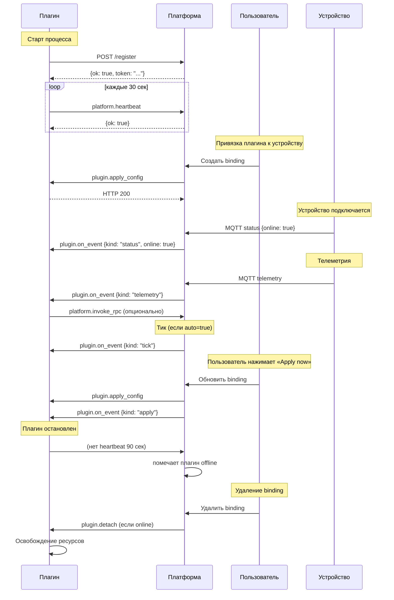
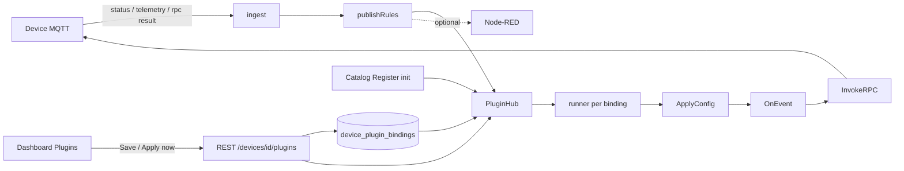
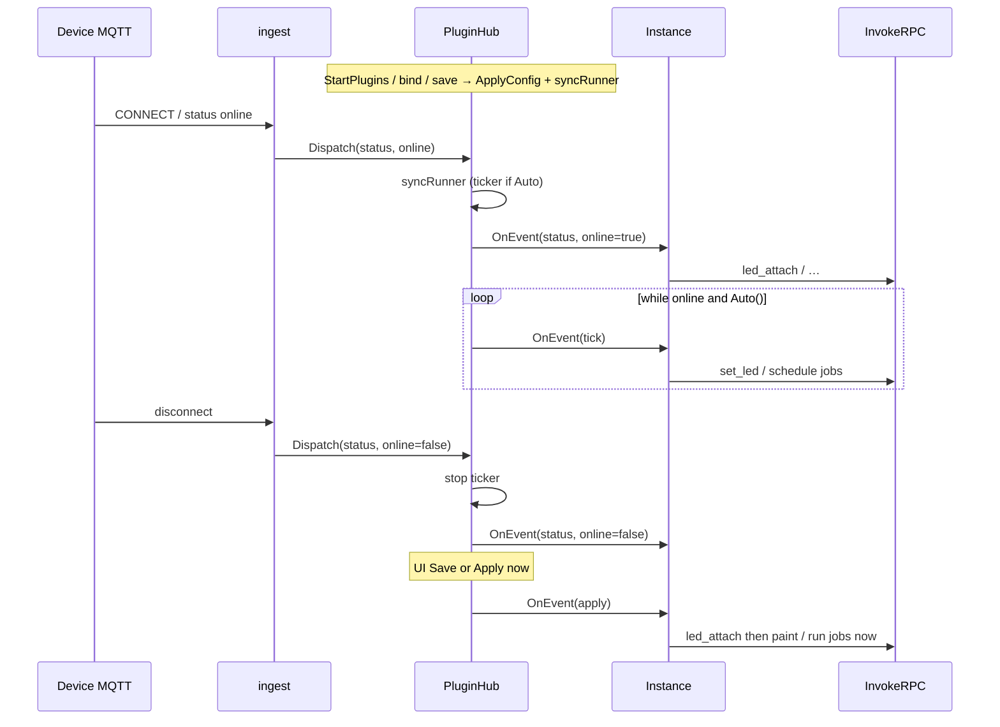

# Diagrams

## Platform Architecture

High-level system architecture of the Cogitor IoT Platform showing all
embedded components and external clients.

## External Plugin Architecture

High-level architecture of the external plugin system showing the IoT Platform
components and an out-of-process plugin communicating over HTTP/gRPC.

## External Plugin Event Flow

Sequence diagram showing how a device telemetry event flows through the platform
to an external plugin and back as an RPC command.

## External Plugin Tick Flow

Plugins with `auto: true` and `interval_ms > 0` receive periodic tick events.
The platform owns the timer; the plugin only reacts.

## External Plugin Heartbeat

The plugin periodically reports liveness to the platform. If no heartbeat arrives
within 90 seconds the plugin is marked offline and event delivery is paused.

## External Plugin End-to-End Flow

Complete interaction flow for the Python temperature-alert plugin: registration,
config apply, telemetry ingest, threshold check, and RPC dispatch.

## External Plugin Lifecycle

Full lifecycle from plugin process start through registration, heartbeat,
binding, device events, apply, offline detection, and detach.

## Internal Plugin Architecture

In-process plugin architecture showing how device MQTT events flow through ingest
and PluginHub to per-binding runners, and how the dashboard manages bindings.

## Internal Plugin Lifecycle

Sequence diagram showing the lifecycle of an internal plugin runner: device
connect/disconnect, tick loop, apply on save, and RPC dispatch.

