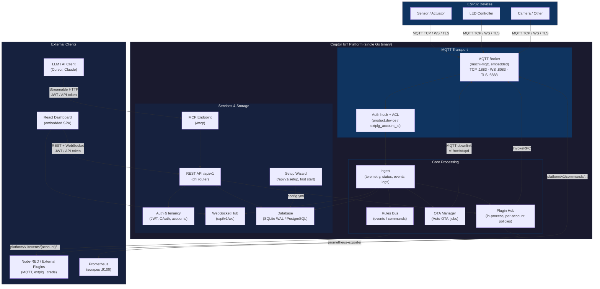

# Cogitor IoT Platform — Product Requirements Document

> **Version**: 1.0  
> **Status**: Active  
> **Last updated**: August 2026

This document defines what the platform does, for whom, and why. It is the source of truth for feature scope and acceptance criteria.

Related docs: [API](02-api.md), [Auth](03-auth.md), [MQTT](04-mqtt.md), [Automation](06-automation.md), [Operations](11-operations.md).

---

## 1. Vision

Cogitor IoT Platform is a **self-hosted, single-binary IoT backend and operations dashboard** for managing ESP32-class devices over MQTT. It provides everything a small-to-medium deployment needs — device provisioning, telemetry ingestion, remote procedure calls, OTA firmware updates, automation, and an LLM integration surface — without depending on cloud services or third-party platforms.

The guiding principle: **one process, one binary, zero external SaaS**.

---

## 2. Problem Statement

| Pain point | Current alternatives | Cogitor approach |
|------------|---------------------|------------------|
| Cloud IoT platforms require internet, incur per-device costs, and lock in data | AWS IoT, ThingsBoard Cloud, Blynk | Self-hosted; all data stays on the operator's NAS / server |
| Multi-component stacks (broker + backend + DB + UI) are complex to deploy and maintain | ThingsBoard CE + Mosquitto + PostgreSQL + Grafana | Single Go binary with embedded MQTT broker, SQLite (or optional PostgreSQL), and React dashboard |
| Firmware OTA is manual (SCP / TFTP / custom scripts) | Custom shell scripts, manual flashing | Built-in OTA: upload `.bin`, hosted download URL, auto-push on reconnect |
| Automation requires a separate server with its own state | Standalone Node-RED, Home Assistant | In-process per-device plugins (Go) + optional Node-RED for cross-device rules via MQTT rules bus |
| No LLM / AI integration for device ops | None in open-source IoT platforms | Embedded MCP endpoint — any MCP-compatible AI client can list devices, invoke RPC, read telemetry |

---

## 3. Target Users

### 3.1 Primary — Device Maker / Lab Operator
- Builds ESP32-based devices (LED controllers, sensors, actuators)
- Needs a dashboard to see device status, push firmware, and send commands
- Runs the platform on a home NAS or a Raspberry Pi
- Wants minimal ops overhead

### 3.2 Secondary — Small-Business IoT Deployer
- Manages 10–200 devices across a single site
- Needs role-based access (admin / operator / viewer)
- Requires automation rules (scheduled reboots, LED quiet hours, threshold alerts)
- Needs audit trail (events, logs, OTA history)

### 3.3 Tertiary — AI/LLM Enthusiast
- Wants to query device state and invoke commands via natural language
- Uses Cursor, ChatGPT, or another MCP-compatible client
- Expects a standards-based integration point (MCP over HTTP)

---

## 4. Goals & Success Metrics

| Goal | Metric | Target |
|------|--------|--------|
| Minimal deployment footprint | Docker containers / processes | 1 (platform) + 1 optional (Node-RED) |
| Fast device onboarding | Time from "Create device" to first telemetry | < 5 minutes (including firmware flash) |
| Reliable device presence | MQTT session tracking accuracy | 100% of connected sessions reflected in dashboard within 2 s |
| Zero-touch firmware updates | Devices on latest firmware after Auto-OTA enable | All online devices updated within one reconnect cycle |
| Operational visibility | Dashboard page load time | < 1 s for up to 200 devices |
| AI operability | MCP tools available | All core device operations accessible via MCP |

---

## 5. Functional Requirements

### 5.1 Device Lifecycle Management

| ID | Requirement | Priority | Status |
|----|-------------|----------|--------|
| F-101 | Create **products** as device archetypes with shared schema (RPC methods, telemetry metrics, attributes) | P0 | ✅ |
| F-102 | Register **devices** under a product; generate one-time access token shown once at creation | P0 | ✅ |
| F-103 | Rotate device token; old MQTT session is disconnected immediately | P0 | ✅ |
| F-104 | Enable / disable / delete devices; disabled devices cannot authenticate | P0 | ✅ |
| F-105 | Auto-detect MQTT topic style (full `iot/v1/…` vs short `v1/me/…`) from the first device packet | P0 | ✅ |
| F-106 | Device provisioning payload: Wi-Fi + Cogitor MQTT credentials as JSON for firmware | P1 | ✅ |

### 5.2 Telemetry & Attributes

| ID | Requirement | Priority | Status |
|----|-------------|----------|--------|
| F-201 | Ingest telemetry from MQTT uplink topics; store in the database (SQLite or PostgreSQL) with timestamps | P0 | ✅ |
| F-202 | Expose latest telemetry and historical range queries via REST | P0 | ✅ |
| F-203 | Support **reported** and **desired** attributes; desired attributes are published to the device on save | P0 | ✅ |
| F-204 | Telemetry retention: auto-cleanup of records older than configurable days (default 30) | P1 | ✅ |
| F-205 | Product-defined metric schema: key, label, group, unit, format (bytes / percent / rssi / etc.) | P1 | ✅ |

### 5.3 Remote Procedure Calls (RPC)

| ID | Requirement | Priority | Status |
|----|-------------|----------|--------|
| F-301 | Send RPC requests to devices via MQTT downlink; wait for response with configurable timeout | P0 | ✅ |
| F-302 | RPC console in dashboard: auto-populate methods from product schema + live `rpc-list` | P0 | ✅ |
| F-303 | RPC history stored per device | P1 | ✅ |
| F-304 | Correlation via JSON `id` field; success = `code: 0` | P0 | ✅ |

### 5.4 OTA Firmware Updates

| ID | Requirement | Priority | Status |
|----|-------------|----------|--------|
| F-401 | Upload `.bin` firmware images (multipart, max 32 MB); hosted at a public URL (no auth for ESP HTTP GET) | P0 | ✅ |
| F-402 | Register external firmware URLs (HTTPS) as an alternative to hosting | P1 | ✅ |
| F-403 | Notify a single device or an entire product about new firmware via MQTT | P0 | ✅ |
| F-404 | **Auto-OTA**: when enabled on a product, push latest firmware to devices on connect or version report | P0 | ✅ |
| F-405 | Track OTA job status: pending → running → success / failed / cancelled | P0 | ✅ |
| F-406 | Module support: same product can have firmware for different modules (main, factory, etc.) | P1 | ✅ |
| F-407 | Same product + module + version replaces the previous image (new download URL) | P1 | ✅ |

### 5.5 Authentication & Authorization

| ID | Requirement | Priority | Status |
|----|-------------|----------|--------|
| F-501 | Login by username or email + password | P0 | ✅ |
| F-502 | Self-registration with optional email verification (SMTP or log mode) | P1 | ✅ |
| F-503 | Google OAuth sign-in / sign-up with account linking | P1 | ✅ |
| F-504 | Role-based access: **admin** (full), **operator** (read + write devices/RPC/OTA), **viewer** (read-only) | P0 | ✅ |
| F-505 | First admin account and default account created by the first-start **setup wizard** (`/setup`); `ADMIN_*` / `BOOTSTRAP_*` env vars do not create users | P0 | ✅ |
| F-506 | Long-lived API tokens for MCP and scripts (created in Settings, shown once) | P0 | ✅ |
| F-507 | Admin Users page: list, change role, disable, delete | P1 | ✅ |

### 5.6 Automation

| ID | Requirement | Priority | Status |
|----|-------------|----------|--------|
| F-601 | **Rules bus**: normalized JSON events on `platform/v1/events/{account_slug}/{product}/{device}/{kind}` via MQTT | P0 | ✅ |
| F-602 | **Commands**: external plugins / Node-RED publish to `platform/v1/commands/{account_slug}/{product}/{device}/…` for RPC, desired attributes, OTA; ACL allows only the plugin's own slug and the device is resolved inside that account | P0 | ✅ |
| F-603 | **Device plugins**: in-process per-device automations (LED garland, schedule) with RPC callbacks | P0 | ✅ |
| F-604 | LED garland plugin: WS2812 strip control with effects, quiet hours, night-light windows | P1 | ✅ |
| F-605 | Schedule plugin: fire device RPC at configurable local times and weekdays | P1 | ✅ |
| F-606 | Node-RED automation page embedded as iframe in the dashboard | P1 | ✅ |
| F-607 | Plugin extensibility: Go builtin plugins via `Register()` + `init()` pattern | P2 | ✅ |

### 5.7 MQTT Broker

| ID | Requirement | Priority | Status |
|----|-------------|----------|--------|
| F-701 | Embedded MQTT broker (mochi-mqtt) in the platform process — no external broker required | P0 | ✅ |
| F-702 | Device ACL scoped to `{product}.{device}` identity (up/down topics only) | P0 | ✅ |
| F-703 | Optional MQTT-over-WebSocket listener | P2 | ✅ |
| F-707 | Optional MQTT over TLS listener (`:8883`, optional mTLS via `MQTT_TLS_CA`) | P1 | ✅ |
| F-704 | LWT-based presence detection (online/offline) | P0 | ✅ |
| F-705 | MQTT monitoring page: live sessions, broker event trail (auth, connect, ACL, ingest) | P0 | ✅ |
| F-706 | NTP sync: device sends time request, platform responds with `serverRecvTime` / `serverSendTime` | P1 | ✅ |

### 5.8 Dashboard (Web UI)

| ID | Requirement | Priority | Status |
|----|-------------|----------|--------|
| F-801 | React SPA (Bootstrap 5, Vite) embedded into Go binary at build time | P0 | ✅ |
| F-802 | Pages: Overview, MQTT, Products, Devices, Device Detail, Events, Logs, OTA, Automation, Settings, Users | P0 | ✅ |
| F-803 | Real-time updates via WebSocket (device status, telemetry, MQTT events, OTA progress) | P0 | ✅ |
| F-804 | Overview: online/offline/total counts, MQTT status, recent events, active sessions | P0 | ✅ |
| F-805 | Device detail: connection info, metrics, desired attributes form, OTA panel, plugins, RPC console, events | P0 | ✅ |
| F-806 | Mobile-responsive layout with off-canvas navigation | P1 | ✅ |

### 5.9 MCP (LLM Integration)

| ID | Requirement | Priority | Status |
|----|-------------|----------|--------|
| F-901 | Streamable HTTP MCP endpoint at `/mcp` (same process, JWT/API token auth) | P0 | ✅ |
| F-902 | Tools: overview, list/get devices, list/get products, invoke RPC, reboot, telemetry, attributes | P0 | ✅ |
| F-903 | Write tools (RPC, reboot, set attributes) require operator/admin role | P0 | ✅ |
| F-904 | Compatible with Cursor, Claude, and other MCP clients | P1 | ✅ |

### 5.10 Observability

| ID | Requirement | Priority | Status |
|----|-------------|----------|--------|
| F-1001 | Structured logs to stdout (`slog`): connect, disconnect, auth_fail, ACL deny, RPC, OTA | P0 | ✅ |
| F-1002 | Configurable log level: debug / info / warn / error | P0 | ✅ |
| F-1003 | Events page: filter by device, severity, time range | P0 | ✅ |
| F-1004 | Logs page: device log messages with level and time filtering | P1 | ✅ |
| F-1005 | Health endpoints: `/healthz` (liveness), `/readyz` (DB + MQTT ready) | P0 | ✅ |

---

## 6. Non-Functional Requirements

| ID | Category | Requirement |
|----|----------|-------------|
| NF-01 | **Deployment** | Single Docker image (multi-stage: Node.js → Go → Alpine). Runs as non-root user. |
| NF-02 | **Deployment** | Alternative: bare-metal via `make build` → single binary + SQLite file; Debian package via `make deb` (systemd) |
| NF-03 | **Portability** | Windows (dev), Linux (production), ARM64 compatible (SQLite pure-Go driver) |
| NF-03a | **Storage** | Database selected by `DATABASE_DRIVER` (`sqlite` default, WAL mode \| `postgres`) and `DATABASE_DSN`; `SQLITE_PATH` kept as a legacy alias |
| NF-03b | **First start** | Empty database → built-in setup wizard (web UI `/setup`, API `/api/v1/setup/*`); no default login |
| NF-04 | **Security** | JWT auth for dashboard/API; SHA-256 hashed device tokens; ACL-scoped MQTT |
| NF-05 | **Security** | No device tokens in Node-RED flows; Node-RED connects to the rules bus as an external plugin with its own MQTT credentials (`extplg_{account_slug}_{id}`) |
| NF-06 | **Security** | OTA firmware download is unauthenticated (ESP HTTP GET) — URL is token-based |
| NF-07 | **Performance** | SQLite WAL mode for concurrent reads during ingest (PostgreSQL for larger deployments) |
| NF-08 | **Performance** | WebSocket fan-out for real-time dashboard updates (no polling) |
| NF-09 | **Reliability** | MQTT session state; LWT for disconnect detection; pending OTA jobs delivered on reconnect |
| NF-10 | **Configuration** | Priority cascade: OS env → `./config.yml` → `/opt/iot-platform/etc/config.yml` (`.env` is not read by the binary) |
| NF-11 | **Maintainability** | Database migrations in `internal/db/migrations/`; auto-applied at startup |
| NF-12 | **Extensibility** | Plugin catalog with Go `init()` registration; form-driven UI generation |

---

## 7. Architecture

> **Diagram**: [Platform Architecture](14-diagrams.md#platform-architecture)



### Data Flow

1. **Device → Platform**: MQTT CONNECT with `{product}.{device}` / access token. PUBLISH telemetry on `v1/t` or `iot/v1/.../up/telemetry/data`. Platform ingests in-process, stores in the database (SQLite or PostgreSQL), broadcasts via WebSocket, publishes to rules bus.
2. **Platform → Device**: RPC requests, desired attribute updates, OTA notifications published on downlink topics (`v1/me/...` for short style, `iot/v1/{product}/{device}/down/...` for full style). Topic style auto-detected from device's uplink prefix.
3. **Platform ↔ Node-RED**: Events on `platform/v1/events/{account_slug}/{product}/{device}/{kind}`; commands on `platform/v1/commands/{account_slug}/{product}/{device}/...` (own account only). Node-RED is registered as an external plugin and uses that plugin's MQTT credentials (the former dedicated Node-RED MQTT user was removed by migration `010_drop_nodered_creds.sql`).
4. **Dashboard → Platform**: REST API + WebSocket for real-time updates. JWT or API token auth.
5. **LLM → Platform**: MCP endpoint at `/mcp` — tools for device listing, telemetry, RPC, OTA.

---

## 8. MQTT Protocol (Cogitor v1)

### Topic Styles

| Style | Prefix | Identity source |
|-------|--------|-----------------|
| Full | `iot/v1/{product}/{device}/{up|down}/{capability}/{operation}` | Topic path |
| Short | uplink `v1/t`, `v1/r/res`, …; downlink `v1/me/r/req`, `v1/me/a/upd`, … | MQTT username (`{product}.{device}`) |

### Key Topics

| Direction | Short | Purpose |
|-----------|-------|---------|
| Up | `v1/s` | Status (LWT) |
| Up | `v1/t` | Telemetry data |
| Up | `v1/e` | Events |
| Up | `v1/a` | Attributes report |
| Down | `v1/me/a/upd` | Attributes update (desired) |
| Down | `v1/me/r/req` | RPC request |
| Up | `v1/r/res` | RPC response |
| Down | `v1/me/o/upd` | OTA update (URL) |
| Up | `v1/o/p` | OTA progress |
| Up | `v1/n/req` | NTP request |
| Down | `v1/me/n/res` | NTP response |

Downlink topics in short style always carry the `v1/me/` prefix; the platform never publishes to `v1/a/upd`, `v1/r/req`, `v1/o/upd` or `v1/n/res`.

---

## 9. Configuration

### Environment Variables (key subset)

| Variable | Default | Purpose |
|----------|---------|---------|
| `HTTP_ADDR` | `:8080` | HTTP listen address |
| `MQTT_ADDR` | `:1883` | Embedded MQTT TCP listen |
| `MQTT_TLS_ADDR` | `:8883` | MQTT over TLS listen (active only when `MQTT_TLS_CERT` + `MQTT_TLS_KEY` are set) |
| `DATABASE_DRIVER` | `sqlite` | `sqlite` \| `postgres` |
| `DATABASE_DSN` | `/opt/iot-platform/lib/platform.db` | SQLite file path or PostgreSQL URL (`postgres://…`) |
| `SQLITE_PATH` | `/opt/iot-platform/lib/platform.db` | Legacy alias for the SQLite file (used when `DATABASE_DSN` is empty) |
| `PUBLIC_BASE_URL` | `http://localhost:8080` | Public URL for OTA downloads, email links, OAuth callbacks |
| `JWT_SECRET` | (dev default) | JWT signing key — **must change in production** (the setup wizard generates one) |
| `TIMEZONE` | `UTC` | IANA timezone for schedules and quiet hours |
| `TELEMETRY_RETENTION_DAYS` | `30` | Auto-cleanup period |
| `RULES_BUS_ENABLED` | `true` | Enable Node-RED event/command bus |
| `BROKER_HOST_PUBLIC` | `localhost` | MQTT host shown in device credentials |

There is no default admin login: on first start with an empty database the platform runs the setup wizard (see [Operations](11-operations.md)), which creates the admin user and default account. `ADMIN_*` / `BOOTSTRAP_*` env vars do not create anything.

### Configuration File Priority

1. OS environment variables
2. `./config.yml`
3. `/opt/iot-platform/etc/config.yml`

The binary does not read `.env` files; `.env` is only useful if Docker Compose or a systemd `EnvironmentFile=` injects it into the process environment.

---

## 10. Deployment

### Docker

The platform image is built from the root `Dockerfile` and run with `docker run` or the root `docker-compose.yml` (see [13-deploy-docker.md](13-deploy-docker.md)):

```bash
docker build -t iot-platform-go .
docker run -d --name iot-platform-go \
  -p 8080:8080 -p 1883:1883 -p 8083:8083 -p 8883:8883 \
  -v /srv/iot-platform/data:/opt/iot-platform/lib \
  -v /srv/iot-platform/etc:/opt/iot-platform/etc \
  iot-platform-go
```

`docker-compose.yml` runs the `platform` service (Docker Hub image or local build, host ports / folders from `.env`) and the optional Node-RED service (`--profile nodered`, port 1880).

### Debian package

`make deb` builds `dist/iot-platform_<version>_amd64.deb` (systemd unit, everything under `/opt/iot-platform/{bin,etc,lib}`). See [12-deploy-vds.md](12-deploy-vds.md).

### Bare Metal (development)

```bash
make build        # builds web UI + Go binary → bin/platform.exe
./bin/platform.exe
```

### Synology NAS

- Gitea CI builds image on push to `master`
- Mounts `/volume1/docker/iot-platform-go/data` → `/opt/iot-platform/lib` for SQLite persistence
- Mounts `/volume1/docker/iot-platform-go/etc` → `/opt/iot-platform/etc` (holds `config.yml` written by the setup wizard; `.env` there is not read)
- Host ports and folders are Gitea repository variables (`IOT_HTTP_PORT`, `IOT_HOST_DIR`, …)

---

## 11. REST API Summary

| Area | Endpoints |
|------|-----------|
| Auth | `POST /auth/login`, `POST /auth/register`, `GET /auth/config`, Google OAuth |
| Overview | `GET /overview`, `GET /healthz`, `GET /readyz`, `GET /settings` |
| Products | CRUD `/products`, `POST /products/{id}/esp-defaults` |
| Devices | CRUD `/devices`, `POST /devices/{id}/token/rotate`, `POST /devices/{id}/enable`, `POST /devices/{id}/disable` |
| Telemetry | `GET /devices/{id}/telemetry`, `GET /devices/{id}/telemetry/latest` |
| Attributes | `GET /devices/{id}/attributes`, `PATCH /devices/{id}/attributes/desired` |
| RPC | `POST /devices/{id}/rpc`, `GET /devices/{id}/rpc` (history) |
| OTA | `POST /ota/firmwares/upload`, `POST /ota/firmwares/{id}/notify`, `POST /devices/{id}/ota` |
| Events/Logs | `GET /events`, `GET /logs` |
| Plugins | `GET /plugins`, CRUD `/devices/{id}/plugins`, `POST …/apply` |
| MQTT | `GET /mqtt` (sessions + events) |
| MCP | `/mcp` (streamable HTTP, JWT/token auth) |
| WebSocket | `GET /api/v1/ws?token=<jwt>` |
| Setup wizard | `GET /api/v1/setup/state`, `POST /api/v1/setup/step`, `POST /api/v1/setup/apply`, `POST /api/v1/setup/generate-tls` (unauthenticated, first start only) |

---

## 12. Tech Stack

| Layer | Technology |
|-------|-----------|
| Backend | Go 1.27+, chi router |
| Database | SQLite (modernc.org/sqlite — pure Go, no CGO) or PostgreSQL |
| MQTT Broker | mochi-mqtt (embedded) |
| Frontend | React 19 + Bootstrap 5 + Vite |
| Auth | JWT (golang-jwt), Google OAuth |
| Real-time | gorilla/websocket (`/api/v1/ws`) |
| Automation | Node-RED (optional, via MQTT rules bus) |
| AI Integration | MCP (modelcontextprotocol/go-sdk) |
| Container | Multi-stage Docker (Node.js 26 → Go 1.27 → Alpine 3.24) |

---

## 13. Out of Scope (v1)

- ~~Multi-tenancy / team workspaces~~ — implemented, see [16-multi-account.md](16-multi-account.md)
- Cloud relay / hybrid cloud-edge
- Mobile native apps (responsive web is sufficient)
- Video streaming from ESP32-CAM
- Mesh networking / device-to-device communication
- Third-party plugin marketplace (plugins are Go builtins)
- Internationalization (UI is English-only)

---

## 14. Future Considerations (v2+)

- **Multi-account / IAM**: see [16-multi-account.md](16-multi-account.md) — implemented release: tenants, per-account roles, account-scoped rules, built-in monitoring
- **MQTT 5 features**: shared subscriptions, message expiry
- **TimescaleDB / InfluxDB**: swap SQLite for high-volume telemetry
- **Plugin marketplace**: user-contributed plugins with web-based install
- **Fleet management**: groups, tags, bulk operations
- **Alerting**: threshold, no-data and offline alerts with email/Telegram are implemented in v1.9.0 without Node-RED; see [Monitoring](11-operations.md#monitoring). Webhook delivery remains planned.
- **mDNS / local discovery**: auto-detect platform from firmware
- ~~**TLS for MQTT**: native TLS listener~~ — implemented (`MQTT_TLS_ADDR`, see [05-mqtt-tls.md](05-mqtt-tls.md))
- **Grafana integration**: telemetry export / direct SQLite datasource

---

## 15. Acceptance Criteria

A device deployment is considered successful when:

- [ ] Device connects with access token and appears **online** in dashboard
- [ ] Telemetry is visible in device detail and updates in real-time via WebSocket
- [ ] Desired attribute patch reaches the device via MQTT downlink
- [ ] RPC round-trip completes with matching `id` and `code: 0`
- [ ] NTP request receives `serverRecvTime` / `serverSendTime`
- [ ] Token rotation invalidates old session; new token works immediately
- [ ] Node-RED receives events on `platform/v1/events/{account_slug}/...`
- [ ] Auto-OTA pushes firmware to device on reconnect when enabled
- [ ] MCP client can list devices and invoke RPC via `/mcp`

---

## Related documentation

| Doc | What |
|-----|------|
| [02-api.md](02-api.md) | REST API reference |
| [03-auth.md](03-auth.md) | Authentication & roles |
| [04-mqtt.md](04-mqtt.md) | MQTT protocol & topics |
| [05-mqtt-tls.md](05-mqtt-tls.md) | MQTT over TLS |
| [06-automation.md](06-automation.md) | Node-RED & rules bus |
| [07-internal-plugins.md](07-internal-plugins.md) | In-process device plugins |
| [08-external-plugins.md](08-external-plugins.md) | Out-of-process plugins |
| [09-product-schema.md](09-product-schema.md) | Product schema (RPC, telemetry, attributes) |
| [10-mcp.md](10-mcp.md) | MCP (LLM integration) |
| [11-operations.md](11-operations.md) | Deployment & configuration |
| [16-multi-account.md](16-multi-account.md) | Multi-account, IAM, monitoring, plugin policies |
