# Diagrams

Architecture diagrams and sequence flow diagrams. Rendered with Mermaid — works in GitHub, GitLab, Obsidian, and most Markdown viewers.

Related docs: [01-PRD](01-prd.md), [07-internal-plugins](07-internal-plugins.md), [08-external-plugins](08-external-plugins.md).

---

## Platform Architecture

High-level system architecture of the Cogitor IoT Platform showing all
embedded components and external clients.

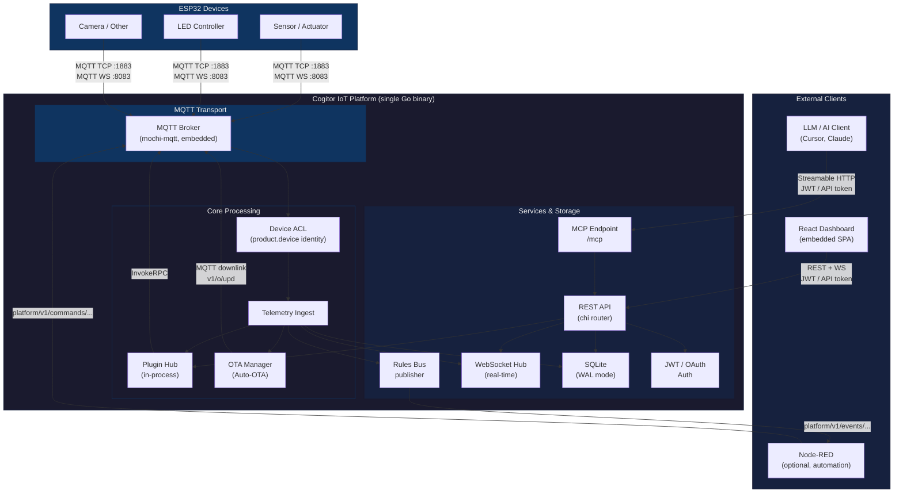

## External Plugin Architecture

High-level architecture of the external plugin system showing the IoT Platform
components and an out-of-process plugin communicating over HTTP/gRPC.

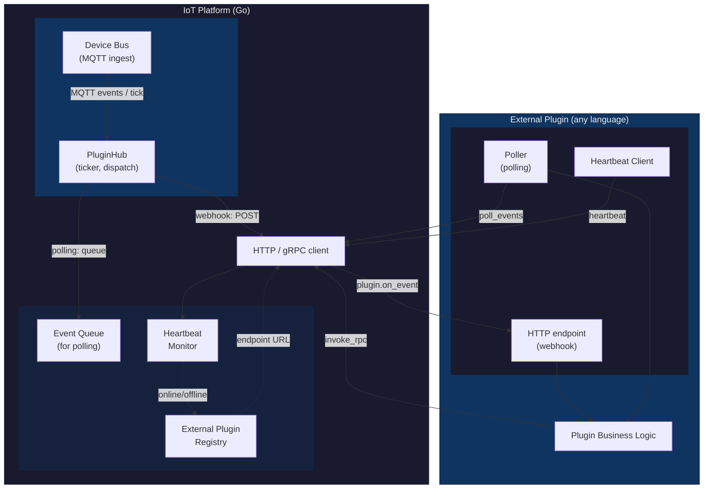

## External Plugin Event Flow

Sequence diagram showing how a device telemetry event flows through the platform
to an external plugin and back as an RPC command.

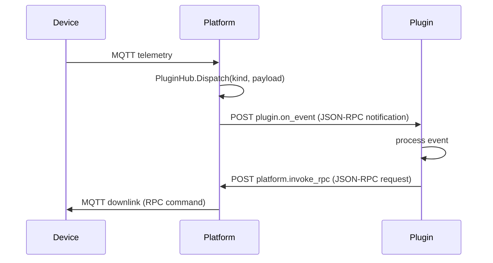

## External Plugin Tick Flow

Plugins with `auto: true` and `interval_ms > 0` receive periodic tick events.
The platform owns the timer; the plugin only reacts.

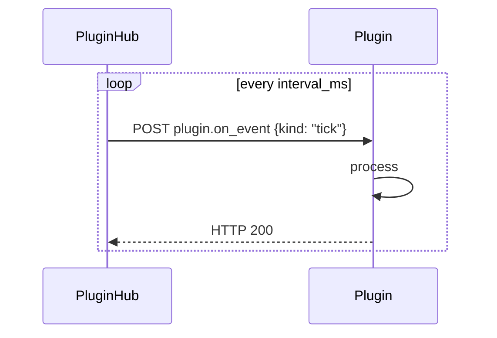

## External Plugin Heartbeat

The plugin periodically reports liveness to the platform. If no heartbeat arrives
within 90 seconds the plugin is marked offline and event delivery is paused.

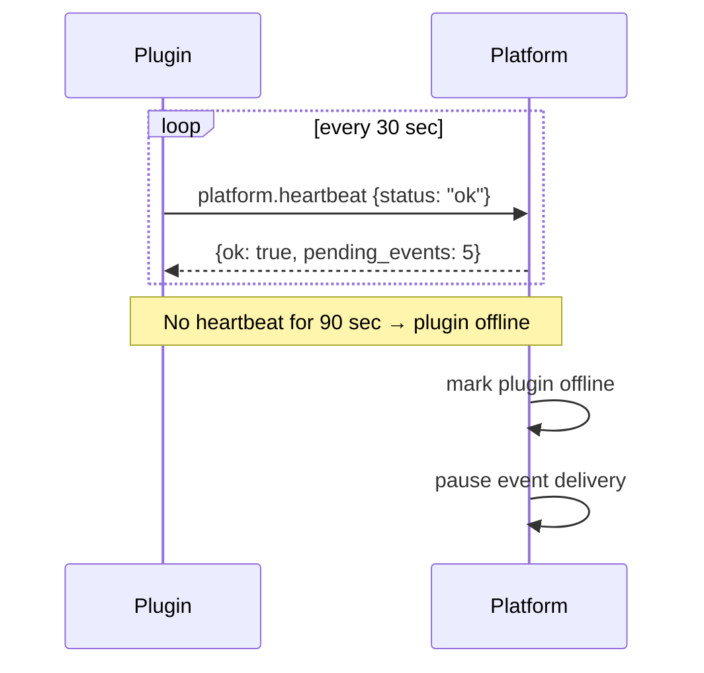

## External Plugin End-to-End Flow

Complete interaction flow for the Python temperature-alert plugin: registration,
config apply, telemetry ingest, threshold check, and RPC dispatch.

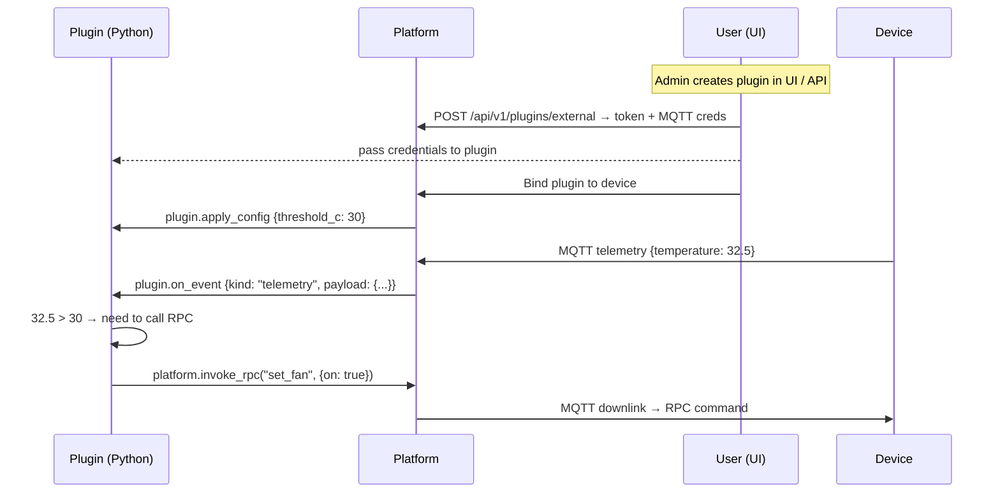

## External Plugin Lifecycle

Full lifecycle from plugin process start through registration, heartbeat,
binding, device events, apply, offline detection, and detach.

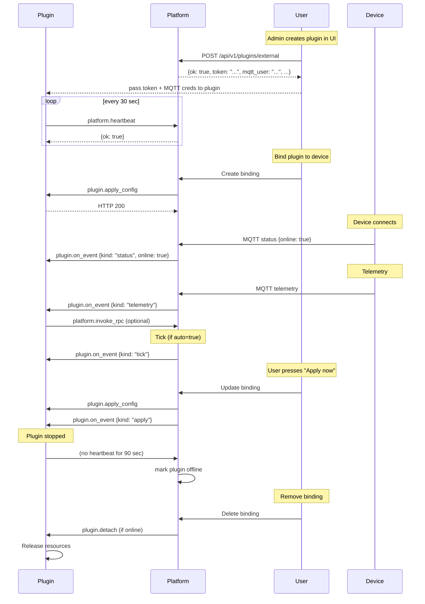

## Internal Plugin Architecture

In-process plugin architecture showing how device MQTT events flow through ingest
and PluginHub to per-binding runners, and how the dashboard manages bindings.

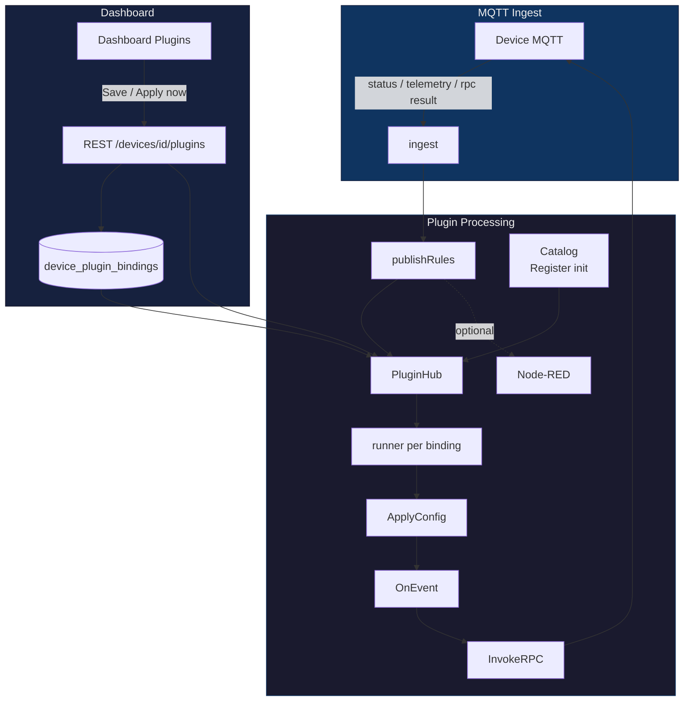

## Internal Plugin Lifecycle

Sequence diagram showing the lifecycle of an internal plugin runner: device
connect/disconnect, tick loop, apply on save, and RPC dispatch.

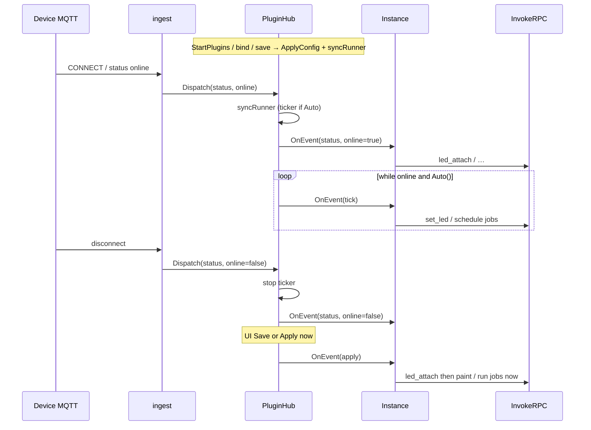

## Multi-Account Architecture

> Source: [16-multi-account.md](16-multi-account.md#71-общая-схема)

High-level view of the multi-tenant release: shared broker with per-username
ACL, account-scoped resources, catalog plugins (including the new
`prometheus-exporter` and `metrics-dashboard`), and a per-account policy table
that controls catalog plugins.

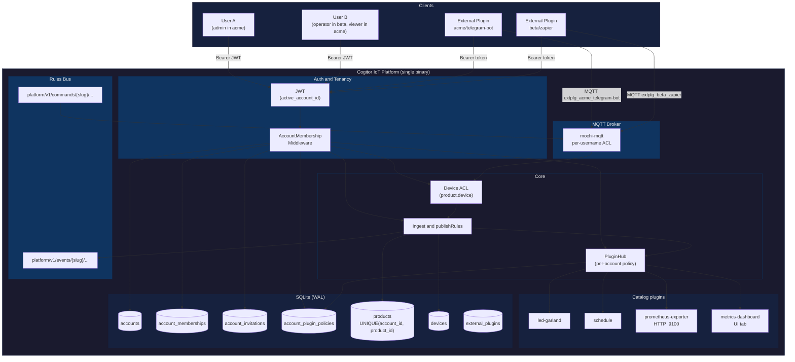

## Invitation Flow

> Source: [16-multi-account.md](16-multi-account.md#53-приглашения)

End-to-end invitation lifecycle: admin creates, recipient accepts (logged-in or
fresh registration), membership appears, JWT carries the new active account.

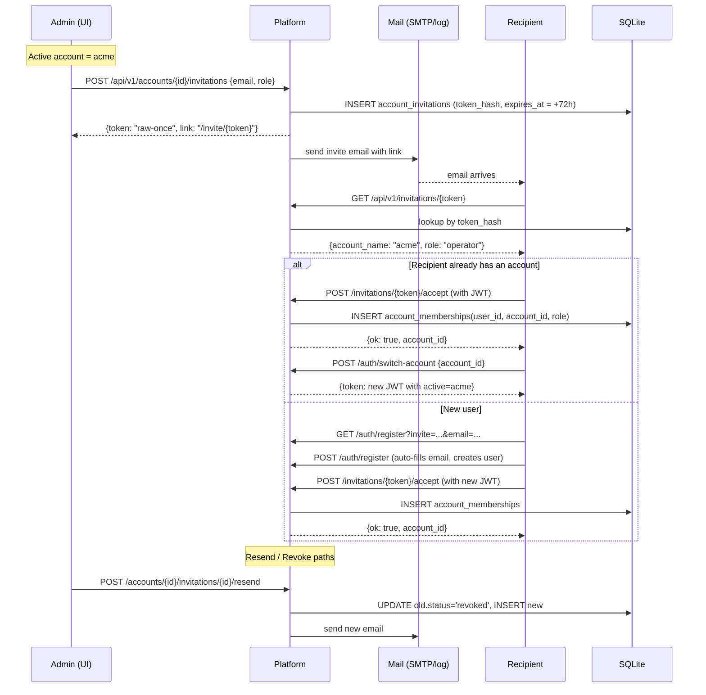

## External Plugin Account ACL

> Source: [16-multi-account.md](16-multi-account.md#56-внешние-плагины-account-scoping)

External plugin registration, MQTT credential issuance, and the ACL check
that prevents cross-account subscription or publish.

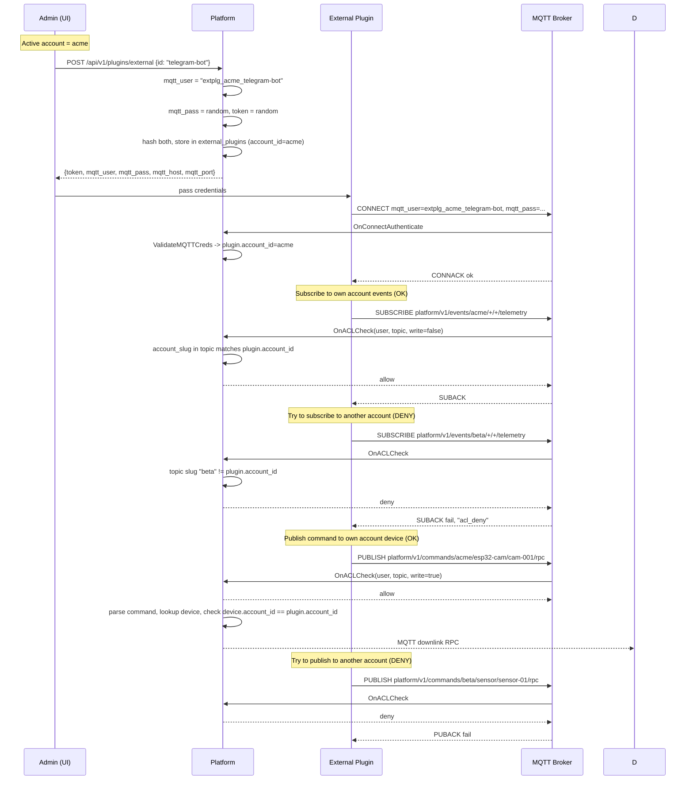

## Prometheus Exporter Lifecycle

> Source: [16-multi-account.md](16-multi-account.md#59-внутренний-плагин-prometheus-exporter)

How the `prometheus-exporter` catalog plugin starts an HTTP server when a
binding is enabled, exposes Prometheus text with `account` labels, and shuts
down when the per-account policy disables it.

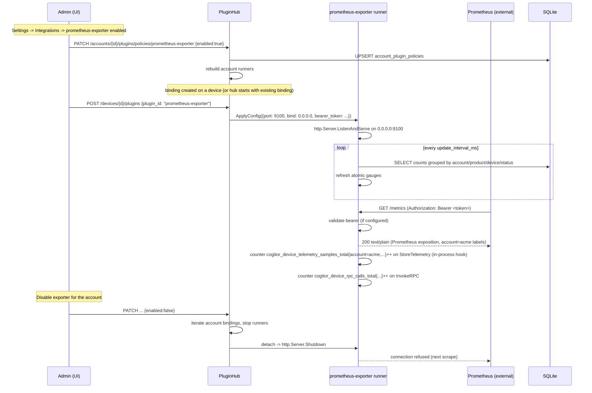

## Internal Plugin Policy

> Source: [16-multi-account.md](16-multi-account.md#58-управление-внутренними-плагинами)

How `account_plugin_policies` controls catalog plugin runners per account,
including dispatch, tick, and account deletion cleanup.

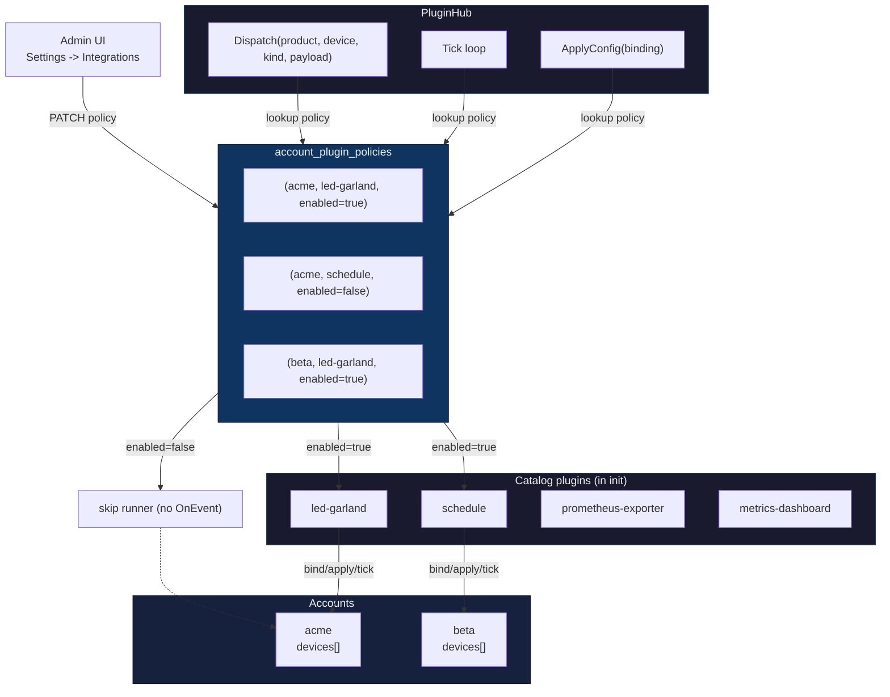
