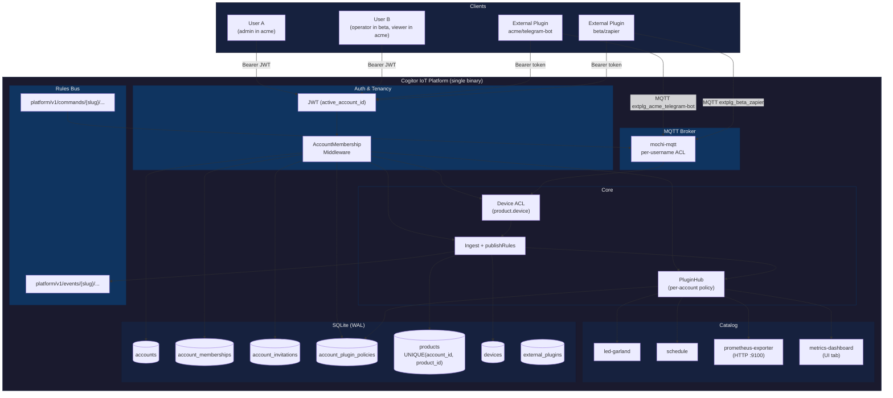
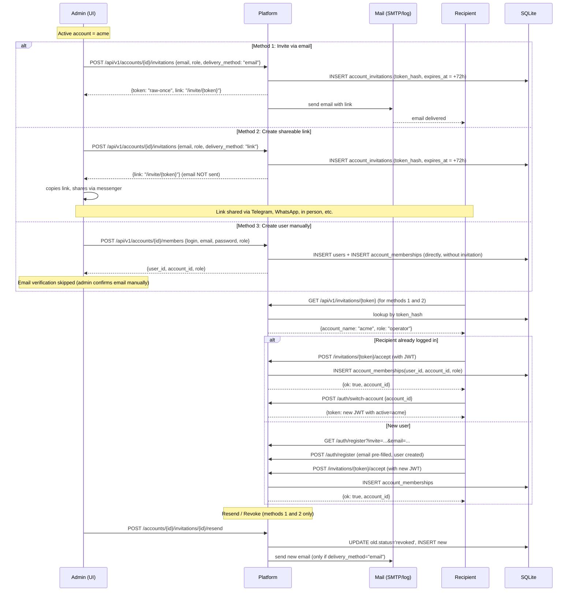
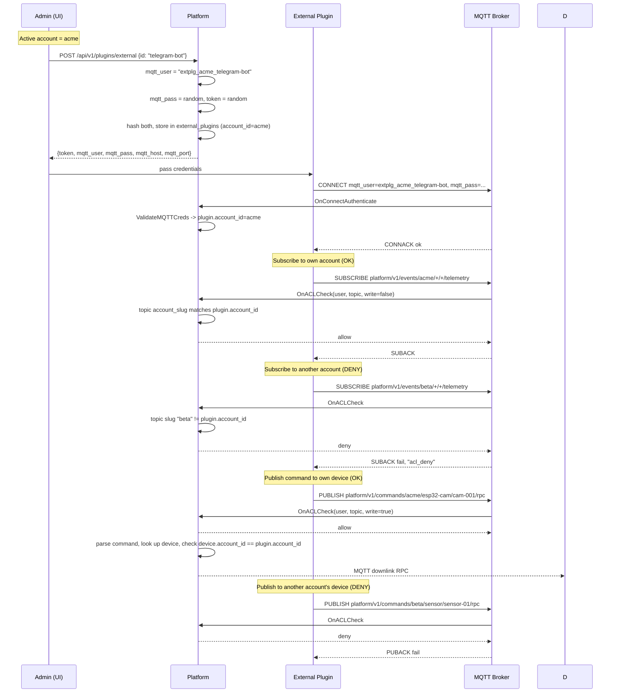
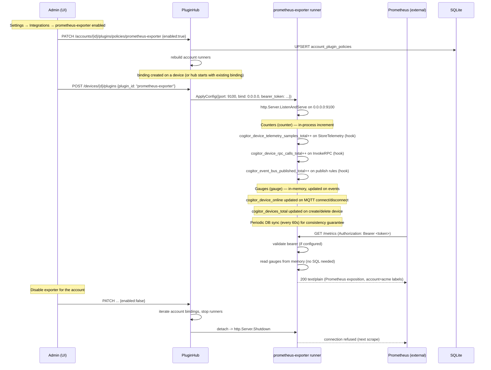
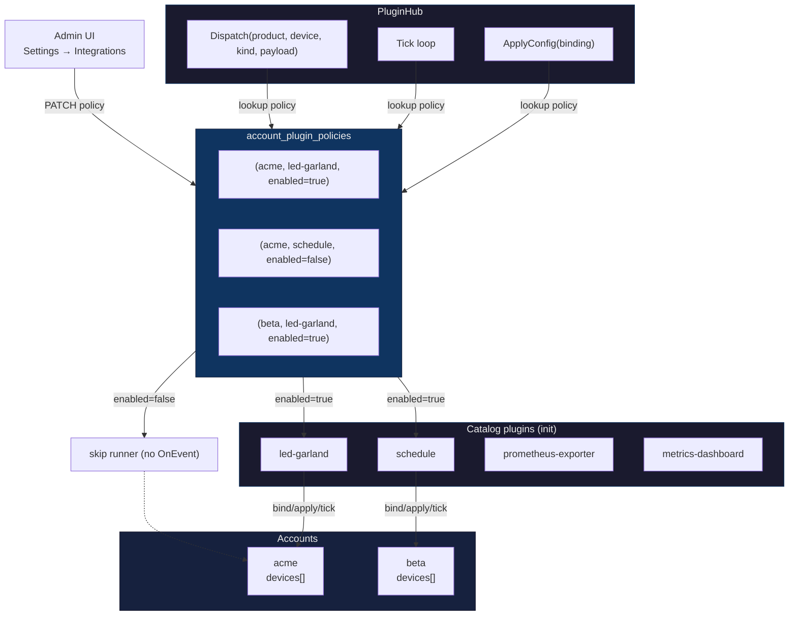

# Multi-Account & Built-in Monitoring — Product Requirements

| Field | Value |
|-------|-------|
| **Document version** | 1.2 |
| **Platform version** | v1.x (see [§4.5 Release plan](#45-release-plan--stages)) |
| **Status** | Draft → Active |
| **Updated** | 13.09.2026 |
| **Scope** | adding multi-tenant isolation, IAM roles, monitoring plugins, and catalog plugin management to the current single-tenant distribution |
| **Canonical version** | this document is maintained in Russian; English ([ru/16-multi-account.md](../ru/16-multi-account.md)) is the source of truth |

This document defines the next major release of the platform: **multi-account tenancy** with role-based access, a new system MQTT topic layout, and built-in monitoring (Prometheus). The release is additive — recreating the DB and configuration on transition is acceptable (no migration utilities are provided).

Related docs: [01-prd](01-prd.md), [02-api](02-api.md), [03-auth](03-auth.md), [04-mqtt](04-mqtt.md), [07-internal-plugins](07-internal-plugins.md), [08-external-plugins](08-external-plugins.md), [11-operations](11-operations.md).

---

## 0. What changes in one page

- A new **Account** entity appears; all per-account resources get `account_id NOT NULL`.
- **One user** can belong to multiple accounts with different roles (`admin` / `operator` / `viewer`).
- **External plugins** are tightly bound to an account — `mqtt_user = extplg_{account_slug}_{plugin_id}`, ACL narrows to `platform/v1/{events|commands}/{account_slug}/#`.
- **System topics** on the rules bus get `account_slug` (hard break). **Device topics `iot/v1/...` and `v1/...` do not change** — devices are unaware of accounts (see [§5.7.1](../ru/16-multi-account-requirements.md#571-что-не-меняется-в-топиках-устройств)).
- **Built-in monitoring**: catalog plugins `prometheus-exporter` (HTTP `/metrics`) and `metrics-dashboard` (UI template).
- **Catalog plugin management** at the account level via `account_plugin_policies`.
- **Database**: support for two drivers — `sqlite` (default) and `postgres`. Driver is selected via `DATABASE_DRIVER` + `DATABASE_DSN`.
- **First-install wizard** (full) — `/setup` is available while `accounts` is empty; `.env` is optional.
- **Versioning**: the release is split into stages v1.0…v1.6 (single mode). HA/clustering is a separate v2.x release, see [17-ha-architecture.md](17-ha-architecture.md).
- **HA / clustering** — explicitly v2, out of scope for this document. v1 is designed with future HA in mind (see NF-19) but only implements single-instance. Details — [17-ha-architecture.md](17-ha-architecture.md).
- **Automation page** — deprecated; replaced by Node-RED integration documentation + inline help in the UI.
- **UI modernization** — visual style update, keeping the mobile-first approach.

---

## 1. Vision

The platform remains **one Go binary, one SQLite database, and one MQTT broker**, but now serves multiple **isolated accounts** (tenants). Each account owns its own products, devices, firmware, audit trail, and settings. A user with one login can belong to multiple accounts with a different role in each. External plugins (Node-RED, gRPC, webhook) are tightly scoped to the account that registered them and physically cannot read another tenant's data.

On top of tenancy we add:

- **Built-in monitoring**: two new catalog plugins — `prometheus-exporter` (scrape endpoint for an external Prometheus) and `metrics-dashboard` (template for visualising device metrics inside the dashboard).
- **Catalog plugin management** at the account level — an admin can disable any catalog plugin and the platform stops creating runners and ACL events for devices in that account.

The guiding principle of this release: **no migrations, no dual-write**. This is a fresh initial schema. Upgrading from a single-tenant install means recreating the database manually (the project is still at prototype stage).

---

## 2. Problem Statement

| Pain point | Current state | What changes |
|------------|---------------|--------------|
| One self-hosted deployment = one tenant. Multi-client / multi-site / production + test setups need isolation | All resources shared, no separation, UI operates on everything | New **Account** entity; all resources (`products`, `devices`, `external_plugins`, `ota_firmwares`, `audit_log`, telemetry, …) get `account_id` |
| Cannot separate warehouse operator and lab operator | Only global roles `admin/operator/viewer` | Same three roles, but **per account**; one user can be admin in one account and viewer in another |
| External plugin (Node-RED / gRPC / webhook) sees every event on the platform | ACL only `platform/v1/events/#` and `platform/v1/commands/#` | Topics get `account_slug` right after the root; ACL narrows to `platform/v1/events/{account_slug}/#` |
| No `/metrics` and no Prometheus integration | None | New catalog plugin `prometheus-exporter` exposes HTTP `/metrics` (Prometheus text format) with `account`, `product`, `device` labels |
| Catalog plugins are always on, even for accounts that don't want background ticks | No toggle | Per-account policy `account_plugin_policies` — admin can disable any catalog plugin in their account |
| No built-in template for device "metrics dashboard" pages | Only standard `Metrics` + `Events` | New catalog plugin `metrics-dashboard` adds customisable panels (telemetry charts, RPC history, online timeline) to a device page |

---

## 3. Target Users

### 3.1 Primary — multi-tenant deployment operator
- Serves a self-hosted platform to multiple internal teams or commercial customers.
- Wants to issue **email invitations** and not think about separate databases.
- Wants a **shared health view** (via Prometheus) but no access to tenant data.

### 3.2 Secondary — corporate operator inside one account
- 10–200 devices on site, 3–10 operators of varying levels.
- Needs admin/operator/viewer **inside** the account; no global rights required.
- Wants in-built graphs (instead of "open Grafana").

### 3.3 Tertiary — AI/LLM agent
- Access to the platform **only via JWT token** (the token carries user info: `user_id`, `accounts[]`, `active_account_id`).
- MCP tools must accept an `account_id` parameter (default = active) and refuse if the user does not have membership in that account.
- AI/LLM agents have no separate authentication mechanism — standard API tokens or user-issued JWTs are used.

### 3.4 Unchanged
- Devices (ESP32 and friends). From the device side the platform remains "one MQTT broker + one token", transparent to firmware.

---

## 4. Goals & Success Metrics

| Goal | Metric | Target |
|------|--------|--------|
| Account isolation | `404` on cross-account device access | 100% denials on ACL integration tests |
| Invite latency | `POST /accounts/{id}/invitations` → response | < 200 ms to return token |
| Invite acceptance | `POST /invitations/{token}/accept` → JWT with active account | < 1 s |
| Account switching | `POST /auth/switch-account` → new JWT | < 100 ms (no DB hit when membership is cached) |
| Topic isolation | Cross-account `acl_deny` | 100% denials on `subscribe platform/v1/events/other_account/#` |
| Scrape latency | `/metrics` response time at 1k devices | < 250 ms (P95) |
| Minimal footprint | Additional processes | 0 (everything in-process) |

---

## 4.5 Release Plan / Stages

The release is split into **stages v1.0…v1.6** plus an explicitly separate **v2 (HA / cluster)**. Each stage has an **entry criterion** (what must be done before starting) and an **exit criterion** (what counts as done). Stages run sequentially, but within a stage work proceeds in parallel (by feature).

| Version | Theme | Key F-IDs | Exit criterion |
|---------|-------|-----------|----------------|
| **v1.0** | **DB foundation + bootstrap** | F-101, F-102, F-104…F-106, F-1301…F-1306, F-1401…F-1412 | Clean install via wizard brings up the platform; SQLite and Postgres pass the same smoke test; DB has one `default` account with an admin |
| **v1.1** | **Auth + Tenancy** | F-201…F-208, F-401…F-407, F-501…F-507, F-108 | All listing endpoints filter by `account_id`; cross-account access = `404`; account switcher in UI works; JWT contains `active_account_id` |
| **v1.2** | **External plugin ACL + system topics** | F-601…F-606, F-701…F-703, F-705, F-706 | `mqtt_user = extplg_{slug}_{id}`; ACL in `internal/mqtt/hook.go` narrowed to `platform/v1/{events\|commands}/{slug}/#`; cross-account → `acl_deny`; `flows.json` updated |
| **v1.3** | **IAM + Invitations** | F-301…F-311 | `POST /invitations` → email → `accept` → membership; resend/revoke work; last-admin protection; **manual user creation** (no email); **shareable link** (messenger sharing) |
| **v1.4** | **Catalog plugin management** | F-801…F-806 | `account_plugin_policies` drives the hub; `PATCH /policies/{pluginId}` applies on the fly; UI Settings → Integrations |
| **v1.5** | **Monitoring** | F-901…F-908, F-1001…F-1010 | `prometheus-exporter` serves metrics; `metrics-dashboard` renders a tab on the device page; scrape config published |
| **v1.6** | **Polish + docs + UI** | F-107, F-1101…F-1106, F-1201…F-1205, F-1501…F-1505, NF-10…NF-12, NF-22…NF-24 | `audit_log` with `actor_kind`; UI pages (Members, Invitations, Account Settings) polished; Automation page removed, replaced by documentation + inline help; UI modernized (NF-22..24); 02/03/04/06/07/08/11 updated; examples/plugins/* for new topics |

**HA/Clustering (v2.x)** — a separate release, not in scope of this document. See [17-ha-architecture.md](17-ha-architecture.md).

**Stage transition rules:**

1. Each stage ends with a **review checkpoint** (PR labelled `multi-account/v1.x`) and a CHANGELOG entry.
2. **Documentation updates go in the same PR** as the code (NF-12).
3. **Tests grow with the feature**: unit (isolation, ACL, validators) + integration (smoke for both DB drivers) + manual checklist.
4. **No carry-over**: if something from a stage is not done — it moves to `Backlog / v1.x+1` and does not block the release.
5. **v1.6 completes single mode**. After v1.6 we do a retro and write/update a separate PRD for v2 (see [17-ha-architecture.md](17-ha-architecture.md)).

**Backlog / candidates for v1.x+1 (between v1.6 and v2.0):**

- Custom RBAC (per-account custom roles on top of the built-in three)
- Account-level feature flags
- Account import/export (JSON)
- Per-account API rate limiting (no Redis — local)
- Webhook signing per-account (HMAC secret per account)
- Per-account data retention override

---

## 5. Functional and Non-Functional Requirements

Detailed F-xxx and NF-xxx tables are in a separate document (Russian only): **[16-multi-account-requirements.md](../ru/16-multi-account-requirements.md)** (≈ 280 lines of tables). Below is only the navigation by groups to show which IDs cover which subsystems.

| Subsystem | Section in sub-doc | ID range |
|-----------|-------------------|----------|
| Account entity | [§5.1](../ru/16-multi-account-requirements.md#51-сущность-account) | F-101…F-108 |
| Membership (multi-account users) | [§5.2](../ru/16-multi-account-requirements.md#52-membership-multi-account-пользователи) | F-201…F-208 |
| Invitations (email, shareable link, manual create) | [§5.3](../ru/16-multi-account-requirements.md#53-приглашения) | F-301…F-311 |
| Resource isolation (REST, WS, MCP) | [§5.4](../ru/16-multi-account-requirements.md#54-изоляция-ресурсов) | F-401…F-406 |
| IAM: JWT and authorisation | [§5.5](../ru/16-multi-account-requirements.md#55-iam-jwt-и-авторизация) | F-501…F-507 |
| External plugins: account-scoping | [§5.6](../ru/16-multi-account-requirements.md#56-внешние-плагины-account-scoping) | F-601…F-606 |
| System topics (rules bus + what does not change) | [§5.7](../ru/16-multi-account-requirements.md#57-системные-топики-платформы-правила) | F-701…F-706 |
| Catalog plugin management (policy) | [§5.8](../ru/16-multi-account-requirements.md#58-управление-внутренними-плагинами) | F-801…F-806 |
| Plugin `prometheus-exporter` | [§5.9](../ru/16-multi-account-requirements.md#59-внутренний-плагин-prometheus-exporter) | F-901…F-908 |
| Plugin `metrics-dashboard` (UI template) | [§5.10](../ru/16-multi-account-requirements.md#510-внутренний-плагин-metrics-dashboard-шаблон-визуализации) | F-1001…F-1010 |
| Dashboard / account switcher | [§5.11](../ru/16-multi-account-requirements.md#511-дашборд) | F-1101…F-1106 |
| Account deletion | [§5.12](../ru/16-multi-account-requirements.md#512-удаление-аккаунта) | F-1201…F-1205 |
| DB driver (SQLite and Postgres) | [§5.13](../ru/16-multi-account-requirements.md#513-драйвер-бд-sqlite-и-postgres) | F-1301…F-1311 |
| First-install wizard (`/setup`) | [§5.14](../ru/16-multi-account-requirements.md#514-мастер-первой-установки) | F-1401…F-1414 |
| Automation page: deprecation + documentation | [§5.15](../ru/16-multi-account-requirements.md#515-automation-page-депрекейс--документация-node-red) | F-1501…F-1505 |
| Non-functional requirements | [§6](../ru/16-multi-account-requirements.md#6-нефункциональные-требования) | NF-01…NF-24 |

**ID conventions:**

- `F-1xx` — Account / membership; `F-2xx` — Auth & tenancy; `F-3xx` — invitations; `F-4xx` — resource isolation; `F-5xx` — IAM/JWT; `F-6xx` — external plugins; `F-7xx` — system topics; `F-8xx` — internal plugin policy; `F-9xx` — `prometheus-exporter`; `F-10xx` — `metrics-dashboard`; `F-11xx` — dashboard UI; `F-12xx` — account deletion; `F-13xx` — DB drivers; `F-14xx` — setup wizard; `F-15xx` — automation page.
- `NF-01..06` — isolation / security; `NF-07` — performance; `NF-08..10` — config / observability; `NF-11..24` — UI / DB / HA-readiness / inline help.
- Removed IDs: `F-103` (v1.1), `F-704` (v1.1) — explicitly noted in the sub-doc.

**PR rule:** new F-IDs go into the sub-doc; the main document only mentions the range (e.g. `F-9xx` for a new plugin). This keeps the main PRD at ≈ 700 lines rather than turning it into a task catalogue.

---

## 7. Architecture

> **Diagrams**: see §7 below (inline Mermaid diagrams)

### 7.1 Overall layout



### 7.2 Data flow (with tenancy)

1. **Login**: user sends `POST /auth/login` → platform verifies password → reads all `memberships` → returns JWT with `accounts[]` and `active_account_id=first_admin_or_first`.
2. **API request**: `GET /devices/42` with `Authorization: Bearer ...` and `X-Account-Id: 7` → middleware checks `membership(user, 7, active)` → handler reads `device` → checks `device.account_id == 7` → 200.
3. **Device → platform**: `CONNECT` with `username=esp32-cam.cam-001`, `password=<token>`. `OnConnectAuthenticate` calls `deviceFor(user)` → `ResolveByToken` → finds device → takes `product.account_id` → ACL scoped to `iot/v1/{product}/{device}/...`. Account is transparent to the device.
4. **Publish telemetry** → `Ingest` → `StoreTelemetry` (account_id from device) → `publishRules(account.slug, product, device, kind)` → MQTT `platform/v1/events/{account_slug}/{product}/{device}/{kind}`. Topic contains `account_slug` — an external plugin from another account cannot subscribe via ACL.
5. **RPC call to device**: platform generates a UUID for `request_id`, stores `{request_id → HTTP channel}` in memory (with timeout), publishes the command to MQTT with `id = request_id` (JSON-RPC standard). Device copies `id` from request to response. Platform matches the response to the pending request by `request_id` and sends the HTTP response to the client. Details: [04-mqtt.md → RPC](04-mqtt.md#rpc), [17-ha-architecture.md → §3.2](../ru/17-ha-architecture.md#32-маршрутизация-команд-и-корреляция-ответов).
6. **External plugin (polling)**: `POST /api/plugins/external/rpc` with token `extplg_acme_telegram-bot` → `ValidateToken` → `plugin.account_id = 1` → `platform.invoke_rpc` → middleware `RequireAccount(account_id=1)` → handler checks `device.account_id == 1` → 200. Cross-account → 403.
7. **SSE**: `GET /api/v1/events/stream?token=...` with active account 7 → Hub subscribes the SSE connection to filter `account_id=7` → events from other accounts never arrive. Browser natively reconnects via `Last-Event-ID`; HTTP-based, no sticky sessions.
8. **Prometheus scrape**: external Prometheus with job `{account: "acme", scrape_url: "http://platform:9100/metrics"}` — each account gets its own port (`prometheus-exporter` starts an instance on the binding-defined port, all metrics labelled `account="acme"`).

### 7.3 Invitation Flow

Three methods of adding users to an account are supported:
1. **Invite via email** — sending an email with a link
2. **Create shareable link** — generating a link for sharing via messenger
3. **Create user manually** — direct user creation (without invitation)



### 7.4 External Plugin Account ACL



### 7.5 Prometheus Exporter Lifecycle

Metrics fall into two types:
- **Counters** — incremented in-process on events (`StoreTelemetry`, `InvokeRPC`, etc.) via atomic operations of the Prometheus client. No SELECT queries needed.
- **Gauges** — maintained in memory and updated on events:
  - `cogitor_device_online` — updated on MQTT connect/disconnect (the platform tracks device online status)
  - `cogitor_devices_total` — updated on device create/delete
  - **Periodic DB sync** (every 60 seconds) — to guarantee consistency after restart or desync. At scrape time Prometheus reads values from memory — no SQL queries are executed.



### 7.6 Internal Plugin Policy



### 7.7 HA-readiness (contract with v2)

v1 is single-instance. But several v1 architectural decisions are already made so as not to block the transition to HA in v2. Full list — in [17-ha-architecture-requirements.md](../ru/17-ha-architecture-requirements.md#5-функциональные-требования-ha-specific).

**Key v1 invariants for v2 (must not violate):**

- ❌ Writing `db.QueryRow(... fmt.Sprintf("WHERE id=%d", id) ...)` — must use `Rebind`/parameterised queries
- ❌ Using `goroutine + time.Sleep` for retry without context — everything through `context.Context`
- ❌ Storing `account_id` in JWT without `accounts[]` claim — need the full list
- ❌ Global mutexes on per-account data
- ❌ Assuming `mochi-mqtt` is the only broker. `Broker` interface from the start

**Documented v1 compromises** (explicit):

- `goroutine leak` in in-memory caches — accepted as known issue until v2 (metric in `/internal/cache` shows leak rate)
- No `circuit breaker` on DB writes — not needed in single-instance
- `audit_log` without rate limit — OK in single-instance, in v2 we'll need to add a batcher

---

## 8. Data Model (new tables)

```sql
-- Accounts (tenants)
CREATE TABLE accounts (
    id           INTEGER PRIMARY KEY AUTOINCREMENT,
    slug         TEXT NOT NULL UNIQUE,
    name         TEXT NOT NULL,
    settings_json TEXT NOT NULL DEFAULT '{}',
    status       TEXT NOT NULL DEFAULT 'active' CHECK(status IN ('active','suspended')),
    created_at   INTEGER NOT NULL,
    updated_at   INTEGER NOT NULL
);

-- Per-account user membership
CREATE TABLE account_memberships (
    user_id     INTEGER NOT NULL REFERENCES users(id) ON DELETE CASCADE,
    account_id  INTEGER NOT NULL REFERENCES accounts(id) ON DELETE CASCADE,
    role        TEXT NOT NULL CHECK(role IN ('admin','operator','viewer')),
    status      TEXT NOT NULL DEFAULT 'active' CHECK(status IN ('active','disabled')),
    joined_at   INTEGER NOT NULL,
    invited_by  INTEGER REFERENCES users(id) ON DELETE SET NULL,
    PRIMARY KEY(user_id, account_id)
);
CREATE INDEX idx_memberships_account ON account_memberships(account_id, status);

-- Email invitations
CREATE TABLE account_invitations (
    id          INTEGER PRIMARY KEY AUTOINCREMENT,
    account_id  INTEGER NOT NULL REFERENCES accounts(id) ON DELETE CASCADE,
    email       TEXT NOT NULL,
    role        TEXT NOT NULL CHECK(role IN ('admin','operator','viewer')),
    token_hash  TEXT NOT NULL UNIQUE,
    token_prefix TEXT NOT NULL,
    invited_by  INTEGER NOT NULL REFERENCES users(id),
    status      TEXT NOT NULL DEFAULT 'pending' CHECK(status IN ('pending','accepted','revoked','expired')),
    expires_at  INTEGER NOT NULL,
    created_at  INTEGER NOT NULL,
    accepted_at INTEGER,
    accepted_user INTEGER REFERENCES users(id)
);
CREATE INDEX idx_invitations_account ON account_invitations(account_id, status);
CREATE INDEX idx_invitations_email ON account_invitations(email);

-- Per-account policy for catalog plugins
CREATE TABLE account_plugin_policies (
    account_id    INTEGER NOT NULL REFERENCES accounts(id) ON DELETE CASCADE,
    plugin_id     TEXT NOT NULL,
    enabled       INTEGER NOT NULL DEFAULT 1,
    settings_json TEXT NOT NULL DEFAULT '{}',
    updated_at    INTEGER NOT NULL,
    PRIMARY KEY(account_id, plugin_id)
);

-- Per-account API tokens
ALTER TABLE api_tokens ADD COLUMN account_id INTEGER REFERENCES accounts(id) ON DELETE CASCADE;

-- Account_id propagation: add column to all per-account tables
-- Existing rows get account_id=1 (default account)
ALTER TABLE products        ADD COLUMN account_id INTEGER NOT NULL DEFAULT 1 REFERENCES accounts(id) ON DELETE CASCADE;
ALTER TABLE external_plugins ADD COLUMN account_id INTEGER NOT NULL DEFAULT 1 REFERENCES accounts(id) ON DELETE CASCADE;

-- Replace UNIQUE(product_id) on products with UNIQUE(account_id, product_id)
-- (migrated by convert-to-multi-account; new installs start with the new shape)

-- users: platform-admin flag for super-admins
ALTER TABLE users ADD COLUMN is_platform_admin INTEGER NOT NULL DEFAULT 0;
```

> **Existing tables** (`devices`, `events`, `device_logs`, `telemetry_samples`, `rpc_calls`, `attribute_history`, `device_attributes_*`, `ingest_dedup`, `device_credentials`, `ota_firmwares`, `ota_jobs`, `audit_log`) get `account_id NOT NULL` via the migration that ships with `convert-to-multi-account`. Fresh installs start with the column.

---

## 9. API Changes (summary)

| Group | Endpoints | Note |
|-------|-----------|------|
| Auth | `POST /auth/login` — now returns `accounts[]` and `active_account_id` | breaking for clients parsing the old shape — `/api/v1` minor version stays |
| | `POST /auth/switch-account` `{account_id}` → new JWT | new |
| | `POST /auth/refresh` — re-issues a JWT with the same `active_account_id` (no refresh tokens, reuse current until expiry) | new |
| | `GET /me` — extended | new fields |
| | `GET /auth/config` — unchanged | |
| Accounts | `GET /accounts` — list available to the user (or all for platform-admin) | new |
| | `POST /accounts` — platform-admin: create account | new |
| | `GET /accounts/{id}` | new |
| | `PATCH /accounts/{id}` — admin/operator (operator — name only) | new |
| | `DELETE /accounts/{id}?force=true` — platform-admin | new |
| Members | `GET /accounts/{id}/members` | new |
| | `PATCH /accounts/{id}/members/{userId}` `{role?, status?}` | new |
| | `DELETE /accounts/{id}/members/{userId}` | new |
| Invitations | `GET /invitations/{token}` (public) | new |
| | `POST /invitations/{token}/accept` | new |
| | `GET /accounts/{id}/invitations` | new |
| | `POST /accounts/{id}/invitations` `{email, role}` | new |
| | `POST /accounts/{id}/invitations/{id}/resend` | new |
| | `DELETE /accounts/{id}/invitations/{id}` | new |
| Plugin policies | `GET /accounts/{id}/plugins/policies` | new |
| | `PATCH /accounts/{id}/plugins/policies/{pluginId}` `{enabled?, settings?}` | new |
| Existing | `GET/POST/PUT/DELETE /products`, `/devices`, … — all require `X-Account-Id` (or take it from JWT active) and verify account scope; `?account_id=` query is supported for platform-admin | all breaking |
| MCP | Each list/get tool gains an `account_id` parameter (optional, default — active) | minor |
| SSE (real-time) | `GET /api/v1/events/stream?token=...&account_id=<active>` — `text/event-stream`, filtered by account, HTTP-based, auto-reconnect via `Last-Event-ID` | extension |

Full endpoint list and request/response shapes are in [02-api.md](02-api.md) (addendum).

---

## 10. Configuration

### New environment variables

| Variable | Default | Purpose |
|----------|---------|---------|
| `DATABASE_DRIVER` | auto (see F-1301) | `sqlite` or `postgres` |
| `DATABASE_DSN` | `data/platform.db` | DSN: file path (sqlite) or URL (postgres) |
| `BOOTSTRAP_ACCOUNT_SLUG` | `default` | Slug of the account created by the wizard (F-1404) or bootstrap logic (F-102) |
| `BOOTSTRAP_ACCOUNT_NAME` | `Default` | Display name |
| `INVITE_TTL_HOURS` | `72` | Invitation TTL |
| `WIZARD_AUTO_DISABLE` | `true` | Whether to disable the `/setup` route after first Apply (F-1401) |
| `PROMETHEUS_EXPORTER_DEFAULT_PORT` | `9100` | Default port for the plugin |
| `WIZARD_WRITE_ENV` | `false` | If `true` — Apply also writes config to `.env` (F-1413) |
| `DB_STATEMENT_TIMEOUT_MS` | `30000` | Postgres `statement_timeout` (sqlite ignores it) |
| `DB_MAX_OPEN_CONNS` | `8` | For postgres — connection pool; for sqlite — ignored (always 1 writer) |

### Removed / deprecated

| Variable | Status | Alternative |
|----------|--------|-------------|
| `RULES_BUS_INCLUDE_LEGACY_PREFIX` | **Removed in v1.1** | — (hard break, see F-704) |
| `CONVERT_TO_MULTI_ACCOUNT` | **Removed in v1.1** | — (no utility, DB is recreated manually) |
| `REGISTER_DEFAULT_ROLE` | Kept, but **only** for the bootstrap account | New accounts get the role from the invitation (F-303) |
| `ADMIN_LOGIN`, `ADMIN_PASSWORD`, `ADMIN_EMAIL` | Kept but **optional** | If set — Step 2 of the wizard is pre-filled; if not — required UI field |

---

## 11. Bad Cases and Risks

### 11.1 Identity

| Case | Behaviour |
|------|-----------|
| User with JWT for active account A sends `X-Account-Id: B` | `403 account_mismatch` |
| User is a member in A and B; JWT `active=A`; `GET /devices/42` where device.account_id=B | `404 not_found` (entity does not exist in the active account) |
| User removed from account but JWT not yet expired; next request | `403 membership_inactive` (revocation check on every request) |
| Platform admin (`is_platform_admin=true`) requests another account | without `X-Account-Id` or with `X-Account-Id: <target>`; request is `actor_kind='platform_admin'`, audit |
| Two admins try to remove each other | both get `200`, but without the last admin → `409 last_admin` |
| Last admin leaves the account | `409 last_admin` — promote another user first or delete the account |
| Old-style refresh token (if any existed) | n/a — we do not introduce refresh; user logs in again on JWT expiry (TTL = 24h) |

### 11.2 Devices

| Case | Behaviour |
|------|-----------|
| Device connects with a valid token but its account is `suspended` | `auth_fail account_suspended` — the device is dropped (platform side); UI shows a banner |
| Device connects with a token but the device has been deleted | `auth_fail device_not_found` |
| Token rotation: device `foo` (account A) token flashed onto `bar` (account B) | `bar` tries to authenticate with username `bar` + password (token from `foo`) → `ResolveByToken` finds the `foo` device but username `bar` does not match `foo`'s `product.device` → `auth_fail` (fail-closed) |
| Cross-account ACL: external plugin account A publishes a command for a device in account B | `acl_deny` + `403` on `invoke_rpc` |
| Topic style differs per device, different accounts | `DetectStyle` inspects the topic, not the account — behaviour is unchanged |

### 11.3 External plugins

| Case | Behaviour |
|------|-----------|
| Plugin `extplg_acme_x` subscribes to `platform/v1/events/beta/y/telemetry` | `acl_deny` |
| Plugin `extplg_acme_x` subscribes to `platform/v1/events/acme/+/+` | `200` (OK) |
| Plugin `extplg_acme_x` publishes to `platform/v1/commands/beta/y/rpc` | `acl_deny` |
| Plugin API token used in HTTP RPC for a device in another account | `403 device_not_in_account` |
| Register a plugin with an `id` already taken in this account | `409 plugin_exists` (but another account may have a plugin with the same id) |
| MQTT password compromised | `POST /plugins/external/{id}/regenerate-mqtt` — old password is invalidated; existing MQTT session is disconnected |

### 11.4 Promotional / API

| Case | Behaviour |
|------|-----------|
| API token (per-account) used in another account | `403 token_account_mismatch` |
| SSE client: user connected, active account changed (new login) | old SSE session keeps the old filter until disconnect; new one uses the new filter. Browser reopens SSE with the new token automatically |
| Audit log overflow | 90-day retention for `audit_log` per account, separate from telemetry retention |
| Invitation token lost | resend; old token is revoked |
| Invitation token expired | UI/email marks it `expired`; cannot accept |
| Email collision: a user with email X exists, new invite to the same email | `409 user_exists`; link to "account already exists, log in and accept invite" — the invitation stays in the DB and is shown on login |
| Bootstrap admin: `ADMIN_LOGIN` already exists in `users` but is not bound to the bootstrap account | on first conversion start — bind the existing user to `default` with role `admin` |

### 11.5 Prometheus exporter

| Case | Behaviour |
|------|-----------|
| Admin disables `prometheus-exporter` in the active account via policy | HTTP server stops; scrape → `connection refused`; UI banner |
| Port is in use by another plugin / instance | `bind error: port already in use` log; runner is marked `last_error`; user must change port in config |
| Account B tries to scrape the endpoint of account A | nothing — each account has its own port; metrics are always labelled `account=acme` |
| Prometheus forgot the bearer token | `401` (if configured) — correct fail-mode |

### 11.7 Setup wizard

| Case | Behaviour |
|------|-----------|
| `accounts.count > 0`, user opens `/setup` | `404 setup_disabled` (route disabled) |
| Wizard open in two tabs simultaneously | Each tab has its own `localStorage`; if Apply succeeds in one — the other gets 404 on the next step. UI shows "Setup already completed, please log in" |
| Postgres DSN entered incorrectly (host does not resolve) | "Test connection" button shows error; next step disabled. After 30s timeout — UI shows "Connection timed out" |
| `JWT_SECRET` not set in env, wizard just reached Step 5, user closed the tab | On next visit to `/setup` — wizard starts from Step 1, secret is not saved (state in localStorage) |
| Admin chose slug `default` in wizard, but `BOOTSTRAP_ACCOUNT_SLUG=acme` in env | Env priority: wizard shows warning "env has different value, please update .env or accept default" |
| Email in Step 2 already taken in `users` | `409 user_exists`; UI suggests "Use existing account" (if login matches) or "Use different email" |
| Apply crashed on Step 8 (e.g. DB migration failed on constraint) | `setup_state.error=true`, logged in audit. Next Apply starts from scratch (idempotency via transaction: look at partial state, roll back) |
| Virtual Apply passed but platform crashed before writing `accounts` | On next start platform checks `accounts.count==0` → `/setup` is available again. No partial state in DB |
| Wizard runs over HTTPS, but `PUBLIC_BASE_URL=http://...` | UI highlights the mismatch; invite links are generated from PUBLIC_BASE_URL, not the current origin (important for reverse proxies) |
| SMTP Step skipped, but `EMAIL_MODE=smtp` in env | On attempt to send invite (F-301) — `500 smtp_not_configured`; UI instructs "Run setup again to configure SMTP" (but `/setup` is already disabled — manual fix via SQL: `UPDATE accounts.settings_json SET...`) |

### 11.8 Known limitations

- **Single-tenant SQLite** — all accounts share one DB. Backup is shared, restore is shared. Multi-DB isolation is out of scope.
- **MQTT broker** — one mochi-mqtt process serves all accounts. Namespace separation is at the ACL level. Horizontal scaling is out of scope.
- **Prometheus exporter** — in-process HTTP server; not reverse-proxy-friendly. If TLS is needed, proxy through `nginx`/`caddy`.
- **Invitations** — email only; per-account SSO (SAML/OIDC) is out of scope.
- **Account transfer** — none; delete + recreate.
- **Cross-account dashboards / shared devices** — out of scope.

---

## 12. Out of Scope (v1 of this release)

- Billing / quota
- Account hierarchy (parent/child, sub-accounts)
- Audit log export (SIEM)
- Per-account database (multi-DB)
- SAML / OIDC SSO per account
- Account transfer (merge / split)
- Cross-account dashboards
- WebSocket multi-account subscription (one SSE stream receiving events from multiple accounts) — in v1 SSE streams events for the active account only; multi-account SSE (one stream for all memberships) is out of scope

---

## 13. Acceptance Criteria

### 13.1 Tenancy

- [ ] First start on a clean DB creates the `default` account with one admin (env) and slug `default`
- [ ] The user sees a dropdown in the header with their accounts and can switch
- [ ] `GET /devices/42` for a device in another account returns `404`
- [ ] `GET /devices` filters the list by the active account
- [ ] Removing the last admin in an account returns `409 last_admin`
- [ ] An API token issued for account A is rejected in account B (`403 token_account_mismatch`)

### 13.2 Invitations

- [ ] `POST /accounts/{id}/invitations` creates a record and sends an email with link `{PUBLIC_BASE_URL}/invite/{token}`
- [ ] The link pre-fills the email on registration (`/auth/register?invite=...`)
- [ ] After `accept` the user immediately sees the account in the switcher
- [ ] Resend revokes the old token and sends a new one
- [ ] TTL defaults to 72h; expired token → `404 invite_not_found`
- [ ] **Manual creation**: `POST /accounts/{id}/members` with `{login, email, password, role}` creates a user directly (without invitation); email verification skipped
- [ ] **Shareable link**: when creating invitation with `delivery_method=link` — no email sent, link returned in response; admin copies and shares via messenger
- [ ] UI Settings → Members: three buttons — "Invite via email", "Create shareable link", "Create user manually" (admin-only)

### 13.3 External plugins and ACL

- [ ] `mqtt_user` has the form `extplg_{account_slug}_{plugin_id}`
- [ ] External plugin account A subscribes to `platform/v1/events/{slug_A}/#` — `200`
- [ ] External plugin account A subscribes to `platform/v1/events/{slug_B}/#` — `acl_deny`
- [ ] External plugin account A publishes to `platform/v1/commands/{slug_A}/{product}/{device}/rpc` — `200`
- [ ] External plugin account A publishes to `platform/v1/commands/{slug_B}/...` — `acl_deny`
- [ ] `platform.invoke_rpc` via the HTTP API of plugin account A on a device in account B — `403`
- [ ] Rules bus is published in the new format with `{account_slug}`; old rules in `flows.json` are updated

### 13.4 Catalog plugins / policy

- [ ] By default `account_plugin_policies` is empty, all catalog plugins work
- [ ] `PATCH /accounts/{id}/plugins/policies/led-garland {enabled:false}` stops runners; in `GET /devices/{id}/plugins` the plugin shows as `disabled`; `tick` events do not reach it
- [ ] `PATCH ... {enabled:true}` restarts the runner on the next online device
- [ ] `metrics-dashboard` shows the virtual "Metrics+" tab on the device page with the default template

### 13.5 Prometheus

- [ ] With `prometheus-exporter` active at `http://platform:9100/metrics` text is returned in Prometheus exposition format with an `account` label
- [ ] Metrics `cogitor_devices_total{account,product,status}` and `cogitor_device_online{account,product,device}` are maintained in memory, updated on events (create/delete, MQTT connect/disconnect); periodic DB sync (every 60s) for consistency guarantee
- [ ] `cogitor_device_telemetry_samples_total{account,product,device}` increments on every `StoreTelemetry`
- [ ] `bearer_token` in config — `Authorization: Bearer <token>` succeeds, missing header → `401`
- [ ] Admin disables exporter in account → scrape returns `connection refused`

### 13.6 Database (sqlite / postgres)

- [ ] `DATABASE_DRIVER=sqlite` with `DATABASE_DSN=data/platform.db` brings up the platform, runs migrations, `/setup` is available
- [ ] `DATABASE_DRIVER=postgres` with `DATABASE_DSN=postgres://...` brings up the platform, runs the same migrations, `/setup` is available
- [ ] `make smoke-sqlite` and `make smoke-postgres` are green; both create the same table structure
- [ ] `make migrate-up && make migrate-down && make migrate-up` on an empty DB — runs without errors
- [ ] `golang-migrate` advisory lock is visible in `pg_locks` during migration on postgres
- [ ] SQLite `WAL` file is created on first write; size is monitored via `cogitor_sqlite_wal_bytes`
- [ ] The same smoke test (devices publish → telemetry stored → ACL scope) passes on both drivers

### 13.7 Setup Wizard

- [ ] On a clean install `GET /setup` returns the SPA page with Step 1
- [ ] After `Apply` (Step 8) — `accounts.count > 0` → `GET /setup` returns `404`
- [ ] `Apply` with `DATABASE_DSN=postgres://...` creates the schema, admin user, default account in one transaction
- [ ] If `DATABASE_DRIVER` is set in env — Step 1 of the wizard is read-only, shows "Using existing config"
- [ ] If Apply crashed on Step 8 (constraint violation) — next Apply correctly rolls back partial state
- [ ] `platform setup --from-yaml=...` CLI fallback works identically to the web wizard
- [ ] All Apply attempts are written to `audit_log` with `actor_kind='setup'`

### 13.8 HA-readiness (for v2)

- [ ] All SQL queries are parameterised — `staticcheck` (or custom linter) finds 0 violations in `internal/services/`
- [ ] All `goroutine`s start via `context.Context` (no leaks on shutdown) — test in `internal/services/lifecycle_test.go`
- [ ] `services.ScopeAccount` is the single per-account filtering point (grep for `WHERE account_id` shows only this helper)
- [ ] `prometheus-exporter` exposes `cogitor_sqlite_wal_bytes`, `cogitor_db_open_connections`, `cogitor_db_in_use`

### 13.9 UI: Automation deprecation + modernization + inline help

- [ ] Route `/automation` removed from `App.tsx` and `AppShell.tsx` NAV array; `AutomationPage.tsx` deleted
- [ ] Page/section `/docs/automation` (or in Settings) contains a Node-RED integration guide: connecting to MQTT broker, topics `platform/v1/events/{account_slug}/...`, flows.json examples, troubleshooting
- [ ] Settings → "Automation & Integrations" (admin-only): brief description of the rules bus, link to documentation, "Copy MQTT topics" button
- [ ] Tooltips / help icons (ⓘ) present on admin-only actions: create external plugin, manage internal plugins (Integrations), invitations, account settings
- [ ] UI has undergone a visual refresh (NF-22): revised `theme.scss` — cards with shadows/rounded corners, improved contrast, consistent sizing
- [ ] All new pages (Setup Wizard, Members, Invitations, Integrations, Account Settings) render correctly on screens ≥ 360px (NF-23)
- [ ] `06-automation.md` updated: iframe description removed, step-by-step Node-RED guide with multi-account added

---

## 14. Future Improvements

**HA/Clustering (v2.x)** — fully moved to a separate document [17-ha-architecture.md](17-ha-architecture.md). Includes:

- **v2.0** — HA Foundation (cluster instance, worker, RabbitMQ, PostgreSQL, SSE)
- **v2.1** — `rabbitmq-bridge` plugin
- **v2.2** — Account-level features (custom RBAC, rate limiting, retention override)
- **v2.3+** — Multi-region DR, SSO, SIEM, plugin marketplace

**Backlog / candidates for v1.x+1 (after v1.6):**

- Custom RBAC (per-account custom roles)
- Account-level feature flags
- Account import/export (JSON)
- Per-account API rate limiting (local, no Redis)
- Webhook signing per-account (HMAC)
- Per-account data retention override
- Simple migration utility (single → cluster, devices/users/default plugins) — deferred
- Git labels/tags for version-marking tasks — deferred

**"We don't do this" principle (explicit list):**

These ideas have been **rejected** after discussion, recorded so we don't revisit them:

- ❌ **Multi-DB isolation (separate DB per account)** — operational nightmare, backups, migrations ×N. Not doing it.
- ❌ **Per-account sub-domain (`acme.platform.local`)** — DNS configuration is the user's responsibility; the platform has no right to impose this
- ❌ **Custom CSS / white-label** per account — out of product scope, handled at the reverse proxy level
- ❌ **Account-level plugin catalogue** (own set of plugins) — while catalog plugins are shared; custom plugins = external plugins (already available)
- ❌ **Embedded NATS** in the binary — adds complexity, rejected
- ❌ **Redis as middleware** — rejected, RabbitMQ covers all needs (see [17-ha-architecture.md](17-ha-architecture.md))

---

## 15. Related Documentation

| Doc | What |
|-----|------|
| [01-prd.md](01-prd.md) | Overall product PRD (updated: multi-tenancy moved from out-of-scope → implemented in this release) |
| [02-api.md](02-api.md) | REST API reference (will be extended with new endpoints) |
| [03-auth.md](03-auth.md) | Authentication (JWT claims, active account) |
| [04-mqtt.md](04-mqtt.md) | MQTT protocol (rules bus — new format) |
| [06-automation.md](06-automation.md) | Node-RED / rules bus (**update**: remove iframe description, add step-by-step multi-account integration guide, new topics with `{account_slug}`, ACL for external plugins) |
| [07-internal-plugins.md](07-internal-plugins.md) | Catalog + new plugins (prometheus-exporter, metrics-dashboard) |
| [08-external-plugins.md](08-external-plugins.md) | Account-scoped external plugins (mqtt_user format, ACL) |
| [11-operations.md](11-operations.md) | Operations (conversion, configuration) |
| [14-diagrams.md](14-diagrams.md) | All release diagrams (5 new) |
| [17-ha-architecture.md](17-ha-architecture.md) | **HA/Clustering architecture (v2.x)** — multi-instance, RabbitMQ, PostgreSQL, 3 binaries, **SSE (HTTP-based, not WebSocket)** |
