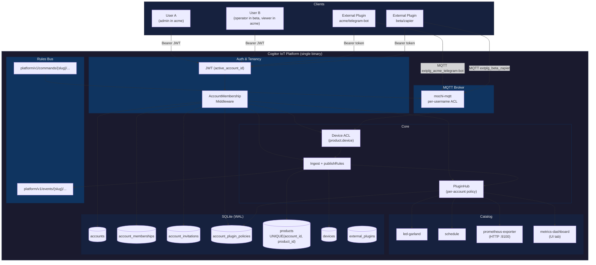
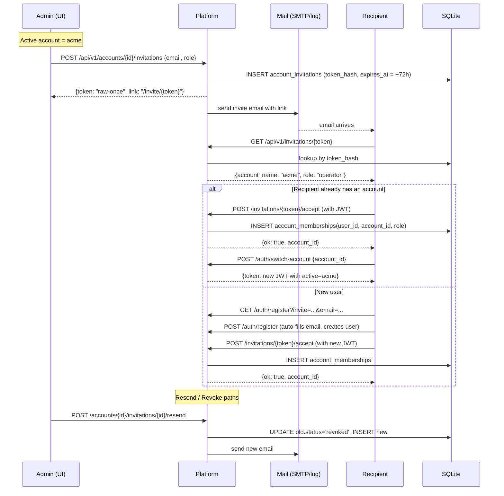
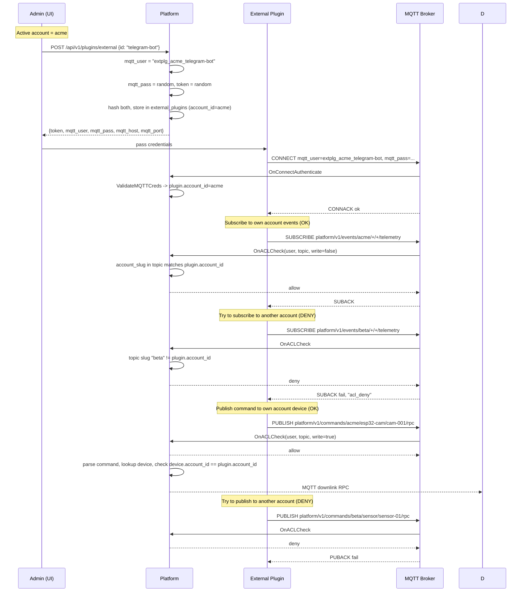
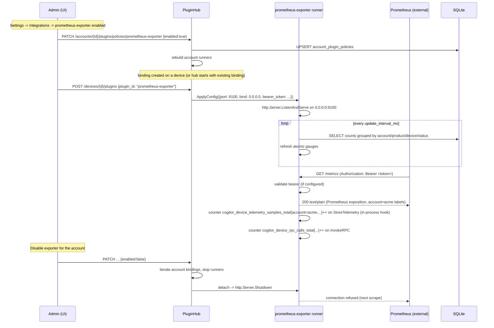

# Multi-Account & Built-in Monitoring — Product Requirements Document

> **Version**: 1.0 (deprecated)
> **Canonical version**: [ru/16-multi-account.md](../ru/16-multi-account.md) (v1.1, actively maintained)
> **Status**: To be rewritten from scratch
> **Last updated**: September 2026
> **Scope**: add multi-tenant isolation, IAM roles, monitoring plugins, and catalog plugin management to the currently single-tenant distribution

> ⚠️ **This English version is out of sync with the canonical Russian version** (which is at v1.1 as of September 2026).
> The Russian version is the source of truth: it includes the staged release plan (v1.0…v1.6 + v2.*), DB-driver abstraction (SQLite + Postgres), full setup wizard, and expanded v2 backlog (HA, rabbitmq-bridge).
> The English version will be **rewritten from scratch** after the platform reaches v1.6. Until then, refer to the [Russian PRD](../ru/16-multi-account.md) for the current scope.
>
> Why the delay: the Russian version reflects the latest design discussions; rewriting the English now would create a third source of truth that drifts. We pick one canonical language for v1 and translate once the scope is locked.
>
> Key differences Russian ↔ this draft (in case you need to read this file):
>
> | Topic | This draft (v1.0) | Russian canonical (v1.1) |
> |-------|-------------------|---------------------------|
> | Migration utility `convert-to-multi-account` | Present (F-103) | **Removed** — no migration tool, project is at prototype stage |
> | `RULES_BUS_INCLUDE_LEGACY_PREFIX` env | Present (F-704) | **Removed** — hard break on new topic format |
> | Database drivers | SQLite only | **SQLite + Postgres** (driver abstraction) |
> | First-install wizard | Not covered | **Full wizard** (Steps 1–8) with env-override |
> | Release plan | Single 1.0 release | **v1.0…v1.6 + v2.0/v2.1** (staged) |
> | §14 Future | Generic list | Concrete F2-01…F2-36 with exit criteria, organised by target version |
> | "What does not change in device topics" | One sentence (F-706) | **Dedicated section §5.7.1** with full topic table |
> | "HA-readiness architectural constraints" | Not present | **§7.7** — 12 design decisions to keep v2 unblocked |

This document defines the next major release of the platform: **multi-account tenancy** with per-account role-based access, a new system-topic layout, and built-in monitoring (Prometheus). The release is additive — recreating the DB and configuration on transition is acceptable.

Related docs: [01-prd](01-prd.md), [02-api](02-api.md), [03-auth](03-auth.md), [04-mqtt](04-mqtt.md), [07-internal-plugins](07-internal-plugins.md), [08-external-plugins](08-external-plugins.md), [11-operations](11-operations.md).

---

## 1. Vision

The platform remains **one Go binary, one SQLite database, and one MQTT broker**, but now serves multiple **isolated accounts** (tenants). Each account owns its own products, devices, firmware, audit trail, and settings. A user with one login can belong to multiple accounts with a different role in each. External plugins (Node-RED, gRPC, webhook) are tightly scoped to the account that registered them and physically cannot read another tenant's data.

On top of tenancy we add:

- **Built-in monitoring**: two new catalog plugins — `prometheus-exporter` (scrape endpoint for an external Prometheus) and `metrics-dashboard` (template for visualising device metrics inside the dashboard).
- **Catalog plugin management** at the account level — an admin can disable any catalog plugin and the platform stops creating runners and ACL events for devices in that account.

The guiding principle of this release: **no migrations, no dual-write**. This is a fresh initial schema. Upgrading from a single-tenant install is a one-shot `convert-to-multi-account` utility that wraps existing products, devices, and plugins into one bootstrap account `default` with the existing bootstrap admin login.

---

## 2. Problem Statement

| Pain point | Current state | What changes |
|------------|---------------|--------------|
| One self-hosted deployment = one tenant. Multi-client / multi-site / production + test setups need isolation | All resources shared, no separation, UI operates on everything | New **Account** entity; all resources (`products`, `devices`, `external_plugins`, `ota_firmwares`, `audit_log`, telemetry, …) get `account_id` |
| Cannot separate warehouse operator and lab operator | Only global roles `admin/operator/viewer` | Same three roles, but **per account**; one user can be admin in one account and viewer in another |
| External plugin (Node-RED / gRPC / webhook) sees every event on the platform | ACL only `platform/v1/events/#` and `platform/v1/commands/#` | Topics get `account_slug` right after the root; ACL narrows to `platform/v1/events/{account_slug}/#` |
| No `/metrics` and no Prometheus integration | None | New catalog plugin `prometheus-exporter` exposes HTTP `/metrics` (Prometheus text format) with `account`, `product`, `device` labels |
| Catalog plugins are always on, even for accounts that don't want background ticks | No toggle | Per-account policy `account_plugin_policies` — admin can disable any catalog plugin in their account |
| No built-in template for device "metrics dashboard" pages | Only standard `Metrics` + `Events` | New catalog plugin `metrics-dashboard` adds customisable panels (telemetry charts, RPC history, online timeline) to a device page |

---

## 3. Target Users

### 3.1 Primary — multi-tenant deployment operator
- Serves a self-hosted platform to multiple internal teams or commercial customers.
- Wants to issue **email invitations** and not think about separate databases.
- Wants a **shared health view** (via Prometheus) but no access to tenant data.

### 3.2 Secondary — corporate operator inside one account
- 10–200 devices on site, 3–10 operators of varying levels.
- Needs admin/operator/viewer **inside** the account; no global rights required.
- Wants in-built graphs (instead of "open Grafana").

### 3.3 Tertiary — AI/LLM agent
- MCP tools must accept an `account_id` parameter (default = active) and refuse if the user does not have membership in that account.

### 3.4 Unchanged
- Devices (ESP32 and friends). From the device side the platform remains "one MQTT broker + one token", transparent to firmware.

---

## 4. Goals & Success Metrics

| Goal | Metric | Target |
|------|--------|--------|
| Account isolation | `404` on cross-account device access | 100% denials on ACL integration tests |
| Invite latency | `POST /accounts/{id}/invitations` to response | < 200 ms |
| Invite acceptance | `POST /invitations/{token}/accept` to JWT with active account | < 1 s |
| Account switching | `POST /auth/switch-account` to new JWT | < 100 ms (no DB hit when membership is cached) |
| Topic isolation | Cross-account `acl_deny` | 100% denials on `subscribe platform/v1/events/other_account/#` |
| Scrape latency | `/metrics` response time at 1k devices | < 250 ms (P95) |
| Footprint | Additional processes | 0 (everything in-process) |

---

## 5. Functional Requirements

### 5.1 Account entity

| ID | Requirement | Priority | Status |
|----|-------------|----------|--------|
| F-101 | New catalog object `account`: `id`, `slug` (unique, `[a-z0-9][a-z0-9-]{1,30}`), `name`, `settings_json`, `status` (`active`/`suspended`), `created_at` | P0 | ☐ |
| F-102 | Bootstrap: on first start the platform creates one account `default` (slug `default`, name `Default`) and binds the bootstrap admin (env `ADMIN_LOGIN/PASSWORD`) with role `admin` | P0 | ☐ |
| F-103 | `convert-to-multi-account` utility (one-shot) — wraps an existing single-tenant DB into one `default` account with the same products/devices. README contains a separate section for manual recreation (the recommended path) | P1 | ☐ |
| F-104 | Every per-account-scoped resource gets `account_id NOT NULL`: `products`, `devices`, `external_plugins`, `device_plugin_bindings`, `ota_firmwares`, `ota_jobs`, `events`, `device_logs`, `telemetry_samples`, `device_attributes_*`, `attribute_history`, `rpc_calls`, `audit_log`, `ingest_dedup`, `device_credentials` | P0 | ☐ |
| F-105 | `products`: uniqueness `(account_id, product_id)` — two accounts may have a product with the same `product_id` | P0 | ☐ |
| F-106 | `devices` derive `account_id` via `product_pk`; application-level constraint: `devices.account_id == products.account_id` | P0 | ☐ |
| F-107 | Account `suspended` — all member API calls return `403 account suspended`; device MQTT sessions remain but new `CONNECT` from the account's devices is rejected; UI shows a banner | P1 | ☐ |
| F-108 | Platform admin (`ADMIN_LOGIN`, flag `is_platform_admin=true`) can read and modify any account without membership. All super-admin actions are logged in `audit_log` with `actor_kind='platform_admin'` | P0 | ☐ |

### 5.2 Membership (multi-account users)

| ID | Requirement | Priority | Status |
|----|-------------|----------|--------|
| F-201 | New table `account_memberships(user_id, account_id, role, status, joined_at, invited_by)` PK `(user_id, account_id)`. `role ∈ {admin, operator, viewer}`. `status ∈ {active, disabled}` | P0 | ☐ |
| F-202 | Email/login of a user remain **globally unique** (as today). One email = one `users.id` = many `account_memberships` | P0 | ☐ |
| F-203 | UI: account switcher in the header (when memberships > 1). API: `POST /api/v1/auth/switch-account` with body `{"account_id": <id>}` returns a new short-lived JWT (TTL = 1 hour) with `active_account_id` in claims. Refresh via `POST /api/v1/auth/refresh` (no refresh tokens — reuse current JWT until expiry) | P0 | ☐ |
| F-204 | Membership check on **every** request: middleware reads `X-Account-Id` (or `?account_id=`), ensures `membership.status='active'` and `users.disabled=false`; otherwise `401/403` | P0 | ☐ |
| F-205 | Refuse to remove the last `admin` in an account (HTTP 409 `last_admin`) | P0 | ☐ |
| F-206 | Role change / membership removal leaves active JWTs valid until expiry; next request returns 403 (see F-204) | P0 | ☐ |
| F-207 | Every API token (`api_tokens`) is **per-account**: add `account_id`; token applies only in its account. Old tokens (if any) are treated as belonging to the user's account (best-effort) | P0 | ☐ |
| F-208 | `GET /me` returns `[{account_id, account_slug, account_name, role, status}]` | P0 | ☐ |

### 5.3 Invitations

| ID | Requirement | Priority | Status |
|----|-------------|----------|--------|
| F-301 | `POST /api/v1/accounts/{id}/invitations` (admin) — creates `account_invitations(token_hash, account_id, email, role, expires_at, invited_by, status='pending')`. Returns a one-time link `{PUBLIC_BASE_URL}/invite/{token}` | P0 | ☐ |
| F-302 | Email + envelope: reuse the same `internal/mail` (smtp / log) used for verify-email | P0 | ☐ |
| F-303 | Invitation TTL: 72 hours (config `INVITE_TTL_HOURS`, default 72) | P0 | ☐ |
| F-304 | Recipient: `GET /api/v1/invitations/{token}` (public, by token) returns `account_name`, `role`, `email`. `POST /api/v1/invitations/{token}/accept` — if the user is logged in: create `account_memberships`; otherwise return `redirect_to_register: true` with pre-filled email and deep-link to `/auth/register?invite=<token>` | P0 | ☐ |
| F-305 | Repeated `accept` on an already accepted invitation is idempotent and returns the membership. Invalid / expired token → `404 invite_not_found` | P0 | ☐ |
| F-306 | Resend: `POST /api/v1/accounts/{id}/invitations/{id}/resend` (admin) generates a new token, marks the old one `revoked` | P1 | ☐ |
| F-307 | Revoke: `DELETE /api/v1/accounts/{id}/invitations/{id}` (admin) | P1 | ☐ |
| F-308 | Audit: `invite.create`, `invite.accept`, `invite.resend`, `invite.revoke` go into `audit_log` with `entity_type='invitation'`, `entity_id=token_prefix` | P0 | ☐ |

### 5.4 Resource isolation

| ID | Requirement | Priority | Status |
|----|-------------|----------|--------|
| F-401 | All `GET/PUT/PATCH/DELETE /products|devices|…/{id}` — middleware checks `entity.account_id == active_account_id` (or actor is_platform_admin). Violation → `404 not_found` (NOT `403`, to avoid leaking existence) | P0 | ☐ |
| F-402 | List endpoints (`GET /products`, `GET /devices`, `GET /events`, `GET /logs`, `GET /mqtt/clients`, `GET /audit_log`) are filtered by `account_id` at the SQL level | P0 | ☐ |
| F-403 | WebSocket `/api/v1/ws` — event payload is filtered server-side by the active memberships of the connection. Clients see events **only** for their active account | P0 | ☐ |
| F-404 | MCP: tools accept `account_id` (optional; default = active). Cross-account access is allowed only for `is_platform_admin`. Add `account_id` to every list/get tool | P0 | ☐ |
| F-405 | `GET /overview` returns counts **per active account**: `online_devices`, `offline_devices`, `total_devices`, `recent_events_24h` | P0 | ☐ |
| F-406 | Telemetry/Events/Logs retention (`TELEMETRY_RETENTION_DAYS`) is applied **per account** — older rows are deleted independently | P0 | ☐ |

### 5.5 IAM: JWT and authorisation

| ID | Requirement | Priority | Status |
|----|-------------|----------|--------|
| F-501 | `auth.Claims` extended: add `Accounts []AccountRef` (`{account_id, account_slug, role}`), `ActiveAccountID int64`, `IsPlatformAdmin bool` | P0 | ☐ |
| F-502 | `auth.IssueJWT(secret, user, activeAccountID, ttl)` builds the claims; `active_account_id` is required (if the user has 0 memberships, `login` rejects) | P0 | ☐ |
| F-503 | `auth.RequireAccount(next)` middleware: parses `X-Account-Id` → `active_account_id`. If header is missing, take it from JWT. If `X-Account-Id != claims.active_account_id` → `403 account_mismatch` | P0 | ☐ |
| F-504 | `auth.CanWrite(role)` stays — admin or operator in the active account | P0 | ☐ |
| F-505 | `auth.CanAdmin(role)` stays — admin in the active account; for platform-admin actions use a separate `auth.CanPlatformAdmin(claims)` | P0 | ☐ |
| F-506 | API tokens (`api_tokens`): at creation (`POST /api/v1/me/tokens`) the client passes `account_id`; token is valid only in that account. `GET /me/tokens` returns the per-account list | P0 | ☐ |
| F-507 | Old JWTs without `active_account_id` after upgrade are rejected; client must log in again | P0 | ☐ |

### 5.6 External plugins: account-scoping

| ID | Requirement | Priority | Status |
|----|-------------|----------|--------|
| F-601 | `external_plugins.account_id NOT NULL`. Uniqueness `(account_id, id)` | P0 | ☐ |
| F-602 | `mqtt_user` is built as `extplg_{account_slug}_{plugin_id}` — guaranteed unique and identifies the account unambiguously. The old `extplg_{plugin_id}` scheme is not used | P0 | ☐ |
| F-603 | External plugin ACL in `internal/mqtt/hook.go` (`aclOK`): for a user `extplg_{slug}_*` only `platform/v1/{events|commands}/{slug}/#` is allowed. Any other prefix (including `platform/v1/events/other-slug/...`) → `acl_deny` | P0 | ☐ |
| F-604 | Registration (`POST /api/v1/plugins/external`): `account_id` is taken from the active membership; API token and MQTT password remain one-time | P0 | ☐ |
| F-605 | Cross-account RPC `platform.invoke_rpc`: `InvokeRPCForPlugin` checks `plugin.account_id == device.account_id` (via product). Cross-account RPC → `403` | P0 | ☐ |
| F-606 | `GetPluginIDByToken` and `ValidateMQTTCreds` stay hash-based; the index by `(account_id, id)` is used to narrow the search | P0 | ☐ |

### 5.7 System topics (rules bus)

| ID | Requirement | Priority | Status |
|----|-------------|----------|--------|
| F-701 | **Breaking change** to `platform/v1/{events|commands}/...` format: add `account_slug` segment right after the root. **New** topics:<br>• `platform/v1/events/{account_slug}/{product_id}/{device_id}/{kind}`<br>• `platform/v1/commands/{account_slug}/{product_id}/{device_id}/{kind}` | P0 | ☐ |
| F-702 | `internal/protocol/topics.go`: new constant `SegAccount`, helpers `RulesEventsRootForAccount(prefix, slug)` and `RulesCommandsRootForAccount(prefix, slug)` | P0 | ☐ |
| F-703 | `publishRules` in `internal/services/ingest.go` / `platform.go` takes `account_slug`; the `OnPublished` hook ignores events whose `account_slug` does not match `device.account_slug` (extra safety against spoofing — the topic is published by the platform itself) | P0 | ☐ |
| F-704 | **Backward-compat**: env `RULES_BUS_INCLUDE_LEGACY_PREFIX=true` — also publish the old topics without slug. Default `false` | P1 | ☐ |
| F-705 | All downstream services (Node-RED, gRPC, webhook) must update their rules — README and `flows.json` templates are updated | P0 | ☐ |
| F-706 | Device topics `iot/v1/{product}/{device}/...` and `v1/...` **do not change** — devices know nothing about accounts. Device identity is `{product}.{device}` + token. The token is globally unique (sha256), so `ResolveByToken` unambiguously finds device → account | P0 | ☐ |

### 5.8 Catalog plugin management

| ID | Requirement | Priority | Status |
|----|-------------|----------|--------|
| F-801 | `account_plugin_policies(account_id, plugin_id, enabled, settings_json, updated_at)` PK `(account_id, plugin_id)`. Default — no row → `enabled=true` (as today) | P0 | ☐ |
| F-802 | API: `GET /api/v1/accounts/{id}/plugins/policies` (admin) — list all catalog plugins with effective `enabled` and overrides | P0 | ☐ |
| F-803 | API: `PATCH /api/v1/accounts/{id}/plugins/policies/{pluginId}` (admin) — body `{enabled?: bool, settings?: json}`. Changes apply on the fly — hub iterates the account's bindings and stops/starts runners | P0 | ☐ |
| F-804 | Hub `services.PluginHub.Dispatch` and `ApplyConfig` skip bindings of disabled plugins (do not call `OnEvent`); device-tick does not wake them | P0 | ☐ |
| F-805 | Catalog plugins (led-garland, schedule) honour the policy; external plugins (registered through the API) are **not** managed by this table (they have their own account scope) | P0 | ☐ |
| F-806 | UI: Settings → Account → **Integrations** — list of plugins with a switch and a "Settings" button (opens the form-driven editor `Descriptor.Form`) | P0 | ☐ |

### 5.9 Catalog plugin: `prometheus-exporter`

| ID | Requirement | Priority | Status |
|----|-------------|----------|--------|
| F-901 | Catalog plugin `prometheus-exporter` in `internal/plugins/prometheus_exporter.go`; `Register` in `init()` | P0 | ☐ |
| F-902 | Binding config: `port` (default 9100), `bind` (default `0.0.0.0`), `path` (default `/metrics`), `bearer_token` (optional — protects the scrape endpoint), `metrics` (list of active metrics), `update_interval_ms` (default 5000) | P0 | ☐ |
| F-903 | Plugin starts a **local HTTP server** on `(bind, port)` when at least one binding is active in the account. One port per account so labels don't mix. If all account bindings are disabled the server stops | P0 | ☐ |
| F-904 | Supported metrics (Prometheus exposition format):<br>• `cogitor_devices_total{account,product,status}` (gauge)<br>• `cogitor_device_online{account,product,device}` (gauge, 0/1)<br>• `cogitor_device_telemetry_samples_total{account,product,device}` (counter, incremented in `StoreTelemetry`)<br>• `cogitor_device_rpc_calls_total{account,product,device,method,status}` (counter)<br>• `cogitor_device_ota_jobs_total{account,product,device,status}` (counter)<br>• `cogitor_event_bus_published_total{account,product,device,kind}` (counter)<br>• `cogitor_mqtt_clients{account,kind}` (gauge)<br>• `cogitor_external_plugin_online{account,plugin_id}` (gauge, 0/1) | P0 | ☐ |
| F-905 | `bearer_token` is checked via `Authorization: Bearer <token>`; missing or wrong → `401`. Not set → endpoint is open (like a normal node_exporter) | P0 | ☐ |
| F-906 | Per-binding `metrics: ["devices", "rpc", "ota", "telemetry", "events", "bus", "external_plugins"]` — empty list disables everything. `update_interval_ms` controls gauge refresh | P1 | ☐ |
| F-907 | Plugin `prometheus-exporter` is managed through `account_plugin_policies` (F-801). If admin disables — HTTP server stops, metrics are not served | P0 | ☐ |
| F-908 | Example scrape config for an external Prometheus is published in `docs/en/external-prometheus.md` / `docs/ru/external-prometheus.md` | P1 | ☐ |

### 5.10 Catalog plugin: `metrics-dashboard` (visualisation template)

| ID | Requirement | Priority | Status |
|----|-------------|----------|--------|
| F-1001 | Catalog plugin `metrics-dashboard` in `internal/plugins/metrics_dashboard.go`. Does not start an HTTP server; it only provides a UI template and a data aggregator | P0 | ☐ |
| F-1002 | Binding config (`device_plugin_bindings.config_json`): `panels: [{type, title, query, ...}]` where `type ∈ {telemetry_chart, telemetry_gauge, rpc_table, online_timeline, events_count}` | P0 | ☐ |
| F-1003 | Plugin registers a **virtual tab** in the device page — `Metrics+` next to the standard `Metrics`. The tab renders the panels from the config | P0 | ☐ |
| F-1004 | Aggregator: `OnEvent("apply")` re-reads `telemetry_samples` and `rpc_calls` for `device_pk`; updates `GET /api/v1/devices/{id}/dashboard` (new endpoint) returning `panels: [{id, type, title, data}]` — the frontend just renders | P0 | ☐ |
| F-1005 | `telemetry_chart`: `{keys: ["temperature","humidity"], window: "1h"|"24h"|"7d"}` → `[{key, points: [[ts, value]]}]` | P0 | ☐ |
| F-1006 | `telemetry_gauge`: `{key, window}` → `{key, current, min, max, avg}` | P0 | ☐ |
| F-1007 | `rpc_table`: `{limit}` → the last N RPC calls | P0 | ☐ |
| F-1008 | `online_timeline`: `{window}` → `[[ts_start, ts_end, online_bool]]` segments | P1 | ☐ |
| F-1009 | `events_count`: `{severity?, window}` → `{critical, error, warning, info}` | P1 | ☐ |
| F-1010 | Template (default binding) — landing page with typical panels: `telemetry_chart` for `wifi_rssi` + `telemetry_gauge` for `free_heap` + `online_timeline` for 24h. Admin can customise via UI Settings → Device → Plugins → metrics-dashboard | P0 | ☐ |

### 5.11 Dashboard

| ID | Requirement | Priority | Status |
|----|-------------|----------|--------|
| F-1101 | Account switcher in the header (dropdown). Active account is visually highlighted. "Account settings" menu goes to the current account's settings | P0 | ☐ |
| F-1102 | Settings → Account: name, slug (read-only after creation), status (`active`/`suspended`), timezone, retention, integrations (see F-806), members (see F-201) | P0 | ☐ |
| F-1103 | Settings → Members: list of account users with role and status; actions — invite, change role, disable, remove (with last-admin protection) | P0 | ☐ |
| F-1104 | Settings → Invitations: pending/accepted/revoked/expired, resend, revoke | P0 | ☐ |
| F-1105 | If active account is unset or membership removed — the home page shows "Choose account" | P0 | ☐ |
| F-1106 | Sidebar/footer shows `account_slug` in small type as a context hint | P2 | ☐ |

### 5.12 Account deletion

| ID | Requirement | Priority | Status |
|----|-------------|----------|--------|
| F-1201 | `DELETE /api/v1/accounts/{id}?force=true` (platform-admin). Without `force=true` only when `devices.count=0` and `external_plugins.count=0` | P0 | ☐ |
| F-1202 | Cascade: products, devices, plugin bindings, firmwares, ota_jobs, telemetry, events, logs, rpc, audit, memberships, invitations, plugin policies | P0 | ☐ |
| F-1203 | All active MQTT sessions of the account's devices are dropped via `MQTT.DropUsername` (by `product.device` list) | P0 | ☐ |
| F-1204 | External plugins of the account — registration is removed, heartbeat monitor is dropped; subscribers receive `external_plugin.deleted` over the rules bus (last will) | P0 | ☐ |
| F-1205 | `audit_log` is kept for 30 days after deletion, then cleaned. The deletion record itself is purged with retention | P1 | ☐ |

---

## 6. Non-Functional Requirements

| ID | Category | Requirement |
|----|----------|-------------|
| NF-01 | **Isolation** | All SQL queries on per-account tables must filter by `account_id` — implement via wrapper `services.ScopeAccount(db, accountID)` (unit test per model: "query without filter returns 0 rows") |
| NF-02 | **Isolation** | An accidental leak on a listing endpoint (missing WHERE) is a P0 bug and blocks release |
| NF-03 | **Security** | MQTT username `extplg_*` — format is fixed, validated at registration, ACL-checked on every packet |
| NF-04 | **Performance** | `account_memberships` — PK `(user_id, account_id)` plus `idx_memberships_account` |
| NF-05 | **Performance** | `products` — `UNIQUE(account_id, product_id)`, index `(account_id, product_id)` |
| NF-06 | **Performance** | `devices` — `idx_devices_account` in addition to existing `idx_devices_status` / `idx_devices_token_prefix` |
| NF-07 | **Performance** | `prometheus-exporter` HTTP server must not block the hub: handlers use `atomic` counters and read-only DB queries through a `SetMaxOpenConns(2)` pool |
| NF-08 | **Configuration** | ENV: `INVITE_TTL_HOURS=72`, `RULES_BUS_INCLUDE_LEGACY_PREFIX=false` |
| NF-09 | **Compatibility** | Old single-tenant DB → `convert-to-multi-account` (one `default` account); new installs start on the new schema |
| NF-10 | **Observability** | `audit_log` already exists — add `account_id` and `actor_kind` (`user`/`platform_admin`/`api_token`); structured logs include `account_id` where possible |
| NF-11 | **UI** | Account switcher, Members, Invitations, Account Settings, Integrations — new SPA pages added to the router |
| NF-12 | **Documentation** | Update `02-api.md`, `03-auth.md`, `04-mqtt.md`, `07-internal-plugins.md`, `08-external-plugins.md`, `11-operations.md`, `06-automation.md` (rules bus) and `examples/plugins/*` (MQTT subscribe/put under new topics) |

---

## 7. Architecture

> **Diagrams**: [Multi-Account Architecture](14-diagrams.md#multi-account-architecture), [Invitation Flow](14-diagrams.md#invitation-flow), [External Plugin Account ACL](14-diagrams.md#external-plugin-account-acl), [Prometheus Exporter Lifecycle](14-diagrams.md#prometheus-exporter-lifecycle), [Internal Plugin Policy](14-diagrams.md#internal-plugin-policy)

### 7.1 Overall layout



### 7.2 Data flow (with tenancy)

1. **Login**: user calls `POST /auth/login` → platform verifies password → reads all `memberships` → returns JWT with `accounts[]` and `active_account_id=first_admin_or_first`.
2. **API request**: `GET /devices/42` with `Authorization: Bearer ...` and `X-Account-Id: 7` → middleware checks `membership(user, 7, active)` → handler reads `device` → checks `device.account_id == 7` → 200.
3. **Device → platform**: `CONNECT` with `username=esp32-cam.cam-001`, `password=<token>`. `OnConnectAuthenticate` calls `deviceFor(user)` → `ResolveByToken` → finds the device → takes `product.account_id` → ACL scoped to `iot/v1/{product}/{device}/...`. The account is transparent to the device.
4. **Publish telemetry** → `Ingest` → `StoreTelemetry` (`account_id` from device) → `publishRules(account.slug, product, device, kind)` → MQTT `platform/v1/events/{account_slug}/{product}/{device}/{kind}`. The topic carries `account_slug` — another account's external plugin cannot subscribe via ACL.
5. **External plugin (polling)**: `POST /api/plugins/external/rpc` with token `extplg_acme_telegram-bot` → `ValidateToken` → `plugin.account_id = 1` → `platform.invoke_rpc` → middleware `RequireAccount(account_id=1)` → handler checks `device.account_id == 1` → 200. Cross-account → 403.
6. **WebSocket**: `/api/v1/ws?token=...` with active account 7 → Hub subscribes the connection to filter `account_id=7` → events of other accounts never reach it.
7. **Prometheus scrape**: external Prometheus with job `{account: "acme", scrape_url: "http://platform:9100/metrics"}` — each account has its own port; `prometheus-exporter` starts an instance on the binding-defined port; every metric carries `account="acme"`.

### 7.3 Invitation Flow



### 7.4 External Plugin Account ACL



### 7.5 Prometheus Exporter Lifecycle



### 7.6 Internal Plugin Policy


---

## 8. Data Model (new tables)

```sql
-- Accounts (tenants)
CREATE TABLE accounts (
    id           INTEGER PRIMARY KEY AUTOINCREMENT,
    slug         TEXT NOT NULL UNIQUE,
    name         TEXT NOT NULL,
    settings_json TEXT NOT NULL DEFAULT '{}',
    status       TEXT NOT NULL DEFAULT 'active' CHECK(status IN ('active','suspended')),
    created_at   INTEGER NOT NULL,
    updated_at   INTEGER NOT NULL
);

-- Per-account user membership
CREATE TABLE account_memberships (
    user_id     INTEGER NOT NULL REFERENCES users(id) ON DELETE CASCADE,
    account_id  INTEGER NOT NULL REFERENCES accounts(id) ON DELETE CASCADE,
    role        TEXT NOT NULL CHECK(role IN ('admin','operator','viewer')),
    status      TEXT NOT NULL DEFAULT 'active' CHECK(status IN ('active','disabled')),
    joined_at   INTEGER NOT NULL,
    invited_by  INTEGER REFERENCES users(id) ON DELETE SET NULL,
    PRIMARY KEY(user_id, account_id)
);
CREATE INDEX idx_memberships_account ON account_memberships(account_id, status);

-- Email invitations
CREATE TABLE account_invitations (
    id          INTEGER PRIMARY KEY AUTOINCREMENT,
    account_id  INTEGER NOT NULL REFERENCES accounts(id) ON DELETE CASCADE,
    email       TEXT NOT NULL,
    role        TEXT NOT NULL CHECK(role IN ('admin','operator','viewer')),
    token_hash  TEXT NOT NULL UNIQUE,
    token_prefix TEXT NOT NULL,
    invited_by  INTEGER NOT NULL REFERENCES users(id),
    status      TEXT NOT NULL DEFAULT 'pending' CHECK(status IN ('pending','accepted','revoked','expired')),
    expires_at  INTEGER NOT NULL,
    created_at  INTEGER NOT NULL,
    accepted_at INTEGER,
    accepted_user INTEGER REFERENCES users(id)
);
CREATE INDEX idx_invitations_account ON account_invitations(account_id, status);
CREATE INDEX idx_invitations_email ON account_invitations(email);

-- Per-account policy for catalog plugins
CREATE TABLE account_plugin_policies (
    account_id    INTEGER NOT NULL REFERENCES accounts(id) ON DELETE CASCADE,
    plugin_id     TEXT NOT NULL,
    enabled       INTEGER NOT NULL DEFAULT 1,
    settings_json TEXT NOT NULL DEFAULT '{}',
    updated_at    INTEGER NOT NULL,
    PRIMARY KEY(account_id, plugin_id)
);

-- Per-account API tokens
ALTER TABLE api_tokens ADD COLUMN account_id INTEGER REFERENCES accounts(id) ON DELETE CASCADE;

-- Account_id propagation: add column to all per-account tables
ALTER TABLE products        ADD COLUMN account_id INTEGER NOT NULL REFERENCES accounts(id) ON DELETE CASCADE;
ALTER TABLE external_plugins ADD COLUMN account_id INTEGER NOT NULL REFERENCES accounts(id) ON DELETE CASCADE;

-- Replace UNIQUE(product_id) on products with UNIQUE(account_id, product_id)
-- (migrated by convert-to-multi-account; new installs start with the new shape)

-- users: platform-admin flag for super-admins
ALTER TABLE users ADD COLUMN is_platform_admin INTEGER NOT NULL DEFAULT 0;
```

> **Existing tables** (`devices`, `events`, `device_logs`, `telemetry_samples`, `rpc_calls`, `attribute_history`, `device_attributes_*`, `ingest_dedup`, `device_credentials`, `ota_firmwares`, `ota_jobs`, `audit_log`) get `account_id NOT NULL` via the migration that ships with `convert-to-multi-account`. Fresh installs start with the column.

---

## 9. API Changes (summary)

| Group | Endpoints | Note |
|-------|-----------|------|
| Auth | `POST /auth/login` — now returns `accounts[]` and `active_account_id` | breaking for clients parsing the old shape — `/api/v1` minor version stays |
| | `POST /auth/switch-account` `{account_id}` → new JWT | new |
| | `POST /auth/refresh` — re-issues a JWT with the same `active_account_id` (no refresh tokens, reuse current until expiry) | new |
| | `GET /me` — extended | new fields |
| | `GET /auth/config` — unchanged | |
| Accounts | `GET /accounts` — list available to the user (or all for platform-admin) | new |
| | `POST /accounts` — platform-admin: create account | new |
| | `GET /accounts/{id}` | new |
| | `PATCH /accounts/{id}` — admin/operator (operator — name only) | new |
| | `DELETE /accounts/{id}?force=true` — platform-admin | new |
| Members | `GET /accounts/{id}/members` | new |
| | `PATCH /accounts/{id}/members/{userId}` `{role?, status?}` | new |
| | `DELETE /accounts/{id}/members/{userId}` | new |
| Invitations | `GET /invitations/{token}` (public) | new |
| | `POST /invitations/{token}/accept` | new |
| | `GET /accounts/{id}/invitations` | new |
| | `POST /accounts/{id}/invitations` `{email, role}` | new |
| | `POST /accounts/{id}/invitations/{id}/resend` | new |
| | `DELETE /accounts/{id}/invitations/{id}` | new |
| Plugin policies | `GET /accounts/{id}/plugins/policies` | new |
| | `PATCH /accounts/{id}/plugins/policies/{pluginId}` `{enabled?, settings?}` | new |
| Existing | `GET/POST/PUT/DELETE /products|devices|…` — all require `X-Account-Id` (or take it from JWT active) and verify account scope; `?account_id=` query is supported for platform-admin | all breaking |
| MCP | Each list/get tool gains an `account_id` parameter (optional, default — active) | minor |
| WebSocket | `GET /api/v1/ws?token=...&account_id=<active>` — filter by account | extension |

Full endpoint list and request/response shapes are in [02-api.md](02-api.md) (addendum).

---

## 10. Configuration

### New environment variables

| Variable | Default | Purpose |
|----------|---------|---------|
| `BOOTSTRAP_ACCOUNT_SLUG` | `default` | Slug of the account created on first start |
| `BOOTSTRAP_ACCOUNT_NAME` | `Default` | Display name |
| `INVITE_TTL_HOURS` | `72` | Invitation TTL |
| `RULES_BUS_INCLUDE_LEGACY_PREFIX` | `false` | Also publish the old `platform/v1/events/...` topics without slug |
| `PROMETHEUS_EXPORTER_DEFAULT_PORT` | `9100` | Default port for the plugin |
| `CONVERT_TO_MULTI_ACCOUNT` | (utility only) | If `1` — the utility runs the migration in place (or call a separate `platform convert` command) |

### Removed / deprecated

- `REGISTER_DEFAULT_ROLE` stays, but **only** for the bootstrap account (creating the first admin). New accounts determine the role through invitations.

---

## 11. Bad Cases and Risks

### 11.1 Identity

| Case | Behaviour |
|------|-----------|
| User with JWT for active account A sends `X-Account-Id: B` | `403 account_mismatch` |
| User is a member in A and B; JWT `active=A`; `GET /devices/42` where device.account_id=B | `404 not_found` (entity does not exist in the active account) |
| User removed from account but JWT not yet expired; next request | `403 membership_inactive` (revocation check on every request) |
| Platform admin (`is_platform_admin=true`) requests another account | without `X-Account-Id` or with `X-Account-Id: <target>`; request is `actor_kind='platform_admin'`, audit |
| Two admins try to remove each other | both get `200`, but if it leaves only one admin → `409 last_admin` |
| Last admin leaves the account | `409 last_admin` — promote another user or delete the account |
| Old-style refresh token (if any existed) | n/a — we do not introduce refresh; user logs in again on JWT expiry (TTL = 24h) |

### 11.2 Devices

| Case | Behaviour |
|------|-----------|
| Device connects with a valid token but its account is `suspended` | `auth_fail account_suspended` — the device is dropped; UI shows a banner |
| Device connects with a token but the device has been deleted | `auth_fail device_not_found` |
| Token rotation: device `foo` (account A) token flashed onto `bar` (account B) | `bar` tries to authenticate with username `bar` + password (token from `foo`) → `ResolveByToken` finds the `foo` device but username `bar` does not match `foo`'s `product.device` → `auth_fail` (fail-closed) |
| Cross-account ACL: external plugin account A publishes a command for a device in account B | `acl_deny` + `403` on `invoke_rpc` |
| Topic style differs per device, different accounts | `DetectStyle` inspects the topic, not the account — behaviour is unchanged |

### 11.3 External plugins

| Case | Behaviour |
|------|-----------|
| Plugin `extplg_acme_x` subscribes to `platform/v1/events/beta/y/telemetry` | `acl_deny` |
| Plugin `extplg_acme_x` subscribes to `platform/v1/events/acme/+/+` | `200` (OK) |
| Plugin `extplg_acme_x` publishes to `platform/v1/commands/beta/y/rpc` | `acl_deny` |
| Plugin API token used in HTTP RPC for a device in another account | `403 device_not_in_account` |
| Register a plugin with an `id` already taken in this account | `409 plugin_exists` (but another account may have a plugin with the same id) |
| MQTT password compromised | `POST /plugins/external/{id}/regenerate-mqtt` — old password is invalidated; existing MQTT session is disconnected |

### 11.4 Promotional / API

| Case | Behaviour |
|------|-----------|
| API token (per-account) used in another account | `403 token_account_mismatch` |
| WebSocket: client connected, active account changed (new login) | old WS session keeps the old filter until disconnect; new one uses the new filter |
| Audit log overflow | 90-day retention for `audit_log` per account, separate from telemetry retention |
| Invitation token lost | resend; old token is revoked |
| Invitation token expired | UI/email marks it `expired`; cannot accept |
| Email collision: a user with email X exists, new invite to the same email | `409 user_exists`; link to "account already exists, log in and accept invite" — the invitation stays in the DB and is shown on login |
| Bootstrap admin: `ADMIN_LOGIN` already exists in `users` but is not bound to the bootstrap account | on first conversion start — bind the existing user to `default` with role `admin` |

### 11.5 Prometheus exporter

| Case | Behaviour |
|------|-----------|
| Admin disables `prometheus-exporter` in the active account via policy | HTTP server stops; scrape → `connection refused`; UI banner |
| Port is in use by another plugin / instance | `bind error: port already in use` log; runner is marked `last_error`; user must change port in config |
| Account B tries to scrape the endpoint of account A | nothing — each account has its own port; metrics are always labelled `account=acme` |
| Prometheus forgot the bearer token | `401` (if configured) — correct fail-mode |

### 11.6 Known limitations

- **Single-tenant SQLite** — all accounts share one DB. Backup is shared, restore is shared. Multi-DB isolation is out of scope.
- **MQTT broker** — one mochi-mqtt process serves all accounts. Namespace separation is at the ACL level. Horizontal scaling is out of scope.
- **Prometheus exporter** — in-process HTTP server; not reverse-proxy-friendly. If TLS is needed, proxy through `nginx`/`caddy`.
- **Invitations** — email only; per-account SSO (SAML/OIDC) is out of scope.
- **Account transfer** — none; delete + recreate.
- **Cross-account dashboards / shared devices** — out of scope.

---

## 12. Out of Scope (v1 of this release)

- Billing / quota
- Account hierarchy (parent/child, sub-accounts)
- Audit log export (SIEM)
- Per-account database (multi-DB)
- SAML / OIDC SSO per account
- Account transfer (merge / split)
- Cross-account dashboards
- WebSocket multi-account subscription (one WS receiving events from multiple accounts)

---

## 13. Acceptance Criteria

### 13.1 Tenancy

- [ ] First start on a clean DB creates the `default` account with one admin (env) and slug `default`
- [ ] The user sees a dropdown in the header with their accounts and can switch
- [ ] `GET /devices/42` for a device in another account returns `404`
- [ ] `GET /devices` filters the list by the active account
- [ ] Removing the last admin in an account returns `409 last_admin`
- [ ] An API token issued for account A is rejected in account B (`403 token_account_mismatch`)

### 13.2 Invitations

- [ ] `POST /accounts/{id}/invitations` creates a record and sends an email with link `{PUBLIC_BASE_URL}/invite/{token}`
- [ ] The link pre-fills the email on registration (`/auth/register?invite=...`)
- [ ] After `accept` the user immediately sees the account in the switcher
- [ ] Resend revokes the old token and sends a new one
- [ ] TTL defaults to 72h; expired token → `404 invite_not_found`

### 13.3 External plugins and ACL

- [ ] `mqtt_user` has the form `extplg_{account_slug}_{plugin_id}`
- [ ] External plugin account A subscribes to `platform/v1/events/{slug_A}/#` — `200`
- [ ] External plugin account A subscribes to `platform/v1/events/{slug_B}/#` — `acl_deny`
- [ ] External plugin account A publishes to `platform/v1/commands/{slug_A}/{product}/{device}/rpc` — `200`
- [ ] External plugin account A publishes to `platform/v1/commands/{slug_B}/...` — `acl_deny`
- [ ] `platform.invoke_rpc` via the HTTP API of plugin account A on a device in account B — `403`
- [ ] Rules bus is published in the new format with `{account_slug}`; old rules in `flows.json` are updated

### 13.4 Catalog plugins / policy

- [ ] By default `account_plugin_policies` is empty, all catalog plugins work
- [ ] `PATCH /accounts/{id}/plugins/policies/led-garland {enabled:false}` stops runners; in `GET /devices/{id}/plugins` the plugin shows as `disabled`; `tick` events do not reach it
- [ ] `PATCH ... {enabled:true}` restarts the runner on the next online device
- [ ] `metrics-dashboard` shows the virtual "Metrics+" tab on the device page with the default template

### 13.5 Prometheus

- [ ] With `prometheus-exporter` active at `http://platform:9100/metrics` text is returned in Prometheus exposition format with an `account` label
- [ ] `cogitor_devices_total{account,product,status}` updates at least every `update_interval_ms`
- [ ] `cogitor_device_telemetry_samples_total{account,product,device}` increments on every `StoreTelemetry`
- [ ] `bearer_token` in config — `Authorization: Bearer <token>` succeeds, missing header → `401`
- [ ] Admin disables exporter in account → scrape returns `connection refused`

### 13.6 Conversion

- [ ] `platform convert-to-multi-account --src=old.db --dst=new.db` (or `make convert-multi`) wraps the existing single-tenant DB into one `default` account with admin = first `admin` in `users`
- [ ] After conversion all new endpoints (`accounts`, `members`, `invitations`, `policies`) work
- [ ] Old device credentials and API tokens remain valid; API tokens are bound to the `default` account

---

## 14. Future Considerations (v2+)

- Account-level RBAC policies (custom roles per account)
- Audit log streaming into SIEM (Kafka / Loki)
- Per-account data export (PG dump)
- SSO providers per account
- Per-account Prometheus remote_write
- Account API rate limiting

---

## 15. Related Documentation

| Doc | What |
|-----|------|
| [01-prd.md](01-prd.md) | Overall product PRD (updated: multi-tenancy moved from out-of-scope → implemented in this release) |
| [02-api.md](02-api.md) | REST API reference (will be extended with new endpoints) |
| [03-auth.md](03-auth.md) | Authentication (JWT claims, active account) |
| [04-mqtt.md](04-mqtt.md) | MQTT protocol (rules bus — new format) |
| [06-automation.md](06-automation.md) | Node-RED / rules bus (update flows.json for new topics) |
| [07-internal-plugins.md](07-internal-plugins.md) | Catalog + new plugins (prometheus-exporter, metrics-dashboard) |
| [08-external-plugins.md](08-external-plugins.md) | Account-scoped external plugins (mqtt_user format, ACL) |
| [11-operations.md](11-operations.md) | Operations (conversion, configuration) |
| [14-diagrams.md](14-diagrams.md) | All release diagrams (5 new) |
