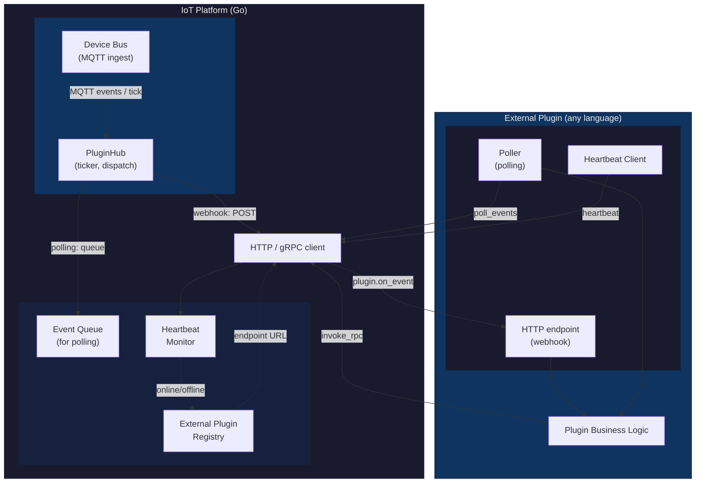
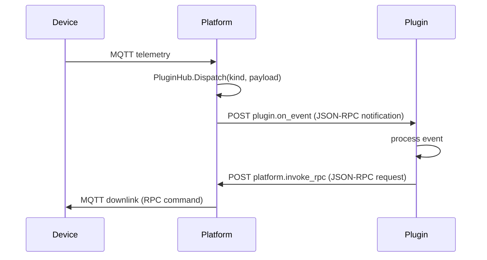
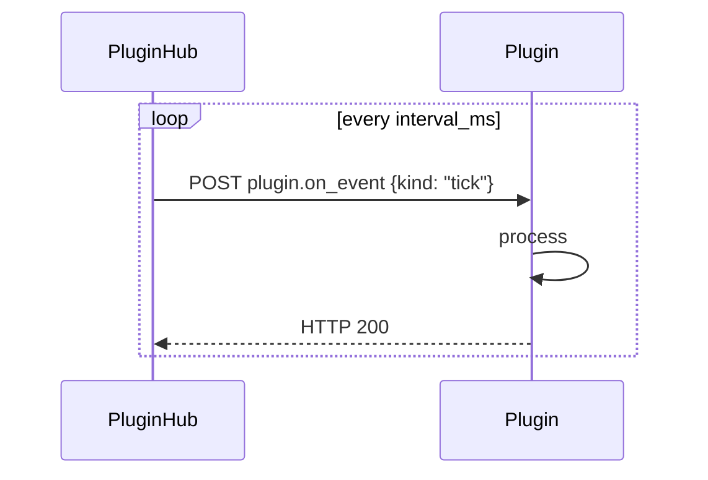
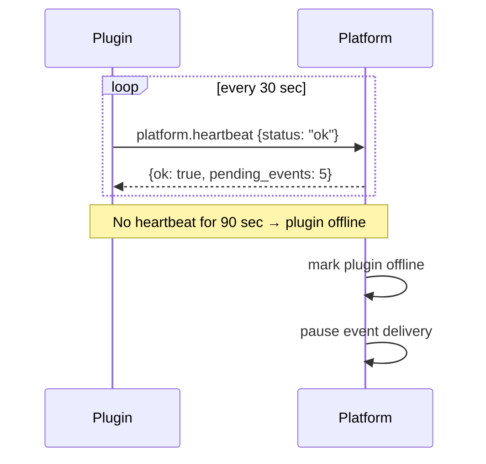
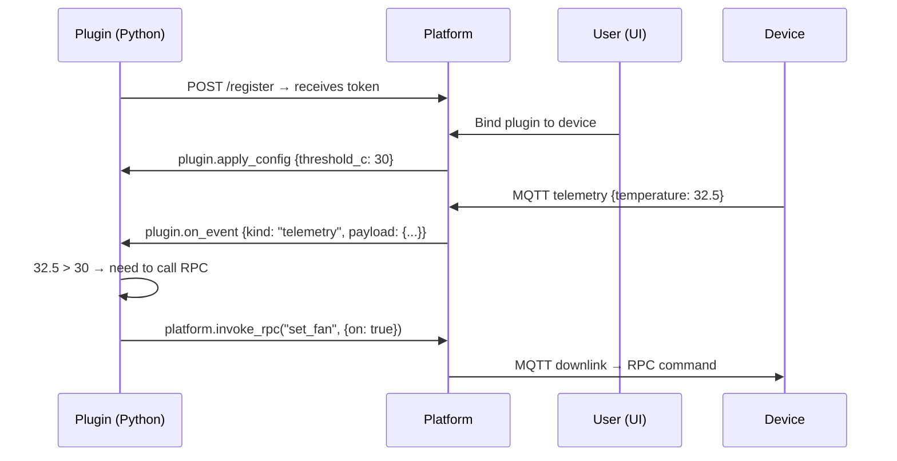
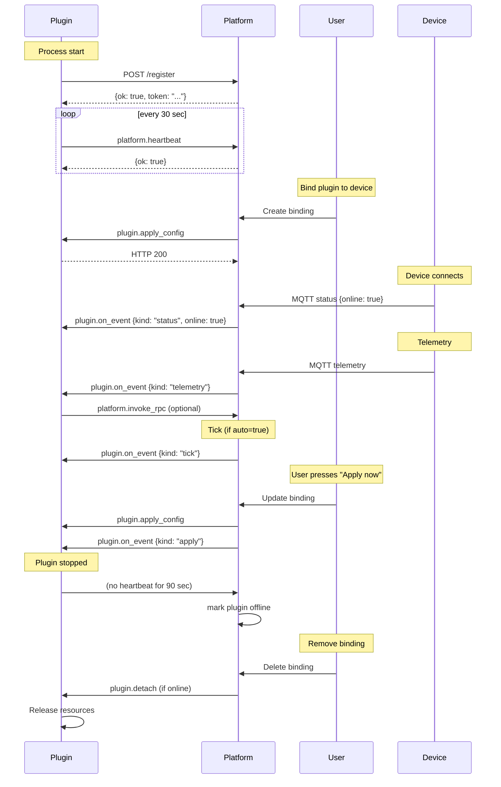

# External Plugin PRD

## 1. Overview

External plugins extend IoT Platform logic without recompiling the Go binary.
They run as separate processes (any language) and communicate with the platform
via **JSON-RPC 2.0 over HTTP** (primary) or **gRPC** (advanced).

The external plugin contract mirrors the internal `plugins.Instance` —
behavior is identical, only the transport changes.

| Internal (in-process)                 | External (out-of-process)                   |
|---------------------------------------|---------------------------------------------|
| `Register(Descriptor, Factory)`       | `POST /api/v1/plugins/external`             |
| `ApplyConfig(json)`                   | Platform → Plugin: `plugin.apply_config`    |
| `OnEvent(Runtime, Event)`             | Platform → Plugin: `plugin.on_event`        |
| `Runtime.InvokeRPC(method, params)`   | Plugin → Platform: `platform.invoke_rpc`    |
| `IntervalMS()` / `Auto()`             | Declared in `Descriptor` at registration    |

---

## 2. Architecture

> **Diagram**: [External Plugin Architecture](diagrams.md#external-plugin-architecture)



### Event Flow

> **Diagram**: [External Plugin Event Flow](diagrams.md#external-plugin-event-flow)



### Tick Flow

Plugins with `auto: true` and `interval_ms > 0` receive periodic `tick`
events — just like internal plugins. The platform owns the timer;
the plugin only reacts.

> **Diagram**: [External Plugin Tick Flow](diagrams.md#external-plugin-tick-flow)



---

## 3. Internal Plugin Model (reference)

Internal plugins implement the `plugins.Instance` interface:

```go
type Instance interface {
    ApplyConfig(raw json.RawMessage) error   // validate + load config
    OnEvent(rt Runtime, ev Event) error      // handle a single event
    IntervalMS() int                         // tick interval (0 = no tick)
    Auto() bool                              // subscribe to tick cycle?
}

type Runtime interface {
    InvokeRPC(method string, params map[string]any) error
}

type Event struct {
    Kind     string // tick | apply | status | telemetry | event | rpc/result
    Online   bool
    Payload  any
    DevicePK int64
}
```

Event types (constants in `plugins` package):

| Constant           | Value        | When delivered                                |
|--------------------|-------------|-----------------------------------------------|
| `EventTick`        | `tick`      | Every `interval_ms` while device is online    |
| `EventApply`       | `apply`     | Config saved or binding created               |
| `EventStatus`      | `status`    | Device online/offline transition              |
| `EventTelemetry`   | `telemetry` | Device published telemetry                    |
| `EventEvent`       | `event`     | Device published a custom event               |
| `EventRPCResult`   | `rpc/result`| Response to a previously sent RPC             |

External plugins receive the **same** event types over the wire.

---

## 4. External Plugin Contract

### 4.1 Registration

The plugin registers once at startup (or via CLI). The platform saves
the descriptor to the `external_plugins` table.

```
POST /api/v1/plugins/external
Content-Type: application/json
Authorization: Bearer <admin JWT>

{
  "id":           "temp-alert",
  "name":         "Temperature Alert",
  "description":  "Send RPC when temperature exceeds threshold",
  "endpoint":     "http://192.168.1.50:8080/rpc",
  "auto":         true,
  "interval_ms":  5000,
  "default_config": {
    "threshold_c": 35.0,
    "rpc_method":  "set_fan",
    "rpc_params":  {"on": true}
  },
  "form": [
    {"key": "threshold_c", "type": "number", "label": "Threshold °C",
     "min": -40, "max": 120},
    {"key": "rpc_method",  "type": "string", "label": "RPC method"},
    {"key": "rpc_params",  "type": "json",   "label": "RPC params JSON"}
  ]
}
```

Response:

```json
{ "ok": true, "id": "temp-alert", "token": "ext_plg_abc123…", "mqtt_user": "extplg_temp-alert_…", "mqtt_pass": "…" }
```

Fields:

| Field            | Type       | Req | Description                                  |
|------------------|-----------|------|----------------------------------------------|
| `id`             | string     | yes  | Unique plugin identifier (slug)             |
| `name`           | string     | yes  | Human-readable name                         |
| `description`    | string     | yes  | Shown in UI catalog                         |
| `endpoint`       | string     | no*  | Webhook URL (required if not using polling) |
| `auto`           | bool       | no   | Subscribe to tick cycle (default `false`)   |
| `interval_ms`    | int        | no   | Tick interval in ms (min 80, default 0)     |
| `default_config` | object     | no   | Default config (JSON)                       |
| `effects`        | string[]   | no   | Effects catalog (for LED-like plugins)      |
| `form`           | FormField[]| no   | Config form schema for UI                   |

The `form` schema is identical to the internal `FormField` type
(see `internal/plugins/form.go`).

### 4.2 Connectivity

The platform needs to know how to deliver events to the plugin. Two modes:

#### Mode 1: Webhook (push) — primary

Plugin specifies `endpoint` at registration. Platform POSTs events to that URL.

**Requirements:**
- URL must be reachable from the platform server
- Plugin must respond HTTP 200 within 5 seconds
- HTTPS recommended for production

**Limitations:**
- Plugin behind NAT/firewall — platform cannot reach it
- Dynamic IP/port — need to re-register

#### Mode 2: Polling (pull) — for plugins behind NAT

Plugin does not specify `endpoint`. Instead, it periodically calls
`platform.poll_events` to get accumulated events.

```json
{
  "jsonrpc": "2.0",
  "id": "poll-1",
  "method": "platform.poll_events",
  "params": {
    "plugin_id": "temp-alert",
    "limit": 100
  }
}
```

Response:

```json
{
  "jsonrpc": "2.0",
  "id": "poll-1",
  "result": {
    "events": [
      {
        "id": 12345,
        "binding_id": 42,
        "method": "plugin.on_event",
        "params": { "kind": "telemetry", "payload": {...} }
      }
    ]
  }
}
```

After processing, plugin calls `platform.ack_events` to confirm:

```json
{
  "jsonrpc": "2.0",
  "id": "ack-1",
  "method": "platform.ack_events",
  "params": { "event_ids": [12345] }
}
```

#### Heartbeat (liveness check)

Plugin periodically pings the platform to report liveness.
Works in both modes (webhook and polling).

```json
{
  "jsonrpc": "2.0",
  "id": "hb-1",
  "method": "platform.heartbeat",
  "params": {
    "plugin_id": "temp-alert",
    "status": "ok",
    "stats": {
      "events_processed": 1234,
      "errors": 2,
      "uptime_sec": 3600
    }
  }
}
```

Response:

```json
{
  "jsonrpc": "2.0",
  "id": "hb-1",
  "result": {
    "ok": true,
    "pending_events": 5
  }
}
```

**Heartbeat parameters:**
- Interval: every 30 seconds (configurable)
- Timeout: no heartbeat for 90 seconds → plugin marked `offline`
- UI shows plugin status: `online` / `offline` / `unknown`

> **Diagram**: [External Plugin Heartbeat](diagrams.md#external-plugin-heartbeat)



#### Mode Comparison

| Characteristic     | Webhook (push)        | Polling (pull)         |
|--------------------|-----------------------|------------------------|
| Delivery latency   | Instant               | Depends on interval    |
| Plugin behind NAT  | No (needs public IP)  | Yes                    |
| Network overhead   | Lower (events only)   | Higher (constant poll) |
| Implementation     | Simpler               | More complex (needs ack)|
| Recommendation     | LAN, cloud            | NAT, firewall          |

### 4.3 Notifications Platform → Plugin (webhook mode only)

Platform sends **JSON-RPC 2.0 notifications** (no `id` field, no response
expected) to `{endpoint}`. Plugin must respond HTTP `200 OK` within
5 seconds, otherwise the event is considered lost.

#### 4.3.1 `plugin.apply_config`

Sent on binding creation, config update, or "Apply now" press.

```json
{
  "jsonrpc": "2.0",
  "method": "plugin.apply_config",
  "params": {
    "binding_id": 42,
    "device_pk": 7,
    "config": { "threshold_c": 35.0, "rpc_method": "set_fan" }
  }
}
```

Plugin must validate config and return HTTP 200. If validation fails —
return HTTP 400 with JSON-RPC error — platform shows error in UI.

#### 4.3.2 `plugin.on_event`

Delivers each event the internal `OnEvent` would receive.

```json
{
  "jsonrpc": "2.0",
  "method": "plugin.on_event",
  "params": {
    "binding_id": 42,
    "device_pk": 7,
    "kind": "telemetry",
    "online": true,
    "payload": { "temperature": 38.2, "humidity": 61 }
  }
}
```

`kind` values: `tick` | `apply` | `status` | `telemetry` | `event` | `rpc/result`.

#### 4.3.3 `plugin.detach`

Sent on binding removal or plugin disconnect. Plugin must
release resources associated with the binding.

```json
{
  "jsonrpc": "2.0",
  "method": "plugin.detach",
  "params": { "binding_id": 42 }
}
```

### 4.4 Calls Plugin → Platform (partially implemented)

Plugin calls platform at `PLATFORM_URL` (env var or from registration response).
All calls are standard JSON-RPC 2.0 with `id`, expect a response.

Auth: `Authorization: Bearer <plugin_token>` header. Token is issued
at registration, limited to plugin operations only.

#### 4.4.1 `platform.invoke_rpc`

Send RPC command to the device bound to this plugin.

```json
{
  "jsonrpc": "2.0",
  "id": "req-1",
  "method": "platform.invoke_rpc",
  "params": {
    "binding_id": 42,
    "method": "set_fan",
    "params": { "on": true },
    "timeout_ms": 4000
  }
}
```

Response:

```json
{
  "jsonrpc": "2.0",
  "id": "req-1",
  "result": { "sent": true }
}
```

#### 4.4.2 `platform.set_attributes` — NOT IMPLEMENTED

Set desired attributes / configuration to the device.

```json
{
  "jsonrpc": "2.0",
  "id": "req-2",
  "method": "platform.set_attributes",
  "params": {
    "binding_id": 42,
    "attributes": { "mode": "eco", "target_temp": 22 }
  }
}
```

#### 4.4.3 `platform.get_device` — NOT IMPLEMENTED

Get current device state (status, latest telemetry, attributes).

```json
{
  "jsonrpc": "2.0",
  "id": "req-3",
  "method": "platform.get_device",
  "params": { "binding_id": 42 }
}
```

Response:

```json
{
  "jsonrpc": "2.0",
  "id": "req-3",
  "result": {
    "device_pk": 7,
    "product_id": "smoke",
    "device_id":  "kitchen-01",
    "status":     "online",
    "enabled":    true,
    "telemetry":  { "temperature": 38.2, "humidity": 61 },
    "attributes": { "mode": "eco" }
  }
}
```

---

## 5. gRPC Transport (advanced)

For plugins requiring low latency or high throughput:

```protobuf
syntax = "proto3";
package iotplugin;

service ExternalPlugin {
  // Platform → Plugin notifications (unary)
  rpc ApplyConfig(ApplyConfigRequest) returns (ApplyConfigResponse);
  rpc OnEvent(OnEventRequest) returns (OnEventResponse);
  rpc Detach(DetachRequest) returns (DetachResponse);
}

service PlatformAPI {
  // Plugin → Platform callbacks
  rpc InvokeRPC(InvokeRPCRequest) returns (InvokeRPCResponse);
  rpc SetAttributes(SetAttributesRequest) returns (SetAttributesResponse);
  rpc GetDevice(GetDeviceRequest) returns (GetDeviceResponse);
}

message Event {
  int64  binding_id = 1;
  int64  device_pk  = 2;
  string kind       = 3; // tick | apply | status | telemetry | event | rpc/result
  bool   online     = 4;
  bytes  payload    = 5; // JSON
}

message ApplyConfigRequest {
  int64  binding_id = 1;
  int64  device_pk  = 2;
  bytes  config     = 3; // JSON
}
message ApplyConfigResponse { bool ok = 1; string error = 2; }

message OnEventRequest  { Event event = 1; }
message OnEventResponse { bool ok = 1; string error = 2; }

message DetachRequest     { int64 binding_id = 1; }
message DetachResponse    { bool ok = 1; }

message InvokeRPCRequest {
  int64  binding_id = 1;
  string method     = 2;
  bytes  params     = 3; // JSON
  int32  timeout_ms = 4;
}
message InvokeRPCResponse { bool sent = 1; }

message SetAttributesRequest {
  int64 binding_id = 1;
  bytes attributes = 2; // JSON
}
message SetAttributesResponse { bool ok = 1; }

message GetDeviceRequest  { int64 binding_id = 1; }
message GetDeviceResponse {
  int64  device_pk   = 1;
  string product_id  = 2;
  string device_id   = 3;
  string status      = 4;
  bool   enabled     = 5;
  bytes  telemetry   = 6; // JSON
  bytes  attributes  = 7; // JSON
}
```

---

## 6. Security (partially implemented)

- Plugin token issued at registration, stored hashed in DB.
- Token is scoped: can only call `platform.invoke_rpc`,
  `platform.set_attributes`, `platform.get_device` for bindings
  referencing this plugin ID.
- Plugin endpoint must be reachable from the platform server.
- HTTPS recommended for production; HTTP allowed for local development.
- Rate limit: 100 calls/sec per plugin token.

---

## 7. Example Implementation — Python "Temperature Alert" Plugin

Full working external plugin in Python (~80 lines).
Receives telemetry events, sends RPC when temperature exceeds threshold.

```python
#!/usr/bin/env python3
"""temp_alert_plugin.py — IoT Platform external plugin example.

Receives telemetry events from the platform.
When temperature exceeds threshold — calls set_fan RPC on the device.

Run:
    pip install flask requests
    python temp_alert_plugin.py
"""

import os
import threading
import requests
from flask import Flask, request, jsonify

# ── Configuration ──────────────────────────────────────────────
PLATFORM_URL = os.environ.get("PLATFORM_URL", "http://localhost:8080")
PLUGIN_TOKEN = os.environ.get("PLUGIN_TOKEN", "")
LISTEN_PORT  = int(os.environ.get("PLUGIN_PORT", "8090"))

app = Flask(__name__)

# Per-binding state: binding_id → {config, last_fired}
bindings: dict[int, dict] = {}
lock = threading.Lock()


# ── Plugin → Platform calls ────────────────────────────────────
def platform_call(method: str, params: dict) -> dict:
    """Call platform JSON-RPC API."""
    resp = requests.post(
        f"{PLATFORM_URL}/api/plugins/external/rpc",
        headers={"Authorization": f"Bearer {PLUGIN_TOKEN}"},
        json={"jsonrpc": "2.0", "id": 1, "method": method, "params": params},
        timeout=5,
    )
    resp.raise_for_status()
    return resp.json().get("result", {})


def invoke_rpc(binding_id: int, method: str, params: dict):
    """Send RPC command to device."""
    return platform_call("platform.invoke_rpc", {
        "binding_id": binding_id,
        "method": method,
        "params": params,
        "timeout_ms": 4000,
    })


# ── Platform → Plugin handlers ─────────────────────────────────
@app.route("/rpc", methods=["POST"])
def handle_rpc():
    """Single endpoint for all platform notifications."""
    data = request.get_json(force=True)
    method = data.get("method")
    params = data.get("params", {})

    if method == "plugin.apply_config":
        return handle_apply_config(params)
    elif method == "plugin.on_event":
        return handle_on_event(params)
    elif method == "plugin.detach":
        return handle_detach(params)
    else:
        return jsonify({"error": f"unknown method: {method}"}), 400


def handle_apply_config(params: dict):
    """Validate and save binding config."""
    binding_id = params["binding_id"]
    config = params.get("config", {})

    # Validate
    threshold = config.get("threshold_c", 35.0)
    if not isinstance(threshold, (int, float)):
        return jsonify({"error": "threshold_c must be a number"}), 400

    with lock:
        bindings[binding_id] = {
            "config": config,
            "last_fired": {},
        }
    return jsonify({"ok": True})


def handle_on_event(params: dict):
    """Handle event from platform."""
    binding_id = params["binding_id"]
    kind = params["kind"]
    payload = params.get("payload", {})

    with lock:
        state = bindings.get(binding_id)
    if not state:
        return jsonify({"ok": True})  # not yet configured

    config = state["config"]

    if kind == "telemetry":
        temp = payload.get("temperature")
        if temp is None:
            return jsonify({"ok": True})

        threshold = config.get("threshold_c", 35.0)
        if temp > threshold:
            method = config.get("rpc_method", "set_fan")
            rpc_params = config.get("rpc_params", {"on": True})
            try:
                invoke_rpc(binding_id, method, rpc_params)
                print(f"[temp-alert] {temp}°C > {threshold}°C → {method} fired")
            except Exception as e:
                print(f"[temp-alert] RPC failed: {e}")

    elif kind == "status":
        online = params.get("online", False)
        print(f"[temp-alert] device {'online' if online else 'offline'}")

    elif kind == "tick":
        # Periodic tick — for housekeeping, retries, etc.
        pass

    return jsonify({"ok": True})


def handle_detach(params: dict):
    """Binding removed — cleanup state."""
    binding_id = params["binding_id"]
    with lock:
        bindings.pop(binding_id, None)
    print(f"[temp-alert] binding {binding_id} detached")
    return jsonify({"ok": True})


# ── Heartbeat ──────────────────────────────────────────────────
start_time = None
events_processed = 0

def heartbeat_loop():
    """Periodic heartbeat to platform."""
    global events_processed
    while True:
        try:
            requests.post(
                f"{PLATFORM_URL}/api/plugins/external/rpc",
                headers={"Authorization": f"Bearer {PLUGIN_TOKEN}"},
                json={
                    "jsonrpc": "2.0", "id": 1,
                    "method": "platform.heartbeat",
                    "params": {
                        "plugin_id": "temp-alert",
                        "status": "ok",
                        "stats": {
                            "events_processed": events_processed,
                            "uptime_sec": int((time.time() - start_time) if start_time else 0),
                        }
                    }
                },
                timeout=5,
            )
        except Exception as e:
            print(f"[temp-alert] heartbeat failed: {e}")
        time.sleep(30)


# ── Registration ───────────────────────────────────────────────
def register():
    """Register plugin on platform at startup."""
    descriptor = {
        "id": "temp-alert",
        "name": "Temperature Alert",
        "description": "Fire RPC when temperature exceeds threshold",
        "endpoint": f"http://localhost:{LISTEN_PORT}/rpc",
        "auto": True,
        "interval_ms": 5000,
        "default_config": {
            "threshold_c": 35.0,
            "rpc_method": "set_fan",
            "rpc_params": {"on": True},
        },
        "form": [
            {
                "key": "threshold_c",
                "type": "number",
                "label": "Threshold °C",
                "min": -40,
                "max": 120,
            },
            {"key": "rpc_method", "type": "string", "label": "RPC method"},
            {"key": "rpc_params", "type": "json", "label": "RPC params JSON", "wide": True},
        ],
    }
    resp = requests.post(
        f"{PLATFORM_URL}/api/plugins/external/register",
        json=descriptor,
        timeout=5,
    )
    if resp.status_code == 200:
        token = resp.json().get("token", "")
        print(f"[temp-alert] registered, token={token[:8]}…")
        return token
    else:
        raise RuntimeError(f"registration failed: {resp.status_code} {resp.text}")


if __name__ == "__main__":
    import time
    start_time = time.time()
    token = register()
    PLUGIN_TOKEN = token
    # Start heartbeat in background
    threading.Thread(target=heartbeat_loop, daemon=True).start()
    app.run(host="0.0.0.0", port=LISTEN_PORT)
```

### End-to-End Flow

> **Diagram**: [External Plugin End-to-End Flow](diagrams.md#external-plugin-end-to-end-flow)



---

## 8. Database Schema (new table)

```sql
CREATE TABLE IF NOT EXISTS external_plugins (
    id                TEXT PRIMARY KEY,
    name              TEXT NOT NULL,
    description       TEXT NOT NULL DEFAULT '',
    endpoint          TEXT NOT NULL DEFAULT '',  -- empty if polling mode
    auth_token_hash   TEXT NOT NULL,
    auto              INTEGER NOT NULL DEFAULT 0,
    interval_ms       INTEGER NOT NULL DEFAULT 0,
    default_config    TEXT NOT NULL DEFAULT '{}',
    effects           TEXT NOT NULL DEFAULT '[]',
    form              TEXT NOT NULL DEFAULT '[]',
    mode              TEXT NOT NULL DEFAULT 'webhook',  -- webhook | polling
    status            TEXT NOT NULL DEFAULT 'unknown',  -- online | offline | unknown
    last_heartbeat_at INTEGER,
    created_at        INTEGER NOT NULL,
    updated_at        INTEGER NOT NULL
);
```

The existing `device_plugin_bindings` table is used unchanged —
external plugins use the same binding mechanism; `PluginHub` simply
delivers events over HTTP instead of in-process `OnEvent` calls.

---

## 9. Lifecycle

> **Diagram**: [External Plugin Lifecycle](diagrams.md#external-plugin-lifecycle)



---

## 10. Requirements Checklist

- [x] Plugin can be written in any language (HTTP + JSON are universal)
- [x] Interaction via JSON-RPC 2.0 (gRPC optional)
- [x] Plugin receives device/platform events (status, telemetry, event, tick, rpc/result)
- [x] Plugin can call RPC on bound device (`platform.invoke_rpc`)
- [ ] Plugin can set device attributes (`platform.set_attributes`) — **not implemented**
- [x] Clean and documented interface with examples
- [x] Behavior identical to internal plugins — same event model, same lifecycle

---

## 11. Future Improvements

- **Bidirectional streaming** (gRPC): replace polling with persistent stream.
- **Plugin marketplace**: signed descriptors, versioned configs.
- **Sandbox**: run untrusted plugins in WASM or container.
- **Metrics**: event counter, error rate, latency per plugin.
- **Hot reload**: re-register without unbinding devices.
- **`platform.set_attributes`**: allow plugins to set device desired attributes.
- **`platform.get_device`**: allow plugins to query device state.
- **Rate limiting**: 100 calls/sec per plugin token.
