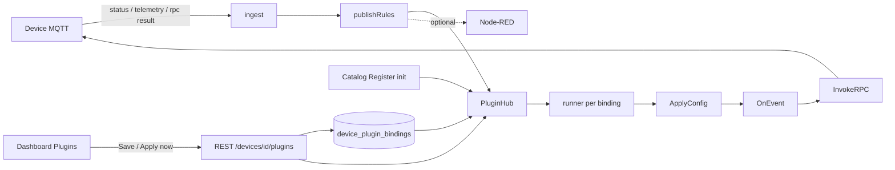
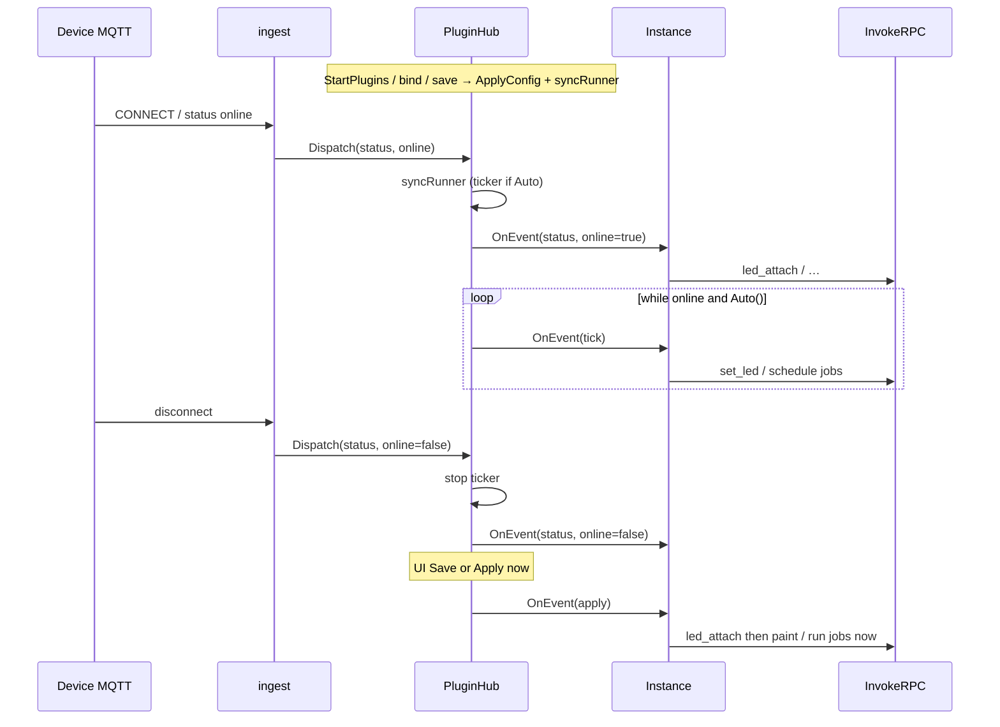

# Device plugins

Per-device automations that live **in the platform process** (not Node-RED). Node-RED stays for **cross-device** rules on the MQTT rules bus. Plugins are **one device + one catalog type**: ingest the same events, call RPC back, UI panel on the device page.

## Architecture



| Piece | Where | Role |
|-------|--------|------|
| **Catalog** | `internal/plugins` `Register()` in `init()` | Builtin types (`led-garland`, `schedule`, …). `GET /plugins`. |
| **Binding** | SQLite `device_plugin_bindings` | `UNIQUE(device_pk, plugin_id)`. Same catalog plugin on many devices = independent instances/configs. One device cannot bind the same `plugin_id` twice. |
| **Hub** | `services.PluginHub` | One runner per enabled binding. Started from `main` via `StartPlugins`. |
| **Instance** | `plugins.Instance` | `ApplyConfig` → `OnEvent` → `IntervalMS` / `Auto`. |
| **Runtime** | hub → `Platform.InvokeRPC` | Fire-and-forget RPC (no JWT). Same downlink as the dashboard console. |

Hub does **not** speak MQTT. Ingest already parsed the envelope; `publishRules` fans out to plugins **and** (if enabled) to Node-RED.

### Lifecycle



| `OnEvent` kind | When | Typical plugin action |
|----------------|------|------------------------|
| `status` | MQTT online/offline (after runner resync) | Attach hardware, reset state. `ev.Online` is authoritative. |
| `apply` | Binding save, bind, or `POST …/apply` | Re-apply config to the device (must be online). |
| `tick` | Hub ticker while **online** and `Auto()` | Animation frames, schedule poll. |
| `telemetry` / `event` / `rpc/result` | Same envelopes as the rules bus | Optional react. |

`Auto()` + `IntervalMS()` control the ticker. Offline always pauses it. Static LED colors do not tick unless a time window is enabled.

Plugins must not: open MQTT, use device tokens, replace Node-RED for multi-device flows, or block long inside `OnEvent`.

## Builtin catalog

| id | What |
|----|------|
| `led-garland` | WS2812-style strips via firmware `set_led`, optional quiet hours / night-light window |
| `schedule` | Fire device RPC at local clock times (reboot at 04:00, lights off at 23:00, …) |

Binding is stored in SQLite (`device_plugin_bindings`). A ticker runs while the device is **online** and the plugin needs frames (`mode: auto`, animated effect, quiet/active windows, or `schedule`). Offline pauses it. Static colors (`off` / `white` / …) do not tick unless a time window is enabled.

Platform **`TIMEZONE`** (IANA, e.g. `Asia/Bangkok`) is the default for all time windows. Set it in `config.yml` / `.env`. A binding may override with `config.tz`. Empty `tz` → platform zone. Unknown zone → save is rejected.

## LED garland

Firmware binds WS2812 strips at runtime. The plugin therefore has a **required attach step**:

1. **Save / Apply now** (`apply`) or **device online** (`status`) → `led_attach` per strip `{ gpio, count, brightness }`
2. Then `set_led` frames `{ gpio, offset, length, r, g, b, on }`
3. Offline clears attach state; next online attaches again. Ticks do not re-attach unless attach was lost.

On the device page: **Add strip** / **Delete strip** (saved immediately). GPIO + LED count per strip.

Default config:

```json
{
  "strips": [
    { "gpio": 16, "length": 8 },
    { "gpio": 17, "length": 8 }
  ],
  "mode": "effect",
  "effect": "off",
  "interval_ms": 200,
  "auto_ms": 8000,
  "rpc": "set_led",
  "attach_rpc": "led_attach",
  "brightness": 32,
  "tz": "",
  "quiet": { "enabled": false, "from": "23:00", "to": "07:00", "effect": "off" },
  "active": { "enabled": false, "from": "18:00", "to": "23:00" }
}
```

Effects: `off`, `white`, `warm`, `red`, `green`, `blue`, `blink`, `strobe`, `breathe`, `chase`, `comet`, `scanner`, `fill`, `theater`, `sparkle`, `fire`, `rainbow`, `police`, `christmas`.

`interval_ms` is the frame period for animated effects **and** for `mode: auto`.  
`mode: auto` additionally switches the effect every `auto_ms`. Static solids do not use the ticker unless **quiet hours** or **only between** is on (then the hub polls ~15s to enter/leave the window).

- **Quiet hours** — inside `[from, to)` (wraps midnight if `from > to`) force `quiet.effect` (usually `off` / `warm`). Strobe/chase stop at night.
- **Only between** (night light) — outside the window the strip is off. Combine with quiet: outside active → off; inside active ∩ quiet → quiet effect; else normal.

RPC:

| Method | Params | When |
|--------|--------|------|
| `led_attach` | `gpio`, `count` (= strip length), `brightness` (1–255, default 32) | save / apply / device online |
| `set_led` | `gpio`, `offset`, `length`, `r`, `g`, `b`, `on` | after attach, each frame |

Same GPIO `led_attach` again recreates the strip (firmware).

## Schedule

Jobs run once per matching minute while the device is online (10s poll). `days` is `time.Weekday` (`0` Sunday … `6` Saturday); empty / all seven = every day.

```json
{
  "tz": "",
  "jobs": [
    { "name": "night off", "at": "23:00", "days": [], "rpc": "set_led", "params": { "gpio": 16, "offset": 0, "length": 8, "on": false } },
    { "name": "weekday reboot", "at": "04:00", "days": [1, 2, 3, 4, 5], "rpc": "reboot", "params": {} }
  ]
}
```

## API

| Method | Path |
|--------|------|
| GET | `/plugins` |
| GET | `/devices/{id}/plugins` |
| POST | `/devices/{id}/plugins` | `{ "plugin_id": "led-garland", "config"?: {}, "enabled"?: true }` |
| PUT | `/devices/{id}/plugins/{bindingId}` | `{ "enabled"?: bool, "config"?: {} }` |
| DELETE | `/devices/{id}/plugins/{bindingId}` |
| POST | `/devices/{id}/plugins/{bindingId}/apply` | one frame now (device must be online) |

UI: device page → **Plugins**. Unknown plugins get a JSON config editor.

## How to add a new plugin

V1 plugins are **Go builtins** (no zip/npm). One file + `init()` register. Rebuild the platform binary.

### 1. Implement `plugins.Instance`

Create `internal/plugins/<name>.go` in package `plugins`:

```go
package plugins

import "encoding/json"

const PluginPing = "ping"

func init() {
	Register(Descriptor{
		ID:            PluginPing,
		Name:          "Ping",
		Description:   "RPC ping while device is online",
		DefaultConfig: json.RawMessage(`{"interval_ms":5000,"rpc":"echo","msg":"ping"}`),
	}, func() Instance { return &Ping{} })
}

type Ping struct {
	interval int
	rpc, msg string
	auto     bool
}

func (p *Ping) ApplyConfig(raw json.RawMessage) error {
	var cfg struct {
		IntervalMS int    `json:"interval_ms"`
		RPC        string `json:"rpc"`
		Msg        string `json:"msg"`
		Mode       string `json:"mode"` // auto | off
	}
	cfg.IntervalMS, cfg.RPC, cfg.Msg = 5000, "echo", "ping"
	if len(raw) > 0 {
		_ = json.Unmarshal(raw, &cfg)
	}
	p.interval, p.rpc, p.msg = cfg.IntervalMS, cfg.RPC, cfg.Msg
	p.auto = cfg.Mode == "auto"
	if p.interval < 200 {
		p.interval = 200
	}
	return nil
}

func (p *Ping) IntervalMS() int { return p.interval }
func (p *Ping) Auto() bool      { return p.auto }

func (p *Ping) OnEvent(rt Runtime, ev Event) error {
	switch ev.Kind {
	case "tick", "apply":
		return rt.InvokeRPC(p.rpc, map[string]any{"msg": p.msg})
	case "status", "telemetry", "event":
		// optional: react to device data
		return nil
	}
	return nil
}
```

Contract:

| Method | Role |
|--------|------|
| `ApplyConfig` | parse/validate binding JSON; called on bind/update |
| `OnEvent` | `tick` / `apply` / `status` / `telemetry` / `event` / `rpc/result`. Use `status`+`Online` for attach-on-connect. |
| `IntervalMS` | ticker period when `Auto()` |
| `Auto` | `true` → hub ticks while device is online |

`Runtime.InvokeRPC` is fire-and-forget (no JWT). Same path as dashboard RPC.

### 2. Register

`init()` + `Register(...)` is enough. Same package `plugins` is imported by the hub, so the new file is linked automatically. **Do not** forget `init()` or the plugin will not appear in `GET /plugins`.

Optional `Effects []string` on the descriptor is only for LED-style UIs.

### 3. UI

- **No extra UI required.** Unknown `plugin_id` shows a JSON textarea on the device page.
- Custom form: branch in `web/src/components/DevicePlugins.tsx` (like `led-garland` / `schedule`).

### 4. Run

```bash
go test ./internal/plugins/ ./internal/services/
# restart platform
```

Device page → **Add plugin** → pick the new name → edit config → Save. `enabled` + `Auto()` starts the ticker after the device is online. If the firmware needs a one-time bind (like `led_attach`), do it on `apply` **and** `status` online.

### 5. Tests

Prefer pure helpers (like `LEDFrame`) without MQTT. Binding CRUD: `internal/services/plugin_hub_test.go`.

### Do not

- Talk MQTT / device tokens from the plugin — only `InvokeRPC` + events.
- Replace Node-RED for multi-device rules.
- Block for long inside `OnEvent` (ticks run sequentially per binding).
