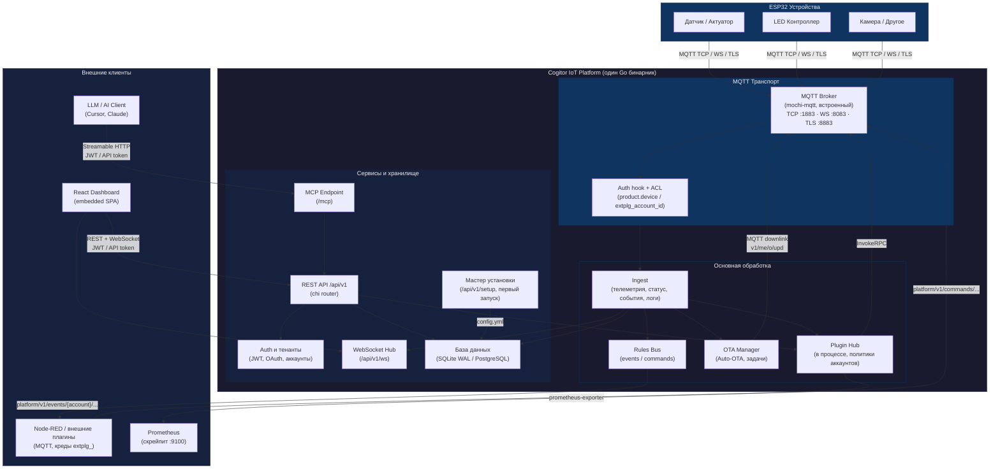

# Cogitor IoT Platform — Требования к продукту

> **Версия**: 1.0
> **Статус**: Активен
> **Обновлено**: Август 2026

Этот документ определяет что делает платформа, для кого и зачем. Источник истины по скоупу функций и критериям приёмки.

Связанные доки: [API](02-api.md), [Авторизация](03-auth.md), [MQTT](04-mqtt.md), [Автоматизация](06-automation.md), [Эксплуатация](11-operations.md).

---

## 1. Видение

Cogitor IoT Platform — **self-hosted, одно-бинарный IoT-бэкенд и операционный дашборд** для управления ESP32-устройствами по MQTT. Предоставляет всё необходимое для небольшого/среднего развёртывания — подключение устройств, приём телеметрии, RPC, OTA-обновления, автоматизацию и интеграцию с LLM — без облачных сервисов.

Главный принцип: **один процесс, один бинарник, без внешнего SaaS**.

---

## 2. Проблемы

| Боль | Альтернативы | Подход Cogitor |
|------|-------------|---------------|
| Облачные IoT требуют интернет, стоят за устройство, привязывают данные | AWS IoT, ThingsBoard Cloud, Blynk | Self-hosted; данные на NAS / сервере оператора |
| Многокомпонентные стеки сложны | ThingsBoard CE + Mosquitto + PostgreSQL + Grafana | Один Go-бинарник с MQTT, SQLite (или опционально PostgreSQL), React |
| OTA ручная | Скрипты, ручная прошивка | Встроенная OTA: загрузка `.bin`, URL, авто-отправка |
| Автоматизация требует отдельный сервер | Node-RED, Home Assistant | Встроенные плагины (Go) для каждого устройства + опциональный Node-RED для кросс-устройственных правил |
| Нет AI-интеграции | — | MCP-эндпоинт для AI-клиентов |

---

## 3. Целевые пользователи

### 3.1 Основной — разработчик устройств / оператор лаборатории
- ESP32-устройства (LED-контроллеры, датчики, актуаторы)
- Дашборд для статуса, прошивки, команд
- Запуск на NAS или Raspberry Pi
- Минимальные операционные затраты

### 3.2 Вторичный — малый бизнес IoT
- 10–200 устройств на одном объекте
- Ролевой доступ (admin / operator / viewer)
- Правила автоматизации (расписания, тихие часы, пороговые алерты)
- Аудит (события, логи, история OTA)

### 3.3 Третичный — AI/LLM энтузиаст
- Управление устройствами через естественный язык
- MCP-совместимый клиент (Cursor, Claude)
- Стандартный протокол интеграции (MCP over HTTP)

---

## 4. Цели и метрики успеха

| Цель | Метрика | Значение |
|------|---------|----------|
| Минимальный footprint | Docker-контейнеров / процессов | 1 (платформа) + 1 опциональный (Node-RED) |
| Быстрое подключение | Время от «Создать устройство» до первой телеметрии | < 5 минут (включая прошивку) |
| Надёжное присутствие | Точность трекинга MQTT-сессий | 100% подключённых сессий в дашборде за 2 с |
| Zero-touch OTA | Устройства на последней прошивке после включения Auto-OTA | Все онлайн-устройства за один цикл переподключения |
| Оперативная видимость | Загрузка страниц дашборда | < 1 с для 200 устройств |
| AI-управляемость | MCP-инструменты доступны | Все основные операции доступны через MCP |

---

## 5. Функциональные требования

### 5.1 Жизненный цикл устройств

| ID | Требование | Приоритет | Статус |
|----|-----------|-----------|--------|
| F-101 | Создание **продуктов** как архетипов устройств с общей схемой (RPC, телеметрия, атрибуты) | P0 | ✅ |
| F-102 | Регистрация **устройств** под продуктом; одноразовый токен показывается один раз | P0 | ✅ |
| F-103 | Ротация токена; старая MQTT-сессия немедленно отключается | P0 | ✅ |
| F-104 | Включение / отключение / удаление устройств; отключённые не могут авторизоваться | P0 | ✅ |
| F-105 | Автоопределение стиля MQTT-топиков (full `iot/v1/…` vs short `v1/me/…`) | P0 | ✅ |
| F-106 | Провижининг устройства: Wi-Fi + MQTT креды как JSON для прошивки | P1 | ✅ |

### 5.2 Телеметрия и атрибуты

| ID | Требование | Приоритет | Статус |
|----|-----------|-----------|--------|
| F-201 | Приём телеметрии из MQTT; хранение в БД (SQLite или PostgreSQL) с временными метками | P0 | ✅ |
| F-202 | REST-запросы последней и исторической телеметрии | P0 | ✅ |
| F-203 | **Reported** и **desired** атрибуты; desired публикуются на устройство | P0 | ✅ |
| F-204 | Хранение телеметрии: автоочистка старше N дней (по умолчанию 30) | P1 | ✅ |
| F-205 | Схема метрик продукта: ключ, метка, группа, единица, формат | P1 | ✅ |

### 5.3 RPC

| ID | Требование | Приоритет | Статус |
|----|-----------|-----------|--------|
| F-301 | RPC-запросы через MQTT downlink; ожидание ответа с настраиваемым таймаутом | P0 | ✅ |
| F-302 | RPC-консоль: автозаполнение из схемы + live `rpc-list` | P0 | ✅ |
| F-303 | История RPC для каждого устройства | P1 | ✅ |
| F-304 | Корреляция по JSON `id`; успех = `code: 0` | P0 | ✅ |

### 5.4 OTA-обновления

| ID | Требование | Приоритет | Статус |
|----|-----------|-----------|--------|
| F-401 | Загрузка `.bin` (multipart, макс. 32 МБ); публичный URL (без auth для ESP HTTP GET) | P0 | ✅ |
| F-402 | Регистрация внешних URL прошивок (HTTPS) | P1 | ✅ |
| F-403 | Уведомление устройства или всего продукта через MQTT | P0 | ✅ |
| F-404 | **Auto-OTA**: автоотправка при подключении или отчёте версии | P0 | ✅ |
| F-405 | Отслеживание статуса: pending → running → success / failed / cancelled | P0 | ✅ |
| F-406 | Модули: один продукт, разные модули (main, factory) | P1 | ✅ |
| F-407 | Тот же продукт+модуль+версия заменяет образ | P1 | ✅ |

### 5.5 Аутентификация

| ID | Требование | Приоритет | Статус |
|----|-----------|-----------|--------|
| F-501 | Вход по логину или email + пароль | P0 | ✅ |
| F-502 | Саморегистрация с подтверждением email (SMTP или log) | P1 | ✅ |
| F-503 | Google OAuth с привязкой аккаунтов | P1 | ✅ |
| F-504 | Роли: **admin** (полный), **operator** (чтение + запись), **viewer** (только чтение) | P0 | ✅ |
| F-505 | Первый администратор и аккаунт по умолчанию создаются **мастером первичной настройки** (setup wizard, `/setup`); переменные `ADMIN_*` / `BOOTSTRAP_*` пользователей не создают | P0 | ✅ |
| F-506 | API-токены для MCP и скриптов (создаются в Settings, показываются один раз) | P0 | ✅ |
| F-507 | Страница Users: список, смена роли, отключение, удаление | P1 | ✅ |

### 5.6 Автоматизация

| ID | Требование | Приоритет | Статус |
|----|-----------|-----------|--------|
| F-601 | **Шина правил**: JSON-события на `platform/v1/events/{account_slug}/{product}/{device}/{kind}` | P0 | ✅ |
| F-602 | **Команды**: внешние плагины / Node-RED публикуют на `platform/v1/commands/{account_slug}/{product}/{device}/…` ; ACL разрешает только slug своего аккаунта, устройство ищется внутри него | P0 | ✅ |
| F-603 | **Плагины устройств**: внутрипроцессные автоматизации с RPC-обратным вызовом | P0 | ✅ |
| F-604 | LED-гирлянда: WS2812, эффекты, тихие часы, ночной свет | P1 | ✅ |
| F-605 | Расписание: RPC по локальному времени и дням недели | P1 | ✅ |
| F-606 | Node-RED в iframe дашборда | P1 | ✅ |
| F-607 | Расширяемость: Go `Register()` + `init()` | P2 | ✅ |

### 5.7 MQTT-брокер

| ID | Требование | Приоритет | Статус |
|----|-----------|-----------|--------|
| F-701 | Встроенный MQTT-брокер (mochi-mqtt) — внешний не нужен | P0 | ✅ |
| F-702 | ACL устройств по `{product}.{device}` (только up/down топики) | P0 | ✅ |
| F-703 | Опциональный MQTT-over-WebSocket | P2 | ✅ |
| F-707 | Опциональный слушатель MQTT over TLS (`:8883`, опционально mTLS через `MQTT_TLS_CA`) | P1 | ✅ |
| F-704 | LWT-присутствие (онлайн/офлайн) | P0 | ✅ |
| F-705 | Страница мониторинга MQTT: сессии, события брокера | P0 | ✅ |
| F-706 | NTP-синхронизация: `serverRecvTime` / `serverSendTime` | P1 | ✅ |

### 5.8 Дашборд

| ID | Требование | Приоритет | Статус |
|----|-----------|-----------|--------|
| F-801 | React SPA (Bootstrap 5, Vite) встроен в Go | P0 | ✅ |
| F-802 | Страницы: Overview, MQTT, Products, Devices, Device Detail, Events, Logs, OTA, Automation, Settings, Users | P0 | ✅ |
| F-803 | Обновления через WebSocket (статус, телеметрия, MQTT, OTA) | P0 | ✅ |
| F-804 | Overview: счётчики online/offline/total, MQTT, события, сессии | P0 | ✅ |
| F-805 | Device Detail: подключение, метрики, desired-атрибуты, OTA, плагины, RPC, события | P0 | ✅ |
| F-806 | Мобильная адаптация с off-canvas навигацией | P1 | ✅ |

### 5.9 MCP (LLM)

| ID | Требование | Приоритет | Статус |
|----|-----------|-----------|--------|
| F-901 | Streamable HTTP MCP на `/mcp` (один процесс, JWT/API token) | P0 | ✅ |
| F-902 | Инструменты: обзор, устройства, продукты, RPC, телеметрия, атрибуты | P0 | ✅ |
| F-903 | Инструменты записи требуют operator/admin | P0 | ✅ |
| F-904 | Совместимость с Cursor, Claude | P1 | ✅ |

### 5.10 Наблюдаемость

| ID | Требование | Приоритет | Статус |
|----|-----------|-----------|--------|
| F-1001 | Структурированные логи в stdout (`slog`): connect, disconnect, auth_fail, ACL, RPC, OTA | P0 | ✅ |
| F-1002 | Настраиваемый уровень: debug / info / warn / error | P0 | ✅ |
| F-1003 | Страница Events: фильтр по устройству, severity, времени | P0 | ✅ |
| F-1004 | Страница Logs: сообщения устройств с фильтром по уровню и времени | P1 | ✅ |
| F-1005 | Health-эндпоинты: `/healthz` (liveness), `/readyz` (DB + MQTT ready) | P0 | ✅ |

---

## 6. Нефункциональные требования

| ID | Категория | Требование |
|----|-----------|-----------|
| NF-01 | Развёртывание | Один Docker-образ (multi-stage: Node.js → Go → Alpine). Non-root. |
| NF-02 | Развёртывание | Альтернатива: bare-metal через `make build` → один бинарник + SQLite; Debian-пакет через `make deb` (systemd) |
| NF-03 | Портативность | Windows (dev), Linux (prod), ARM64 (pure-Go SQLite драйвер) |
| NF-03a | Хранилище | БД выбирается через `DATABASE_DRIVER` (`sqlite` по умолчанию, режим WAL \| `postgres`) и `DATABASE_DSN`; `SQLITE_PATH` — устаревший алиас |
| NF-03b | Первый запуск | Пустая БД → встроенный мастер настройки (веб-UI `/setup`, API `/api/v1/setup/*`); логина по умолчанию нет |
| NF-04 | Безопасность | JWT; SHA-256 хеши device tokens; ACL MQTT |
| NF-05 | Безопасность | Без device tokens в Node-RED; Node-RED подключается к шине правил как внешний плагин со своими MQTT-кредами (`extplg_{account_slug}_{id}`) |
| NF-06 | Безопасность | OTA download без auth (URL по токену) |
| NF-07 | Производительность | SQLite WAL (параллельное чтение при записи); PostgreSQL для крупных инсталляций |
| NF-08 | Производительность | WebSocket fan-out (без polling) |
| NF-09 | Надёжность | LWT; pending OTA на переподключение |
| NF-10 | Конфигурация | Каскад: env → `./config.yml` → `/opt/iot-platform/etc/config.yml` (`.env` бинарник не читает) |
| NF-11 | Обслуживание | Миграции в `internal/db/migrations/`; автоприменение |
| NF-12 | Расширяемость | Каталог плагинов с `init()`; form-driven UI |

---

## 7. Архитектура

> **Диаграмма**: [Архитектура платформы](14-diagrams.md#архитектура-платформы)



### Поток данных

1. **Устройство → Платформа**: MQTT CONNECT с `{product}.{device}` / токен. PUBLISH телеметрии на `v1/t` или `iot/v1/.../up/telemetry/data`. Платформа принимает, хранит в БД (SQLite или PostgreSQL), транслирует через WebSocket, публикует в шину правил.
2. **Платформа → Устройство**: RPC, desired-атрибуты, OTA — на downlink-топиках (`v1/me/...` для короткого стиля, `iot/v1/{product}/{device}/down/...` для полного). Стиль топиков автоопределяется из uplink-префикса устройства.
3. **Платформа ↔ Node-RED**: События на `platform/v1/events/{account_slug}/{product}/{device}/{kind}`; команды на `platform/v1/commands/{account_slug}/{product}/{device}/...` (только свой аккаунт). Node-RED регистрируется как внешний плагин и использует его MQTT-креды (отдельный MQTT-пользователь Node-RED удалён миграцией `010_drop_nodered_creds.sql`).
4. **Дашборд → Платформа**: REST API + WebSocket для real-time обновлений. JWT или API-токен.
5. **LLM → Платформа**: MCP-эндпоинт на `/mcp` — инструменты для управления устройствами, телеметрии, RPC, OTA.

---

## 8. MQTT-протокол (Cogitor v1)

### Стили топиков

| Стиль | Префикс | Источник идентичности |
|-------|---------|----------------------|
| Full | `iot/v1/{product}/{device}/{up|down}/{capability}/{operation}` | Путь топика |
| Short | uplink `v1/t`, `v1/r/res`, …; downlink `v1/me/r/req`, `v1/me/a/upd`, … | MQTT username (`{product}.{device}`) |

### Основные топики

| Направление | Короткий | Назначение |
|-------------|----------|-----------|
| ↑ | `v1/s` | Статус (LWT) |
| ↑ | `v1/t` | Телеметрия |
| ↑ | `v1/e` | События |
| ↑ | `v1/a` | Атрибуты (отчёт) |
| ↓ | `v1/me/a/upd` | Desired-атрибуты |
| ↓ | `v1/me/r/req` | RPC-запрос |
| ↑ | `v1/r/res` | RPC-ответ |
| ↓ | `v1/me/o/upd` | OTA-обновление (URL) |
| ↑ | `v1/o/p` | OTA-прогресс |
| ↑ | `v1/n/req` | NTP-запрос |
| ↓ | `v1/me/n/res` | NTP-ответ |

В коротком стиле downlink-топики всегда имеют префикс `v1/me/`; платформа не публикует в `v1/a/upd`, `v1/r/req`, `v1/o/upd` и `v1/n/res`.

---

## 9. Конфигурация

### Переменные окружения (основные)

| Переменная | По умолчанию | Назначение |
|-----------|-------------|-----------|
| `HTTP_ADDR` | `:8080` | HTTP-адрес (дашборд + API) |
| `MQTT_ADDR` | `:1883` | MQTT TCP-слушатель |
| `MQTT_TLS_ADDR` | `:8883` | MQTT over TLS (активен только при заданных `MQTT_TLS_CERT` + `MQTT_TLS_KEY`) |
| `DATABASE_DRIVER` | `sqlite` | `sqlite` \| `postgres` |
| `DATABASE_DSN` | `/opt/iot-platform/lib/platform.db` | Путь к файлу SQLite или URL PostgreSQL (`postgres://…`) |
| `SQLITE_PATH` | `/opt/iot-platform/lib/platform.db` | Устаревший алиас файла SQLite (используется, если `DATABASE_DSN` пуст) |
| `PUBLIC_BASE_URL` | `http://localhost:8080` | Публичный URL (OTA, email, OAuth) |
| `JWT_SECRET` | dev-значение | Ключ подписи JWT — **сменить в production** (мастер настройки генерирует его сам) |
| `TIMEZONE` | `UTC` | Часовая зона для расписаний и тихих часов |
| `TELEMETRY_RETENTION_DAYS` | `30` | Автоочистка старых данных |
| `RULES_BUS_ENABLED` | `true` | Шина событий для Node-RED |
| `BROKER_HOST_PUBLIC` | `localhost` | MQTT-хост в креды устройства |

Логина по умолчанию нет: при первом запуске с пустой БД платформа запускает мастер настройки (см. [Эксплуатация](11-operations.md)), который создаёт администратора и аккаунт по умолчанию. Переменные `ADMIN_*` / `BOOTSTRAP_*` ничего не создают.

### Приоритет конфигурации

1. Переменные окружения (OS env)
2. `./config.yml`
3. `/opt/iot-platform/etc/config.yml`

Бинарник не читает файлы `.env`; `.env` полезен, только если Docker Compose или systemd `EnvironmentFile=` передаёт его в окружение процесса.

---

## 10. Развёртывание

### Docker

Образ платформы собирается из корневого `Dockerfile` и запускается через `docker run` или корневой `docker-compose.yml` (см. [13-deploy-docker.md](13-deploy-docker.md)):

```bash
docker build -t iot-platform-go .
docker run -d --name iot-platform-go \
  -p 8080:8080 -p 1883:1883 -p 8083:8083 -p 8883:8883 \
  -v /srv/iot-platform/data:/opt/iot-platform/lib \
  -v /srv/iot-platform/etc:/opt/iot-platform/etc \
  iot-platform-go
```

`docker-compose.yml` запускает сервис `platform` (образ с Docker Hub или локальная сборка, порты и папки хоста — из `.env`) и опциональный Node-RED (`--profile nodered`, порт 1880).

### Debian-пакет

`make deb` собирает `dist/iot-platform_<version>_amd64.deb` (systemd-юнит, всё в `/opt/iot-platform/{bin,etc,lib}`). См. [12-deploy-vds.md](12-deploy-vds.md).

### Bare Metal (разработка)

```bash
make build        # web UI + Go binary → bin/platform.exe
./bin/platform.exe
```

### Synology NAS

- Gitea CI собирает образ на push в `master`
- Монтирование `/volume1/docker/iot-platform-go/data` → `/opt/iot-platform/lib` для SQLite
- Монтирование `/volume1/docker/iot-platform-go/etc` → `/opt/iot-platform/etc` (там `config.yml`, записанный мастером настройки; `.env` оттуда не читается)
- Порты и папки хоста — переменные репозитория Gitea (`IOT_HTTP_PORT`, `IOT_HOST_DIR`, …)

---

## 11. REST API (сводка)

| Область | Эндпоинты |
|---------|----------|
| Auth | `POST /auth/login`, `POST /auth/register`, `GET /auth/config`, Google OAuth |
| Overview | `GET /overview`, `GET /healthz`, `GET /readyz`, `GET /settings` |
| Products | CRUD `/products`, `POST /products/{id}/esp-defaults` |
| Devices | CRUD `/devices`, `POST /devices/{id}/token/rotate`, `POST /devices/{id}/enable`, `POST /devices/{id}/disable` |
| Telemetry | `GET /devices/{id}/telemetry`, `GET /devices/{id}/telemetry/latest` |
| Attributes | `GET /devices/{id}/attributes`, `PATCH /devices/{id}/attributes/desired` |
| RPC | `POST /devices/{id}/rpc`, `GET /devices/{id}/rpc` (история) |
| OTA | `POST /ota/firmwares/upload`, `POST /ota/firmwares/{id}/notify`, `POST /devices/{id}/ota` |
| Events/Logs | `GET /events`, `GET /logs` |
| Plugins | `GET /plugins`, CRUD `/devices/{id}/plugins`, `POST …/apply` |
| MQTT | `GET /mqtt` (сессии + события) |
| MCP | `/mcp` (streamable HTTP, JWT/token) |
| WebSocket | `GET /api/v1/ws?token=<jwt>` |
| Setup wizard | `GET /api/v1/setup/state`, `POST /api/v1/setup/step`, `POST /api/v1/setup/apply`, `POST /api/v1/setup/generate-tls` (без авторизации, только при первом запуске) |

---

## 12. Технологический стек

| Слой | Технология |
|------|-----------|
| Backend | Go 1.26+, chi router |
| Database | SQLite (modernc.org/sqlite — pure Go, без CGO) или PostgreSQL |
| MQTT Broker | mochi-mqtt (embedded) |
| Frontend | React 19 + Bootstrap 5 + Vite |
| Auth | JWT (golang-jwt), Google OAuth |
| Real-time | gorilla/websocket (`/api/v1/ws`) |
| Automation | Node-RED (опционально, через шину правил MQTT) |
| AI Integration | MCP (modelcontextprotocol/go-sdk) |
| Container | Multi-stage Docker (Node.js 22 → Go 1.26 → Alpine 3.20) |

---

## 13. Вне скобки (v1)

- ~~Multi-tenancy / рабочие пространства~~ — реализовано, см. [16-multi-account.md](16-multi-account.md)
- Облачный relay / hybrid cloud-edge
- Нативные мобильные приложения
- Видеостриминг с ESP32-CAM
- Mesh-сети / device-to-device
- Маркетплейс плагинов
- Интернационализация UI

---

## 14. Будущие улучшения (v2+)

- **Multi-account / IAM**: см. [16-multi-account.md](16-multi-account.md) — реализованный релиз, тенанты, роли per-account, account-scope правил, встроенный мониторинг
- **MQTT 5**: shared subscriptions, message expiry
- **TimescaleDB / InfluxDB**: замена SQLite для высоконагруженной телеметрии
- **Маркетплейс плагинов**: пользовательские плагины с веб-установкой
- **Fleet management**: группы, теги, массовые операции
- **Alerting**: пороговые, no-data и offline алерты с email/Telegram реализованы в v1.9.0 без Node-RED; см. [Мониторинг](11-operations.md#monitoring). Доставка через webhook остаётся в планах.
- **mDNS**: автообнаружение платформы из прошивки
- ~~**TLS для MQTT**: нативный TLS-слушатель~~ — реализовано (`MQTT_TLS_ADDR`, см. [05-mqtt-tls.md](05-mqtt-tls.md))
- **Grafana**: экспорт телеметрии

---

## 15. Критерии приёмки

- [ ] Устройство подключается с токеном и появляется **online**
- [ ] Телеметрия видна и обновляется через WebSocket
- [ ] Desired-атрибут достигает устройства через MQTT downlink
- [ ] RPC round-trip с совпадающим `id` и `code: 0`
- [ ] NTP-запрос получает `serverRecvTime` / `serverSendTime`
- [ ] Ротация токена отключает старую сессию
- [ ] Node-RED получает события на `platform/v1/events/{account_slug}/...`
- [ ] Auto-OTA отправляет прошивку при переподключении
- [ ] MCP-клиент может перечислять устройства и вызывать RPC через `/mcp`

---

## Связанная документация

| Док | Что |
|-----|------|
| [02-api.md](02-api.md) | REST API |
| [03-auth.md](03-auth.md) | Авторизация и роли |
| [04-mqtt.md](04-mqtt.md) | MQTT-протокол и топики |
| [05-mqtt-tls.md](05-mqtt-tls.md) | MQTT over TLS |
| [06-automation.md](06-automation.md) | Node-RED и шина правил |
| [07-internal-plugins.md](07-internal-plugins.md) | Встроенные плагины |
| [08-external-plugins.md](08-external-plugins.md) | Внешние плагины |
| [09-product-schema.md](09-product-schema.md) | Схема продукта (RPC, телеметрия, атрибуты) |
| [10-mcp.md](10-mcp.md) | MCP (LLM-интеграция) |
| [11-operations.md](11-operations.md) | Развёртывание и конфигурация |
| [16-multi-account.md](16-multi-account.md) | Multi-account, IAM, monitoring, plugin policies |
