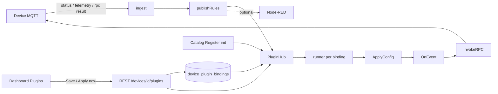

# Плагины устройств

Автоматизации для каждого устройства, работающие **в процессе платформы** (не Node-RED). Node-RED — для **меж-устройственных** правил на шине правил MQTT. Плагины — **одно устройство + один тип из каталога**: получают те же события, вызывают RPC обратно, UI-панель на странице устройства.

## Архитектура



| Компонент | Где | Роль |
|-----------|-----|------|
| **Каталог** | `internal/plugins` `Register()` в `init()` | Встроенные типы (`led-garland`, `schedule`, …). `GET /plugins`. |
| **Binding** | SQLite `device_plugin_bindings` | `UNIQUE(device_pk, plugin_id)`. Один плагин на многих устройствах = независимые инстансы/конфиги. |
| **Hub** | `services.PluginHub` | Один runner на каждый включённый binding. Запускается из `main` через `StartPlugins`. |
| **Instance** | `plugins.Instance` | `ApplyConfig` → `OnEvent` → `IntervalMS` / `Auto`. |
| **Runtime** | hub → `Platform.InvokeRPC` | Fire-and-forget RPC (без JWT). Тот же downlink, что и консоль дашборда. |

### Жизненный цикл

| `OnEvent` тип | Когда | Действие плагина |
|---------------|-------|-----------------|
| `status` | MQTT online/offline | Подключить оборудование, сбросить состояние. |
| `apply` | Сохранение конфига, bind, или `POST …/apply` | Повторно применить конфиг к устройству. |
| `tick` | Hub ticker пока **онлайн** и `Auto()` | Кадры анимации, опрос расписания. |
| `telemetry` / `event` / `rpc/result` | Те же конверты, что и шина правил | Опциональная реакция. |

## Встроенный каталог

| id | Описание |
|----|----------|
| `led-garland` | WS2812-ленты через firmware `set_led`, тихие часы / ночной свет |
| `schedule` | Вызов RPC устройства по локальному времени (перезагрузка в 04:00, свет выключить в 23:00, …) |

**`TIMEZONE`** платформы (IANA, напр. `Asia/Bangkok`) — по умолчанию для всех временных окон. Binding может переопределить через `config.tz`.

## LED-гирлянда

Конфиг по умолчанию:

```json
{
  "strips": [
    { "gpio": 16, "length": 8 },
    { "gpio": 17, "length": 8 }
  ],
  "mode": "effect",
  "effect": "off",
  "interval_ms": 200,
  "auto_ms": 8000,
  "rpc": "set_led",
  "attach_rpc": "led_attach",
  "brightness": 32,
  "tz": "",
  "quiet": { "enabled": false, "from": "23:00", "to": "07:00", "effect": "off" },
  "active": { "enabled": false, "from": "18:00", "to": "23:00" }
}
```

Эффекты: `off`, `white`, `warm`, `red`, `green`, `blue`, `blink`, `strobe`, `breathe`, `chase`, `comet`, `scanner`, `fill`, `theater`, `sparkle`, `fire`, `rainbow`, `police`, `christmas`.

- **Тихие часы** — внутри `[from, to)` (переходит через полночь если `from > to`) принудительно `quiet.effect`.
- **Только между** (ночной свет) — вне окна лента выключена.

## Расписание

Задачи выполняются раз в подходящую минуту, пока устройство онлайн (опрос 10с). `days` — `time.Weekday` (`0` воскресенье … `6` суббота); пусто / все семь = каждый день.

```json
{
  "tz": "",
  "jobs": [
    { "name": "night off", "at": "23:00", "days": [], "rpc": "set_led", "params": { "gpio": 16, "offset": 0, "length": 8, "on": false } },
    { "name": "weekday reboot", "at": "04:00", "days": [1, 2, 3, 4, 5], "rpc": "reboot", "params": {} }
  ]
}
```

## API

| Метод | Путь |
|-------|------|
| GET | `/plugins` |
| GET | `/devices/{id}/plugins` |
| POST | `/devices/{id}/plugins` | `{ "plugin_id": "led-garland", "config"?: {}, "enabled"?: true }` |
| PUT | `/devices/{id}/plugins/{bindingId}` | `{ "enabled"?: bool, "config"?: {} }` |
| DELETE | `/devices/{id}/plugins/{bindingId}` |
| POST | `/devices/{id}/plugins/{bindingId}/apply` | один кадр сейчас (устройство должно быть онлайн) |

## Как добавить новый плагин

V1 плагины — **Go builtins** (без zip/npm). Один файл + `init()` регистрация. Пересобрать бинарник платформы.

### 1. Реализовать `plugins.Instance`

Создать `internal/plugins/<name>.go` в пакете `plugins`:

```go
package plugins

import "encoding/json"

const PluginPing = "ping"

func init() {
	Register(Descriptor{
		ID:            PluginPing,
		Name:          "Ping",
		Description:   "RPC ping while device is online",
		DefaultConfig: json.RawMessage(`{"interval_ms":5000,"rpc":"echo","msg":"ping"}`),
		Form: []FormField{
			{Key: "interval_ms", Type: "number", Label: "Interval ms", Min: num(200)},
			{Key: "rpc", Type: "string", Label: "RPC"},
			{Key: "msg", Type: "string", Label: "Message"},
		},
	}, func() Instance { return &Ping{} })
}

type Ping struct {
	interval int
	rpc, msg string
	auto     bool
}

func (p *Ping) ApplyConfig(raw json.RawMessage) error { /* ... */ return nil }
func (p *Ping) IntervalMS() int { return p.interval }
func (p *Ping) Auto() bool      { return p.auto }
func (p *Ping) OnEvent(rt Runtime, ev Event) error {
	switch ev.Kind {
	case "tick", "apply":
		return rt.InvokeRPC(p.rpc, map[string]any{"msg": p.msg})
	}
	return nil
}
```

### 2. Регистрация

`init()` + `Register(...)` достаточно. **Не забыть** `init()` или плагин не появится в `GET /plugins`.

### 3. UI

Установить `Descriptor.Form` (`[]FormField`). Типы: `number` `string` `select` `checkbox` `time` `timezone` `json` `weekdays` `object` `array` `break`. Пустой `Form` → JSON textarea.

### 4. Запуск

```bash
go test ./internal/plugins/ ./internal/services/
# перезапустить платформу
```

### Не делать

- Не использовать MQTT / токены устройств из плагина — только `InvokeRPC` + события.
- Не заменять Node-RED для меж-устройственных правил.
- Не блокировать надолго внутри `OnEvent`.

---

## Внешние плагины

Внешние плагины работают как **отдельные процессы** (любой язык) и общаются с платформой через четыре транспорта. Получают те же события, что и встроенные плагины, без перекомпиляции Go-бинарника.

### Режимы транспорта

| Режим | Направление | Когда использовать |
|-------|-------------|--------------------|
| **Webhook** (HTTP push) | Платформа → Плагин | Низкая задержка, у плагина есть публичный IP |
| **Polling** (HTTP pull) | Плагин → Платформа | Плагин за NAT/файрволом |
| **MQTT** (шина правил) | Плагин подписывается на брокер | Кросс-устройственные события, стиль Node-RED |
| **gRPC** | Платформа → Плагин | Высокая пропускная способность, строгая типизация |

### Регистрация

```
POST /api/v1/plugins/external
Authorization: Bearer <admin JWT>

{
  "id": "my-plugin",
  "name": "My Plugin",
  "description": "...",
  "endpoint": "http://192.168.1.50:8080/rpc"   // webhook URL, или пропустить для polling
}
```

Ответ содержит API-токен **и** MQTT-креды:

```json
{
  "ok": true,
  "id": "my-plugin",
  "token": "ext_plg_abc123…",
  "mqtt_user": "extplg_my-plugin",
  "mqtt_pass": "одноразовый-пароль…",
  "mqtt_host": "192.168.1.22",
  "mqtt_port": 1883,
  "mqtt_ws": "ws://192.168.1.22:8083/",
  "rules_bus": "platform/v1"
}
```

### Режим MQTT

Каждый зарегистрированный плагин может подключиться к встроенному MQTT-брокеру, используя креды из регистрации. Самый простой режим — не нужен HTTP-сервер или polling.

**Подключение:** `mqtt_user` / `mqtt_pass` из ответа регистрации. Формат username: `extplg_{plugin_id}`.

**ACL (что плагин может через MQTT):**

| Действие | Паттерн топика | Описание |
|----------|---------------|----------|
| Подписка | `{rules_bus}/events/#` | Все события устройств: телеметрия, статус, события, логи, OTA, атрибуты |
| Публикация | `{rules_bus}/commands/{product}/{device}/{cap}` | Отправка RPC, установка атрибутов, запуск OTA |

**Топики событий** (подписка):
```
platform/v1/events/{product_id}/{device_id}/telemetry
platform/v1/events/{product_id}/{device_id}/status
platform/v1/events/{product_id}/{device_id}/event
platform/v1/events/{product_id}/{device_id}/log
platform/v1/events/{product_id}/{device_id}/ota
platform/v1/events/{product_id}/{device_id}/attributes/reported
platform/v1/events/{product_id}/{device_id}/attributes/desired
platform/v1/events/{product_id}/{device_id}/rpc/result
```

**Топики команд** (публикация):
```
platform/v1/commands/{product_id}/{device_id}/rpc
platform/v1/commands/{product_id}/{device_id}/attributes/desired
platform/v1/commands/{product_id}/{device_id}/ota
```

**Пример: подписка на все события (Python):**
```python
import paho.mqtt.client as mqtt

def on_message(client, userdata, msg):
    print(f"[{msg.topic}] {msg.payload.decode()}")

client = mqtt.Client()
client.username_pw_set("extplg_my-plugin", "одноразовый-пароль")
client.connect("192.168.1.22", 1883)
client.subscribe("platform/v1/events/#")
client.on_message = on_message
client.loop_forever()
```

**Пример: отправка RPC команды (публикация):**
```python
import json
client.publish(
    "platform/v1/commands/esp32-cam/cam-001/rpc",
    json.dumps({"method": "reboot", "params": {"delayMs": 1000}})
)
```

**Преимущества:** Не нужен HTTP endpoint; работает за NAT; видит все устройства; может отправлять команды.
**Ограничения:** Нет фильтрации по binding; нет тик-событий; нет уведомлений `plugin.apply_config` / `plugin.detach`.

### API

| Метод | Путь |
|-------|------|
| POST | `/api/v1/plugins/external` | Регистрация (admin JWT) |
| GET | `/api/v1/plugins/external` | Список плагинов (auth) |
| DELETE | `/api/v1/plugins/external/{id}` | Удаление (admin) |
| POST | `/api/v1/plugins/external/{id}/regenerate-mqtt` | Обновить MQTT-пароль (admin) |
| POST | `/api/plugins/external/rpc` | JSON-RPC endpoint (plugin token) |

Полная спецификация — [08-external-plugins.md](08-external-plugins.md), примеры кода — [examples/plugins/](../../examples/plugins/) (Python, Go, Java, C++, gRPC).
