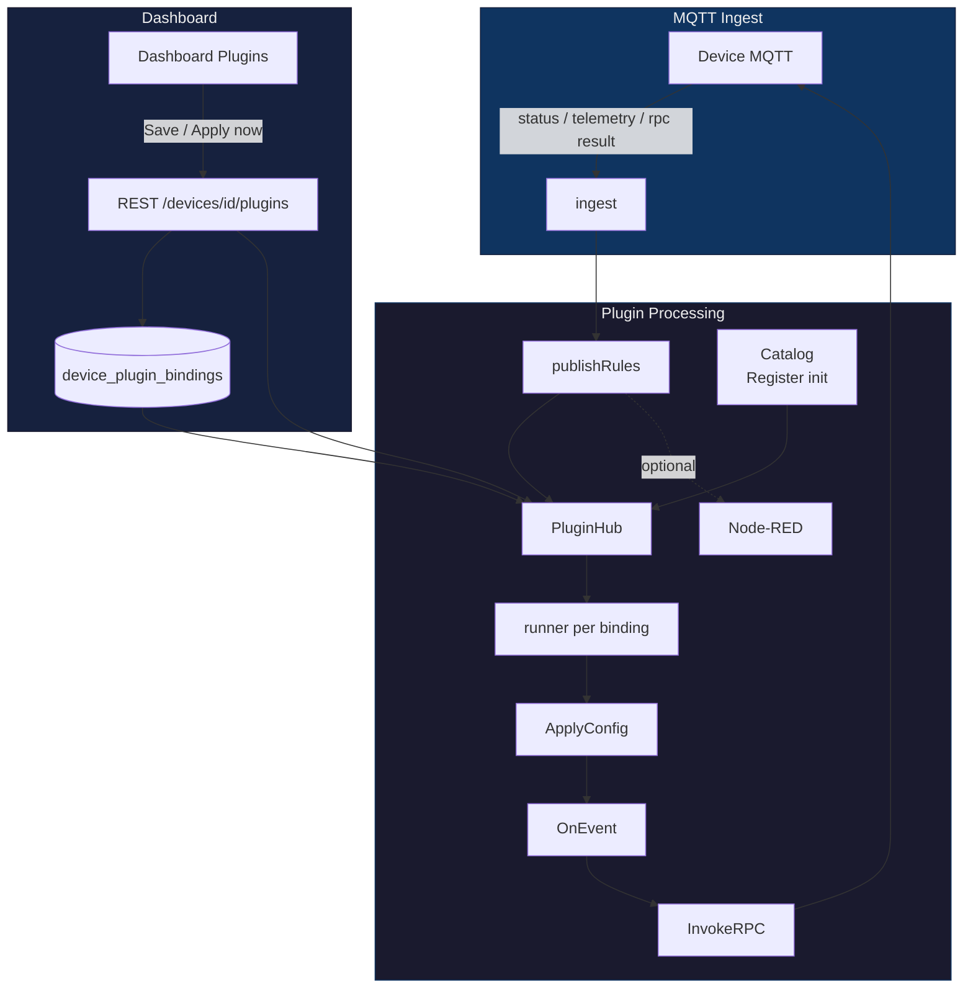
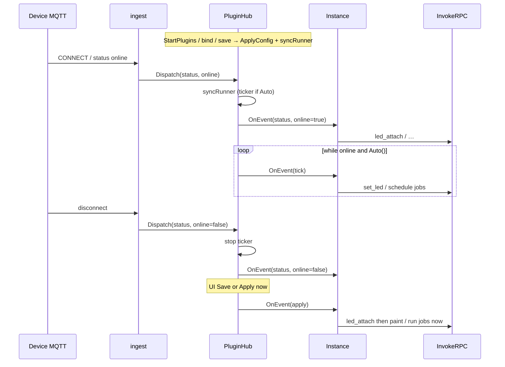

# Плагины устройств

Автоматизации для **каждого устройства**, работающие в процессе платформы. Не путать с Node-RED — он для **меж-устройственных** правил на шине правил MQTT.

Плагин — это **одно устройство + один тип из каталога**. Получает события устройства (статус, телеметрия, тики), вызывает RPC обратно, имеет UI-панель на странице устройства.

Встроенные плагины: `led-garland` (WS2812-ленты) и `schedule` (RPC по времени). Свой плагин — один Go-файл + `init()`.

---

## Архитектура

> **Диаграмма**: [Архитектура внутренних плагинов](14-diagrams.md#архитектура-внутренних-плагинов)



| Компонент | Где | Роль |
|-----------|-----|------|
| **Каталог** | `internal/plugins` `Register()` в `init()` | Встроенные типы (`led-garland`, `schedule`, …). `GET /plugins`. |
| **Binding** | SQLite `device_plugin_bindings` | `UNIQUE(device_pk, plugin_id)`. Один плагин на многих устройствах = независимые инстансы/конфиги. |
| **Hub** | `services.PluginHub` | Один runner на каждый включённый binding. Запускается из `main` через `StartPlugins`. |
| **Instance** | `plugins.Instance` | `ApplyConfig` → `OnEvent` → `IntervalMS` / `Auto`. |
| **Runtime** | hub → `Platform.InvokeRPC` | Fire-and-forget RPC (без JWT). Тот же downlink, что и консоль дашборда. |

Hub **не говорит** в MQTT. Ingest уже распарсил конверт; `publishRules` рассылает в плагины **и** (если включено) в Node-RED.

### Жизненный цикл

> **Диаграмма**: [Жизненный цикл внутреннего плагина](14-diagrams.md#жизненный-цикл-внутреннего-плагина)



| `OnEvent` тип | Когда | Действие плагина |
|---------------|-------|-----------------|
| `status` | MQTT online/offline (после runner resync) | Подключить оборудование, сбросить состояние. `ev.Online` — авторитетный. |
| `apply` | Сохранение конфига, bind, или `POST …/apply` | Повторно применить конфиг к устройству (должно быть онлайн). |
| `tick` | Hub ticker пока **онлайн** и `Auto()` | Кадры анимации, опрос расписания. |
| `telemetry` / `event` / `rpc/result` | Те же конверты, что и шина правил | Опциональная реакция. |

`Auto()` + `IntervalMS()` управляют тикером. Offline всегда приостанавливает. Статические цвета LED не тикают, если не включены временные окна.

Плагины **не должны**: открывать MQTT, использовать токены устройств, заменять Node-RED для мульти-устройственных правил, блокировать надолго внутри `OnEvent`.

---

## Встроенный каталог

| id | Описание |
|----|----------|
| `led-garland` | WS2812-ленты через firmware `set_led`, тихие часы / ночной свет |
| `schedule` | Вызов RPC устройства по локальному времени (перезагрузка в 04:00, свет выключить в 23:00, …) |

Binding хранится в SQLite (`device_plugin_bindings`). Тикер работает пока устройство **онлайн** и плагину нужны кадры (`mode: auto`, анимированный эффект, тихие/активные окна, или `schedule`). Offline приостанавливает. Статические цвета (`off` / `white` / …) не тикают, если не включены временные окна.

**`TIMEZONE`** платформы (IANA, напр. `Asia/Bangkok`) — по умолчанию для всех временных окон. Настраивается в `config.yml` / `.env`. Binding может переопределить через `config.tz`. Пустой `tz` → зона платформы. Неизвестная зона → ошибка сохранения.

---

## LED-гирлянда

Firmware привязывает WS2812-ленты в runtime. Плагин поэтому имеет **обязательный шаг attach**:

1. **Save / Apply now** (`apply`) или **device online** (`status`) → `led_attach` на каждую ленту `{ gpio, count, brightness }`
2. Затем `set_led` кадры `{ gpio, offset, length, r, g, b, on }`
3. Offline очищает attach; следующий online снова прикрепляет. Тики не пере-прикрепляют, если attach не потерян.

На странице устройства: **Add strip** / **Delete strip** (сохраняется сразу). GPIO + количество LED на ленту.

Конфиг по умолчанию:

```json
{
  "strips": [
    { "gpio": 16, "length": 8 },
    { "gpio": 17, "length": 8 }
  ],
  "mode": "effect",
  "effect": "off",
  "interval_ms": 200,
  "auto_ms": 8000,
  "rpc": "set_led",
  "attach_rpc": "led_attach",
  "brightness": 32,
  "tz": "",
  "quiet": { "enabled": false, "from": "23:00", "to": "07:00", "effect": "off" },
  "active": { "enabled": false, "from": "18:00", "to": "23:00" }
}
```

Эффекты: `off`, `white`, `warm`, `red`, `green`, `blue`, `blink`, `strobe`, `breathe`, `chase`, `comet`, `scanner`, `fill`, `theater`, `sparkle`, `fire`, `rainbow`, `police`, `christmas`.

`interval_ms` — период кадра для анимированных эффектов **и** для `mode: auto`.
`mode: auto` дополнительно переключает эффект каждые `auto_ms`. Статические цвета не используют тикер, если не включены **тихие часы** или **только между** (тогда хаб опрашивает ~15с для входа/выхода из окна).

- **Тихие часы** — внутри `[from, to)` (переходит через полночь если `from > to`) принудительно `quiet.effect` (обычно `off` / `warm`). Strobe/chase останавливаются ночью.
- **Только между** (ночной свет) — вне окна лента выключена. Комбинируется с тихими: вне active → off; внутри active ∩ quiet → quiet effect; иначе нормально.

RPC:

| Метод | Параметры | Когда |
|-------|-----------|-------|
| `led_attach` | `gpio`, `count` (= длина ленты), `brightness` (1–255, по умолчанию 32) | save / apply / device online |
| `set_led` | `gpio`, `offset`, `length`, `r`, `g`, `b`, `on` | после attach, каждый кадр |

Повторный `led_attach` на тот же GPIO пересоздаёт ленту (firmware).

---

## Расписание

Задачи выполняются раз в подходящую минуту, пока устройство онлайн (опрос 10с). `days` — `time.Weekday` (`0` воскресенье … `6` суббота); пусто / все семь = каждый день.

```json
{
  "tz": "",
  "jobs": [
    { "name": "night off", "at": "23:00", "days": [], "rpc": "set_led", "params": { "gpio": 16, "offset": 0, "length": 8, "on": false } },
    { "name": "weekday reboot", "at": "04:00", "days": [1, 2, 3, 4, 5], "rpc": "reboot", "params": {} }
  ]
}
```

---

## API

| Метод | Путь |
|-------|------|
| GET | `/plugins` |
| GET | `/devices/{id}/plugins` |
| POST | `/devices/{id}/plugins` | `{ "plugin_id": "led-garland", "config"?: {}, "enabled"?: true }` |
| PUT | `/devices/{id}/plugins/{bindingId}` | `{ "enabled"?: bool, "config"?: {} }` |
| DELETE | `/devices/{id}/plugins/{bindingId}` |
| POST | `/devices/{id}/plugins/{bindingId}/apply` | один кадр сейчас (устройство должно быть онлайн) |

UI: страница устройства → **Plugins**. Форма рендерится из **`Descriptor.Form`** (GET `/plugins` → `form`). Save / Apply / Remove — в shell. Нет `form` → JSON textarea.

---

## Как добавить новый плагин

V1 плагины — **Go builtins** (без zip/npm). Один файл + `init()` регистрация. Пересобрать бинарник платформы.

### 1. Реализовать `plugins.Instance`

Создать `internal/plugins/<name>.go` в пакете `plugins`:

```go
package plugins

import "encoding/json"

const PluginPing = "ping"

func init() {
	Register(Descriptor{
		ID:            PluginPing,
		Name:          "Ping",
		Description:   "RPC ping while device is online",
		DefaultConfig: json.RawMessage(`{"interval_ms":5000,"rpc":"echo","msg":"ping"}`),
		Form: []FormField{
			{Key: "interval_ms", Type: "number", Label: "Interval ms", Min: num(200)},
			{Key: "rpc", Type: "string", Label: "RPC"},
			{Key: "msg", Type: "string", Label: "Message"},
		},
	}, func() Instance { return &Ping{} })
}

type Ping struct {
	interval int
	rpc, msg string
	auto     bool
}

func (p *Ping) ApplyConfig(raw json.RawMessage) error {
	var cfg struct {
		IntervalMS int    `json:"interval_ms"`
		RPC        string `json:"rpc"`
		Msg        string `json:"msg"`
		Mode       string `json:"mode"` // auto | off
	}
	cfg.IntervalMS, cfg.RPC, cfg.Msg = 5000, "echo", "ping"
	if len(raw) > 0 {
		_ = json.Unmarshal(raw, &cfg)
	}
	p.interval, p.rpc, p.msg = cfg.IntervalMS, cfg.RPC, cfg.Msg
	p.auto = cfg.Mode == "auto"
	if p.interval < 200 {
		p.interval = 200
	}
	return nil
}

func (p *Ping) IntervalMS() int { return p.interval }
func (p *Ping) Auto() bool      { return p.auto }

func (p *Ping) OnEvent(rt Runtime, ev Event) error {
	switch ev.Kind {
	case "tick", "apply":
		return rt.InvokeRPC(p.rpc, map[string]any{"msg": p.msg})
	case "status", "telemetry", "event":
		return nil
	}
	return nil
}
```

Контракт:

| Метод | Роль |
|-------|------|
| `ApplyConfig` | парсинг/валидация JSON конфига; вызывается при bind/update |
| `OnEvent` | `tick` / `apply` / `status` / `telemetry` / `event` / `rpc/result`. Использовать `status`+`Online` для attach-on-connect. |
| `IntervalMS` | период тика когда `Auto()` |
| `Auto` | `true` → хаб тикает пока устройство онлайн |

`Runtime.InvokeRPC` — fire-and-forget (без JWT). Тот же путь, что и дашборд RPC.

### 2. Регистрация

`init()` + `Register(...)` достаточно. Тот же пакет `plugins` импортируется хабом, новый файл линкуется автоматически. **Не забыть** `init()` или плагин не появится в `GET /plugins`.

Опциональный `Effects []string` питает `options_from: "effects"` на select-полях.

### 3. UI (не трогать webui)

Установить `Descriptor.Form` (`[]FormField`). Типы: `number` `string` `select` `checkbox` `time` `timezone` `json` `weekdays` `object` `array` `break`. `break` — layout-only (опциональный `label` + `<hr>`). Дашборд рендерит; Save/Apply/Remove — в shell. Пустой `Form` → JSON textarea.

```go
Form: []FormField{
  {Key: "interval_ms", Type: "number", Label: "Interval ms", Min: num(200)},
  {Key: "rpc", Type: "string", Label: "RPC"},
},
```

### 4. Запуск

```bash
go test ./internal/plugins/ ./internal/services/
# перезапустить платформу
```

Страница устройства → **Add plugin** → выбрать новое имя → редактировать конфиг → Save. `enabled` + `Auto()` запускает тикер после подключения устройства. Если firmware нужен одноразовый bind (как `led_attach`), делать на `apply` **и** `status` online.

### 5. Тесты

Предпочитать чистые хелперы (как `LEDFrame`) без MQTT. Binding CRUD: `internal/services/plugin_hub_test.go`.

### Не делать

- Не использовать MQTT / токены устройств из плагина — только `InvokeRPC` + события.
- Не заменять Node-RED для меж-устройственных правил.
- Не блокировать надолго внутри `OnEvent` (тики идут последовательно).

---

## Внешние плагины

Внешние плагины работают как **отдельные процессы** (любой язык) и общаются с платформой через четыре транспорта (Webhook, Polling, MQTT, gRPC). Получают те же события, что и встроенные, без перекомпиляции Go-бинарника.

Полная спецификация — [08-external-plugins.md](08-external-plugins.md), примеры кода — [examples/plugins/](../../examples/plugins/) (Python, Go, Java, C++, gRPC).
