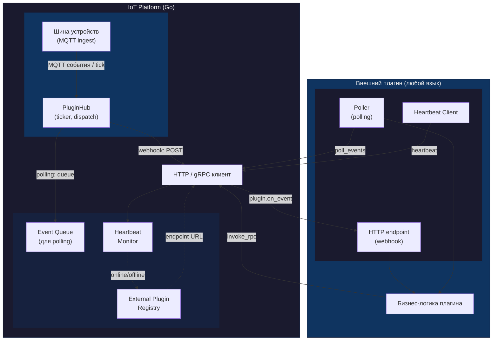
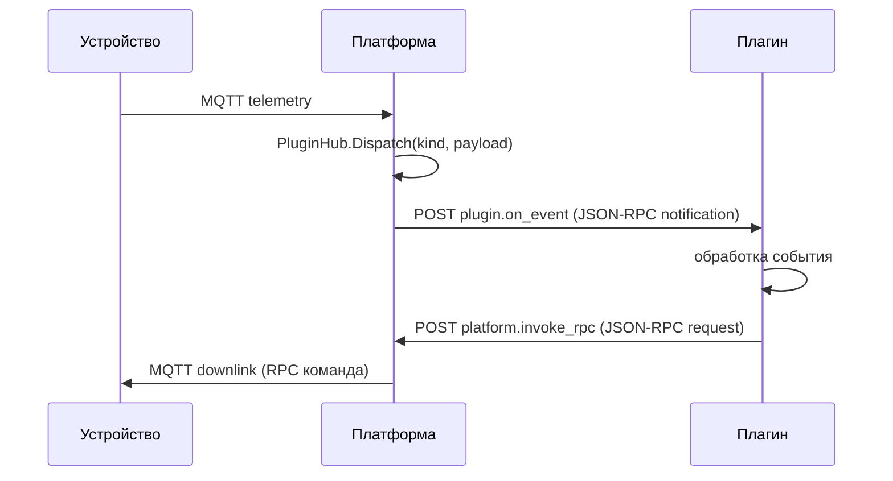
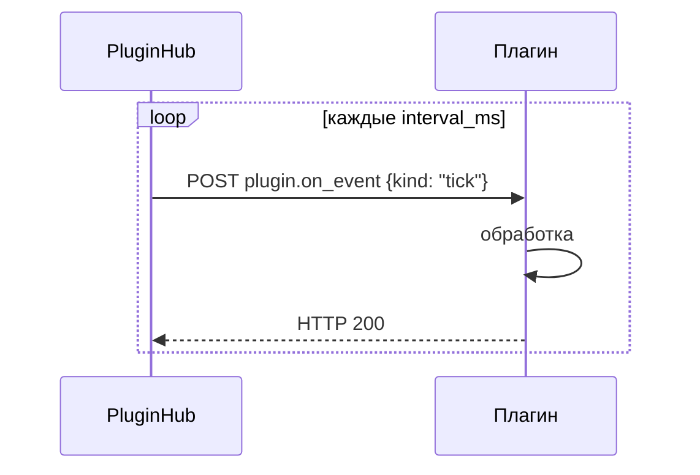
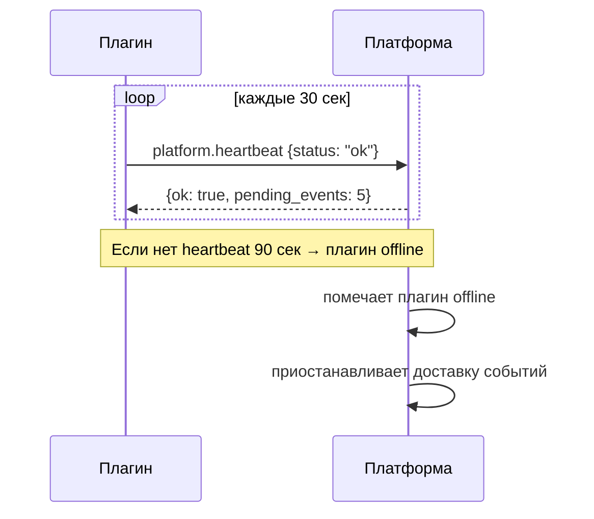
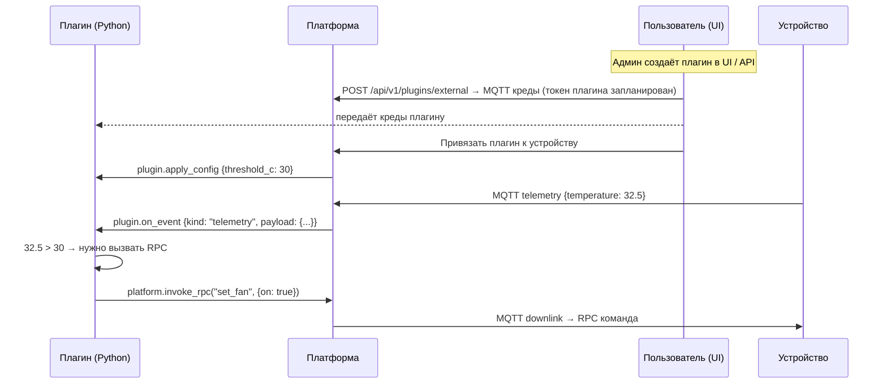
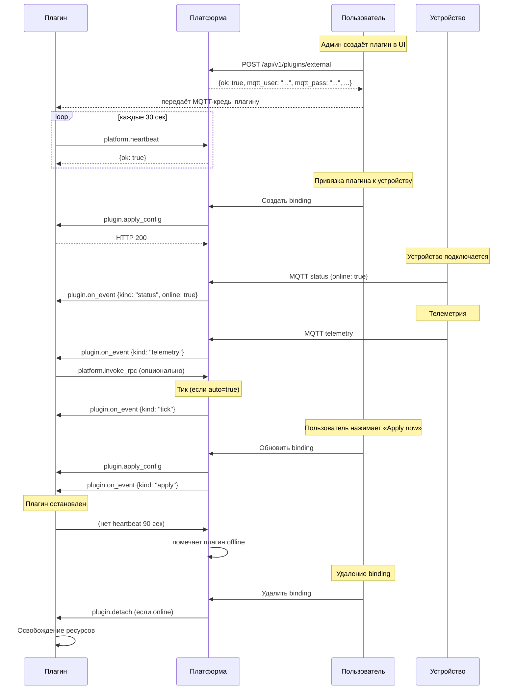

# Внешние плагины

> **Статус реализации (v1.0.x)**
>
> **Реализовано:** **только MQTT-транспорт** (шина правил). Админ регистрирует плагин
> (`POST /api/v1/plugins/external` или Settings → External Plugins) и получает MQTT-креды
> (`mqtt_user` = `extplg_{account_slug}_{plugin_id}`, одноразовый `mqtt_pass`; API-токена нет).
> Плагин подписывается на `{rules_bus}/events/{account_slug}/#` и публикует в
> `{rules_bus}/commands/…`. Также реализованы: список / удаление / `regenerate-mqtt` и
> статус `online` / `offline` по состоянию MQTT-соединения.
>
> **Запланировано, не реализовано:** транспорты webhook, polling и gRPC; heartbeat; JSON-RPC
> endpoint `/api/plugins/external/rpc`; уведомления `plugin.*` и методы `platform.*`;
> поле регистрации `endpoint`; API-токены плагинов (хеширование, rate limit); колонки БД
> `endpoint` / `auth_token_hash` / `mode` / `last_heartbeat_at`; привязка внешних плагинов
> к устройствам и доставка им `tick` / `apply`. Разделы с их описанием сохранены как roadmap
> и помечены **(запланировано)**.
>
> Команды публикуются в `{rules_bus}/commands/{account_slug}/{product_id}/{device_id}/…` со slug
> собственного аккаунта плагина; устройство ищется внутри этого аккаунта. См. [06-automation.md → Мультиаккаунтные топики](06-automation.md#мультиаккаунтные-топики).

## 1. Обзор

Внешние плагины расширяют логику IoT Platform **без перекомпиляции Go-бинарника**.
Работают как отдельные процессы (любой язык), общаются с платформой через
**MQTT** (подписка на шину правил). Транспорты **HTTP** (webhook/polling) и **gRPC** запланированы.

Запланированный полный контракт зеркалит внутренний `plugins.Instance`; с доступным сейчас
MQTT-транспортом плагин видит события шины правил своего аккаунта и отправляет команды,
но binding-ов, `tick`, `apply` и доставки конфига нет.

**Когда использовать внешние плагины:**
- Логика, которая должна работать независимо от процесса платформы
- Код на Python, Java, C++ или любом языке с HTTP/MQTT/gRPC
- Кросс-устройственные правила, не помещающиеся в Node-RED
- Интеграция со сторонними сервисами

**Когда лучше внутренние плагины:**
- Простая автоматизация каждого устройства (LED-эффекты, расписания)
- Минимальная задержка (в процессе, без сетевого хопа)
- См. [07-internal-plugins.md](07-internal-plugins.md)

| Транспорт | Направление | Когда использовать | Статус |
|-----------|-------------|--------------------|--------|
| **Webhook** (HTTP push) | Платформа → Плагин | Низкая задержка, у плагина есть публичный IP | запланировано |
| **Polling** (HTTP pull) | Плагин → Платформа | Плагин за NAT/файрволом | запланировано |
| **MQTT** (шина правил) | Плагин подписывается на брокер | Кросс-устройственные события, стиль Node-RED | **реализовано** |
| **gRPC** | Платформа → Плагин | Высокая пропускная способность, строгая типизация | запланировано |

Запланированное соответствие (сейчас существует только строка регистрации):

| Внутренний (in-process)               | Внешний (out-of-process)                    |
|---------------------------------------|---------------------------------------------|
| `Register(Descriptor, Factory)`       | `POST /api/v1/plugins/external`             |
| `ApplyConfig(json)`                   | Platform → Plugin: `plugin.apply_config`    |
| `OnEvent(Runtime, Event)`             | Platform → Plugin: `plugin.on_event`        |
| `Runtime.InvokeRPC(method, params)`   | Plugin → Platform: `platform.invoke_rpc`    |
| `IntervalMS()` / `Auto()`             | Декларируется в `Descriptor` при регистрации|

---

## 2. Архитектура (запланировано)

> Диаграммы этого раздела показывают запланированную схему webhook/polling/heartbeat. В v1.0.x путь один: устройство → ingest → MQTT-топик шины правил `{rules_bus}/events/{account_slug}/…` → MQTT-подписка плагина; плагин → `{rules_bus}/commands/…` → брокер → downlink устройству.

> **Diagram**: [External Plugin Architecture](14-diagrams.md#external-plugin-architecture)



### Поток событий (запланировано)

> **Diagram**: [External Plugin Event Flow](14-diagrams.md#external-plugin-event-flow)



### Поток тиков (запланировано)

Плагины с `auto: true` и `interval_ms > 0` получают периодические `tick`
события — точно так же, как внутренние. Платформа владеет таймером,
плагин только реагирует.

> **Diagram**: [External Plugin Tick Flow](14-diagrams.md#external-plugin-tick-flow)



---

## 3. Модель внутреннего плагина (справочник)

Внутренние плагины реализуют интерфейс `plugins.Instance`:

```go
type Instance interface {
    ApplyConfig(raw json.RawMessage) error   // валидация + загрузка конфига
    OnEvent(rt Runtime, ev Event) error      // обработка одного события
    IntervalMS() int                         // интервал тика (0 = без тика)
    Auto() bool                              // подписаться на тик-цикл?
}

type Runtime interface {
    InvokeRPC(method string, params map[string]any) error
}

type Event struct {
    Kind     string // tick | apply | status | telemetry | event | rpc/result
    Online   bool
    Payload  any
    DevicePK int64
}
```

Типы событий (константы в пакете `plugins`):

| Константа          | Значение       | Когда доставляется                            |
|--------------------|----------------|-----------------------------------------------|
| `EventTick`        | `tick`         | Каждые `interval_ms`, пока устройство online  |
| `EventApply`       | `apply`        | Конфиг сохранён или binding создан            |
| `EventStatus`      | `status`       | Переход устройства online/offline             |
| `EventTelemetry`   | `telemetry`    | Устройство опубликовало телеметрию            |
| `EventEvent`       | `event`        | Устройство опубликовало пользовательское событие |
| `EventRPCResult`   | `rpc/result`   | Ответ на ранее отправленный RPC               |

Запланированные транспорты webhook/polling/gRPC будут доставлять **те же** типы событий по проводу. MQTT-плагины (v1.0.x) вместо этого получают виды событий шины правил: `status`, `telemetry`, `event`, `attributes/reported`, `attributes/desired`, `rpc/result`, `ota`, `log` — без `tick` и `apply`.

---

## 4. Контракт внешнего плагина

### 4.1 Регистрация

Админ создаёт плагин через дашборд (**Settings → External Plugins**) или
через API. Платформа сохраняет дескриптор в таблицу `external_plugins`
в **активном аккаунте** админа (из JWT) и возвращает MQTT-креды.
API-токен не выдаётся.

```
POST /api/v1/plugins/external
Content-Type: application/json
Authorization: Bearer <admin JWT>

{
  "id":           "temp-alert",
  "name":         "Temperature Alert",
  "description":  "Send RPC when temperature exceeds threshold",
  "auto":         true,
  "interval_ms":  5000,
  "default_config": {
    "threshold_c": 35.0,
    "rpc_method":  "set_fan",
    "rpc_params":  {"on": true}
  },
  "form": [
    {"key": "threshold_c", "type": "number", "label": "Threshold °C",
     "min": -40, "max": 120},
    {"key": "rpc_method",  "type": "string", "label": "RPC method"},
    {"key": "rpc_params",  "type": "json",   "label": "RPC params JSON"}
  ]
}
```

Ответ (`201 Created`):

```json
{
  "ok": true,
  "id": "temp-alert",
  "mqtt_user": "extplg_acme_temp-alert",
  "mqtt_pass": "ext_plg_3f9c…",
  "mqtt_host": "192.168.1.22",
  "mqtt_port": 1883,
  "mqtt_ws": "ws://192.168.1.22:8083/",
  "rules_bus": "platform/v1"
}
```

Поля ответа: `ok`, `id`, `mqtt_user` (`extplg_{account_slug}_{plugin_id}`), `mqtt_pass`,
`mqtt_port`, `mqtt_host` (`BROKER_HOST_PUBLIC`), `mqtt_ws`, `rules_bus` (префикс шины правил).

**Сохраните `mqtt_pass` сразу** — он показывается только один раз (хранится только SHA-256 хеш).
Новый пароль выдаёт `POST /api/v1/plugins/external/{id}/regenerate-mqtt`
(ответ: `ok`, `id`, `mqtt_user`, `mqtt_pass`).

`id` — первичный ключ таблицы и уникален среди всех аккаунтов: повторная регистрация
существующего `id` перезаписывает плагин и выдаёт новый пароль.

Поля (запрос):

| Поле             | Тип        | Обяз. | Описание                                   |
|------------------|------------|-------|--------------------------------------------|
| `id`             | string     | да    | Уникальный идентификатор плагина (slug)    |
| `name`           | string     | да    | Человекочитаемое имя                       |
| `description`    | string     | нет   | Отображается в UI                          |
| `auto`           | bool       | нет   | Сохраняется; доставка тиков запланирована (по умолчанию `false`) |
| `interval_ms`    | int        | нет   | Сохраняется; доставка тиков запланирована (по умолчанию 0) |
| `default_config` | object     | нет   | Сохраняемый конфиг по умолчанию (JSON)     |
| `effects`        | string[]   | нет   | Сохраняемый каталог эффектов (для LED-подобных плагинов) |
| `form`           | FormField[]| нет   | Сохраняемая схема формы конфига для UI     |

`account_id` / `account_slug` в теле игнорируются — они берутся из JWT.
Поле `endpoint` (URL webhook / адрес gRPC) **запланировано** и сейчас игнорируется.

Схема `form` идентична внутреннему типу `FormField`
(см. `internal/plugins/form.go`).

### 4.2 Подключение и доступность

Спроектированы четыре транспорта; в v1.0.x **реализован только режим 3 (MQTT)**.

#### Режим 1: Webhook (HTTP push) (запланировано)

Плагин указывает `endpoint` (начинается с `http://` или `https://`) при регистрации.
Платформа POST-ит JSON-RPC уведомления на этот URL.

**Требования:**
- URL должен быть доступен с сервера платформы
- Плагин должен отвечать HTTP 200 в течение 5 секунд
- Рекомендуется HTTPS для production

**Проблемы:**
- Плагин за NAT/файрволом — платформа не достучится
- Динамический IP/порт — нужно перерегистрироваться

#### Режим 2: Polling (HTTP pull) (запланировано)

Плагин не указывает `endpoint`. Вместо этого он периодически вызывает
`platform.poll_events` чтобы получить накопленные события.

#### Режим 3: MQTT (подписка на шину правил)

Каждый зарегистрированный плагин получает **MQTT-креды** при регистрации.
Плагин подключается к встроенному MQTT-брокеру платформы и подписывается
на шину правил — те же топики, что использует Node-RED.

**Подключение:**
```
Хост:     mqtt_host (из ответа регистрации)
Порт:     mqtt_port (по умолчанию 1883) или mqtt_ws (WebSocket)
Имя:      mqtt_user (формат: extplg_{account_slug}_{plugin_id})
Пароль:   mqtt_pass (одноразовый, показан только при регистрации / regenerate-mqtt)
```

**ACL (что плагин может через MQTT):**

| Действие | Паттерн топика | Описание |
|----------|---------------|----------|
| Подписка (чтение) | `{rules_bus}/events/{account_slug}/#` (или уже) | События своего аккаунта: телеметрия, статус, события, логи, OTA, атрибуты, rpc/result |
| Публикация (запись) | `{rules_bus}/commands/{account_slug}/{product}/{device}/{cap}` | Отправка RPC, установка desired-атрибутов, запуск OTA на устройствах своего аккаунта |

`{rules_bus}/events/#`, `#` и `+` запрещены, как и поддеревья событий и команд других аккаунтов.
Slug аккаунта — часть `mqtt_user` между `extplg_` и следующим `_`.

**Структура топиков событий** (подписка):
```
platform/v1/events/{account_slug}/{product_id}/{device_id}/telemetry
platform/v1/events/{account_slug}/{product_id}/{device_id}/status
platform/v1/events/{account_slug}/{product_id}/{device_id}/event
platform/v1/events/{account_slug}/{product_id}/{device_id}/log
platform/v1/events/{account_slug}/{product_id}/{device_id}/ota
platform/v1/events/{account_slug}/{product_id}/{device_id}/attributes/reported
platform/v1/events/{account_slug}/{product_id}/{device_id}/attributes/desired
platform/v1/events/{account_slug}/{product_id}/{device_id}/rpc/result
```

**Структура топиков команд** (публикация):
```
platform/v1/commands/{account_slug}/{product_id}/{device_id}/rpc
platform/v1/commands/{account_slug}/{product_id}/{device_id}/attributes/desired
platform/v1/commands/{account_slug}/{product_id}/{device_id}/ota
```

Slug должен совпадать с аккаунтом плагина (чужие ACL отклоняет), а `{product_id}/{device_id}`
ищется внутри этого аккаунта. Старая форма без slug больше не принимается.

**Пример: подписка на все события аккаунта (Python):**
```python
import paho.mqtt.client as mqtt

MQTT_USER = "extplg_acme_temp-alert"
ACCOUNT_SLUG = MQTT_USER.removeprefix("extplg_").split("_", 1)[0]  # "acme"

def on_message(client, userdata, msg):
    print(f"[{msg.topic}] {msg.payload.decode()}")

client = mqtt.Client()
client.username_pw_set(MQTT_USER, "одноразовый-пароль")
client.connect("192.168.1.22", 1883)
client.subscribe(f"platform/v1/events/{ACCOUNT_SLUG}/#")
client.on_message = on_message
client.loop_forever()
```

**Пример: отправка RPC команды (публикация):**
```python
import json
client.publish(
    f"platform/v1/commands/{ACCOUNT_SLUG}/esp32-cam/cam-001/rpc",
    json.dumps({"method": "reboot", "params": {"delayMs": 1000}})
)
```

**Преимущества MQTT-режима:**
- Не нужен HTTP endpoint или polling — просто подписка
- Работает за NAT (исходящее MQTT-соединение)
- Видит все события устройств **своего аккаунта**, не только привязанные
- Может отправлять команды устройствам своего аккаунта через топики commands
- Heartbeat не нужен: MQTT connect / disconnect выставляет статус плагина `online` / `offline`

**Ограничения MQTT-режима:**
- Нет фильтрации по binding-ам (получает все события)
- Нет тик-событий (используйте внутренний таймер)
- Нет уведомлений `plugin.apply_config` / `plugin.detach`

#### Режим 4: gRPC (запланировано)

Плагин указывает `endpoint` **без** префикса `http://` (напр. `localhost:50051`).
Платформа подключается как gRPC клиент. См. [Раздел 5](#5-grpc-транспорт-продвинутый-запланировано).

#### Детали Polling (запланировано)

```json
{
  "jsonrpc": "2.0",
  "id": "poll-1",
  "method": "platform.poll_events",
  "params": {
    "plugin_id": "temp-alert",
    "limit": 100
  }
}
```

Ответ:

```json
{
  "jsonrpc": "2.0",
  "id": "poll-1",
  "result": {
    "events": [
      {
        "id": 12345,
        "binding_id": 42,
        "method": "plugin.on_event",
        "params": { "kind": "telemetry", "payload": {...} }
      }
    ]
  }
}
```

После обработки плагин вызывает `platform.ack_events` чтобы подтвердить:

```json
{
  "jsonrpc": "2.0",
  "id": "ack-1",
  "method": "platform.ack_events",
  "params": { "event_ids": [12345] }
}
```

#### Heartbeat (проверка живости) (запланировано)

Плагин периодически стучится в платформу чтобы сообщить что он жив.
Это работает в обоих режимах (webhook и polling).

```json
{
  "jsonrpc": "2.0",
  "id": "hb-1",
  "method": "platform.heartbeat",
  "params": {
    "plugin_id": "temp-alert",
    "status": "ok",
    "stats": {
      "events_processed": 1234,
      "errors": 2,
      "uptime_sec": 3600
    }
  }
}
```

Ответ:

```json
{
  "jsonrpc": "2.0",
  "id": "hb-1",
  "result": {
    "ok": true,
    "pending_events": 5
  }
}
```

**Параметры heartbeat:**
- Интервал: каждые 30 секунд (настраивается)
- Таймаут: если нет heartbeat 90 секунд → плагин помечается `offline`
- UI показывает статус плагина: `online` / `offline` / `unknown`

> **Diagram**: [External Plugin Heartbeat](14-diagrams.md#external-plugin-heartbeat)



#### Сравнение режимов

Реализована только колонка MQTT; остальные описывают запланированные режимы.

| Характеристика       | Webhook (push)        | Polling (pull)         | MQTT (подписка)        | gRPC            |
|----------------------|-----------------------|------------------------|------------------------|------------------|
| Задержка доставки    | Мгновенно             | Зависит от интервала   | Мгновенно              | Мгновенно        |
| Плагин за NAT        | Нет (нужен public IP) | Да                     | Да (исходящее MQTT)    | Нет (нужен IP)   |
| Видит все события    | Только свои binding   | Только свои binding    | Да (все устройства своего аккаунта) | Только свои binding |
| Может отправлять команды | Через invoke_rpc  | Через invoke_rpc       | Через commands топики  | Через invoke_rpc |
| Сложность реализации | Средняя (HTTP server) | Выше (poll + ack)      | Ниже (MQTT клиент)     | Высокая (protobuf) |
| Рекомендация         | LAN, cloud            | NAT, firewall          | Node-RED стиль, мониторинг | Высокая нагрузка |

### 4.3 Уведомления Platform → Plugin (только webhook режим) (запланировано)

Платформа отправляет **JSON-RPC 2.0 уведомления** (без поля `id`, без ожидания
ответа) на `{endpoint}`. Плагин должен ответить HTTP `200 OK` в течение
5 секунд, иначе событие считается потерянным.

#### 4.2.1 `plugin.apply_config`

Отправляется при создании binding, обновлении конфига или нажатии «Apply now».

```json
{
  "jsonrpc": "2.0",
  "method": "plugin.apply_config",
  "params": {
    "binding_id": 42,
    "device_pk": 7,
    "config": { "threshold_c": 35.0, "rpc_method": "set_fan" }
  }
}
```

Плагин обязан валидировать конфиг и вернуть HTTP 200. Если валидация не пройдена —
вернуть HTTP 400 с JSON-RPC ошибкой — платформа покажет ошибку в UI.

#### 4.2.2 `plugin.on_event`

Доставляет каждое событие, которое получил бы внутренний `OnEvent`.

```json
{
  "jsonrpc": "2.0",
  "method": "plugin.on_event",
  "params": {
    "binding_id": 42,
    "device_pk": 7,
    "kind": "telemetry",
    "online": true,
    "payload": { "temperature": 38.2, "humidity": 61 }
  }
}
```

Значения `kind`: `tick` | `apply` | `status` | `telemetry` | `event` | `rpc/result`.

#### 4.2.3 `plugin.detach`

Отправляется при удалении binding или отключении плагина. Плагин должен
освободить ресурсы, связанные с binding.

```json
{
  "jsonrpc": "2.0",
  "method": "plugin.detach",
  "params": { "binding_id": 42 }
}
```

### 4.4 Вызовы Plugin → Platform (запланировано)

В v1.0.x нет ни JSON-RPC endpoint, ни токена плагина. Сейчас плагин отправляет команды
через MQTT (`{rules_bus}/commands/…`, см. режим 3) или через REST
`POST /api/v1/devices/{id}/rpc` с Bearer-токеном пользователя.

Плагин вызывает платформу по `PLATFORM_URL` (env var или из ответа регистрации).
Все вызовы — стандартный JSON-RPC 2.0 с `id`, ожидают ответ.

Авторизация: заголовок `Authorization: Bearer <plugin_token>`. Токен выдаётся
при регистрации, ограничен только плагинными операциями.

#### 4.4.1 `platform.invoke_rpc` (запланировано)

Отправить RPC-команду устройству, привязанному к этому плагину.

```json
{
  "jsonrpc": "2.0",
  "id": "req-1",
  "method": "platform.invoke_rpc",
  "params": {
    "binding_id": 42,
    "method": "set_fan",
    "params": { "on": true },
    "timeout_ms": 4000
  }
}
```

Ответ:

```json
{
  "jsonrpc": "2.0",
  "id": "req-1",
  "result": { "sent": true }
}
```

#### 4.4.2 `platform.set_attributes` — НЕ РЕАЛИЗОВАНО

Отправить желаемые атрибуты / конфигурацию устройству.

```json
{
  "jsonrpc": "2.0",
  "id": "req-2",
  "method": "platform.set_attributes",
  "params": {
    "binding_id": 42,
    "attributes": { "mode": "eco", "target_temp": 22 }
  }
}
```

#### 4.4.3 `platform.get_device` — НЕ РЕАЛИЗОВАНО

Получить текущее состояние устройства (статус, последнюю телеметрию, атрибуты).

```json
{
  "jsonrpc": "2.0",
  "id": "req-3",
  "method": "platform.get_device",
  "params": { "binding_id": 42 }
}
```

Ответ:

```json
{
  "jsonrpc": "2.0",
  "id": "req-3",
  "result": {
    "device_pk": 7,
    "product_id": "smoke",
    "device_id":  "kitchen-01",
    "status":     "online",
    "enabled":    true,
    "telemetry":  { "temperature": 38.2, "humidity": 61 },
    "attributes": { "mode": "eco" }
  }
}
```

---

## 5. gRPC транспорт (продвинутый) (запланировано)

Для плагинов с требованиями к низкой задержке или высокой пропускной способности:

```protobuf
syntax = "proto3";
package iotplugin;

service ExternalPlugin {
  // Platform → Plugin уведомления (unary)
  rpc ApplyConfig(ApplyConfigRequest) returns (ApplyConfigResponse);
  rpc OnEvent(OnEventRequest) returns (OnEventResponse);
  rpc Detach(DetachRequest) returns (DetachResponse);
}

service PlatformAPI {
  // Plugin → Platform обратные вызовы
  rpc InvokeRPC(InvokeRPCRequest) returns (InvokeRPCResponse);
  rpc SetAttributes(SetAttributesRequest) returns (SetAttributesResponse);
  rpc GetDevice(GetDeviceRequest) returns (GetDeviceResponse);
}

message Event {
  int64  binding_id = 1;
  int64  device_pk  = 2;
  string kind       = 3; // tick | apply | status | telemetry | event | rpc/result
  bool   online     = 4;
  bytes  payload    = 5; // JSON
}

message ApplyConfigRequest {
  int64  binding_id = 1;
  int64  device_pk  = 2;
  bytes  config     = 3; // JSON
}
message ApplyConfigResponse { bool ok = 1; string error = 2; }

message OnEventRequest  { Event event = 1; }
message OnEventResponse { bool ok = 1; string error = 2; }

message DetachRequest     { int64 binding_id = 1; }
message DetachResponse    { bool ok = 1; }

message InvokeRPCRequest {
  int64  binding_id = 1;
  string method     = 2;
  bytes  params     = 3; // JSON
  int32  timeout_ms = 4;
}
message InvokeRPCResponse { bool sent = 1; }

message SetAttributesRequest {
  int64 binding_id = 1;
  bytes attributes = 2; // JSON
}
message SetAttributesResponse { bool ok = 1; }

message GetDeviceRequest  { int64 binding_id = 1; }
message GetDeviceResponse {
  int64  device_pk   = 1;
  string product_id  = 2;
  string device_id   = 3;
  string status      = 4;
  bool   enabled     = 5;
  bytes  telemetry   = 6; // JSON
  bytes  attributes  = 7; // JSON
}
```

---

## 6. Безопасность

### HTTP API (запланировано)

- Токен плагина выдаётся при регистрации, хранится хешированным в БД.
- Токен ограничен: можно вызывать только `platform.invoke_rpc`,
  `platform.set_attributes`, `platform.get_device` только для тех binding,
  которые ссылаются на данный plugin ID.
- Endpoint плагина должен быть доступен с сервера платформы.
- HTTPS рекомендуется для production; HTTP разрешён для локальной разработки.
- Rate limit: 100 вызовов/сек на один токен плагина.

Ничего из перечисленного в v1.0.x нет: токен плагина не выдаётся, HTTP API плагинов и rate limit отсутствуют.

### MQTT ACL

Внешние плагины подключаются к MQTT с username `extplg_{account_slug}_{plugin_id}` и паролем
(хранится только SHA-256 хеш пароля). Брокер применяет ACL:

| Действие | Разрешено | Запрещено |
|----------|-----------|-----------|
| Подписка | `{prefix}/events/{account_slug}/…` — события своего аккаунта | `{prefix}/events/#`, `#`, `+`, события других аккаунтов, топики устройств (`iot/v1/…`, `v1/…`), `$…` |
| Публикация | `{prefix}/commands/{account_slug}/…` | Команды других аккаунтов, команды без slug, топики устройств, `{prefix}/events/…`, `$…` |

Плагины **не могут** выдавать себя за устройства, читать события других аккаунтов или командовать
чужими устройствами: целевое устройство ищется внутри аккаунта плагина.

MQTT-пароль показывается **один раз** при регистрации. Для сброса пароля:
```
POST /api/v1/plugins/external/{id}/regenerate-mqtt
Authorization: Bearer <admin JWT>
```

---

## 7. Пример реализации — Python плагин «Temperature Alert» (пример в коде) (запланировано)

> Этот пример рассчитан на запланированный транспорт webhook + JSON-RPC (`endpoint`, `plugin.*`,
> `platform.*`, `/api/plugins/external/rpc`, `/api/plugins/external/register`, токен плагина)
> и **не работает с v1.0.x**. Рабочие MQTT-примеры — в
> [examples/plugins/](../../examples/plugins/).

Полный внешний плагин на Python (~80 строк) для запланированного webhook-транспорта.
Получает события телеметрии, отправляет RPC при превышении порога температуры.

```python
#!/usr/bin/env python3
"""temp_alert_plugin.py — Пример внешнего плагина IoT Platform.

Получает события телеметрии от платформы.
При превышении температуры порога — вызывает set_fan RPC на устройстве.

Запуск:
    pip install flask requests
    python temp_alert_plugin.py
"""

import os
import threading
import requests
from flask import Flask, request, jsonify

# ── Конфигурация ───────────────────────────────────────────────
PLATFORM_URL = os.environ.get("PLATFORM_URL", "http://localhost:8080")
PLUGIN_TOKEN = os.environ.get("PLUGIN_TOKEN", "")
LISTEN_PORT  = int(os.environ.get("PLUGIN_PORT", "8090"))

app = Flask(__name__)

# Состояние по binding: binding_id → {config, last_fired}
bindings: dict[int, dict] = {}
lock = threading.Lock()


# ── Вызовы Plugin → Platform ───────────────────────────────────
def platform_call(method: str, params: dict) -> dict:
    """Вызов JSON-RPC API платформы."""
    resp = requests.post(
        f"{PLATFORM_URL}/api/plugins/external/rpc",
        headers={"Authorization": f"Bearer {PLUGIN_TOKEN}"},
        json={"jsonrpc": "2.0", "id": 1, "method": method, "params": params},
        timeout=5,
    )
    resp.raise_for_status()
    return resp.json().get("result", {})


def invoke_rpc(binding_id: int, method: str, params: dict):
    """Отправить RPC-команду устройству."""
    return platform_call("platform.invoke_rpc", {
        "binding_id": binding_id,
        "method": method,
        "params": params,
        "timeout_ms": 4000,
    })


# ── Обработчики Platform → Plugin ──────────────────────────────
@app.route("/rpc", methods=["POST"])
def handle_rpc():
    """Единый endpoint для всех уведомлений платформы."""
    data = request.get_json(force=True)
    method = data.get("method")
    params = data.get("params", {})

    if method == "plugin.apply_config":
        return handle_apply_config(params)
    elif method == "plugin.on_event":
        return handle_on_event(params)
    elif method == "plugin.detach":
        return handle_detach(params)
    else:
        return jsonify({"error": f"unknown method: {method}"}), 400


def handle_apply_config(params: dict):
    """Валидация и сохранение конфига binding."""
    binding_id = params["binding_id"]
    config = params.get("config", {})

    # Валидация
    threshold = config.get("threshold_c", 35.0)
    if not isinstance(threshold, (int, float)):
        return jsonify({"error": "threshold_c must be a number"}), 400

    with lock:
        bindings[binding_id] = {
            "config": config,
            "last_fired": {},
        }
    return jsonify({"ok": True})


def handle_on_event(params: dict):
    """Обработка события от платформы."""
    binding_id = params["binding_id"]
    kind = params["kind"]
    payload = params.get("payload", {})

    with lock:
        state = bindings.get(binding_id)
    if not state:
        return jsonify({"ok": True})  # ещё не сконфигурирован

    config = state["config"]

    if kind == "telemetry":
        temp = payload.get("temperature")
        if temp is None:
            return jsonify({"ok": True})

        threshold = config.get("threshold_c", 35.0)
        if temp > threshold:
            method = config.get("rpc_method", "set_fan")
            rpc_params = config.get("rpc_params", {"on": True})
            try:
                invoke_rpc(binding_id, method, rpc_params)
                print(f"[temp-alert] {temp}°C > {threshold}°C → {method} fired")
            except Exception as e:
                print(f"[temp-alert] RPC failed: {e}")

    elif kind == "status":
        online = params.get("online", False)
        print(f"[temp-alert] device {'online' if online else 'offline'}")

    elif kind == "tick":
        # Периодический тик — для housekeeping, retries, и т.д.
        pass

    return jsonify({"ok": True})


def handle_detach(params: dict):
    """Binding удалён — очистка состояния."""
    binding_id = params["binding_id"]
    with lock:
        bindings.pop(binding_id, None)
    print(f"[temp-alert] binding {binding_id} detached")
    return jsonify({"ok": True})


# ── Heartbeat ──────────────────────────────────────────────────
start_time = None
events_processed = 0

def heartbeat_loop():
    """Периодический heartbeat в платформу."""
    global events_processed
    while True:
        try:
            requests.post(
                f"{PLATFORM_URL}/api/plugins/external/rpc",
                headers={"Authorization": f"Bearer {PLUGIN_TOKEN}"},
                json={
                    "jsonrpc": "2.0", "id": 1,
                    "method": "platform.heartbeat",
                    "params": {
                        "plugin_id": "temp-alert",
                        "status": "ok",
                        "stats": {
                            "events_processed": events_processed,
                            "uptime_sec": int((time.time() - start_time) if start_time else 0),
                        }
                    }
                },
                timeout=5,
            )
        except Exception as e:
            print(f"[temp-alert] heartbeat failed: {e}")
        time.sleep(30)


# ── Регистрация ────────────────────────────────────────────────
def register():
    """Регистрация плагина на платформе при старте."""
    descriptor = {
        "id": "temp-alert",
        "name": "Temperature Alert",
        "description": "Fire RPC when temperature exceeds threshold",
        "endpoint": f"http://localhost:{LISTEN_PORT}/rpc",
        "auto": True,
        "interval_ms": 5000,
        "default_config": {
            "threshold_c": 35.0,
            "rpc_method": "set_fan",
            "rpc_params": {"on": True},
        },
        "form": [
            {
                "key": "threshold_c",
                "type": "number",
                "label": "Threshold °C",
                "min": -40,
                "max": 120,
            },
            {"key": "rpc_method", "type": "string", "label": "RPC method"},
            {"key": "rpc_params", "type": "json", "label": "RPC params JSON", "wide": True},
        ],
    }
    resp = requests.post(
        f"{PLATFORM_URL}/api/plugins/external/register",
        json=descriptor,
        timeout=5,
    )
    if resp.status_code == 200:
        token = resp.json().get("token", "")
        print(f"[temp-alert] registered, token={token[:8]}…")
        return token
    else:
        raise RuntimeError(f"registration failed: {resp.status_code} {resp.text}")


if __name__ == "__main__":
    import time
    start_time = time.time()
    token = register()
    PLUGIN_TOKEN = token
    # Запуск heartbeat в фоне
    threading.Thread(target=heartbeat_loop, daemon=True).start()
    app.run(host="0.0.0.0", port=LISTEN_PORT)
```

### End-to-end поток (запланировано)

> **Diagram**: [External Plugin End-to-End Flow](14-diagrams.md#external-plugin-end-to-end-flow)



---

## 8. Схема базы данных

Фактическая таблица (`internal/db/migrations/001_init.sql`):

```sql
CREATE TABLE IF NOT EXISTS external_plugins (
    id                TEXT PRIMARY KEY,
    account_id        INTEGER NOT NULL REFERENCES accounts(id) ON DELETE CASCADE,
    name              TEXT NOT NULL,
    description       TEXT NOT NULL DEFAULT '',
    mqtt_user         TEXT NOT NULL DEFAULT '',   -- extplg_{account_slug}_{plugin_id}
    mqtt_pass_hash    TEXT NOT NULL DEFAULT '',   -- SHA-256 от mqtt_pass
    auto              INTEGER NOT NULL DEFAULT 0,
    interval_ms       INTEGER NOT NULL DEFAULT 0,
    default_config    TEXT NOT NULL DEFAULT '{}',
    effects           TEXT NOT NULL DEFAULT '[]',
    form              TEXT NOT NULL DEFAULT '[]',
    status            TEXT NOT NULL DEFAULT 'unknown',  -- online | offline | unknown
    created_at        INTEGER NOT NULL,
    updated_at        INTEGER NOT NULL
);

CREATE INDEX IF NOT EXISTS idx_external_plugins_account ON external_plugins(account_id);
```

Запланированные транспорты добавят колонки `endpoint`, `auth_token_hash`, `mode` (webhook | polling)
и `last_heartbeat_at`; сейчас их нет.

В v1.0.x внешние плагины **не** привязываются к устройствам: `device_plugin_bindings` используется
только встроенными плагинами. Доставка событий привязанным внешним плагинам через `PluginHub` запланирована.

---

## 9. Жизненный цикл

Реализовано (MQTT): админ регистрирует плагин → статус `unknown` → плагин подключается к брокеру
с `mqtt_user` / `mqtt_pass` → статус `online` → плагин отключается → статус `offline`.
**Regenerate MQTT** заменяет пароль; **Delete** удаляет плагин вместе с кредами.

Диаграмма ниже показывает запланированный полный жизненный цикл (heartbeat, binding-и, уведомления `plugin.*`) **(запланировано)**.

> **Diagram**: [External Plugin Lifecycle](14-diagrams.md#external-plugin-lifecycle)



---

## 10. Чек-лист требований

- [x] Плагин можно написать на любом языке (MQTT + JSON)
- [x] Регистрация, удаление, перевыпуск MQTT-пароля (`/api/v1/plugins/external`)
- [x] Плагин получает события шины правил своего аккаунта по MQTT (status, telemetry, event, attributes, rpc/result, ota, log)
- [x] Плагин может отправлять RPC / desired-атрибуты / OTA через `{rules_bus}/commands/{account_slug}/…` (только свой аккаунт)
- [ ] Взаимодействие через JSON-RPC 2.0 (`/api/plugins/external/rpc`) — **запланировано**
- [ ] Транспорты webhook / polling / gRPC, heartbeat — **запланировано**
- [ ] Плагин может вызывать RPC на привязанном устройстве (`platform.invoke_rpc`) — **запланировано** (`InvokeRPCForPlugin` есть в коде, но не подключён ни к одному endpoint)
- [ ] Плагин может устанавливать атрибуты устройства (`platform.set_attributes`) — **запланировано**
- [ ] События `tick` / `apply` и binding-и устройств для внешних плагинов — **запланировано**
- [ ] Поведение идентично внутренним плагинам — та же модель событий, тот же жизненный цикл — **запланировано**

---

## 11. Будущие улучшения

- **Двунаправленный стриминг** (gRPC): замена polling на постоянный поток.
- **Маркетплейс плагинов**: подписанные дескрипторы, версионированные конфиги.
- **Песочница**: запуск недоверенных плагинов в WASM или контейнере.
- **Метрики**: счётчик событий, частота ошибок, задержка по каждому плагину.
- **Горячая перезагрузка**: перерегистрация без отвязки устройств.
- **`platform.set_attributes`**: allow plugins to set device desired attributes.
- **`platform.get_device`**: allow plugins to query device state.
- **Rate limiting**: 100 calls/sec per plugin token.

---

## Связанная документация

| Док | Что |
|-----|------|
| [07-internal-plugins.md](07-internal-plugins.md) | Встроенные плагины устройства |
| [06-automation.md](06-automation.md) | Node-RED и шина правил |
| [04-mqtt.md](04-mqtt.md) | MQTT-протокол и топики |
| [examples/plugins/](../../examples/plugins/) | MQTT-примеры кода (Python, Go, Java, C++) |
