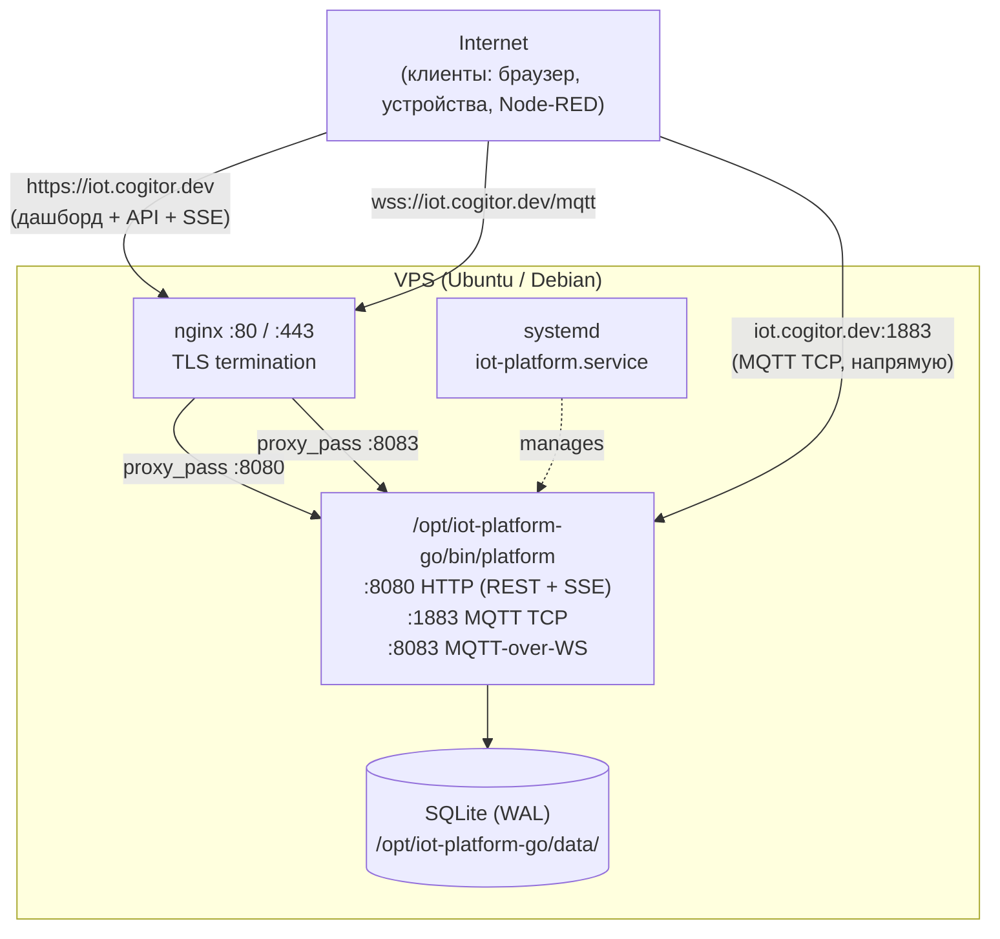
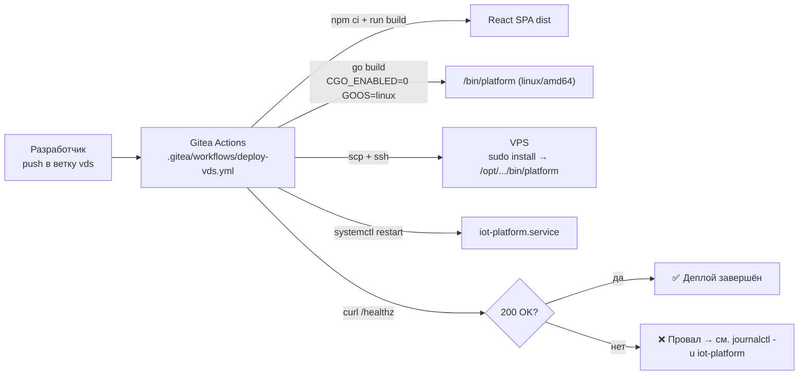

# Развёртывание на VDS (systemd, без Docker)

Production-развёртывание платформы на виртуальном сервере. Платформа — это **один Go-бинарник**, который systemd запускает как сервис. Никакого Docker, никаких дополнительных процессов.

**Что получается:** `iot.cogitor.dev` — дашборд по HTTPS, MQTT по TCP и WebSocket.

---

## Архитектура



## CI/CD pipeline



---

## Пререквизиты

| Компонент | Требование |
|-----------|-----------|
| VPS | Linux (Ubuntu 22+, Debian 12+), 512 МБ RAM, 1 vCPU |
| DNS | Запись `iot.cogitor.dev` → IP сервера |
| SSH | Пользователь с `sudo NOPASSWD` |
| nginx | Для TLS-терминации HTTPS и WSS |
| Домен | Для Let's Encrypt (или self-signed для internal use) |

---

## Подготовка сервера

### 1. Пользователь и каталоги

```bash
# На сервере
sudo useradd -r -m -d /opt/iot-platform-go -s /usr/sbin/nologin iot
sudo mkdir -p /opt/iot-platform-go/{bin,data,etc}
sudo chown -R iot:iot /opt/iot-platform-go
```

### 2. Systemd unit

```ini
# /etc/systemd/system/iot-platform.service
[Unit]
Description=IoT Platform (Go)
After=network-online.target
Wants=network-online.target

[Service]
Type=simple
User=iot
Group=iot
WorkingDirectory=/opt/iot-platform-go
EnvironmentFile=/opt/iot-platform-go/etc/.env
ExecStart=/opt/iot-platform-go/bin/platform
Restart=on-failure
RestartSec=5
StandardOutput=journal
StandardError=journal
SyslogIdentifier=iot-platform

# Hardening
NoNewPrivileges=true
ProtectSystem=strict
ReadWritePaths=/opt/iot-platform-go/data
ProtectHome=true
PrivateTmp=true

[Install]
WantedBy=multi-user.target
```

```bash
sudo systemctl daemon-reload
sudo systemctl enable iot-platform
```

### 3. Переменные окружения

```bash
sudo tee /opt/iot-platform-go/etc/.env << 'EOF'
# --- Обязательные ---
PUBLIC_BASE_URL=https://iot.cogitor.dev
JWT_SECRET=<сгенерировать-случайный-64-символа>
BROKER_HOST_PUBLIC=iot.cogitor.dev

# --- Администратор ---
ADMIN_EMAIL=admin@example.com
ADMIN_PASSWORD=<надёжный-пароль>

# --- База данных ---
SQLITE_PATH=/opt/iot-platform-go/data/platform.db

# --- Сеть ---
HTTP_ADDR=:8080
MQTT_ADDR=:1883

# --- Опционально ---
TIMEZONE=UTC
TELEMETRY_RETENTION_DAYS=30
LOG_LEVEL=info
EOF

sudo chown iot:iot /opt/iot-platform-go/etc/.env
sudo chmod 600 /opt/iot-platform-go/etc/.env
```

---

## nginx (TLS-терминация)

```nginx
# /etc/nginx/sites-available/iot-platform
server {
    listen 443 ssl http2;
    server_name iot.cogitor.dev;

    ssl_certificate     /etc/letsencrypt/live/iot.cogitor.dev/fullchain.pem;
    ssl_certificate_key /etc/letsencrypt/live/iot.cogitor.dev/privkey.pem;

    # Дашборд + API
    location / {
        proxy_pass http://127.0.0.1:8080;
        proxy_set_header Host $host;
        proxy_set_header X-Real-IP $remote_addr;
        proxy_set_header X-Forwarded-For $proxy_add_x_forwarded_for;
        proxy_set_header X-Forwarded-Proto $scheme;
    }

    # SSE (дашборд real-time) — HTTP-based, не WebSocket
    location /api/v1/events/stream {
        proxy_pass http://127.0.0.1:8080;
        proxy_http_version 1.1;
        # SSE не использует Upgrade/Connection: upgrade — оставляем обычный HTTP/1.1
        proxy_set_header Host $host;
        proxy_set_header X-Real-IP $remote_addr;
        proxy_set_header X-Forwarded-For $proxy_add_x_forwarded_for;
        proxy_set_header X-Forwarded-Proto $scheme;
        # Критично для SSE: выключаем буферизацию и увеличиваем таймаут
        proxy_buffering off;
        proxy_cache off;
        proxy_read_timeout 86400s;
    }

    # MQTT over WebSocket
    location /mqtt {
        proxy_pass http://127.0.0.1:8083;
        proxy_http_version 1.1;
        proxy_set_header Upgrade $http_upgrade;
        proxy_set_header Connection "upgrade";
        proxy_set_header Host $host;
        proxy_read_timeout 86400;
    }
}

server {
    listen 80;
    server_name iot.cogitor.dev;
    return 301 https://$host$request_uri;
}
```

```bash
sudo ln -s /etc/nginx/sites-available/iot-platform /etc/nginx/sites-enabled/
sudo certbot --nginx -d iot.cogitor.dev
sudo nginx -t && sudo systemctl reload nginx
```

**Порты на firewall:**

| Порт | Протокол | Назначение |
|------|----------|-----------|
| 80 | TCP | HTTP → redirect на HTTPS |
| 443 | TCP | HTTPS (дашборд + API + SSE + MQTT-over-WebSocket) |
| 1883 | TCP | MQTT TCP (для устройств) |

---

## Деплой бинарника

### Автоматический (Gitea CI)

Workflow **`.gitea/workflows/deploy-vds.yml`** — push в ветку `vds` или ручной запуск:

1. Собирает web UI (`npm ci && npm run build`)
2. Собирает Go-бинарник (`CGO_ENABLED=0 GOOS=linux`)
3. `scp` бинарник + systemd unit на сервер
4. `systemctl restart iot-platform`
5. Проверка health: `curl http://127.0.0.1:8080/healthz`

**Секреты Gitea:**

| Секрет | Значение |
|--------|---------|
| `IOT_DEPLOY_HOST` | IP или домен сервера (`iot.cogitor.dev`) |
| `IOT_DEPLOY_USER` | SSH-пользователь с sudo NOPASSWD |
| `IOT_DEPLOY_SSH_KEY` | Приватный ключ ed25519 (публичный в `authorized_keys`) |

### Ручной деплой

```bash
# Локально — собрать и загрузить
make build-linux
scp bin/platform darvik@HOST:/tmp/iot-platform.new

# На сервере — установить и перезапустить
ssh darvik@HOST '
  sudo install -o iot -g iot -m 755 /tmp/iot-platform.new /opt/iot-platform-go/bin/platform
  sudo systemctl restart iot-platform
  sleep 2
  systemctl is-active --quiet iot-platform && echo "OK" || echo "FAILED"
'
```

---

## Проверка

```bash
# Статус сервиса
sudo systemctl status iot-platform

# Логи
sudo journalctl -u iot-platform -f

# Health endpoints
curl -fsS https://iot.cogitor.dev/healthz   # liveness
curl -fsS https://iot.cogitor.dev/readyz    # readiness (MQTT + DB)

# MQTT
mosquitto_sub -h iot.cogitor.dev -t '#' -u 'product.device' -P '<token>' -v
```

---

## Обновление платформы

При push в `vds` — CI автоматически:
1. Собирает новый бинарник
2. Загружает на сервер
3. Перезапускает сервис (простой ~2 секунды)

SQLite-база и данные сохраняются в `/opt/iot-platform-go/data/` — не затрагиваются при обновлении.

---

## Сводка эндпоинтов

| Сервис | URL |
|--------|-----|
| Дашборд / API | `https://iot.cogitor.dev` |
| SSE (real-time) | `https://iot.cogitor.dev/api/v1/events/stream` |
| MQTT TCP | `iot.cogitor.dev:1883` |
| MQTT WebSocket | `wss://iot.cogitor.dev/mqtt` |
| Healthcheck | `https://iot.cogitor.dev/healthz` |

Docker / Synology: [13-deploy-docker.md](13-deploy-docker.md).
