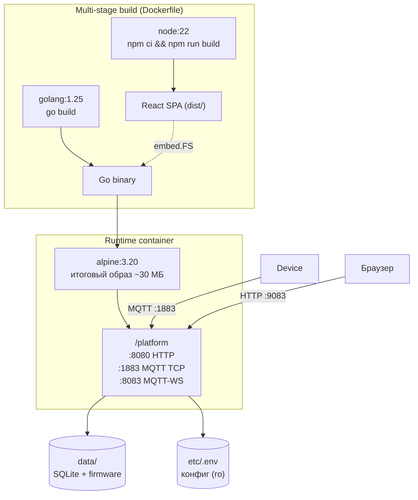
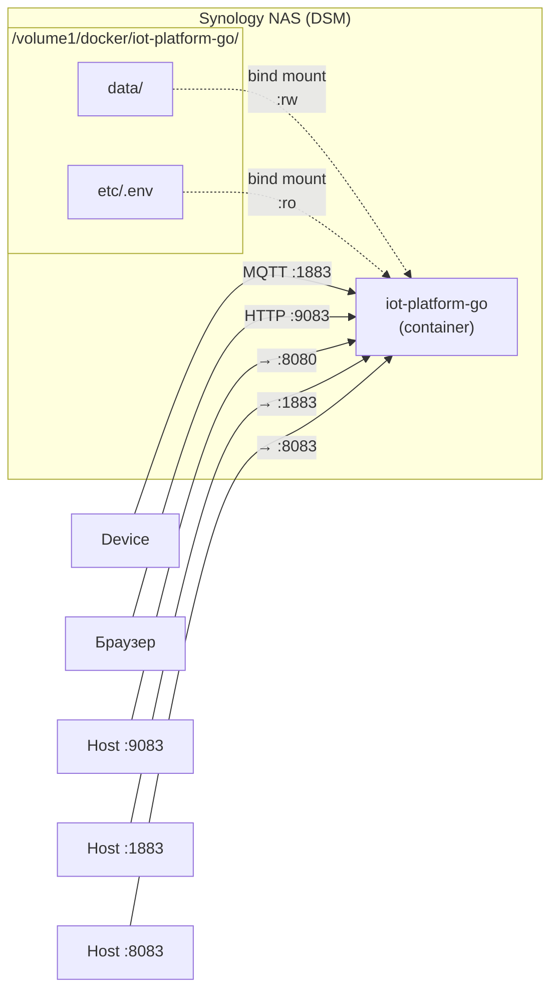

# Развёртывание Docker (Synology / compose)

Контейнерный запуск платформы — удобно для NAS (Synology, QNAP) или любого Docker-хоста. Multi-stage сборка: Node.js → Go → Alpine (итоговый образ ~30 МБ).

Контейнер платформы собирается из корневого `Dockerfile` и запускается через `docker run` (так делает и CI-workflow). `deploy/docker-compose.yml` содержит **только** опциональный сервис Node-RED — сервиса `platform` в compose нет.

Production на VPS использует systemd — см. [12-deploy-vds.md](12-deploy-vds.md).

---

## Как это работает



> **Уточнение к диаграмме**: сборка идёт на `node:22-bookworm` и `golang:1.26-bookworm`; образ также открывает порт `8883` (MQTT TLS); каталог `etc/` монтируется в `/etc/iot-platform` на чтение и запись и содержит `config.yml` (файл `.env` бинарник не читает).

Факты об образе (`Dockerfile`, `docker-entrypoint.sh`):

- `EXPOSE 8080 1883 8083 8883`
- `ENV SQLITE_PATH=/data/platform.db`, `HTTP_ADDR=:8080`, `MQTT_ADDR=:1883`
- Entrypoint делает `chown` каталога `/data` на пользователя `platform` (uid 1000) и понижает привилегии через `su-exec platform`. `/etc/iot-platform` **не** chown-ится — чтобы мастер настройки мог сохранить туда `config.yml`, каталог на хосте должен быть доступен на запись uid 1000.

---

## Быстрый старт (локально)

```bash
# Платформа
docker build -t iot-platform-go .
mkdir -p ./run/data ./run/etc && sudo chown -R 1000:1000 ./run/etc
docker run -d --name iot-platform-go \
  -p 8080:8080 -p 1883:1883 -p 8083:8083 -p 8883:8883 \
  -v "$PWD/run/data:/data" \
  -v "$PWD/run/etc:/etc/iot-platform" \
  iot-platform-go

# Опционально: Node-RED
cd deploy && docker compose up -d
```

- Мастер настройки (первый запуск): http://localhost:8080/setup
- Дашборд: http://localhost:8080
- MQTT: `mqtt://localhost:1883`
- MQTT WS: `ws://localhost:8083/`
- MQTT TLS: `mqtts://localhost:8883` (только если настроены сертификат и ключ TLS)

---

## Конфигурация

Бинарник читает **OS env → `./config.yml` → `/etc/iot-platform/config.yml`**. Файлы `.env` он не читает; переменные передаются через `docker run -e VAR=…` или `docker run --env-file <файл>`.

### Первый запуск — мастер настройки

При пустой `/data/platform.db` контейнер поднимает на порту 8080 **мастер настройки** (`/setup`, API `/api/v1/setup/*`) — логина по умолчанию нет, переменные `ADMIN_*` игнорируются. Подробности: [Эксплуатация → мастер настройки](11-operations.md#первый-запуск-мастер-настройки).

- На шаге 1 укажите DSN SQLite **`/data/platform.db`** (мастер подставляет `/var/lib/iot-platform/platform.db`, а этот путь внутри контейнера не на volume).
- Мастер пишет `config.yml` в `/etc/iot-platform/config.yml`, если каталог доступен на запись uid 1000; иначе в `./config.yml` (= `/config.yml`, тоже недоступен) и только пишет предупреждение в лог. Без сохранённого `config.yml` следующий запуск возьмёт env/значения по умолчанию (настройки БД теряются; JWT-секрет восстанавливается из таблицы `settings`, если БД доступна) — поэтому либо сделайте `etc/` доступным на запись, либо явно передайте `-e DATABASE_DSN=…` / `-e JWT_SECRET=…`.
- Эндпоинты мастера без авторизации: проходите мастер из доверенной сети / localhost, затем перезапустите контейнер.

### Опциональные переменные

```bash
docker run ... \
  -e PUBLIC_BASE_URL=http://<host-ip>:9083 \
  -e BROKER_HOST_PUBLIC=<host-ip> \
  -e JWT_SECRET=<случайные-64-символа> \
  -e TIMEZONE=Asia/Bangkok \
  ...
# PostgreSQL вместо SQLite:
#  -e DATABASE_DRIVER=postgres -e DATABASE_DSN=postgres://user:pass@db:5432/iot_platform?sslmode=disable
```

Значения env перекрывают `config.yml`. Полный список переменных — в [11-operations.md](11-operations.md#конфигурация).

---

## Synology NAS

### 1. Первоначальная настройка

```bash
# SSH на Synology
mkdir -p /volume1/docker/iot-platform-go/{data,etc}
chown 1000:1000 /volume1/docker/iot-platform-go/etc   # чтобы мастер настройки мог записать config.yml
```

### Архитектура деплоя



> **Уточнение к диаграмме**: `etc/` монтируется в `/etc/iot-platform` без `:ro` и содержит `config.yml` (не `.env`).

### 2. Gitea workflow (автоматический деплой)

`.gitea/workflows/deploy-docker.yml` — запускается при **push в `master`** и через **workflow_dispatch** (ручной запуск), на NAS runner:

1. Создаёт `/volume1/docker/iot-platform-go/{data,etc}`
2. Собирает образ `localhost/iot-platform-go:latest` (`DOCKER_API_VERSION=1.43`)
3. Пересоздаёт контейнер `iot-platform-go` (`--restart unless-stopped`) на портах:
   - HTTP: **9083** → 8080 (`TARGET_PORT`)
   - MQTT TCP: **1883** → 1883 (`TARGET_MQTT_PORT`)
   - MQTT WS: **8083** → 8083 (`TARGET_MQTT_WS_PORT`)
   - 8883 (MQTT TLS) workflow **не** публикует — добавьте `-p 8883:8883`, если включаете TLS
4. Монтирование (оба на чтение и запись, без `:ro`):
   - `/volume1/docker/iot-platform-go/data` → `/data` (SQLite + firmware)
   - `/volume1/docker/iot-platform-go/etc` → `/etc/iot-platform` (config.yml, сертификаты)
5. `-e` / `--env-file` не передаются — конфигурация берётся из `config.yml`, записанного мастером.

### 3. Ручная пересборка

```bash
export DOCKER_API_VERSION=1.43
docker build -t localhost/iot-platform-go:latest .
docker rm -f iot-platform-go || true
docker run -d \
  -p 9083:8080 \
  -p 1883:1883 \
  -p 8083:8083 \
  --restart unless-stopped \
  --name iot-platform-go \
  -v /volume1/docker/iot-platform-go/data:/data \
  -v /volume1/docker/iot-platform-go/etc:/etc/iot-platform \
  localhost/iot-platform-go:latest
```

Дашборд: `http://<nas-ip>:9083` · MQTT: `<nas-ip>:1883`

---

## Обновление

```bash
# Пересобрать образ и пересоздать контейнер (данные сохраняются в bind-монтированиях)
docker build --no-cache -t localhost/iot-platform-go:latest .
docker rm -f iot-platform-go
docker run -d ...   # те же аргументы, что выше
```

Данные SQLite хранятся в смонтированном каталоге `data/` — не теряются при пересоздании контейнера.

---

## Проверка

```bash
# Статус контейнера
docker ps --filter name=iot-platform-go

# Логи
docker logs -f iot-platform-go

# Health
curl -fsS http://localhost:8080/healthz
curl -fsS http://localhost:8080/readyz
```

---

## Конфликт порта 1883

Если на хосте уже работает MQTT-брокер (Mosquitto, RabbitMQ), опубликуйте MQTT на другом порту хоста:

```bash
# docker run
-p 1884:1883

# или в Gitea workflow: env TARGET_MQTT_PORT: 1884 в .gitea/workflows/deploy-docker.yml
```

`TARGET_MQTT_PORT` — переменная workflow, а не настройка платформы. Устройства подключать на `mqtt://<host>:1884`.

---

## Node-RED (опционально)

`deploy/docker-compose.yml` уже описывает единственный сервис compose — `nodered`:

- образ `nodered/node-red:4.0`, контейнер `cogitor-nodered`, порт `1880:1880`
- `extra_hosts: host.docker.internal:host-gateway`
- env `NODERED_CREDENTIAL_SECRET` (по умолчанию `cogitor-nodered-dev`), `MQTT_BROKER_HOST` (по умолчанию `host.docker.internal`; для Podman — `host.containers.internal`)
- bind-монтирования `./nodered/data:/data`, `./nodered/settings.js`, `./nodered/flows.json`, `./nodered/entrypoint.sh` (пути относительно `deploy/`)

```bash
cd deploy && docker compose up -d
```

Node-RED подключается к MQTT-брокеру платформы через `host.docker.internal:1883`. Отдельных MQTT-кредов у него больше нет — зарегистрируйте его в дашборде как **внешний плагин** и используйте выданные MQTT-логин/пароль `extplg_…`. Настройка автоматизации — [06-automation.md](06-automation.md).

---

## Сводка портов

| Порт хоста | Порт контейнера | Протокол | Назначение |
|-----------|----------------|----------|-----------|
| 9083 | 8080 | HTTP | Дашборд + API (+ мастер настройки при первом запуске) |
| 1883 | 1883 | MQTT TCP | Устройства |
| 8083 | 8083 | MQTT WS | Устройства (WebSocket) |
| 8883 | 8883 | MQTT TLS | Устройства (TLS; только при настроенных сертификате/ключе, CI-workflow не публикует) |
| 1880 | 1880 | HTTP | Node-RED (опционально, compose) |

VPS (systemd): [12-deploy-vds.md](12-deploy-vds.md).
