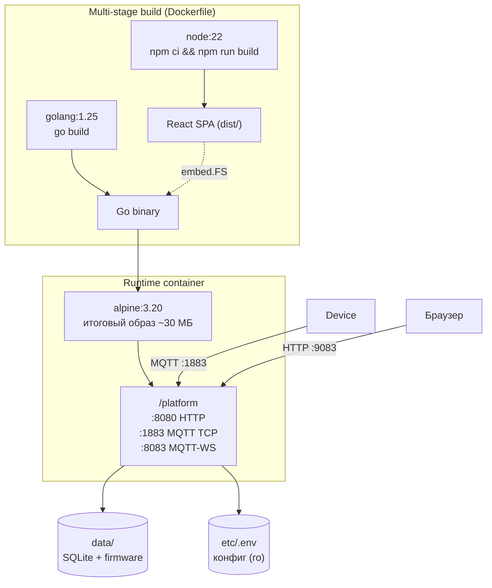
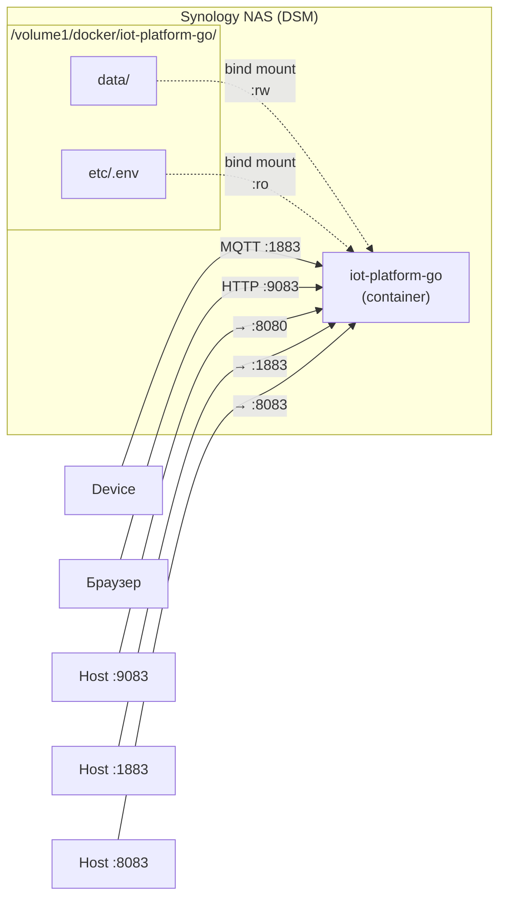

# Развёртывание Docker (Synology / compose)

Контейнерный запуск платформы — удобно для NAS (Synology, QNAP) или любого Docker-хоста. Multi-stage сборка: Node.js → Go → Alpine (итоговый образ ~30 МБ).

Production на VPS использует systemd — см. [12-deploy-vds.md](12-deploy-vds.md).

---

## Как это работает



---

## Быстрый старт (локально)

```bash
cd deploy
cp .env.example .env
# Отредактировать .env — минимум: JWT_SECRET, PUBLIC_BASE_URL, BROKER_HOST_PUBLIC
docker compose up -d --build
```

- Дашборд: http://localhost:8080
- MQTT: `mqtt://localhost:1883`
- MQTT WS: `ws://localhost:8083/`

---

## Конфигурация

Минимальный `.env`:

```bash
# --- Обязательные ---
PUBLIC_BASE_URL=http://<host-ip>:9083
JWT_SECRET=<случайные-64-символа>
BROKER_HOST_PUBLIC=<host-ip>

# --- Администратор ---
ADMIN_EMAIL=admin@local
ADMIN_PASSWORD=admin

# --- База данных (в контейнере) ---
SQLITE_PATH=/data/platform.db
```

Полный список переменных — в [11-operations.md](11-operations.md#конфигурация).

---

## Synology NAS

### 1. Первоначальная настройка

```bash
# SSH на Synology
mkdir -p /volume1/docker/iot-platform-go/{data,etc}
cp .env.example /volume1/docker/iot-platform-go/etc/.env
# Отредактировать /volume1/docker/iot-platform-go/etc/.env
```

### Архитектура деплоя



### 2. Gitea workflow (автоматический деплой)

`.gitea/workflows/deploy-docker.yml` — **workflow_dispatch** (ручной запуск на NAS runner):

1. Создаёт каталоги данных
2. Собирает образ `localhost/iot-platform-go:latest`
3. Пересоздаёт контейнер на портах:
   - HTTP: **9083** → 8080
   - MQTT TCP: **1883** → 1883
   - MQTT WS: **8083** → 8083
4. Монтирование:
   - `/volume1/docker/iot-platform-go/data` → `/data` (SQLite + firmware)
   - `/volume1/docker/iot-platform-go/etc` → `/etc/iot-platform` (read-only, конфиг)

### 3. Ручная пересборка

```bash
export DOCKER_API_VERSION=1.41
docker build -t localhost/iot-platform-go:latest .
docker rm -f iot-platform-go || true
docker run -d \
  -p 9083:8080 \
  -p 1883:1883 \
  -p 8083:8083 \
  --restart unless-stopped \
  --name iot-platform-go \
  -v /volume1/docker/iot-platform-go/data:/data \
  -v /volume1/docker/iot-platform-go/etc:/etc/iot-platform:ro \
  localhost/iot-platform-go:latest
```

Дашборд: `http://<nas-ip>:9083` · MQTT: `<nas-ip>:1883`

---

## Обновление

```bash
# Пересобрать образ
docker compose build --no-cache

# Пересоздать контейнер (данные сохраняются в volume)
docker compose up -d --force-recreate
```

Данные SQLite хранятся в смонтированном каталоге `data/` — не теряются при пересоздании контейнера.

---

## Проверка

```bash
# Статус контейнера
docker compose ps

# Логи
docker compose logs -f platform

# Health
curl -fsS http://localhost:8080/healthz
curl -fsS http://localhost:8080/readyz
```

---

## Конфликт порта 1883

Если на хосте уже работает MQTT-брокер (Mosquitto, RabbitMQ):

```bash
# Изменить порт MQTT в .env
TARGET_MQTT_PORT=1884

# Или в docker run
-p 1884:1883
```

Устройства подключать на `mqtt://<host>:1884`.

---

## Node-RED (опционально)

```yaml
# deploy/docker-compose.yml — добавить в services:
  nodered:
    image: nodered/node-red:4.0
    ports:
      - "1880:1880"
    extra_hosts:
      - "host.docker.internal:host-gateway"
    environment:
      MQTT_BROKER_HOST: host.docker.internal
```

Node-RED подключается к MQTT-брокеру платформы через `host.docker.internal:1883`.
Настройка автоматизации — [06-automation.md](06-automation.md).

---

## Сводка портов

| Порт хоста | Порт контейнера | Протокол | Назначение |
|-----------|----------------|----------|-----------|
| 9083 | 8080 | HTTP | Дашборд + API |
| 1883 | 1883 | MQTT TCP | Устройства |
| 8083 | 8083 | MQTT WS | Устройства (WebSocket) |
| 1880 | 1880 | HTTP | Node-RED (опционально) |

VPS (systemd): [12-deploy-vds.md](12-deploy-vds.md).
