# Диаграммы

Архитектурные диаграммы и sequence-диаграммы потоков. Используют Mermaid — рендерятся в GitHub, GitLab, Obsidian и большинстве Markdown-просмотрщиков.

Связанные доки: [01-PRD](01-prd.md), [07-внутренние плагины](07-internal-plugins.md), [08-внешние плагины](08-external-plugins.md).

---

## Архитектура платформы

Высокоуровневая архитектура Cogitor IoT Platform со всеми встроенными компонентами и внешними клиентами.

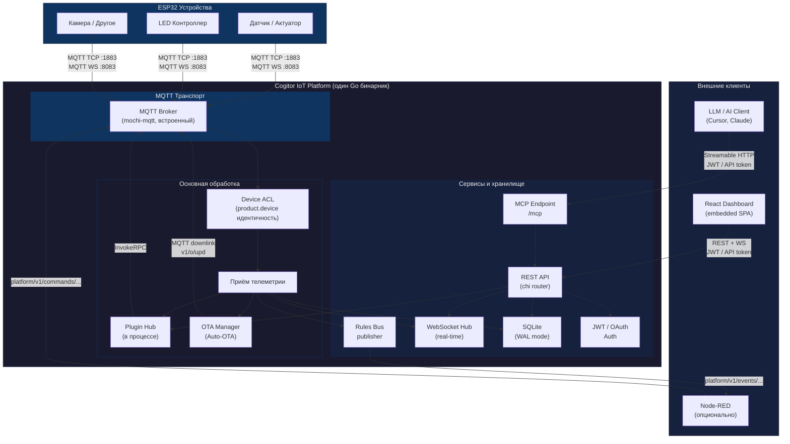

## Архитектура внешних плагинов

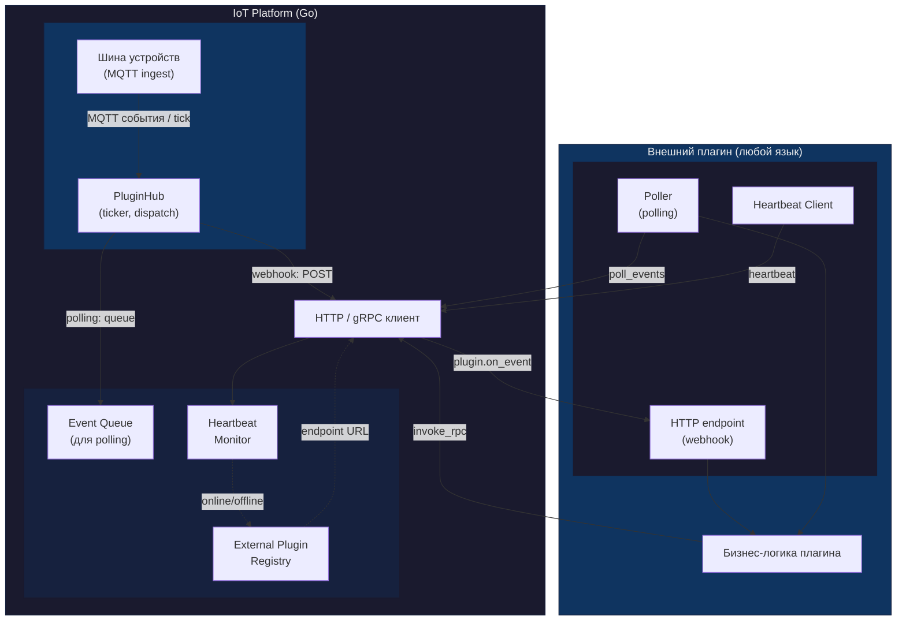

## Поток событий внешнего плагина

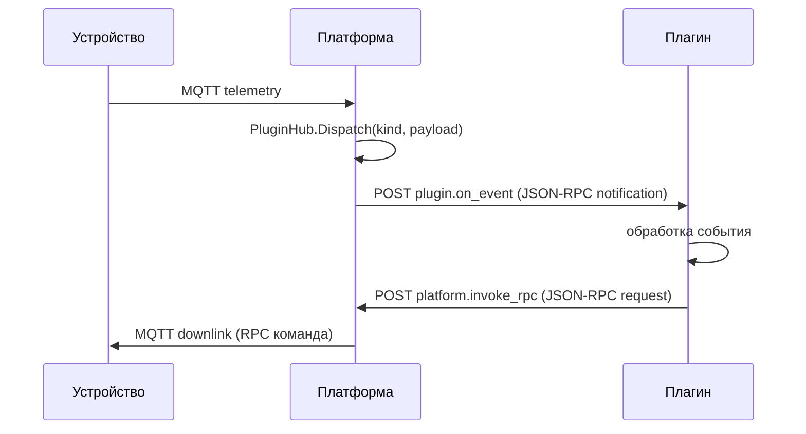

## Поток тиков внешнего плагина

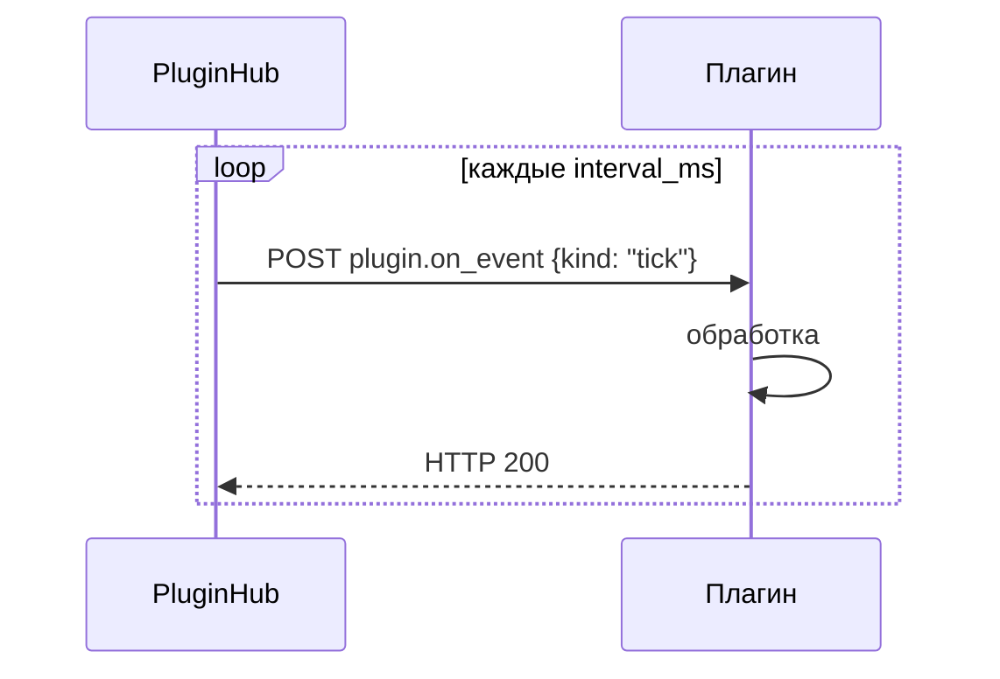

## Heartbeat внешнего плагина

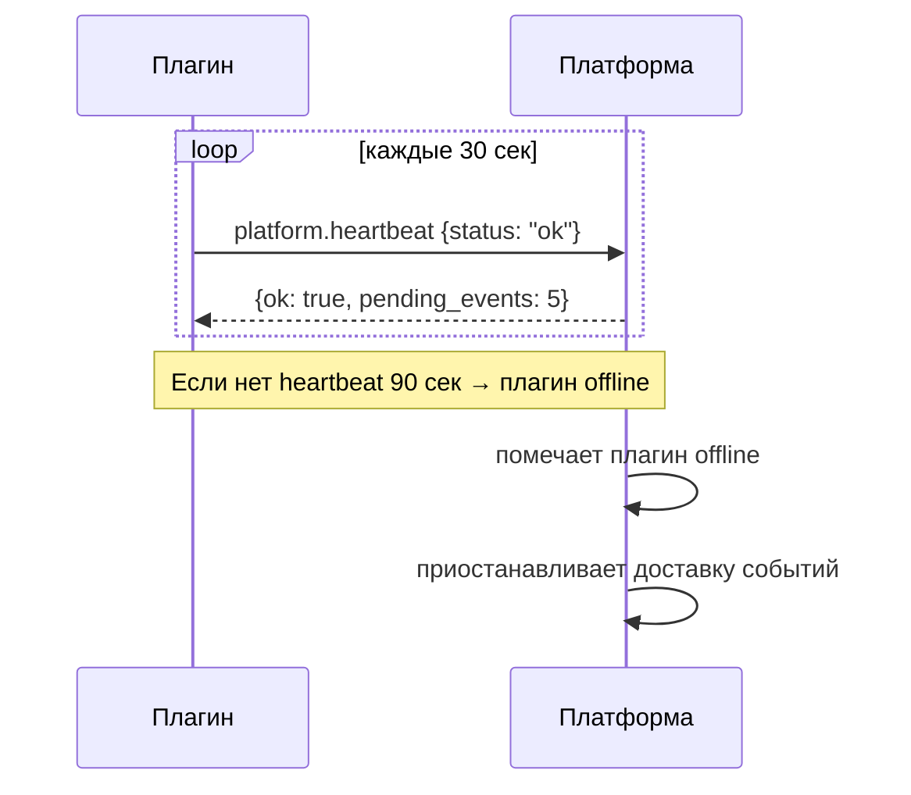

## Жизненный цикл внешнего плагина

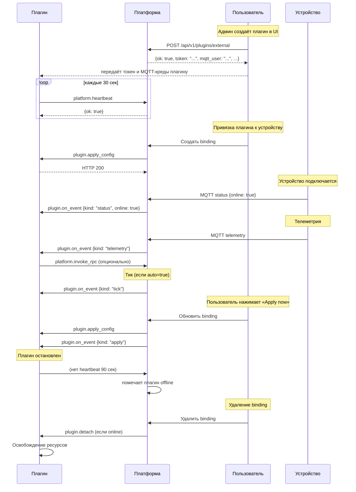

## Архитектура внутренних плагинов

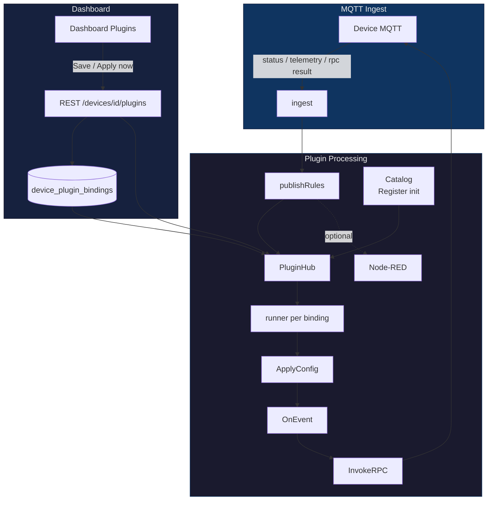

## Жизненный цикл внутреннего плагина

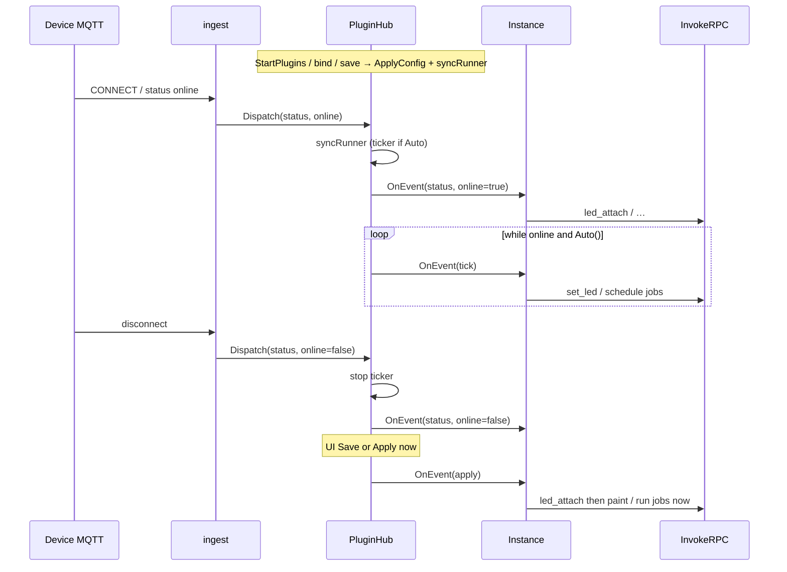

## Архитектура Multi-Account

> Источник: [16-multi-account.md](16-multi-account.md#71-общая-схема)

Высокоуровневая схема релиза: общий брокер с per-username ACL, account-scope ресурсы, каталожные плагины (включая новые `prometheus-exporter` и `metrics-dashboard`), и таблица per-account политик для каталожных плагинов.

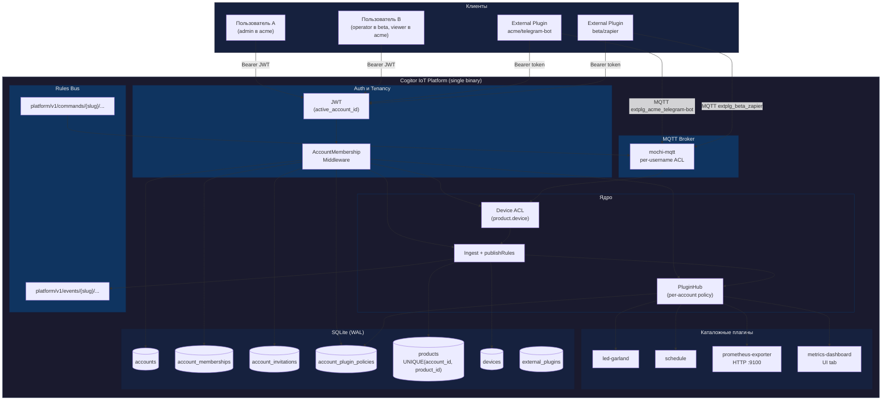

## Поток приглашений

> Источник: [16-multi-account.md](16-multi-account.md#53-приглашения)

Полный цикл приглашения: admin создаёт, получатель принимает (залогинен или свежая регистрация), membership появляется, JWT несёт новый active account.

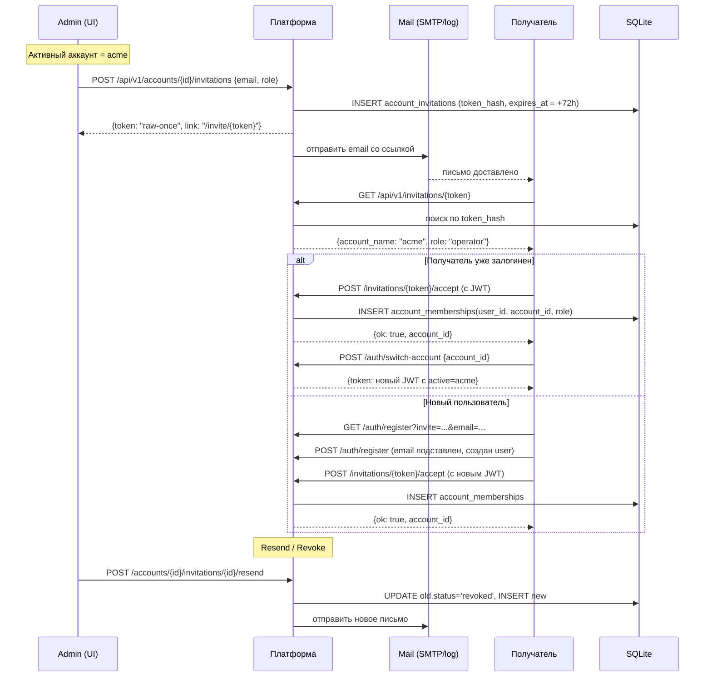

## Account ACL внешнего плагина

> Источник: [16-multi-account.md](16-multi-account.md#56-внешние-плагины-account-scoping)

Регистрация внешнего плагина, выдача MQTT-креда и ACL-проверка, запрещающая кросс-аккаунтный subscribe/publish.

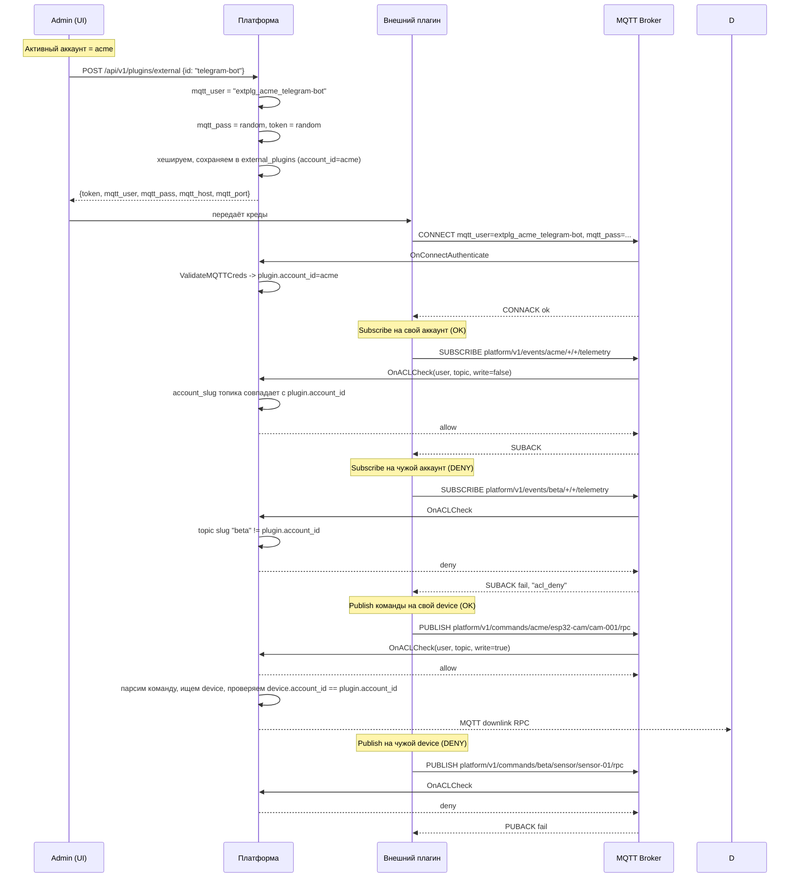

## Жизненный цикл Prometheus Exporter

> Источник: [16-multi-account.md](16-multi-account.md#59-внутренний-плагин-prometheus-exporter)

Как каталожный плагин `prometheus-exporter` поднимает HTTP-сервер, отдаёт Prometheus-метрики с лейблом `account` и останавливается, когда per-account policy отключает плагин.

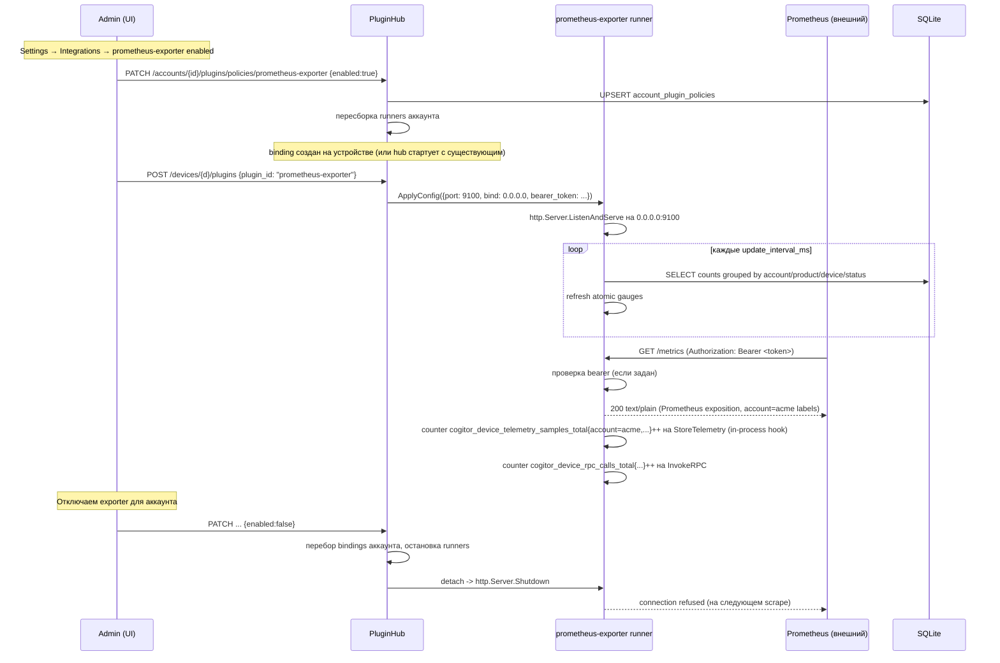

## Policy внутренних плагинов

> Источник: [16-multi-account.md](16-multi-account.md#58-управление-внутренними-плагинами)

Как `account_plugin_policies` управляет каталожными плагинами per-account: dispatch, tick и очистка при удалении аккаунта.

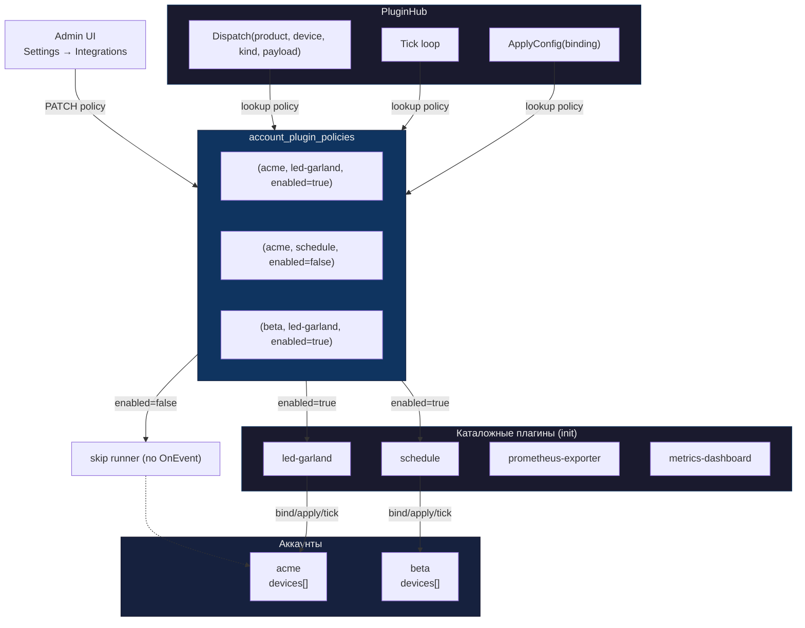
