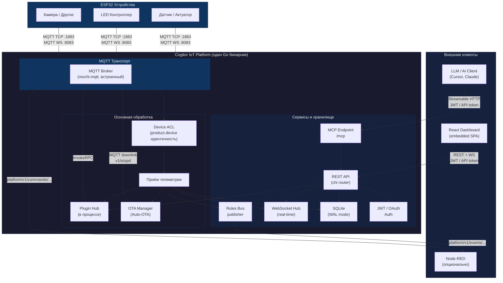
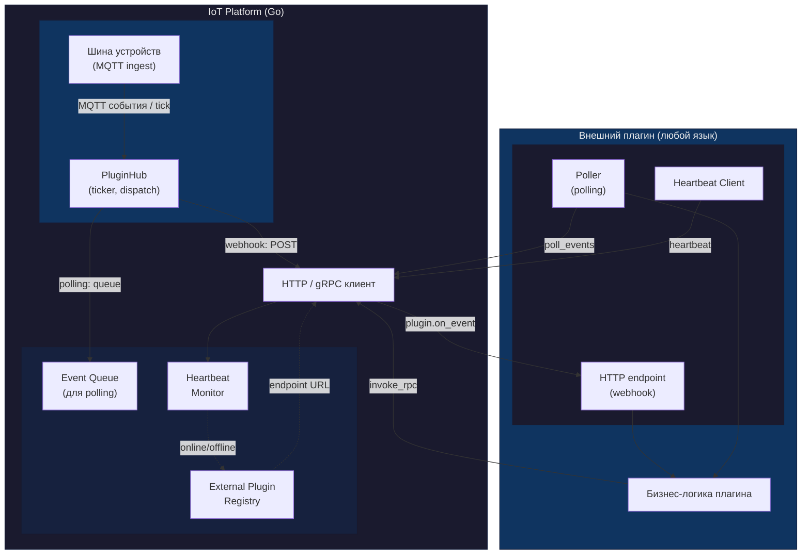
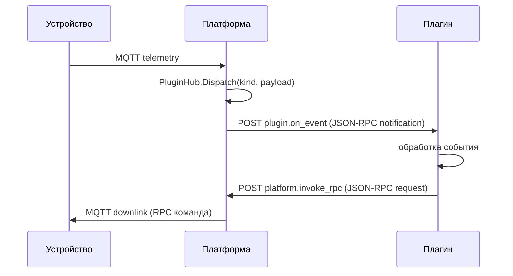
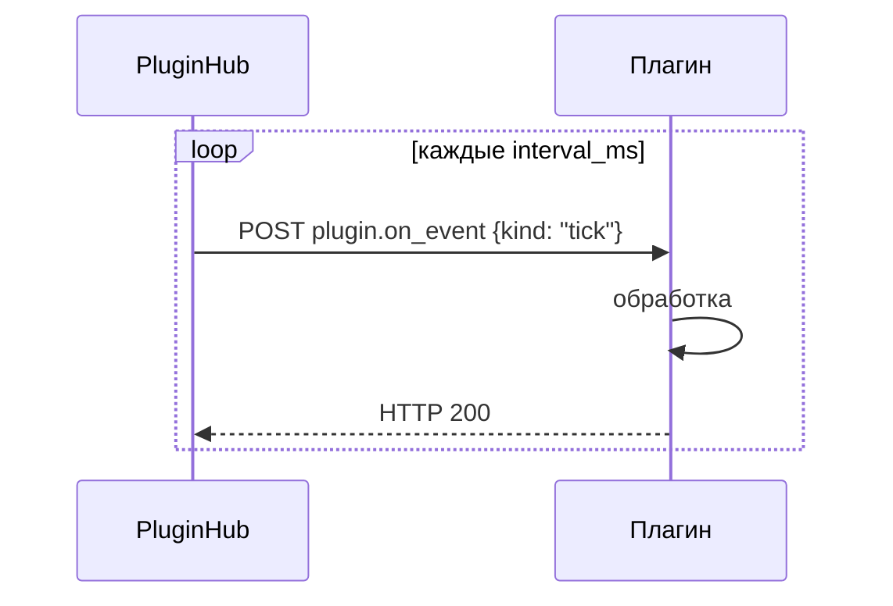
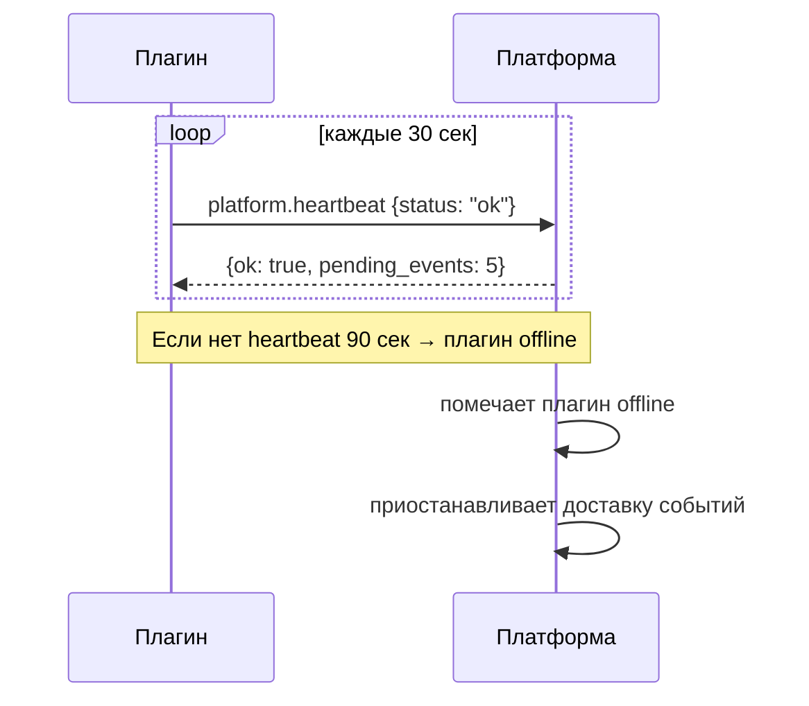
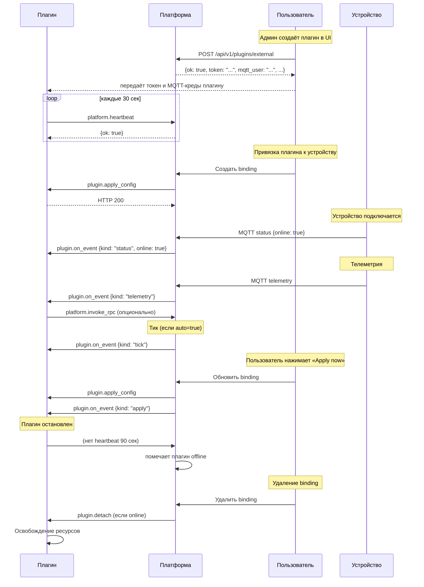
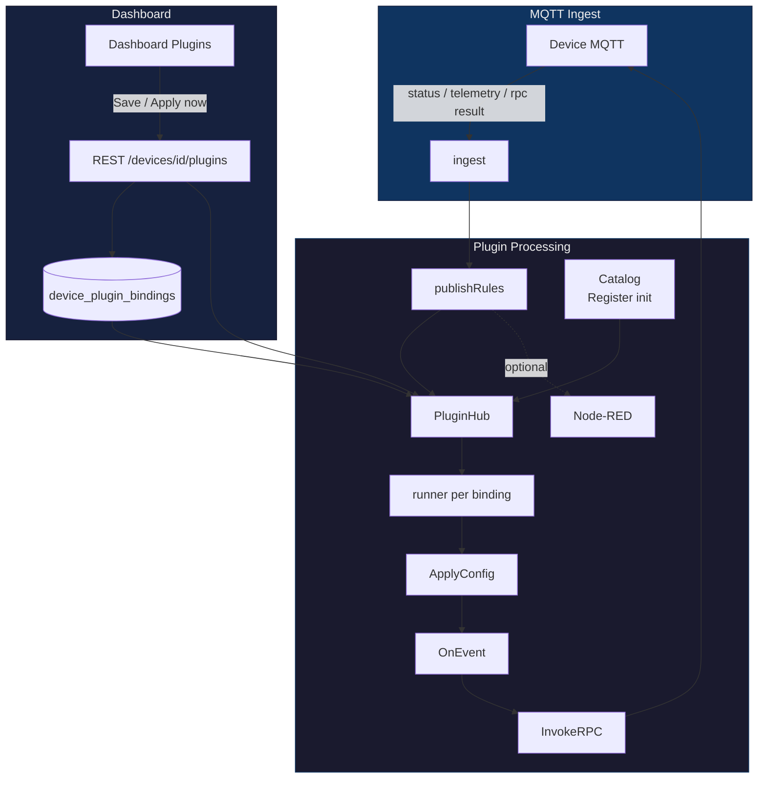
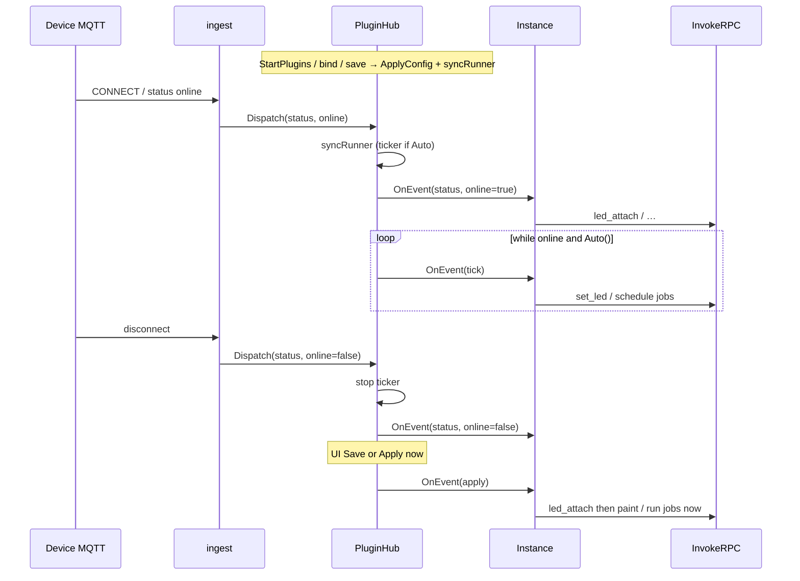

# Диаграммы

Архитектурные диаграммы и sequence-диаграммы потоков. Используют Mermaid — рендерятся в GitHub, GitLab, Obsidian и большинстве Markdown-просмотрщиков.

Связанные доки: [01-PRD](01-prd.md), [07-внутренние плагины](07-internal-plugins.md), [08-внешние плагины](08-external-plugins.md).

---

## Архитектура платформы

Высокоуровневая архитектура Cogitor IoT Platform со всеми встроенными компонентами и внешними клиентами.

## Архитектура внешних плагинов

## Поток событий внешнего плагина

## Поток тиков внешнего плагина

## Heartbeat внешнего плагина

## Жизненный цикл внешнего плагина

## Архитектура внутренних плагинов

## Жизненный цикл внутреннего плагина

