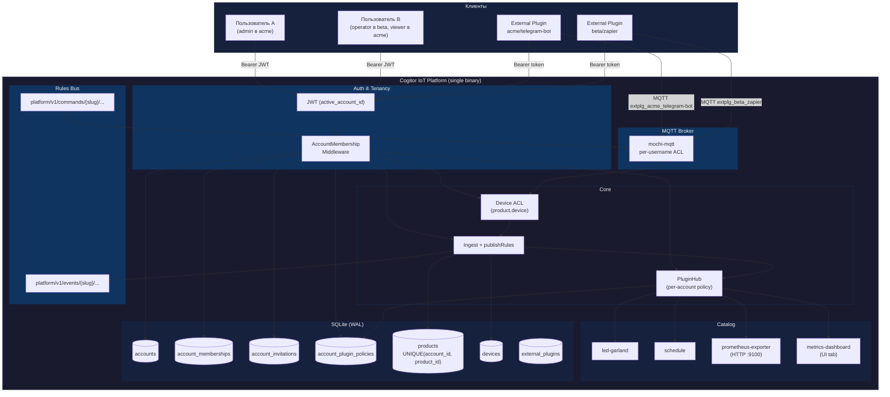
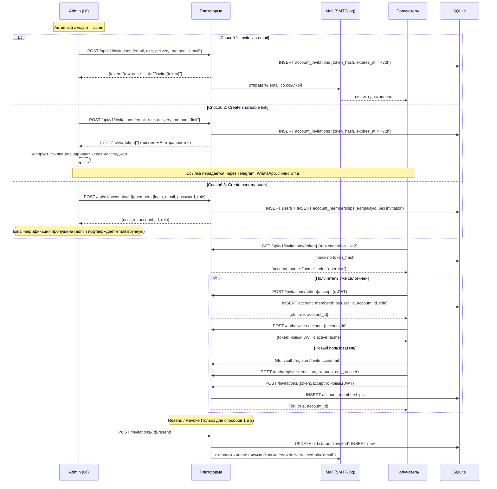
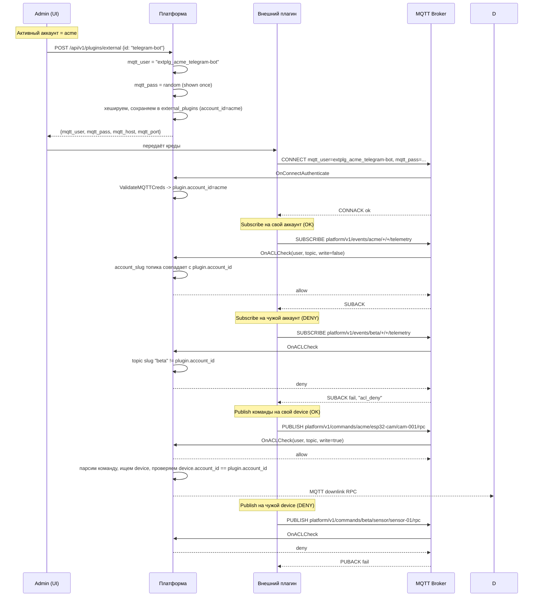
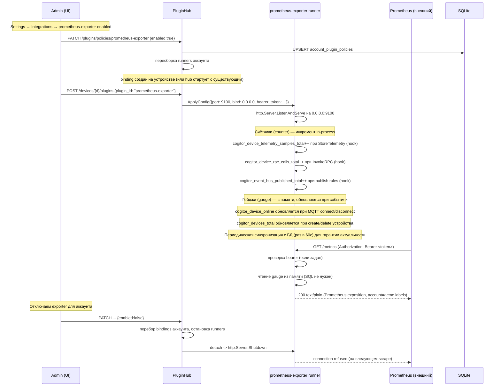
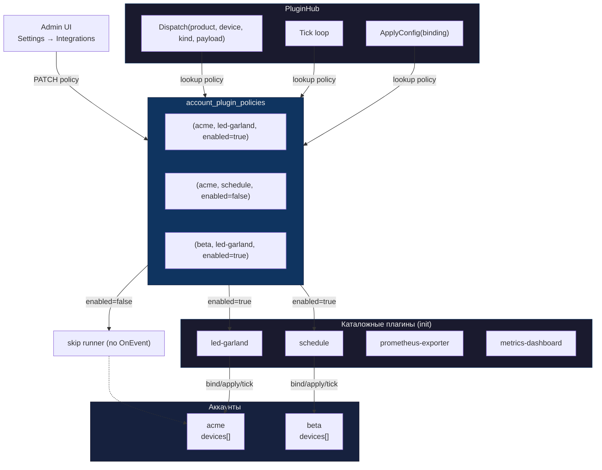

# Multi-Account и встроенный мониторинг — Требования к продукту

| Поле | Значение |
|------|----------|
| **Версия документа** | 1.2 |
| **Версия платформы** | v1.x (см. [§4.5 План релиза](#45-план-релиза--этапы)) |
| **Статус** | Черновик → Активен |
| **Обновлено** | 13.09.2026 |
| **Область** | добавление multi-tenant изоляции, IAM-ролей, monitoring-плагинов и управления внутренними плагинами в текущий single-tenant дистрибутив |
| **Каноническая версия** | этот документ ведётся на русском; английский ([en/16-multi-account.md](../en/16-multi-account.md)) будет переписан с нуля после стабилизации v1 |

> **Статус реализации (сверено с кодом 30.09.2026).** Это спецификация; код в нескольких местах от неё отличается:
> - **Маршруты плоские**, привязаны к активному аккаунту из JWT: `/members`, `/invitations`, `/plugins/policies`, `/audit-log`, `/me/accounts`, `POST /auth/switch-account` — а не `/accounts/{id}/...`. CRUD аккаунтов (`/accounts`), `POST /auth/refresh` и заголовка `X-Account-Id` нет.
> - Колонки `users.is_platform_admin` нет. Админ платформы — пользователь, чей id записан в `settings.platform_admin_user_id` (админ из мастера; на старых БД — первый пользователь с `users.role=admin`). Только он может смотреть и удалять всех пользователей (`GET/DELETE /users`); админ аккаунта может `PATCH /users/{id}` только для пользователей, состоящих исключительно в его аккаунте.
> - Переменных `INVITE_TTL_HOURS` (TTL захардкожен — 72 ч), `WIZARD_AUTO_DISABLE`, `WIZARD_WRITE_ENV`, `PROMETHEUS_EXPORTER_DEFAULT_PORT`, `DB_STATEMENT_TIMEOUT_MS` нет; `DB_MAX_OPEN_CONNS` / `DATABASE_MAX_OPEN_CONNS` читается, но не применяется.
> - **Мастер настройки**: API `/api/v1/setup/*`, UI `/setup`; состояние хранится **на сервере в памяти** (не в `localStorage`); запускается, когда в БД нет ни пользователей, ни аккаунтов; результат пишется в таблицу `settings` и в `config.yml`. Маршруты мастера смонтированы только пока он работает; после завершения `GET /api/v1/setup/state` отвечает `{"completed":true}`, остальных `/setup`-маршрутов нет. API состояния никогда не отдаёт секреты (только флаги `*_set` и DSN со скрытым паролем).
> - Real-time канал — **WebSocket** `/api/v1/ws`, не SSE; каждое соединение получает события только своего активного аккаунта (общие события брокера — админу платформы).
> - **MCP** ограничен активным аккаунтом токена (параметра `account_id` нет — для смены области переключите аккаунт).
> - И события, и команды rules bus содержат slug (`platform/v1/{events|commands}/{account_slug}/...`); ACL отклоняет чужие поддеревья, а команды ищут устройство внутри аккаунта плагина.
> - `REGISTER_DEFAULT_ROLE` (в коде по умолчанию `admin`) пишется в `users.role` при каждой регистрации, но прав на уровне платформы не даёт; в личном аккаунте пользователя membership всегда `admin`.
>
> Текущее поведение: [02-api](02-api.md), [11-operations](11-operations.md).

Этот документ определяет следующий крупный релиз платформы: **multi-account tenancy** с ролевым доступом, новый формат системных MQTT-топиков и встроенный мониторинг (Prometheus). Релиз additive — пересоздание БД и конфигурации при переходе допустимо (миграционных утилит не предусматривается).

Связанные доки: [01-prd](01-prd.md), [02-api](02-api.md), [03-auth](03-auth.md), [04-mqtt](04-mqtt.md), [07-internal-plugins](07-internal-plugins.md), [08-external-plugins](08-external-plugins.md), [11-operations](11-operations.md).

---

## 0. Что меняется на одной странице

- Появляется сущность **Account**; все per-account ресурсы получают `account_id NOT NULL`.
- **Один пользователь** может состоять в нескольких аккаунтах с разными ролями (`admin` / `operator` / `viewer`).
- **Внешние плагины** жёстко привязаны к аккаунту — `mqtt_user = extplg_{account_slug}_{plugin_id}`, ACL сужается до `platform/v1/{events|commands}/{account_slug}/#`.
- **Системные топики** rules bus получают `account_slug` (hard break). **Топики устройств `iot/v1/...` и `v1/...` не меняются** — устройства не знают про аккаунты (см. [§5.7.1](16-multi-account-requirements.md#571-что-не-меняется-в-топиках-устройств)).
- **Встроенный мониторинг**: каталожные плагины `prometheus-exporter` (HTTP `/metrics`) и `metrics-dashboard` (UI-шаблон).
- **Управление внутренними плагинами** на уровне аккаунта через `account_plugin_policies`.
- **БД**: поддержка двух драйверов — `sqlite` (default) и `postgres`. Драйвер выбирается через `DATABASE_DRIVER` + `DATABASE_DSN`.
- **Мастер первой установки** (полный) — `/setup` доступен, пока `accounts` пуста; `.env` опционален.
- **Версионирование**: релиз разбит на этапы v1.0…v1.6 (single mode). HA/clustering — отдельный релиз v2.x, см. [17-ha-architecture.md](17-ha-architecture.md).
- **HA / кластеризация** — явно v2, не в скоупе этого документа. v1 проектируется с учётом будущей HA (см. NF-19), но реализует только single-instance. Подробности — [17-ha-architecture.md](17-ha-architecture.md).
- **Automation page** — депрекейс; замена на документацию по интеграции с Node-RED + inline help в UI.
- **UI modernization** — обновление визуального стиля, сохранение mobile-first подхода.

---

## 1. Видение

Платформа остаётся **одним Go-бинарником, одной SQLite-базой и одним MQTT-брокером**, но обслуживает сразу несколько **изолированных аккаунтов** (tenants). Каждый аккаунт — это отдельный набор продуктов, устройств, прошивок, аудита и настроек. Пользователь с одним логином может состоять в нескольких аккаунтах с разными ролями в каждом. Внешние плагины (Node-RED, gRPC, webhook) жёстко привязаны к аккаунту, который их зарегистрировал, и физически не могут читать данные соседей.

Поверх tenancy добавляются:

- **Встроенный мониторинг**: два новых каталожных плагина — `prometheus-exporter` (scrape-эндпоинт для внешнего Prometheus) и `metrics-dashboard` (шаблон визуализации метрик устройств в дашборде).
- **Управление внутренними плагинами** на уровне аккаунта — admin может отключить любой каталожный плагин, и он перестаёт создавать раннеры и MQTT ACL-события для устройств этого аккаунта.

Главный принцип релиза: **никаких миграций, никаких dual-write**. Это новая начальная схема БД; апгрейд с single-tenant инсталляции — отдельная одноразовая утилита `convert-to-multi-account`, которая заворачивает существующие продукты/устройства/плагины в один bootstrap-аккаунт `default` с логином bootstrap-админа.

---

## 2. Проблемы

| Боль | Текущее состояние | Что меняется |
|------|------------------|--------------|
| Один self-hosted = один tenant. Хочется обслуживать нескольких клиентов / несколько объектов / производство + тест | Все ресурсы общие, разделения нет, UI оперирует всем подряд | Появляется сущность **Account**; все ресурсы (`products`, `devices`, `external_plugins`, `ota_firmwares`, `audit_log`, telemetry и т.д.) получают `account_id` |
| Невозможно разграничить оператора склада и оператора лаборатории | Только глобальные роли `admin/operator/viewer` | Те же три роли, но **per-account**; один пользователь — admin в одном аккаунте, viewer — в другом |
| Внешний плагин (Node-RED / gRPC / webhook) видит все события платформы | ACL только `platform/v1/events/#` и `platform/v1/commands/#` | Топики получают `account_slug` сразу после префикса; ACL сужается до `platform/v1/events/{account_slug}/#` |
| Непонятно, какие метрики доступны и как их снимать — нет ни `/metrics`, ни интеграции с Prometheus | Нет | Новый каталожный плагин `prometheus-exporter` выставляет HTTP `/metrics` (формат Prometheus text) с лейблами `account`, `product`, `device` |
| Каталожные плагины всегда включены — даже если аккаунт не хочет, чтобы что-то тикало в фоне | Нет тоггла | Per-account policy `account_plugin_policies`: admin может выключить любой каталожный плагин в своём аккаунте |
| Нет шаблона для «встроенного» дашборда устройства на основе метрик | Только стандартный `Metrics` + `Events` | Новый каталожный плагин `metrics-dashboard` — шаблон, который добавляет в страницу устройства настраиваемые панели (графики телеметрии, RPC history, online-timeline) |

---

## 3. Целевые пользователи

### 3.1 Основной — оператор multi-tenant инсталляции
- Раздаёт self-hosted платформу нескольким внутренним командам или коммерческим клиентам.
- Хочет выдавать **приглашения по email** и не думать про отдельные БД.
- Хочет **посмотреть общий health** (через Prometheus), но не иметь доступа к данным тенантов.

### 3.2 Вторичный — корпоративный оператор внутри одного аккаунта
- 10–200 устройств на объекте, 3–10 операторов разного уровня.
- Нужен admin/operator/viewer **внутри** аккаунта; никакие глобальные права не нужны.
- Хочет встроенные графики (вместо «открой Grafana»).

### 3.3 Третичный — AI/LLM-агент
- Доступ к платформе **только по JWT-токену** (в токене — информация о пользователе: `user_id`, `accounts[]`, `active_account_id`).
- MCP-инструменты должны принимать параметр `account_id` (по умолчанию — активный) и отказывать, если пользователь не состоит в этом аккаунте.
- AI/LLM-агенты не имеют отдельного механизма аутентификации — используются стандартные API-токены или JWT, выданный пользователю.

### 3.4 Без изменений
- Устройства (ESP32 и др.). Со стороны устройства платформа по-прежнему «один MQTT-брокер + один токен», прозрачно для firmware.

---

## 4. Цели и метрики успеха

| Цель | Метрика | Целевое значение |
|------|---------|------------------|
| Изоляция аккаунтов | `404` при попытке доступа к чужому `device_id` | 100% отрицаний на integration-тестах ACL |
| Скорость приглашения | `POST /invitations` → письмо | < 200 мс до возврата токена |
| Принятие приглашения | Время от `POST /invitations/{token}/accept` до `JWT с активным аккаунтом` | < 1 с |
| Переключение аккаунта | `POST /auth/switch-account` → новый JWT | < 100 мс (без обращения к БД при закэшированном membership) |
| Изоляция топиков | Кросс-аккаунтный `acl_deny` | 100% отрицаний при `subscribe platform/v1/events/other_account/#` |
| Scrape метрик | Время ответа `/metrics` на 1k устройств | < 250 мс (P95) |
| Минимальный footprint | Дополнительных процессов | 0 (всё in-process) |

---

## 4.5 План релиза / Этапы

Релиз разбит на **этапы v1.0…v1.6** плюс явно выделенный **v2 (HA / кластер)**. Каждый этап имеет **entry-критерий** (что должно быть до старта работ) и **exit-критерий** (что считается готовым). Этапы выполняются последовательно, но внутри этапа — параллельно (по фичам).

| Версия | Тема | Ключевые F-ID | Exit-критерий |
|--------|------|---------------|----------------|
| **v1.0** | **DB foundation + bootstrap** | F-101, F-102, F-104…F-106, F-1301…F-1306, F-1401…F-1412 | Чистая установка через визард поднимает платформу; SQLite и Postgres проходят одинаковый smoke; в БД есть один аккаунт `default` с admin |
| **v1.1** | **Auth + Tenancy** | F-201…F-208, F-401…F-407, F-501…F-507, F-108 | Все listing-эндпоинты фильтруют по `account_id`; кросс-аккаунтный доступ = `404`; account switcher в UI работает; JWT содержит `active_account_id` |
| **v1.2** | **External plugin ACL + system topics** | F-601…F-606, F-701…F-703, F-705, F-706 | `mqtt_user = extplg_{slug}_{id}`; ACL в `internal/mqtt/hook.go` сужен до `platform/v1/{events\|commands}/{slug}/#`; cross-account → `acl_deny`; `flows.json` обновлён |
| **v1.3** | **IAM + Invitations** | F-301…F-311 | `POST /invitations` → письмо → `accept` → membership; resend/revoke работают; last-admin защита; **ручное создание пользователя** (без email); **shareable link** (расшаривание через мессенджер) |
| **v1.4** | **Catalog plugin management** | F-801…F-806 | `account_plugin_policies` управляет hub; `PATCH /policies/{pluginId}` применяется «на лету»; UI Settings → Integrations |
| **v1.5** | **Monitoring** | F-901…F-908, F-1001…F-1010 | `prometheus-exporter` отдаёт метрики; `metrics-dashboard` рисует таб в device page; scrape-конфиг опубликован |
| **v1.6** | **Polish + docs + UI** | F-107, F-1101…F-1106, F-1201…F-1205, F-1501…F-1505, NF-10…NF-12, NF-22…NF-24 | `audit_log` с `actor_kind`; UI-страницы (Members, Invitations, Account Settings) полированы; Automation page удалена, заменена документацией + inline help; UI modernized (NF-22..24); 02/03/04/06/07/08/11 обновлены; examples/plugins/* под новые топики |

**HA/Clustering (v2.x)** — отдельный релиз, не в скоупе этого документа. См. [17-ha-architecture.md](17-ha-architecture.md).

**Правила перехода между этапами:**

1. Каждый этап заканчивается **review-чекпоинтом** (PR с меткой `multi-account/v1.x`) и записью в CHANGELOG.
2. **Документация обновляется в том же PR**, что и код (NF-12).
3. **Тесты растут вместе с фичей**: unit (изоляция, ACL, валидаторы) + integration (смоук обоих драйверов БД) + ручной чеклист.
4. **Никакого carry-over**: если что-то из этапа не вошло — задача переходит в `Backlog / v1.x+1`, а не блокирует релиз.
5. **v1.6 завершает single mode**. После v1.6 делаем retro и пишем/обновляем отдельный PRD под v2 (см. [17-ha-architecture.md](17-ha-architecture.md)).

**Backlog / кандидаты на v1.x+1 (между v1.6 и v2.0):**

- Custom RBAC (per-account custom roles поверх встроенных трёх)
- Account-level feature flags
- Account import/export (JSON)
- Per-account API rate limiting (без Redis — локально)
- Webhook signing per-account (HMAC secret per account)
- Per-account data retention override

---

## 5. Функциональные и нефункциональные требования

Детальные таблицы F-xxx и NF-xxx вынесены в отдельный документ: **[16-multi-account-requirements.md](16-multi-account-requirements.md)** (≈ 280 строк таблиц). Здесь — только навигация по группам, чтобы было видно, какие ID покрывают какие подсистемы.

| Подсистема | Секция в sub-doc | ID-диапазон |
|------------|------------------|-------------|
| Сущность Account | [§5.1](16-multi-account-requirements.md#51-сущность-account) | F-101…F-108 |
| Membership (multi-account пользователи) | [§5.2](16-multi-account-requirements.md#52-membership-multi-account-пользователи) | F-201…F-208 |
| Приглашения (email, shareable link, manual create) | [§5.3](16-multi-account-requirements.md#53-приглашения) | F-301…F-311 |
| Изоляция ресурсов (REST, WS, MCP) | [§5.4](16-multi-account-requirements.md#54-изоляция-ресурсов) | F-401…F-406 |
| IAM: JWT и авторизация | [§5.5](16-multi-account-requirements.md#55-iam-jwt-и-авторизация) | F-501…F-507 |
| Внешние плагины: account-scoping | [§5.6](16-multi-account-requirements.md#56-внешние-плагины-account-scoping) | F-601…F-606 |
| Системные топики (rules bus + что не меняется) | [§5.7](16-multi-account-requirements.md#57-системные-топики-платформы-правила) | F-701…F-706 |
| Управление внутренними плагинами (policy) | [§5.8](16-multi-account-requirements.md#58-управление-внутренними-плагинами) | F-801…F-806 |
| Плагин `prometheus-exporter` | [§5.9](16-multi-account-requirements.md#59-внутренний-плагин-prometheus-exporter) | F-901…F-908 |
| Плагин `metrics-dashboard` (UI-шаблон) | [§5.10](16-multi-account-requirements.md#510-внутренний-плагин-metrics-dashboard-шаблон-визуализации) | F-1001…F-1010 |
| Дашборд / account switcher | [§5.11](16-multi-account-requirements.md#511-дашборд) | F-1101…F-1106 |
| Удаление аккаунта | [§5.12](16-multi-account-requirements.md#512-удаление-аккаунта) | F-1201…F-1205 |
| Драйвер БД (SQLite и Postgres) | [§5.13](16-multi-account-requirements.md#513-драйвер-бд-sqlite-и-postgres) | F-1301…F-1311 |
| Мастер первой установки (`/setup`) | [§5.14](16-multi-account-requirements.md#514-мастер-первой-установки) | F-1401…F-1414 |
| Automation page: удаление + документация | [§5.15](16-multi-account-requirements.md#515-automation-page-удаление--документация-node-red) | F-1501…F-1505 |
| Нефункциональные требования | [§6](16-multi-account-requirements.md#6-нефункциональные-требования) | NF-01…NF-24 |

**Соглашения по ID:**

- `F-1xx` — Account / membership; `F-2xx` — Auth & tenancy; `F-3xx` — invitations; `F-4xx` — resource isolation; `F-5xx` — IAM/JWT; `F-6xx` — external plugins; `F-7xx` — system topics; `F-8xx` — internal plugin policy; `F-9xx` — `prometheus-exporter`; `F-10xx` — `metrics-dashboard`; `F-11xx` — dashboard UI; `F-12xx` — account deletion; `F-13xx` — DB drivers; `F-14xx` — setup wizard; `F-15xx` — automation page.
- `NF-01..06` — изоляция / безопасность; `NF-07` — производительность; `NF-08..10` — конфиг / observability; `NF-11..24` — UI / DB / HA-readiness / inline help.
- Удалённые ID: `F-103` (v1.1), `F-704` (v1.1) — указаны явно в sub-doc.

**Правило для PR:** новые F-IDs добавляются в sub-doc; в main-документе упоминается только диапазон (например, `F-9xx` для нового плагина). Это держит основной PRD на ≈ 700 строк, не превращая его в каталог задач.

---


## 7. Архитектура

> **Диаграммы**: см. §7 ниже (встроенные Mermaid-диаграммы)

### 7.1 Общая схема



### 7.2 Поток данных (с учётом tenancy)

1. **Login**: пользователь шлёт `POST /auth/login` → платформа проверяет пароль → читает все `memberships` → возвращает JWT с `accounts[]` и `active_account_id=первый_admin_or_first`.
2. **Запрос в API**: `GET /devices/42` с `Authorization: Bearer ...` и `X-Account-Id: 7` → middleware проверяет `membership(user, 7, active)` → handler читает `device` → проверяет `device.account_id == 7` → отдаёт 200.
3. **Устройство → платформа**: `CONNECT` с `username=esp32-cam.cam-001`, `password=<token>`. `OnConnectAuthenticate` вызывает `deviceFor(user)` → `ResolveByToken` → находит device → берёт `product.account_id` → ACL scoped к `iot/v1/{product}/{device}/...`. Account — прозрачен для устройства.
4. **Publish telemetry** → `Ingest` → `StoreTelemetry` (account_id из device) → `publishRules(account.slug, product, device, kind)` → MQTT `platform/v1/events/{account_slug}/{product}/{device}/{kind}`. Топик содержит `account_slug` — внешний плагин другого аккаунта через ACL не подпишется.
5. **RPC-вызов на устройство**: платформа генерирует UUID для `request_id`, сохраняет `{request_id → HTTP-канал}` в памяти (с таймаутом), публикует команду в MQTT с `id = request_id` (стандарт JSON-RPC). Устройство копирует `id` из запроса в ответ. Платформа сопоставляет ответ с ожидающим запросом по `request_id` и отправляет HTTP-ответ клиенту. Подробнее: [04-mqtt.md → RPC](04-mqtt.md#rpc), [17-ha-architecture.md → §3.2](17-ha-architecture.md#32-маршрутизация-команд-и-корреляция-ответов).
6. **External plugin (polling)**: `POST /api/plugins/external/rpc` с токеном `extplg_acme_telegram-bot` → `ValidateToken` → `plugin.account_id = 1` → `platform.invoke_rpc` → middleware `RequireAccount(account_id=1)` → handler проверяет `device.account_id == 1` → 200. Cross-account → 403.
7. **WebSocket**: `GET /api/v1/ws?token=...` с активным аккаунтом 7 → Hub должен фильтровать соединение по `account_id=7`, чтобы события других аккаунтов не приходили. *(Реализация: WebSocket, не SSE; фильтр по аккаунту пока не реализован — хаб рассылает всем клиентам.)*
8. **Prometheus scrape**: внешний Prometheus с job `{account: "acme", scrape_url: "http://platform:9100/metrics"}` — на аккаунт свой порт (`prometheus-exporter` стартует инстанс на binding-defined port, все метрики с лейблом `account="acme"`).

### 7.3 Поток приглашений

Поддерживаются **три способа** добавления пользователей в аккаунт:
1. **Invite via email** — отправка письма со ссылкой
2. **Create shareable link** — генерация ссылки для расшаривания через мессенджер
3. **Create user manually** — прямое создание пользователя (без приглашения)



### 7.4 Account ACL внешнего плагина



### 7.5 Жизненный цикл Prometheus Exporter

Метрики делятся на два типа:
- **Счётчики (counter)** — инкрементируются in-process при событиях (`StoreTelemetry`, `InvokeRPC` и т.д.) через атомарные операции Prometheus-клиента. SELECT-запросы не нужны.
- **Гейджи (gauge)** — поддерживаются в памяти и обновляются при событиях:
  - `cogitor_device_online` — обновляется при MQTT connect/disconnect (платформа отслеживает online-статус устройств)
  - `cogitor_devices_total` — обновляется при создании/удалении устройств
  - **Периодическая синхронизация с БД** (раз в 60 секунд) — для гарантии актуальности после перезапуска или рассинхронизации. При scrape Prometheus читает значения из памяти — SQL-запросы не выполняются.



### 7.6 Policy внутренних плагинов



### 7.7 HA-readiness (контракт с v2)

v1 — single instance. Но ряд архитектурных решений v1 уже сейчас делается так, чтобы не заблокировать переход к HA в v2. Полный список — в [17-ha-architecture-requirements.md](17-ha-architecture-requirements.md#5-функциональные-требования-ha-specific).

**Ключевые инварианты v1 для v2 (нельзя нарушать):**

- ❌ Писать `db.QueryRow(... fmt.Sprintf("WHERE id=%d", id) ...)` — должен быть `Rebind`/параметризованные запросы
- ❌ Использовать `goroutine + time.Sleep` для retry без контекста — всё через `context.Context`
- ❌ Хранить `account_id` в JWT без `accounts[]` claim — нужен полный список
- ❌ Глобальные мьютексы на per-account данные
- ❌ Считать, что `mochi-mqtt` — единственный брокер. `Broker` интерфейс с самого начала

**Документированные компромиссы v1** (явно):

- `goroutine leak` в in-memory кэшах — принимаем как known issue до v2 (метрика в `/internal/cache` показывает leak rate)
- Нет `circuit breaker` на запись в БД — в single-instance это не нужно
- `audit_log` без rate limit — в single-instance ОК, в v2 придётся добавить batcher

---

## 8. Модель данных (новые таблицы)

```sql
-- Accounts (tenants)
CREATE TABLE accounts (
    id           INTEGER PRIMARY KEY AUTOINCREMENT,
    slug         TEXT NOT NULL UNIQUE,
    name         TEXT NOT NULL,
    settings_json TEXT NOT NULL DEFAULT '{}',
    status       TEXT NOT NULL DEFAULT 'active' CHECK(status IN ('active','suspended')),
    created_at   INTEGER NOT NULL,
    updated_at   INTEGER NOT NULL
);

-- Per-account user membership
CREATE TABLE account_memberships (
    user_id     INTEGER NOT NULL REFERENCES users(id) ON DELETE CASCADE,
    account_id  INTEGER NOT NULL REFERENCES accounts(id) ON DELETE CASCADE,
    role        TEXT NOT NULL CHECK(role IN ('admin','operator','viewer')),
    status      TEXT NOT NULL DEFAULT 'active' CHECK(status IN ('active','disabled')),
    joined_at   INTEGER NOT NULL,
    invited_by  INTEGER REFERENCES users(id) ON DELETE SET NULL,
    PRIMARY KEY(user_id, account_id)
);
CREATE INDEX idx_memberships_account ON account_memberships(account_id, status);

-- Email invitations
CREATE TABLE account_invitations (
    id          INTEGER PRIMARY KEY AUTOINCREMENT,
    account_id  INTEGER NOT NULL REFERENCES accounts(id) ON DELETE CASCADE,
    email       TEXT NOT NULL,
    role        TEXT NOT NULL CHECK(role IN ('admin','operator','viewer')),
    token_hash  TEXT NOT NULL UNIQUE,
    token_prefix TEXT NOT NULL,
    invited_by  INTEGER NOT NULL REFERENCES users(id),
    status      TEXT NOT NULL DEFAULT 'pending' CHECK(status IN ('pending','accepted','revoked','expired')),
    expires_at  INTEGER NOT NULL,
    created_at  INTEGER NOT NULL,
    accepted_at INTEGER,
    accepted_user INTEGER REFERENCES users(id)
);
CREATE INDEX idx_invitations_account ON account_invitations(account_id, status);
CREATE INDEX idx_invitations_email ON account_invitations(email);

-- Per-account policy for catalog plugins
CREATE TABLE account_plugin_policies (
    account_id    INTEGER NOT NULL REFERENCES accounts(id) ON DELETE CASCADE,
    plugin_id     TEXT NOT NULL,
    enabled       INTEGER NOT NULL DEFAULT 1,
    settings_json TEXT NOT NULL DEFAULT '{}',
    updated_at    INTEGER NOT NULL,
    PRIMARY KEY(account_id, plugin_id)
);

-- Per-account API tokens
ALTER TABLE api_tokens ADD COLUMN account_id INTEGER REFERENCES accounts(id) ON DELETE CASCADE;

-- Account_id propagation: add column to all per-account tables
-- Для существующих строк используется account_id=1 (default account)
ALTER TABLE products        ADD COLUMN account_id INTEGER NOT NULL DEFAULT 1 REFERENCES accounts(id) ON DELETE CASCADE;
ALTER TABLE external_plugins ADD COLUMN account_id INTEGER NOT NULL DEFAULT 1 REFERENCES accounts(id) ON DELETE CASCADE;

-- Replace UNIQUE(product_id) on products with UNIQUE(account_id, product_id)
-- (migrated by convert-to-multi-account; new installs start with the new shape)

-- users: platform-admin flag for super-admins
ALTER TABLE users ADD COLUMN is_platform_admin INTEGER NOT NULL DEFAULT 0;
```

> **Существующие таблицы** (`devices`, `events`, `device_logs`, `telemetry_samples`, `rpc_calls`, `attribute_history`, `device_attributes_*`, `ingest_dedup`, `device_credentials`, `ota_firmwares`, `ota_jobs`, `audit_log`) получают `account_id NOT NULL` через миграцию, которая идёт в одном пакете с `convert-to-multi-account`. В новых установках — стартуют с этой колонкой.

---

## 9. Изменения в API (сводка)

| Группа | Эндпоинты | Заметка |
|--------|-----------|---------|
| Auth | `POST /auth/login` — теперь возвращает `accounts[]` и `active_account_id` | брейкинг для клиентов, которые парсили старый shape — minor version bump в URL `/api/v1` остаётся |
| | `POST /auth/switch-account` `{account_id}` → новый JWT | новый |
| | `POST /auth/refresh` — пере-выпускает JWT с тем же `active_account_id` (без refresh-токенов, переиспользует старый до истечения) | новый |
| | `GET /me` — расширенный | новые поля |
| | `GET /auth/config` — без изменений | |
| Accounts | `GET /accounts` — список доступных пользователю (или всех для platform-admin) | новый |
| | `POST /accounts` — platform-admin: создать аккаунт | новый |
| | `GET /accounts/{id}` | новый |
| | `PATCH /accounts/{id}` — admin/operator (operator — только name) | новый |
| | `DELETE /accounts/{id}?force=true` — platform-admin | новый |
| Members | `GET /accounts/{id}/members` | новый |
| | `PATCH /accounts/{id}/members/{userId}` `{role?, status?}` | новый |
| | `DELETE /accounts/{id}/members/{userId}` | новый |
| Invitations | `GET /invitations/{token}` (публичный) | новый |
| | `POST /invitations/{token}/accept` | новый |
| | `GET /invitations` | новый |
| | `POST /invitations` `{email, role}` | новый |
| | `POST /invitations/{id}/resend` | новый |
| | `DELETE /invitations/{id}` | новый |
| Plugin policies | `GET /plugins/policies` | новый |
| | `PATCH /plugins/policies/{pluginId}` `{enabled?, settings?}` | новый |
| Existing | `GET/POST/PUT/DELETE /products`, `/devices`, … — все требуют `X-Account-Id` (или берут из JWT active) и проверяют account-scope; `?account_id=` query поддерживается для platform-admin | все брейкинг |
| MCP | Каждый list/get-тул получает параметр `account_id` (optional, default — active) | minor |
| WebSocket (real-time) | `GET /api/v1/ws?token=...` — WebSocket (не SSE); фильтр по аккаунту запланирован, не реализован | расширение |

Полный перечень эндпоинтов и формат запросов/ответов — в [02-api.md](02-api.md) (дополнение).

---

## 10. Конфигурация

### Новые переменные окружения

| Переменная | По умолчанию | Назначение |
|-----------|-------------|------------|
| `DATABASE_DRIVER` | авто (см. F-1301) | `sqlite` или `postgres` |
| `DATABASE_DSN` | `/var/lib/iot-platform/platform.db` | DSN: путь к файлу (sqlite) или URL (postgres) |
| `BOOTSTRAP_ACCOUNT_SLUG` | `default` | Slug аккаунта, который создаётся визардом (F-1404) или bootstrap-логикой (F-102) |
| `BOOTSTRAP_ACCOUNT_NAME` | `Default` | Display name |
| `INVITE_TTL_HOURS` | `72` | TTL приглашения |
| `WIZARD_AUTO_DISABLE` | `true` | Отключить ли `/setup` маршрут после первого Apply (F-1401) |
| `PROMETHEUS_EXPORTER_DEFAULT_PORT` | `9100` | Default port для плагина |
| `WIZARD_WRITE_ENV` | `false` | Если `true` — Apply пишет конфиг ещё и в `.env` (F-1413) |
| `DB_STATEMENT_TIMEOUT_MS` | `30000` | Postgres `statement_timeout` (sqlite игнорирует) |
| `DB_MAX_OPEN_CONNS` | `8` | Для postgres — connection pool; для sqlite — игнорируется (всегда 1 writer). *Пока не применяется: пул захардкожен (postgres 8 открытых / 2 простаивающих, sqlite 1)* |

### Удалённые / устаревшие

| Переменная | Статус | Альтернатива |
|------------|--------|--------------|
| `RULES_BUS_INCLUDE_LEGACY_PREFIX` | **Удалена в v1.1** | — (hard break, см. F-704) |
| `CONVERT_TO_MULTI_ACCOUNT` | **Удалена в v1.1** | — (утилиты нет, БД пересоздаётся вручную) |
| `REGISTER_DEFAULT_ROLE` | Сохранён, но **только** для bootstrap-аккаунта | Для новых аккаунтов роль определяется приглашением (F-303) |
| `ADMIN_LOGIN`, `ADMIN_PASSWORD`, `ADMIN_EMAIL` | Сохранены, но **опциональны** | Если заданы — Step 2 визарда pre-filled; если нет — обязательное поле UI |

---

## 11. Bad cases и риски

### 11.1 Identity

| Кейс | Поведение |
|------|-----------|
| Пользователь с JWT, выданным для активного аккаунта A, шлёт `X-Account-Id: B` | `403 account_mismatch` |
| Пользователь — member в A и B; в JWT `active=A`; `GET /devices/42` где device.account_id=B | `404 not_found` (entity не существует в active-аккаунте) |
| Пользователь удалён из аккаунта, но JWT ещё не истёк; следующий запрос | `403 membership_inactive` (revocation check на каждом запросе) |
| Платформенный admin (`is_platform_admin=true`) запрашивает чужой аккаунт | без `X-Account-Id` или с `X-Account-Id: <target>`; запрос от `actor_kind='platform_admin'`, audit |
| Два admin пытаются удалить друг друга | оба получают `200`, но без последнего admin — `409 last_admin` |
| Последний admin покидает аккаунт | `409 last_admin` — нужно сначала повысить другого или удалить аккаунт |
| Refresh-токен старого типа (если бы был) | не применимо — мы не вводим refresh, пользователь заново делает login при истечении JWT (TTL = 24h) |

### 11.2 Devices

| Кейс | Поведение |
|------|-----------|
| Device подключается с валидным token, но аккаунт устройства `suspended` | `auth_fail account_suspended` — устройство отключается (на стороне платформы); UI рисует баннер |
| Device подключается с token, но устройство удалено | `auth_fail device_not_found` |
| Token rotate: device `foo` (account A) передан в прошивку `bar` (account B) | `bar` пытается авторизоваться с username `bar` + password (token от `foo`) → `ResolveByToken` ищет по hash → `foo` device, но username `bar` не совпадает с `foo`'s `product.device` → `auth_fail` (fail-closed) |
| Cross-account ACL: external plugin account A публикует команду на device account B | `acl_deny` + `403` на invoke_rpc |
| Topic style device разный, разные аккаунты | `DetectStyle` смотрит на топик, не на account — поведение не меняется |

### 11.3 External plugins

| Кейс | Поведение |
|------|-----------|
| Plugin `extplg_acme_x` подписывается на `platform/v1/events/beta/y/telemetry` | `acl_deny` |
| Plugin `extplg_acme_x` подписывается на `platform/v1/events/acme/+/+` | `200` (OK) |
| Plugin `extplg_acme_x` публикует на `platform/v1/commands/beta/y/rpc` | `acl_deny` |
| API-токен плагина передан в HTTP RPC с указанием device из другого аккаунта | `403 device_not_in_account` |
| Регистрация плагина с уже занятым `id` в этом аккаунте | `409 plugin_exists` (но другой аккаунт может иметь plugin с тем же id) |
| MQTT-пароль скомпрометирован | `POST /plugins/external/{id}/regenerate-mqtt` — старый пароль инвалидируется; существующая MQTT-сессия отключается |

### 11.4 Promotional / API

| Кейс | Поведение |
|------|-----------|
| API-token (per-account) использован в другом аккаунте | `403 token_account_mismatch` |
| WebSocket-клиент: пользователь подключился, активный аккаунт сменили (новый login) | старая WebSocket-сессия остаётся со старым фильтром до дисконнекта; новая — с новым. Дашборд переоткроет WebSocket с новым токеном *(реализация: WebSocket, не SSE; фильтр по аккаунту пока не реализован)* |
| Audit log переполнение | retention 90 дней для audit_log per-account, отдельно от telemetry retention |
| Invitation token утерян | resend; старый revoke |
| Invitation token истёк | UI/email помечает `expired`; нельзя accept |
| Email collision: пользователь с email X уже есть, новый invite на тот же email | `409 user_exists`; ссылка на «уже есть аккаунт, войдите и примите invite» — приглашение лежит в БД и показывается при логине |
| Bootstrap admin: `ADMIN_LOGIN` уже существует в `users`, но не привязан к bootstrap-аккаунту | при первом старте конвертации — привязываем существующего пользователя к `default` с ролью `admin` |

### 11.5 Prometheus exporter

| Кейс | Поведение |
|------|-----------|
| Админ выключает `prometheus-exporter` в активном аккаунте через policy | HTTP-сервер останавливается; scrape → `connection refused`; на UI — баннер |
| Port занят другим плагином/инстансом | `bind error: port already in use` лог; runner помечается `last_error`; пользователь должен сменить port в config |
| Account B пытается scrape endpoint account A | ничего — порт у каждого свой; метрики лейблованы `account=acme` всегда |
| Prometheus забыл bearer_token | `401` (если задан) — корректный fail-mode |

### 11.7 Setup wizard

| Кейс | Поведение |
|------|-----------|
| `accounts.count > 0`, юзер открывает `/setup` | `404 setup_disabled` (маршрут выключен). *Реализация: при обычном старте `/api/v1/setup/*` просто не монтируется; после завершения мастера маршруты остаются до перезапуска, а `step`/`apply` возвращают `setup already completed`* |
| Wizard открыт в двух вкладках одновременно | Каждая вкладка имеет свой `localStorage`; если Apply в одной прошёл — вторая получит 404 на следующем шаге. UI рисует «Setup already completed, please log in». *Реализация: состояние общее, на сервере в памяти, поэтому обе вкладки видят одно и то же* |
| Postgres DSN ввели неверно (host не резолвится) | Кнопка «Test connection» показывает ошибку; следующий шаг disabled. После таймаута 30s — UI показывает «Connection timed out» |
| `JWT_SECRET` в env не задан, визард только что дошёл до Step 5, юзер закрыл вкладку | При следующем заходе `/setup` — визард начинает с Step 1, секрет не сохраняется (state в localStorage). *Реализация: состояние в памяти сервера — при повторном открытии вкладки продолжается то же состояние до перезапуска процесса* |
| Admin в визарде выбрал slug `default`, но `BOOTSTRAP_ACCOUNT_SLUG=acme` в env | Env-приоритет: визард покажет warning «env has different value, please update .env or accept default» |
| Email в Step 2 уже занят в `users` | `409 user_exists`; UI предлагает «Use existing account» (если логин совпадает) или «Use different email» |
| Apply упал на Step 8 (например, миграция БД упала на constraint) | `setup_state.error=true`, лог в audit. Следующий Apply начинает сначала (idempotency через transaction: смотрим на partial state, откатываем) |
| Виртуальный Apply прошёл, но платформа упала до того, как записала `accounts` | На следующем старте платформа проверяет `accounts.count==0` → `/setup` снова доступен. Никаких partial state'ов в БД |
| Wizard работает по HTTPS, а `PUBLIC_BASE_URL=http://...` | UI подсвечивает несоответствие; invite-ссылки генерируются по PUBLIC_BASE_URL, не по текущему origin (важно для реверс-прокси) |
| SMTP Step пропустили (`Skip`), но `EMAIL_MODE=smtp` в env | При попытке отправить invite (F-301) — `500 smtp_not_configured`; UI инструктирует «Run setup again to configure SMTP» (но `/setup` уже выключен — manual fix через SQL: `UPDATE accounts.settings_json SET...`) |

### 11.8 Известные ограничения

- **Single-tenant БД SQLite** — все аккаунты в одной БД. Бэкап — общий, restore — общий. Multi-DB isolation — не в скоупе.
- **MQTT broker** — один процесс mochi-mqtt обслуживает все аккаунты. Разделение по namespace — на уровне ACL. Горизонтальное масштабирование — не в скоупе.
- **Prometheus exporter** — in-process HTTP-сервер; не reverse-proxy-friendly. Если нужен TLS — рекомендуем проксировать через `nginx`/`caddy`.
- **Invitations** — только email; SSO (SAML/OIDC) per-account — не в скоупе.
- **Account transfer** — нет; удаление + recreate.
- **Cross-account dashboards / shared devices** — не в скоупе.

---

## 12. Вне скобки (v1 этого релиза)

- Billing / quota
- Account hierarchy (parent/child, sub-accounts)
- Audit log export (SIEM)
- Per-account database (multi-DB)
- SAML / OIDC SSO per account
- Account transfer (merge / split)
- Cross-account dashboards
- WebSocket multi-account subscription (один WebSocket-стрим получает события нескольких аккаунтов) — на v1 стрим должен нести события только активного аккаунта; один стрим на все memberships — не в скоупе

---

## 13. Критерии приёмки

### 13.1 Tenancy

- [ ] При первом запуске на чистой БД создаётся аккаунт `default` с одним admin (env) и slug `default`
- [ ] Пользователь видит в шапке dropdown со списком своих аккаунтов, может переключиться
- [ ] `GET /devices/42` для device в чужом аккаунте возвращает `404`
- [ ] `GET /devices` фильтрует список по активному аккаунту
- [ ] Удаление последнего admin в аккаунте возвращает `409 last_admin`
- [ ] API-токен, выданный для account A, отвергается в account B (`403 token_account_mismatch`)

### 13.2 Приглашения

- [ ] `POST /invitations` создаёт запись и шлёт письмо с ссылкой `{PUBLIC_BASE_URL}/invite/{token}`
- [ ] Ссылка в UI предзаполняет email при регистрации (`/auth/register?invite=...`)
- [ ] После `accept` пользователь сразу видит аккаунт в switcher
- [ ] Resend revoke'ит старый токен и шлёт новый
- [ ] TTL по умолчанию 72h; expired токен → `404 invite_not_found`
- [ ] **Ручное создание**: `POST /accounts/{id}/members` с `{login, email, password, role}` создаёт пользователя напрямую (без invitation); email-верификация пропущена
- [ ] **Shareable link**: при создании invitation с `delivery_method=link` — письмо не отправляется, ссылка возвращается в ответе; админ копирует и расшаривает через мессенджер
- [ ] UI Settings → Members: три кнопки — «Invite via email», «Create shareable link», «Create user manually» (admin-only)

### 13.3 Внешние плагины и ACL

- [ ] `mqtt_user` имеет формат `extplg_{account_slug}_{plugin_id}`
- [ ] External plugin account A подписывается на `platform/v1/events/{slug_A}/#` — `200`
- [ ] External plugin account A подписывается на `platform/v1/events/{slug_B}/#` — `acl_deny`
- [ ] External plugin account A публикует на `platform/v1/commands/{slug_A}/{product}/{device}/rpc` — `200`
- [ ] External plugin account A публикует на `platform/v1/commands/{slug_B}/...` — `acl_deny`
- [ ] `platform.invoke_rpc` через HTTP API от плагина account A на device account B — `403`
- [ ] Правила bus публикуются в новом формате с `{account_slug}`; старые правила в `flows.json` обновлены

### 13.4 Внутренние плагины / policy

- [ ] По умолчанию `account_plugin_policies` пуст, все каталожные плагины работают
- [ ] `PATCH /plugins/policies/led-garland {enabled:false}` останавливает runner'ы; в `GET /devices/{id}/plugins` плагин показывается как `disabled`; события `tick` к нему не приходят
- [ ] `PATCH ... {enabled:true}` перезапускает раннер на ближайшем online-устройстве
- [ ] `metrics-dashboard` отображает виртуальный таб «Metrics+» на странице устройства с дефолтным шаблоном

### 13.5 Prometheus

- [ ] При активном `prometheus-exporter` на `http://platform:9100/metrics` отдаётся текст в формате Prometheus exposition с лейблом `account`
- [ ] Метрики `cogitor_devices_total{account,product,status}` и `cogitor_device_online{account,product,device}` поддерживаются в памяти, обновляются при событиях (create/delete, MQTT connect/disconnect); периодическая синхронизация с БД (раз в 60с) для гарантии актуальности
- [ ] `cogitor_device_telemetry_samples_total{account,product,device}` инкрементируется при каждом `StoreTelemetry`
- [ ] `bearer_token` в config — `Authorization: Bearer <token>` проходит, без заголовка — `401`
- [ ] Admin выключает exporter в account → scrape возвращает `connection refused`

### 13.6 Database (sqlite / postgres)

- [ ] `DATABASE_DRIVER=sqlite` с `DATABASE_DSN=data/platform.db` поднимает платформу, прогоняет миграции, доступен `/setup`
- [ ] `DATABASE_DRIVER=postgres` с `DATABASE_DSN=postgres://...` поднимает платформу, прогоняет те же миграции, `/setup` доступен
- [ ] `make smoke-sqlite` и `make smoke-postgres` зелёные; оба создают одинаковую структуру таблиц
- [ ] `make migrate-up && make migrate-down && make migrate-up` на пустой БД — отрабатывает без ошибок
- [ ] `golang-migrate` advisory lock виден в `pg_locks` во время миграции на postgres
- [ ] `WAL`-файл SQLite создаётся при первой записи; размер мониторится через `cogitor_sqlite_wal_bytes`
- [ ] Один и тот же смоук-тест (devices publish → telemetry stored → ACL scope) проходит на обоих драйверах

### 13.7 Setup Wizard

- [ ] На чистой установке `GET /setup` отдаёт SPA-страницу со Step 1
- [ ] После `Apply` (Step 8) — `accounts.count > 0` → `GET /setup` возвращает `404`
- [ ] `Apply` с `DATABASE_DSN=postgres://...` создаёт схему, admin user, default account в одной транзакции
- [ ] Если в env задан `DATABASE_DRIVER` — Step 1 визарда read-only, показывает «Using existing config»
- [ ] Если Apply упал на Step 8 (constraint violation) — следующий Apply корректно откатывает partial state
- [ ] `platform setup --from-yaml=...` CLI fallback работает идентично веб-визарду
- [ ] Все попытки Apply пишутся в `audit_log` с `actor_kind='setup'`

### 13.8 HA-readiness (для v2)

- [ ] Все SQL-запросы параметризованы — `staticcheck` (или кастомный линтер) находит 0 нарушений в `internal/services/`
- [ ] Все `goroutine` стартуют через `context.Context` (no leaks при shutdown) — тест в `internal/services/lifecycle_test.go`
- [ ] `services.ScopeAccount` — единственная точка фильтрации per-account (grep по `WHERE account_id` показывает только этот helper)
- [ ] `prometheus-exporter` `cogitor_sqlite_wal_bytes`, `cogitor_db_open_connections`, `cogitor_db_in_use` экспозятся

### 13.9 UI: Automation депрекейс + modernization + inline help

- [ ] Маршрут `/automation` удалён из `App.tsx` и `AppShell.tsx` NAV-массива; `AutomationPage.tsx` удалён
- [ ] Страница/раздел `/docs/automation` (или в Settings) содержит руководство по интеграции с Node-RED: подключение к MQTT broker, топики `platform/v1/events/{account_slug}/...`, примеры flows.json, troubleshooting
- [ ] Settings → «Automation & Integrations» (admin-only): краткое описание rules bus, ссылка на документацию, кнопка «Copy MQTT topics»
- [ ] Tooltips / help-иконки (ⓘ) присутствуют на admin-only действиях: создание external plugin, управление internal plugins (Integrations), приглашения, account settings
- [ ] UI прошёл визуальное обновление (NF-22): пересмотрена `theme.scss` — карточки с тенями/скруглениями, улучшенные контрасты, консистентные размеры
- [ ] Все новые страницы (Setup Wizard, Members, Invitations, Integrations, Account Settings) корректно отображаются на экранах ≥360px (NF-23)
- [ ] `06-automation.md` обновлён: убрано описание iframe, добавлено пошаговое руководство по Node-RED с multi-account

---

## 14. Будущие улучшения

**HA/Clustering (v2.x)** — полностью вынесен в отдельный документ [17-ha-architecture.md](17-ha-architecture.md). Включает:

- **v2.0** — HA Foundation (cluster instance, worker, RabbitMQ, PostgreSQL, SSE)
- **v2.1** — `rabbitmq-bridge` plugin
- **v2.2** — Account-level features (custom RBAC, rate limiting, retention override)
- **v2.3+** — Multi-region DR, SSO, SIEM, plugin marketplace

**Backlog / кандидаты на v1.x+1 (после v1.6):**

- Custom RBAC (per-account кастомные роли)
- Account-level feature flags
- Account import/export (JSON)
- Per-account API rate limiting (локально, без Redis)
- Webhook signing per-account (HMAC)
- Per-account data retention override
- Simple migration utility (single → cluster, devices/users/default plugins) — отложено
- Git labels/tags для маркировки задач по версиям — отложено

**Принцип «не делаем» (явный список):**

Эти идеи **отвергнуты** после обсуждения, фиксируем чтобы не возвращаться:

- ❌ **Multi-DB isolation (отдельная БД на аккаунт)** — operational nightmare, бэкапы, миграции ×N. Не делаем.
- ❌ **Per-account sub-domain (`acme.platform.local`)** — DNS-конфигурация лежит на пользователе; платформа не в праве это навязывать
- ❌ **Custom CSS / white-label** для account'а — out of product scope, лежит на уровне reverse proxy
- ❌ **Account-level плагин-каталог** (свой набор плагинов) — пока каталожные плагины общие; custom plugins = external plugins (уже есть)
- ❌ **Embedded NATS** в binary — добавляет complexity, отвергнут
- ❌ **Redis как middleware** — отвергнут, RabbitMQ покрывает все needs (см. [17-ha-architecture.md](17-ha-architecture.md))

---

## 15. Связанная документация

| Док | Что |
|-----|------|
| [01-prd.md](01-prd.md) | Общий продуктовый PRD (обновлён: out-of-scope multi-tenancy → реализован в этом релизе) |
| [02-api.md](02-api.md) | REST API reference (будет дополнен новыми эндпоинтами) |
| [03-auth.md](03-auth.md) | Аутентификация (JWT claims, active account) |
| [04-mqtt.md](04-mqtt.md) | MQTT-протокол (правила bus — новый формат) |
| [06-automation.md](06-automation.md) | Node-RED / rules bus (**обновить**: убрать iframe-описание, добавить пошаговое руководство по интеграции с multi-account, новые топики с `{account_slug}`, ACL для external plugins) |
| [07-internal-plugins.md](07-internal-plugins.md) | Catalog + новые плагины (prometheus-exporter, metrics-dashboard) |
| [08-external-plugins.md](08-external-plugins.md) | Account-scoped external plugins (mqtt_user формат, ACL) |
| [11-operations.md](11-operations.md) | Эксплуатация (конверсия, конфигурация) |
| [14-diagrams.md](14-diagrams.md) | Все диаграммы релиза (5 новых) |
| [17-ha-architecture.md](17-ha-architecture.md) | **HA/Clustering архитектура (v2.x)** — multi-instance, RabbitMQ, PostgreSQL, 3 бинарника, **SSE (HTTP-based, не WebSocket)** |
