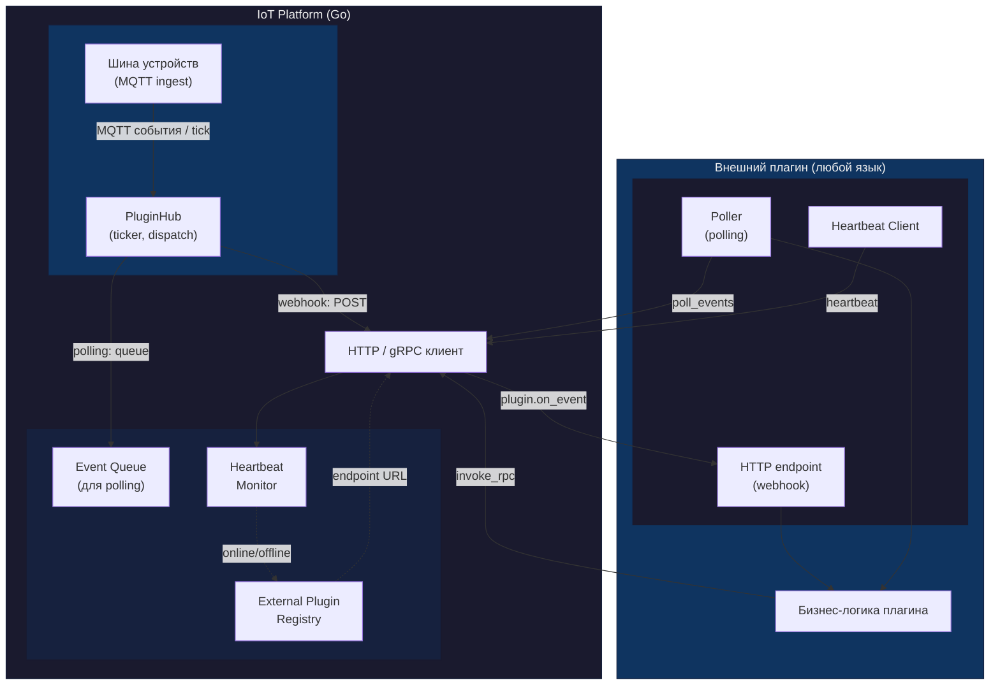
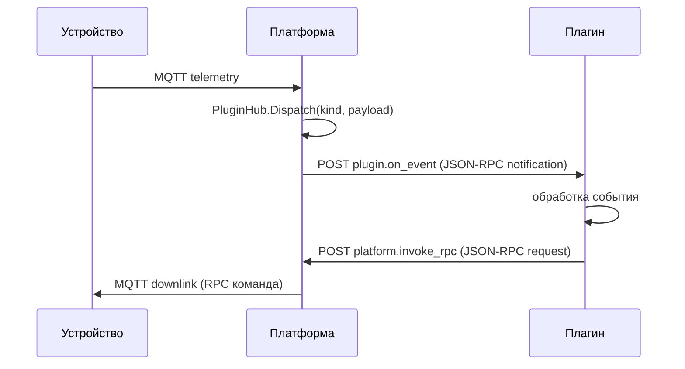
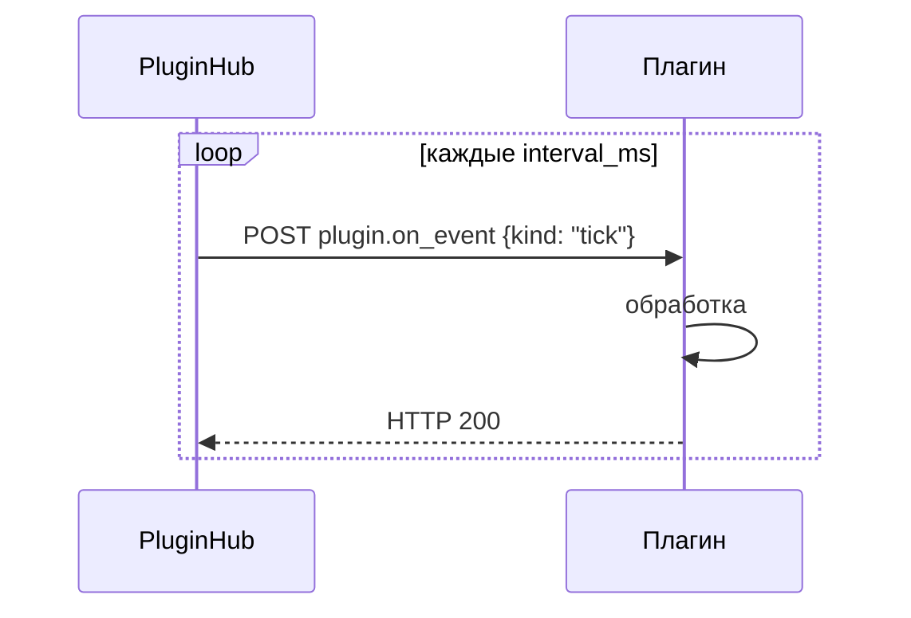
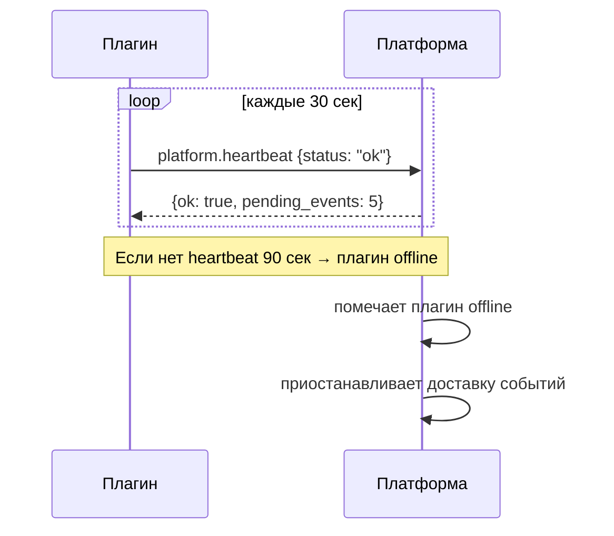
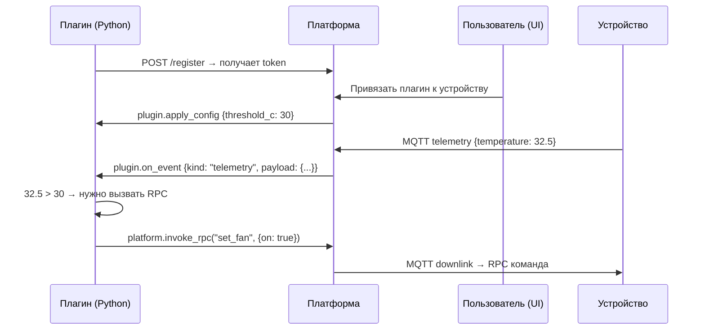
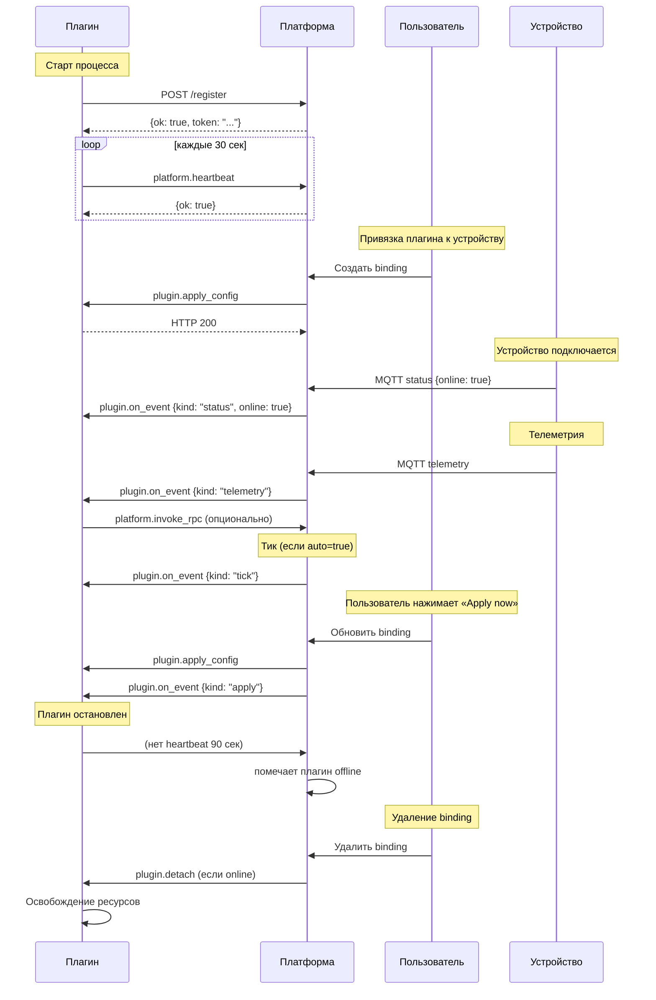

# PRD: Внешние плагины

## 1. Обзор

Внешние плагины расширяют логику IoT Platform без перекомпиляции Go-бинарника.
Работают как отдельные процессы (любой язык), общаются с платформой через
**JSON-RPC 2.0 поверх HTTP** (основной) или **gRPC** (продвинутый).

Контракт внешнего плагина зеркалит внутренний `plugins.Instance` —
поведение идентично, меняется только транспорт.

| Внутренний (in-process)               | Внешний (out-of-process)                    |
|---------------------------------------|---------------------------------------------|
| `Register(Descriptor, Factory)`       | `POST /api/plugins/external/register`       |
| `ApplyConfig(json)`                   | Platform → Plugin: `plugin.apply_config`    |
| `OnEvent(Runtime, Event)`             | Platform → Plugin: `plugin.on_event`        |
| `Runtime.InvokeRPC(method, params)`   | Plugin → Platform: `platform.invoke_rpc`    |
| `IntervalMS()` / `Auto()`             | Декларируется в `Descriptor` при регистрации|

---

## 2. Архитектура

> **Diagram**: [External Plugin Architecture](diagrams.md#external-plugin-architecture)



### Поток событий

> **Diagram**: [External Plugin Event Flow](diagrams.md#external-plugin-event-flow)



### Поток тиков

Плагины с `auto: true` и `interval_ms > 0` получают периодические `tick`
события — точно так же, как внутренние. Платформа владеет таймером,
плагин только реагирует.

> **Diagram**: [External Plugin Tick Flow](diagrams.md#external-plugin-tick-flow)



---

## 3. Модель внутреннего плагина (справочник)

Внутренние плагины реализуют интерфейс `plugins.Instance`:

```go
type Instance interface {
    ApplyConfig(raw json.RawMessage) error   // валидация + загрузка конфига
    OnEvent(rt Runtime, ev Event) error      // обработка одного события
    IntervalMS() int                         // интервал тика (0 = без тика)
    Auto() bool                              // подписаться на тик-цикл?
}

type Runtime interface {
    InvokeRPC(method string, params map[string]any) error
}

type Event struct {
    Kind     string // tick | apply | status | telemetry | event | rpc/result
    Online   bool
    Payload  any
    DevicePK int64
}
```

Типы событий (константы в пакете `plugins`):

| Константа          | Значение       | Когда доставляется                            |
|--------------------|----------------|-----------------------------------------------|
| `EventTick`        | `tick`         | Каждые `interval_ms`, пока устройство online  |
| `EventApply`       | `apply`        | Конфиг сохранён или binding создан            |
| `EventStatus`      | `status`       | Переход устройства online/offline             |
| `EventTelemetry`   | `telemetry`    | Устройство опубликовало телеметрию            |
| `EventEvent`       | `event`        | Устройство опубликовало пользовательское событие |
| `EventRPCResult`   | `rpc/result`   | Ответ на ранее отправленный RPC               |

Внешний плагин получает **те же** типы событий по проводу.

---

## 4. Контракт внешнего плагина

### 4.1 Регистрация

Плагин регистрируется один раз при старте (или через CLI). Платформа сохраняет
дескриптор в таблицу `external_plugins`.

```
POST /api/plugins/external/register
Content-Type: application/json

{
  "id":           "temp-alert",
  "name":         "Temperature Alert",
  "description":  "Send RPC when temperature exceeds threshold",
  "endpoint":     "http://192.168.1.50:8080/rpc",
  "auto":         true,
  "interval_ms":  5000,
  "default_config": {
    "threshold_c": 35.0,
    "rpc_method":  "set_fan",
    "rpc_params":  {"on": true}
  },
  "form": [
    {"key": "threshold_c", "type": "number", "label": "Threshold °C",
     "min": -40, "max": 120},
    {"key": "rpc_method",  "type": "string", "label": "RPC method"},
    {"key": "rpc_params",  "type": "json",   "label": "RPC params JSON"}
  ]
}
```

Ответ:

```json
{ "ok": true, "id": "temp-alert", "token": "ext_plg_abc123…" }
```

Поля:

| Поле             | Тип        | Обяз. | Описание                                   |
|------------------|------------|-------|--------------------------------------------|
| `id`             | string     | да    | Уникальный идентификатор плагина (slug)    |
| `name`           | string     | да    | Человекочитаемое имя                       |
| `description`    | string     | да    | Отображается в каталоге UI                 |
| `endpoint`       | string     | нет*  | URL для webhook (обязателен если не используется polling) |
| `auto`           | bool       | нет   | Подписаться на тик-цикл (по умолчанию `false`) |
| `interval_ms`    | int        | нет   | Интервал тика в мс (мин 80, по умолчанию 0)|
| `default_config` | object     | нет   | Конфиг по умолчанию (JSON)                 |
| `effects`        | string[]   | нет   | Каталог эффектов (для LED-подобных плагинов)|
| `form`           | FormField[]| нет   | Схема формы конфига для UI                 |

Схема `form` идентична внутреннему типу `FormField`
(см. `internal/plugins/form.go`).

### 4.2 Подключение и доступность

Платформа должна знать, как доставить события плагину. Есть два режима:

#### Режим 1: Webhook (push) — основной

Плагин указывает `endpoint` при регистрации. Платформа POST-ит события на этот URL.

**Требования:**
- URL должен быть доступен с сервера платформы
- Плагин должен отвечать HTTP 200 в течение 5 секунд
- Рекомендуется HTTPS для production

**Проблемы:**
- Плагин за NAT/файрволом — платформа не достучится
- Динамический IP/порт — нужно перерегистрироваться

#### Режим 2: Polling (pull) — для плагинов за NAT

Плагин не указывает `endpoint`. Вместо этого он периодически вызывает
`platform.poll_events` чтобы получить накопленные события.

```json
{
  "jsonrpc": "2.0",
  "id": "poll-1",
  "method": "platform.poll_events",
  "params": {
    "plugin_id": "temp-alert",
    "limit": 100
  }
}
```

Ответ:

```json
{
  "jsonrpc": "2.0",
  "id": "poll-1",
  "result": {
    "events": [
      {
        "id": 12345,
        "binding_id": 42,
        "method": "plugin.on_event",
        "params": { "kind": "telemetry", "payload": {...} }
      }
    ]
  }
}
```

После обработки плагин вызывает `platform.ack_events` чтобы подтвердить:

```json
{
  "jsonrpc": "2.0",
  "id": "ack-1",
  "method": "platform.ack_events",
  "params": { "event_ids": [12345] }
}
```

#### Heartbeat (проверка живости)

Плагин периодически стучится в платформу чтобы сообщить что он жив.
Это работает в обоих режимах (webhook и polling).

```json
{
  "jsonrpc": "2.0",
  "id": "hb-1",
  "method": "platform.heartbeat",
  "params": {
    "plugin_id": "temp-alert",
    "status": "ok",
    "stats": {
      "events_processed": 1234,
      "errors": 2,
      "uptime_sec": 3600
    }
  }
}
```

Ответ:

```json
{
  "jsonrpc": "2.0",
  "id": "hb-1",
  "result": {
    "ok": true,
    "pending_events": 5
  }
}
```

**Параметры heartbeat:**
- Интервал: каждые 30 секунд (настраивается)
- Таймаут: если нет heartbeat 90 секунд → плагин помечается `offline`
- UI показывает статус плагина: `online` / `offline` / `unknown`

> **Diagram**: [External Plugin Heartbeat](diagrams.md#external-plugin-heartbeat)



#### Сравнение режимов

| Характеристика       | Webhook (push)        | Polling (pull)         |
|----------------------|-----------------------|------------------------|
| Задержка доставки    | Мгновенно             | Зависит от интервала   |
| Плагин за NAT        | Нет (нужен public IP) | Да                     |
| Нагрузка на сеть     | Ниже (только события) | Выше (постоянный poll) |
| Сложность реализации | Ниже                  | Выше (нужен ack)       |
| Рекомендация         | LAN, cloud            | NAT, firewall          |

### 4.3 Уведомления Platform → Plugin (только webhook режим)

Платформа отправляет **JSON-RPC 2.0 уведомления** (без поля `id`, без ожидания
ответа) на `{endpoint}`. Плагин должен ответить HTTP `200 OK` в течение
5 секунд, иначе событие считается потерянным.

#### 4.2.1 `plugin.apply_config`

Отправляется при создании binding, обновлении конфига или нажатии «Apply now».

```json
{
  "jsonrpc": "2.0",
  "method": "plugin.apply_config",
  "params": {
    "binding_id": 42,
    "device_pk": 7,
    "config": { "threshold_c": 35.0, "rpc_method": "set_fan" }
  }
}
```

Плагин обязан валидировать конфиг и вернуть HTTP 200. Если валидация не пройдена —
вернуть HTTP 400 с JSON-RPC ошибкой — платформа покажет ошибку в UI.

#### 4.2.2 `plugin.on_event`

Доставляет каждое событие, которое получил бы внутренний `OnEvent`.

```json
{
  "jsonrpc": "2.0",
  "method": "plugin.on_event",
  "params": {
    "binding_id": 42,
    "device_pk": 7,
    "kind": "telemetry",
    "online": true,
    "payload": { "temperature": 38.2, "humidity": 61 }
  }
}
```

Значения `kind`: `tick` | `apply` | `status` | `telemetry` | `event` | `rpc/result`.

#### 4.2.3 `plugin.detach`

Отправляется при удалении binding или отключении плагина. Плагин должен
освободить ресурсы, связанные с binding.

```json
{
  "jsonrpc": "2.0",
  "method": "plugin.detach",
  "params": { "binding_id": 42 }
}
```

### 4.4 Вызовы Plugin → Platform (частично реализовано)

Плагин вызывает платформу по `PLATFORM_URL` (env var или из ответа регистрации).
Все вызовы — стандартный JSON-RPC 2.0 с `id`, ожидают ответ.

Авторизация: заголовок `Authorization: Bearer <plugin_token>`. Токен выдаётся
при регистрации, ограничен только плагинными операциями.

#### 4.4.1 `platform.invoke_rpc`

Отправить RPC-команду устройству, привязанному к этому плагину.

```json
{
  "jsonrpc": "2.0",
  "id": "req-1",
  "method": "platform.invoke_rpc",
  "params": {
    "binding_id": 42,
    "method": "set_fan",
    "params": { "on": true },
    "timeout_ms": 4000
  }
}
```

Ответ:

```json
{
  "jsonrpc": "2.0",
  "id": "req-1",
  "result": { "sent": true }
}
```

#### 4.4.2 `platform.set_attributes` — НЕ РЕАЛИЗОВАНО

Отправить желаемые атрибуты / конфигурацию устройству.

```json
{
  "jsonrpc": "2.0",
  "id": "req-2",
  "method": "platform.set_attributes",
  "params": {
    "binding_id": 42,
    "attributes": { "mode": "eco", "target_temp": 22 }
  }
}
```

#### 4.4.3 `platform.get_device` — НЕ РЕАЛИЗОВАНО

Получить текущее состояние устройства (статус, последнюю телеметрию, атрибуты).

```json
{
  "jsonrpc": "2.0",
  "id": "req-3",
  "method": "platform.get_device",
  "params": { "binding_id": 42 }
}
```

Ответ:

```json
{
  "jsonrpc": "2.0",
  "id": "req-3",
  "result": {
    "device_pk": 7,
    "product_id": "smoke",
    "device_id":  "kitchen-01",
    "status":     "online",
    "enabled":    true,
    "telemetry":  { "temperature": 38.2, "humidity": 61 },
    "attributes": { "mode": "eco" }
  }
}
```

---

## 5. gRPC транспорт (продвинутый)

Для плагинов с требованиями к низкой задержке или высокой пропускной способности:

```protobuf
syntax = "proto3";
package iotplugin;

service ExternalPlugin {
  // Platform → Plugin уведомления (unary)
  rpc ApplyConfig(ApplyConfigRequest) returns (ApplyConfigResponse);
  rpc OnEvent(OnEventRequest) returns (OnEventResponse);
  rpc Detach(DetachRequest) returns (DetachResponse);
}

service PlatformAPI {
  // Plugin → Platform обратные вызовы
  rpc InvokeRPC(InvokeRPCRequest) returns (InvokeRPCResponse);
  rpc SetAttributes(SetAttributesRequest) returns (SetAttributesResponse);
  rpc GetDevice(GetDeviceRequest) returns (GetDeviceResponse);
}

message Event {
  int64  binding_id = 1;
  int64  device_pk  = 2;
  string kind       = 3; // tick | apply | status | telemetry | event | rpc/result
  bool   online     = 4;
  bytes  payload    = 5; // JSON
}

message ApplyConfigRequest {
  int64  binding_id = 1;
  int64  device_pk  = 2;
  bytes  config     = 3; // JSON
}
message ApplyConfigResponse { bool ok = 1; string error = 2; }

message OnEventRequest  { Event event = 1; }
message OnEventResponse { bool ok = 1; string error = 2; }

message DetachRequest     { int64 binding_id = 1; }
message DetachResponse    { bool ok = 1; }

message InvokeRPCRequest {
  int64  binding_id = 1;
  string method     = 2;
  bytes  params     = 3; // JSON
  int32  timeout_ms = 4;
}
message InvokeRPCResponse { bool sent = 1; }

message SetAttributesRequest {
  int64 binding_id = 1;
  bytes attributes = 2; // JSON
}
message SetAttributesResponse { bool ok = 1; }

message GetDeviceRequest  { int64 binding_id = 1; }
message GetDeviceResponse {
  int64  device_pk   = 1;
  string product_id  = 2;
  string device_id   = 3;
  string status      = 4;
  bool   enabled     = 5;
  bytes  telemetry   = 6; // JSON
  bytes  attributes  = 7; // JSON
}
```

---

## 6. Безопасность (частично реализовано)

- Токен плагина выдаётся при регистрации, хранится хешированным в БД.
- Токен ограничен: можно вызывать только `platform.invoke_rpc`,
  `platform.set_attributes`, `platform.get_device` только для тех binding,
  которые ссылаются на данный plugin ID.
- Endpoint плагина должен быть доступен с сервера платформы.
- HTTPS рекомендуется для production; HTTP разрешён для локальной разработки.
- Rate limit: 100 вызовов/сек на один токен плагина.

---

## 7. Пример реализации — Python плагин «Temperature Alert» (пример в коде)

Полный рабочий внешний плагин на Python (~80 строк).
Получает события телеметрии, отправляет RPC при превышении порога температуры.

```python
#!/usr/bin/env python3
"""temp_alert_plugin.py — Пример внешнего плагина IoT Platform.

Получает события телеметрии от платформы.
При превышении температуры порога — вызывает set_fan RPC на устройстве.

Запуск:
    pip install flask requests
    python temp_alert_plugin.py
"""

import os
import threading
import requests
from flask import Flask, request, jsonify

# ── Конфигурация ───────────────────────────────────────────────
PLATFORM_URL = os.environ.get("PLATFORM_URL", "http://localhost:8080")
PLUGIN_TOKEN = os.environ.get("PLUGIN_TOKEN", "")
LISTEN_PORT  = int(os.environ.get("PLUGIN_PORT", "8090"))

app = Flask(__name__)

# Состояние по binding: binding_id → {config, last_fired}
bindings: dict[int, dict] = {}
lock = threading.Lock()


# ── Вызовы Plugin → Platform ───────────────────────────────────
def platform_call(method: str, params: dict) -> dict:
    """Вызов JSON-RPC API платформы."""
    resp = requests.post(
        f"{PLATFORM_URL}/api/plugins/external/rpc",
        headers={"Authorization": f"Bearer {PLUGIN_TOKEN}"},
        json={"jsonrpc": "2.0", "id": 1, "method": method, "params": params},
        timeout=5,
    )
    resp.raise_for_status()
    return resp.json().get("result", {})


def invoke_rpc(binding_id: int, method: str, params: dict):
    """Отправить RPC-команду устройству."""
    return platform_call("platform.invoke_rpc", {
        "binding_id": binding_id,
        "method": method,
        "params": params,
        "timeout_ms": 4000,
    })


# ── Обработчики Platform → Plugin ──────────────────────────────
@app.route("/rpc", methods=["POST"])
def handle_rpc():
    """Единый endpoint для всех уведомлений платформы."""
    data = request.get_json(force=True)
    method = data.get("method")
    params = data.get("params", {})

    if method == "plugin.apply_config":
        return handle_apply_config(params)
    elif method == "plugin.on_event":
        return handle_on_event(params)
    elif method == "plugin.detach":
        return handle_detach(params)
    else:
        return jsonify({"error": f"unknown method: {method}"}), 400


def handle_apply_config(params: dict):
    """Валидация и сохранение конфига binding."""
    binding_id = params["binding_id"]
    config = params.get("config", {})

    # Валидация
    threshold = config.get("threshold_c", 35.0)
    if not isinstance(threshold, (int, float)):
        return jsonify({"error": "threshold_c must be a number"}), 400

    with lock:
        bindings[binding_id] = {
            "config": config,
            "last_fired": {},
        }
    return jsonify({"ok": True})


def handle_on_event(params: dict):
    """Обработка события от платформы."""
    binding_id = params["binding_id"]
    kind = params["kind"]
    payload = params.get("payload", {})

    with lock:
        state = bindings.get(binding_id)
    if not state:
        return jsonify({"ok": True})  # ещё не сконфигурирован

    config = state["config"]

    if kind == "telemetry":
        temp = payload.get("temperature")
        if temp is None:
            return jsonify({"ok": True})

        threshold = config.get("threshold_c", 35.0)
        if temp > threshold:
            method = config.get("rpc_method", "set_fan")
            rpc_params = config.get("rpc_params", {"on": True})
            try:
                invoke_rpc(binding_id, method, rpc_params)
                print(f"[temp-alert] {temp}°C > {threshold}°C → {method} fired")
            except Exception as e:
                print(f"[temp-alert] RPC failed: {e}")

    elif kind == "status":
        online = params.get("online", False)
        print(f"[temp-alert] device {'online' if online else 'offline'}")

    elif kind == "tick":
        # Периодический тик — для housekeeping, retries, и т.д.
        pass

    return jsonify({"ok": True})


def handle_detach(params: dict):
    """Binding удалён — очистка состояния."""
    binding_id = params["binding_id"]
    with lock:
        bindings.pop(binding_id, None)
    print(f"[temp-alert] binding {binding_id} detached")
    return jsonify({"ok": True})


# ── Heartbeat ──────────────────────────────────────────────────
start_time = None
events_processed = 0

def heartbeat_loop():
    """Периодический heartbeat в платформу."""
    global events_processed
    while True:
        try:
            requests.post(
                f"{PLATFORM_URL}/api/plugins/external/rpc",
                headers={"Authorization": f"Bearer {PLUGIN_TOKEN}"},
                json={
                    "jsonrpc": "2.0", "id": 1,
                    "method": "platform.heartbeat",
                    "params": {
                        "plugin_id": "temp-alert",
                        "status": "ok",
                        "stats": {
                            "events_processed": events_processed,
                            "uptime_sec": int((time.time() - start_time) if start_time else 0),
                        }
                    }
                },
                timeout=5,
            )
        except Exception as e:
            print(f"[temp-alert] heartbeat failed: {e}")
        time.sleep(30)


# ── Регистрация ────────────────────────────────────────────────
def register():
    """Регистрация плагина на платформе при старте."""
    descriptor = {
        "id": "temp-alert",
        "name": "Temperature Alert",
        "description": "Fire RPC when temperature exceeds threshold",
        "endpoint": f"http://localhost:{LISTEN_PORT}/rpc",
        "auto": True,
        "interval_ms": 5000,
        "default_config": {
            "threshold_c": 35.0,
            "rpc_method": "set_fan",
            "rpc_params": {"on": True},
        },
        "form": [
            {
                "key": "threshold_c",
                "type": "number",
                "label": "Threshold °C",
                "min": -40,
                "max": 120,
            },
            {"key": "rpc_method", "type": "string", "label": "RPC method"},
            {"key": "rpc_params", "type": "json", "label": "RPC params JSON", "wide": True},
        ],
    }
    resp = requests.post(
        f"{PLATFORM_URL}/api/plugins/external/register",
        json=descriptor,
        timeout=5,
    )
    if resp.status_code == 200:
        token = resp.json().get("token", "")
        print(f"[temp-alert] registered, token={token[:8]}…")
        return token
    else:
        raise RuntimeError(f"registration failed: {resp.status_code} {resp.text}")


if __name__ == "__main__":
    import time
    start_time = time.time()
    token = register()
    PLUGIN_TOKEN = token
    # Запуск heartbeat в фоне
    threading.Thread(target=heartbeat_loop, daemon=True).start()
    app.run(host="0.0.0.0", port=LISTEN_PORT)
```

### End-to-end поток

> **Diagram**: [External Plugin End-to-End Flow](diagrams.md#external-plugin-end-to-end-flow)



---

## 8. Схема базы данных (новая таблица)

```sql
CREATE TABLE IF NOT EXISTS external_plugins (
    id                TEXT PRIMARY KEY,
    name              TEXT NOT NULL,
    description       TEXT NOT NULL DEFAULT '',
    endpoint          TEXT NOT NULL DEFAULT '',  -- пусто если polling режим
    auth_token_hash   TEXT NOT NULL,
    auto              INTEGER NOT NULL DEFAULT 0,
    interval_ms       INTEGER NOT NULL DEFAULT 0,
    default_config    TEXT NOT NULL DEFAULT '{}',
    effects           TEXT NOT NULL DEFAULT '[]',
    form              TEXT NOT NULL DEFAULT '[]',
    mode              TEXT NOT NULL DEFAULT 'webhook',  -- webhook | polling
    status            TEXT NOT NULL DEFAULT 'unknown',  -- online | offline | unknown
    last_heartbeat_at INTEGER,
    created_at        INTEGER NOT NULL,
    updated_at        INTEGER NOT NULL
);
```

Существующая таблица `device_plugin_bindings` используется без изменений —
внешние плагины применяют тот же механизм binding, `PluginHub` просто
доставляет события по HTTP вместо in-process вызова `OnEvent`.

---

## 9. Жизненный цикл

> **Diagram**: [External Plugin Lifecycle](diagrams.md#external-plugin-lifecycle)



---

## 10. Чек-лист требований

- [x] Плагин можно написать на любом языке (HTTP + JSON универсальны)
- [x] Взаимодействие через JSON-RPC 2.0 (gRPC опционально)
- [x] Плагин получает события устройства/платформы (status, telemetry, event, tick, rpc/result)
- [x] Плагин может вызывать RPC на привязанном устройстве (`platform.invoke_rpc`)
- [ ] Плагин может устанавливать атрибуты устройства (`platform.set_attributes`) — **не реализовано**
- [x] Чистый и документированный интерфейс с примерами
- [x] Поведение идентично внутренним плагинам — та же модель событий, тот же жизненный цикл

---

## 11. Будущие улучшения

- **Двунаправленный стриминг** (gRPC): замена polling на постоянный поток.
- **Маркетплейс плагинов**: подписанные дескрипторы, версионированные конфиги.
- **Песочница**: запуск недоверенных плагинов в WASM или контейнере.
- **Метрики**: счётчик событий, частота ошибок, задержка по каждому плагину.
- **Горячая перезагрузка**: перерегистрация без отвязки устройств.
- **`platform.set_attributes`**: allow plugins to set device desired attributes.
- **`platform.get_device`**: allow plugins to query device state.
- **Rate limiting**: 100 calls/sec per plugin token.
